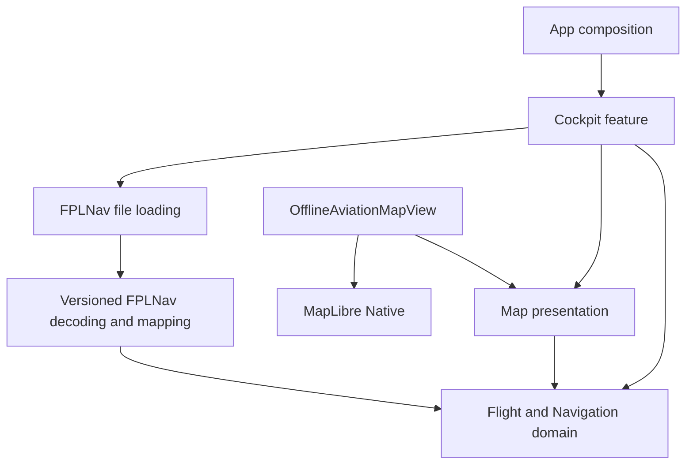
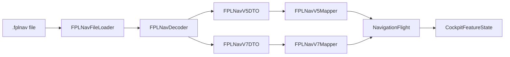
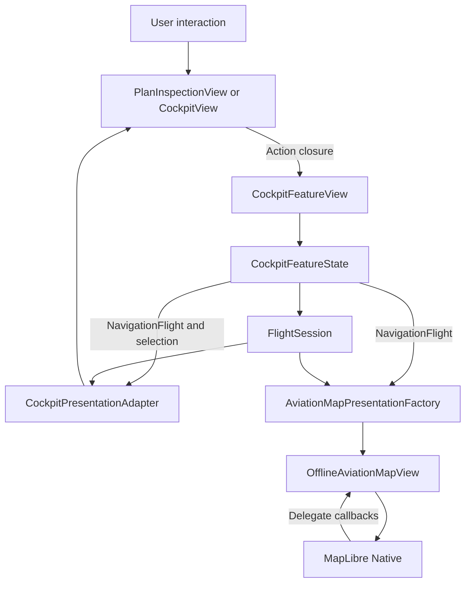

# NavigationFlight Architecture

## Architectural overview

NavigationFlight is a SwiftUI application organized around a thin application layer, a user-facing Cockpit feature, framework-independent domain models, versioned FPLNav data adapters, and a separate MapLibre presentation boundary.



Application and feature code compose the domain capabilities. FPLNav and Map code form boundaries around external data and rendering frameworks. The domain itself does not depend on SwiftUI, MapLibre, filesystem access, or versioned serialized representations.

## Entry points

The application starts at [`NavigationFlightApp`](../NavigationFlight/App/NavigationFlightApp.swift), which creates a SwiftUI `WindowGroup`. [`RootView`](../NavigationFlight/App/RootView.swift) supplies the root content and currently presents [`CockpitFeatureView`](../NavigationFlight/Features/Cockpit/CockpitFeatureView.swift).

```text
NavigationFlightApp
  -> RootView
      -> CockpitFeatureView
```

`CockpitFeatureView` is the current feature composition boundary. It owns the feature state, file-import presentation, errors, the transition between plan inspection and cockpit presentation, and the creation of presentation data passed to its child views.

## Major components

### App

`App/` contains application startup and root composition through `NavigationFlightApp` and `RootView`.

### Features

`Features/` organizes user-facing capabilities. The implemented feature is `Cockpit`, whose principal types are:

- [`CockpitFeatureView`](../NavigationFlight/Features/Cockpit/CockpitFeatureView.swift), the feature container and state owner.
- [`CockpitFeatureState`](../NavigationFlight/Features/Cockpit/CockpitFeatureState.swift), the feature's state and allowed transitions.
- [`CockpitPresentationAdapter`](../NavigationFlight/Features/Cockpit/CockpitPresentationAdapter.swift), which projects domain and session values into cockpit display data.
- [`PlanInspectionView`](../NavigationFlight/Features/Cockpit/PlanInspectionView.swift), the preflight inspection surface.
- [`CockpitView`](../NavigationFlight/Features/Cockpit/CockpitView.swift), the active cockpit surface.

`Brief`, `Charts`, `Flights`, and `RouteAmendment` currently contain placeholder files.

### Domain

`Domain/Navigation` defines navigation values and saved execution concepts. [`NavigationTypes.swift`](../NavigationFlight/Domain/Navigation/NavigationTypes.swift) contains coordinates, strongly typed units, waypoints, legs, wind, frequencies, annotations, navigation-aid references, and execution snapshots.

`Domain/Flight` defines the flight aggregate and runtime flight behavior:

- [`NavigationFlight`](../NavigationFlight/Domain/Flight/NavigationFlight.swift) is the imported plan aggregate, including its route, operational context, and execution availability.
- [`FlightSession`](../NavigationFlight/Domain/Flight/FlightSession.swift) records runtime progress such as the active leg, leg state, timestamps, identification-point timing, and pilot ETA state.
- [`IdentificationPointTimingCalculator`](../NavigationFlight/Domain/Flight/IdentificationPointTimingCalculator.swift) contains timing calculations used by the session behavior.

Imported plan data and runtime state remain distinct: `NavigationFlight` contains the mapped plan, while `FlightSession` records activity performed during use of that plan.

### Data / FPLNav

`Data/FPLNav` adapts `.fplnav` data to domain models. [`FPLNavDecoder`](../NavigationFlight/Data/FPLNav/FPLNavDecoder.swift) reads format metadata and dispatches decoding to the corresponding version boundary:

- [`FPLNavV5DTO`](../NavigationFlight/Data/FPLNav/V5/FPLNavV5DTO.swift) and [`FPLNavV5Mapper`](../NavigationFlight/Data/FPLNav/V5/FPLNavV5Mapper.swift).
- [`FPLNavV7DTO`](../NavigationFlight/Data/FPLNav/V7/FPLNavV7DTO.swift) and [`FPLNavV7Mapper`](../NavigationFlight/Data/FPLNav/V7/FPLNavV7Mapper.swift).

The decoder recognizes versions 5 and 7. Version 5 maps into a `NavigationFlight` whose execution is unavailable for the cockpit. Version 7 maps source navigation and saved execution data, with nonempty eligible plans available to the Cockpit feature. Feature and domain code consume `NavigationFlight` rather than versioned DTOs.

### Map

[`AviationMapPresentation`](../NavigationFlight/Map/AviationMapPresentation.swift) contains map-specific display values. `AviationMapPresentationFactory` derives them from a `NavigationFlight` and `FlightSession`. [`AviationMapVisualStyle`](../NavigationFlight/Map/AviationMapVisualStyle.swift) contains visual parameters used by the map.

[`OfflineAviationMapView`](../NavigationFlight/Map/OfflineAviationMapView.swift) is a SwiftUI [`UIViewRepresentable`](https://developer.apple.com/documentation/swiftui/uiviewrepresentable) bridge to MapLibre Native. Its nested coordinator implements MapLibre delegate communication and transfers updates through SwiftUI bindings and callbacks. `AviationMapResourceProviding` and `BundledAviationMapResourceProvider` locate the bundled style and map resources.

### Persistence, DesignSystem, and Resources

`Persistence/` and `DesignSystem/` currently contain placeholder files. `Resources/` contains the bundled offline map, map style, and placeholder directories for charts and fixtures.

## Views, state, models, and services

### Views

`CockpitFeatureView` composes the feature and owns its workflow. `PlanInspectionView` and `CockpitView` receive display values and action closures. `OfflineAviationMapView` renders map presentation values through MapLibre.

Child views send user actions upward through closures. They receive new value snapshots when feature or session state changes.

### State

The current code separates state by lifetime and responsibility:

| State category | Owner | Examples |
|---|---|---|
| Runtime domain state | `FlightSession` | Active leg, leg state, recorded times, identification points, pilot ETA |
| Feature state | `CockpitFeatureState` | Loaded flight, selected leg, navigation mode, checklist state |
| Transient presentation state | SwiftUI views | Importer and alert visibility, drawers, map camera, focus, selected callouts |

`CockpitFeatureState` and `FlightSession` are value types whose stored state is changed through mutating operations. Their externally readable mutable properties use `private(set)`.

SwiftUI views use [`@State`](https://developer.apple.com/documentation/swiftui/state) for feature-owned and transient presentation values. The code does not use `ObservableObject` or a separate ViewModel type.

### Models

`NavigationFlight` is the domain aggregate produced by import. The types in `NavigationTypes.swift` model navigation concepts and saved execution values. `FlightSession` models runtime flight activity.

`CockpitPresentationData` and related types in [`CockpitPresentationAdapter.swift`](../NavigationFlight/Features/Cockpit/CockpitPresentationAdapter.swift) are cockpit-oriented projections. `AviationMapPresentation` and its related types are map-oriented projections. Many domain, state, and presentation values conform to [`Sendable`](https://developer.apple.com/documentation/swift/sendable) and `Equatable`.

### Presentation adapters

`CockpitPresentationAdapter` derives cockpit display values from `NavigationFlight`, the selected leg and mode, and `FlightSession` where runtime information is required. `AviationMapPresentationFactory` derives map display values from `NavigationFlight` and `FlightSession`.

The adapters and factories return values to their callers; they do not observe or own the source state.

### Services

[`FPLNavFileLoader`](../NavigationFlight/Features/Cockpit/CockpitFeatureState.swift) validates the selected file extension, manages security-scoped file access, reads the data, delegates decoding to `FPLNavDecoder`, and maps decoder failures into feature errors.

`FPLNavDecoder` and the versioned mappers form the data-import services. The map resource providers supply URLs for bundled map resources. These services are concrete value types, apart from the `AviationMapResourceProviding` protocol used at the map resource boundary.

## Naming and conventions

The source uses role-based type suffixes:

| Naming form | Existing role |
|---|---|
| `...View` | SwiftUI or UIKit-backed rendering |
| `...FeatureView` | Feature composition and workflow ownership |
| `...FeatureState` | Feature-level state and transitions |
| `...Presentation` / `...PresentationData` | Display-ready values |
| `...Adapter` / `...Factory` | Transformation into presentation data |
| `...DTO` | Versioned serialized representation |
| `...Mapper` | DTO-to-domain conversion and validation |
| `...Error` | Typed failure cases |
| `...Provider` | Resource access abstraction or implementation |
| `...Session` | Runtime flight lifecycle state |

Most domain, feature-state, presentation, and service types are `struct` or `enum`. Reference types appear where UIKit, MapLibre delegate coordination, or XCTest requires them.

## Communication between components

### Import and mapping flow



Version selection is contained within `FPLNavDecoder`. Both version paths produce the same `NavigationFlight` domain type, so downstream feature code does not switch on the wire-format version.

### Runtime interaction and rendering flow



`CockpitFeatureView` mutates `CockpitFeatureState` in response to child-view callbacks. SwiftUI then reevaluates the feature content, and the presentation adapter and map factory create new display snapshots from the updated domain and session values.

`OfflineAviationMapView` receives map data, bindings, and callbacks from `CockpitView`. Its coordinator translates these values and events to and from MapLibre delegate APIs.

## Tests and testing strategy

### Unit and integration tests

[`NavigationFlightTests`](../NavigationFlightTests/NavigationFlightTests.swift) uses [Swift Testing](https://developer.apple.com/documentation/testing/) with `@Test`, `#expect`, `#require`, and parameterized tests.

The tests cover:

- FPLNav v5 and v7 decoding, mapping, validation, and typed failures.
- Preservation of saved execution values during import and runtime activity.
- `FlightSession` state transitions and timing behavior using explicit timestamps.
- `CockpitFeatureState` transitions and checklist state.
- Cockpit presentation transformations.
- Map presentation, visual values, timing targets, and geometry.

Fixture-driven tests use versioned inputs under [`Fixtures/FPLNav/V5`](../NavigationFlightTests/Fixtures/FPLNav/V5/) and [`Fixtures/FPLNav/V7`](../NavigationFlightTests/Fixtures/FPLNav/V7/). V7 fixtures are separated into official contract examples and editor-produced examples, with provenance files stored alongside them.

### UI tests

[`NavigationFlightUITests`](../NavigationFlightUITests/NavigationFlightUITests.swift) uses [XCTest UI automation](https://developer.apple.com/documentation/xctest/user_interface_tests). The UI tests cover the empty state, imported saved values, wind-mode selection, transition into the cockpit, flight-session interactions, completion, portrait and landscape presentation, and launch performance.

The imported-plan UI test passes a base64-encoded fixture through a debug launch environment value. `CockpitFeatureView` decodes this value during initialization to establish the test's starting state.

## Concise characterization

The current project consists of thin SwiftUI application composition, one implemented Cockpit feature, navigation domain values, a flight-session state machine, versioned FPLNav decoding and mapping, explicit cockpit and map presentation transformations, a MapLibre bridge, fixture-driven Swift Testing tests, and XCUIAutomation workflow tests.
