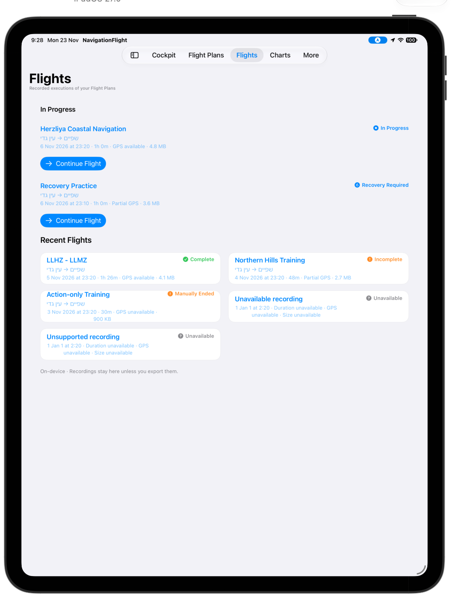
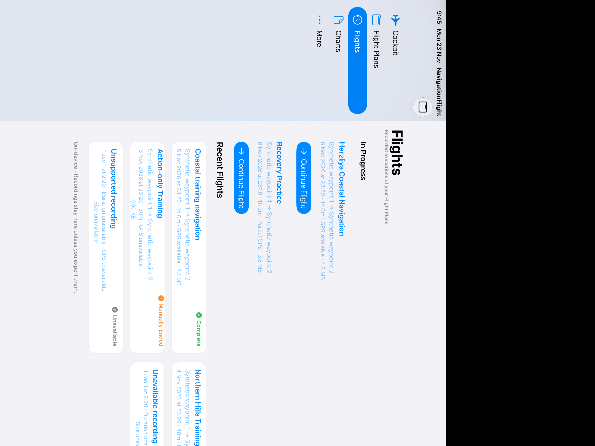

# Flights UI test failure investigation

Debug branch: `debug/flights-ui-test-failures`.

Evidence only. Waiting for the owner to select which tests to fix; no application or test behavior has been changed.

## Test results

Full NavigationFlight test plan, 23 November 2026, iPad Pro 13-inch (M5), iPadOS 27.0. Build succeeded; run duration 36.9 minutes.

| Suite | Passed | Failed | Skipped |
| --- | ---: | ---: | ---: |
| App unit tests | 508 | 1 | 0 |
| UI tests | 115 | 15 | 1 |
| FlightEvidenceCore package | 8 | 0 | 0 |

The app plan contains 640 named tests. Including parameterized executions, Xcode reports 802 results: 785 passed, 16 failed, 1 skipped, 0 not run.

## Failing tests

Unchecked items are awaiting owner selection, not implementation tasks already approved.

- [ ] `FlightRecordingLibraryTests/corruptPackageDetail()` (NavigationFlightTests)

    Expectation failed: detail.flightPlanTitle == "Unavailable recording"
    detail.flightPlanTitle → "Unreadable recording"

- [ ] `NavigationFlightUITests/testAccessibilityTextUsesScrollableCompactConsoleWithoutTruncatingActions()` (NavigationFlightUITests)

    XCTAssertTrue failed

- [ ] `NavigationFlightUITests/testAddPickerCancellationPreservesEmptyLibrary()` (NavigationFlightUITests)

    XCTAssertTrue failed

- [ ] `NavigationFlightUITests/testCanonicalReviewPresentsFrequencyAndRouteDetailsAsSheets()` (NavigationFlightUITests)

    XCTAssertTrue failed

- [ ] `NavigationFlightUITests/testChecklistActionsRemainReachableWithAccessibilityText()` (NavigationFlightUITests)

    XCTAssertTrue failed

- [ ] `NavigationFlightUITests/testClosedFlightDeletionCancellationPreservesTheNamedFlight()` (NavigationFlightUITests)

    XCTAssertTrue failed

- [ ] `NavigationFlightUITests/testCockpitOperationalCuesExposeSemanticFrequencyAndAltitudeValues()` (NavigationFlightUITests)

    XCTAssertEqual failed: ("Planned next, Synthetic service, 120.50 megahertz, Synthetic waypoint 1 → Synthetic waypoint 2 · later this leg") is not equal to ("Planned now, SYN, 113.50 megahertz")

- [ ] `NavigationFlightUITests/testConfirmedClosedFlightDeletionReturnsToListAfterRemoval()` (NavigationFlightUITests)

    XCTAssertFalse failed

- [ ] `NavigationFlightUITests/testDraftCanSelectAnInteriorDepartureAndKeepItWhenRotated()` (NavigationFlightUITests)

    XCTAssertTrue failed

- [ ] `NavigationFlightUITests/testFailedDeletionPreservesDetailAndOffersRetry()` (NavigationFlightUITests)

    XCTAssertTrue failed

- [ ] `NavigationFlightUITests/testImportedWindPlanLaunchesCockpitWithNoWindValuesAndNoModeSelector()` (NavigationFlightUITests)

    XCTAssertTrue failed

- [ ] `CockpitChartsUITests/testKnownArrivalWithoutChartsAndLargeTextLeaveDepartureUsable()` (NavigationFlightUITests)

    XCTAssertTrue failed

- [ ] `NavigationFlightUITests/testManualAmendmentChartSelectsLegsAndDisambiguatesTheirRoles()` (NavigationFlightUITests)

    XCTAssertEqualWithAccuracy failed: ("644.0") is not equal to ("446.0") +/- ("1.0")

- [ ] `NavigationFlightUITests/testManualAmendmentReviewSupportsLargerText()` (NavigationFlightUITests)

    XCTAssertTrue failed

- [ ] `NavigationFlightUITests/testPositionCheckAccessibilityTextStacksDistinctReachableActions()` (NavigationFlightUITests)

    XCTAssertTrue failed

- [ ] `NavigationFlightUITests/testSingleRecoveryRequiresChoiceAndContinueOpensRestoredCockpit()` (NavigationFlightUITests)

    XCTAssertEqual failed: ("Recording · GPS Gap") is not equal to ("Recording · No GPS")

## Flights visual evidence

All four Flights library tests passed: empty state, populated rows, accessibility text size, and iPad landscape columns. Their assertions do not check styling, contrast, viewport containment, or compare the screenshot against an approved visual baseline.

### Original reported screen

### Screenshot retained by the passing landscape test

Source: `NavigationFlightUITests/testFlightsUsesTwoRecentColumnsInIPadLandscape()`, attachment “Issue 93 Flights iPad Landscape”.

The inspected test capture shows blue row text and centered wrapped metadata, as in the reported screen. It also shows a large black area above the app and right-column content clipped at the image edge. These are observations of the captured image; the rendering and capture causes remain unverified.

The landscape test only asserts that the second recent row is to the right of the first and their vertical midpoints align. The accessibility-size test asserts nonempty accessibility labels and a hittable Continue button. These checks can pass despite the observed visual problems.

## Skipped test

`NavigationFlightUITests/testCompactPendingAmendmentKeepsLegIdentityAtLargerText()`

## Runtime warnings

- Modifying state during view update, this will cause undefined behavior.
- Type "app.navigationflight.diagnostic-bundle" was expected to be declared and exported in the Info.plist of NavigationFlight.app, but it was not found.

## Investigation limits

Failed assertions are observations, not verified root causes. No fixes, acceptance approvals, or design-match claims are included. The installed skill catalog had no `investigate` skill; the investigation used `diagnosing-bugs`.

The pre-existing changes to `NavigationFlight.xcodeproj/project.pbxproj` and `FlightEvidenceCore/.swiftpm/` are outside this evidence checkpoint.
