# Flights UI test failure investigation

Debug branch: `debug/flights-ui-test-failures`.

Evidence only. Waiting for the owner to select which tests to fix; no application or test behavior has been changed.

## Test results

Full NavigationFlight test plan, 23 November 2026, iPad Pro 13-inch (M5), iPadOS 27.0. Build succeeded; run duration 36.9 minutes.

| Suite | Passed | Failed | Skipped |
| --- | ---: | ---: | ---: |
| App unit tests | 508 | 1 | 0 |
| UI tests | 115 | 15 | 1 |
| FlightEvidenceCore package | 8 | 0 | 0 |

The app plan contains 640 named tests. Including parameterized executions, Xcode reports 802 results: 785 passed, 16 failed, 1 skipped, 0 not run.

## Failing tests

Unchecked items are awaiting owner selection, not implementation tasks already approved.

- [ ] `FlightRecordingLibraryTests/corruptPackageDetail()` (NavigationFlightTests)

    Expectation failed: detail.flightPlanTitle == "Unavailable recording"
    detail.flightPlanTitle → "Unreadable recording"

- [ ] `NavigationFlightUITests/testAccessibilityTextUsesScrollableCompactConsoleWithoutTruncatingActions()` (NavigationFlightUITests)

    XCTAssertTrue failed

- [ ] `NavigationFlightUITests/testAddPickerCancellationPreservesEmptyLibrary()` (NavigationFlightUITests)

    XCTAssertTrue failed

- [ ] `NavigationFlightUITests/testCanonicalReviewPresentsFrequencyAndRouteDetailsAsSheets()` (NavigationFlightUITests)

    XCTAssertTrue failed

- [ ] `NavigationFlightUITests/testChecklistActionsRemainReachableWithAccessibilityText()` (NavigationFlightUITests)

    XCTAssertTrue failed

- [ ] `NavigationFlightUITests/testClosedFlightDeletionCancellationPreservesTheNamedFlight()` (NavigationFlightUITests)

    XCTAssertTrue failed

- [ ] `NavigationFlightUITests/testCockpitOperationalCuesExposeSemanticFrequencyAndAltitudeValues()` (NavigationFlightUITests)

    XCTAssertEqual failed: ("Planned next, Synthetic service, 120.50 megahertz, Synthetic waypoint 1 → Synthetic waypoint 2 · later this leg") is not equal to ("Planned now, SYN, 113.50 megahertz")

- [ ] `NavigationFlightUITests/testConfirmedClosedFlightDeletionReturnsToListAfterRemoval()` (NavigationFlightUITests)

    XCTAssertFalse failed

- [ ] `NavigationFlightUITests/testDraftCanSelectAnInteriorDepartureAndKeepItWhenRotated()` (NavigationFlightUITests)

    XCTAssertTrue failed

- [ ] `NavigationFlightUITests/testFailedDeletionPreservesDetailAndOffersRetry()` (NavigationFlightUITests)

    XCTAssertTrue failed

- [ ] `NavigationFlightUITests/testImportedWindPlanLaunchesCockpitWithNoWindValuesAndNoModeSelector()` (NavigationFlightUITests)

    XCTAssertTrue failed

- [ ] `CockpitChartsUITests/testKnownArrivalWithoutChartsAndLargeTextLeaveDepartureUsable()` (NavigationFlightUITests)

    XCTAssertTrue failed

- [ ] `NavigationFlightUITests/testManualAmendmentChartSelectsLegsAndDisambiguatesTheirRoles()` (NavigationFlightUITests)

    XCTAssertEqualWithAccuracy failed: ("644.0") is not equal to ("446.0") +/- ("1.0")

- [ ] `NavigationFlightUITests/testManualAmendmentReviewSupportsLargerText()` (NavigationFlightUITests)

    XCTAssertTrue failed

- [ ] `NavigationFlightUITests/testPositionCheckAccessibilityTextStacksDistinctReachableActions()` (NavigationFlightUITests)

    XCTAssertTrue failed

- [ ] `NavigationFlightUITests/testSingleRecoveryRequiresChoiceAndContinueOpensRestoredCockpit()` (NavigationFlightUITests)

    XCTAssertEqual failed: ("Recording · GPS Gap") is not equal to ("Recording · No GPS")

## Flights visual evidence

All four Flights library tests passed: empty state, populated rows, accessibility text size, and iPad landscape columns. Their assertions do not check styling, contrast, viewport containment, or compare the screenshot against an approved visual baseline.

### Original reported screen

### Screenshot retained by the passing landscape test

Source: `NavigationFlightUITests/testFlightsUsesTwoRecentColumnsInIPadLandscape()`, attachment “Issue 93 Flights iPad Landscape”.

The inspected test capture shows blue row text and centered wrapped metadata, as in the reported screen. It also shows a large black area above the app and right-column content clipped at the image edge. These are observations of the captured image; the rendering and capture causes remain unverified.

The landscape test only asserts that the second recent row is to the right of the first and their vertical midpoints align. The accessibility-size test asserts nonempty accessibility labels and a hittable Continue button. These checks can pass despite the observed visual problems.

## Frames from the failing UI test recordings

All 15 failing UI tests retained screen recordings. The failure-only export missed these because their attachment metadata reports `isAssociatedWithFailure: false`.

The images below were extracted from those original recordings at approximately 0.5 seconds before the end. They are recording frames, not separately captured screenshots or new test runs. Exact recording names and frame timestamps are in [the extraction manifest](snapshots/failing-tests/manifest.json). The failed unit test `FlightRecordingLibraryTests/corruptPackageDetail()` has no visual attachments.

NavigationFlightUITests/testAccessibilityTextUsesScrollableCompactConsoleWithoutTruncatingActions()

Original recording: `Screen Recording 2026-11-23 at 09.32.12 AM.mp4`; frame at 15.257 seconds.

NavigationFlightUITests/testAddPickerCancellationPreservesEmptyLibrary()

Original recording: `Screen Recording 2026-11-23 at 09.34.58 AM.mp4`; frame at 13.772 seconds.

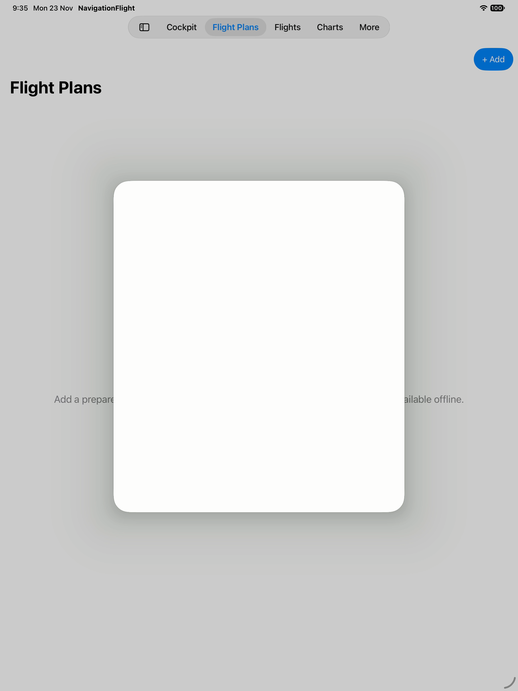

NavigationFlightUITests/testCanonicalReviewPresentsFrequencyAndRouteDetailsAsSheets()

Original recording: `Screen Recording 2026-11-23 at 09.35.54 AM.mp4`; frame at 13.337 seconds.

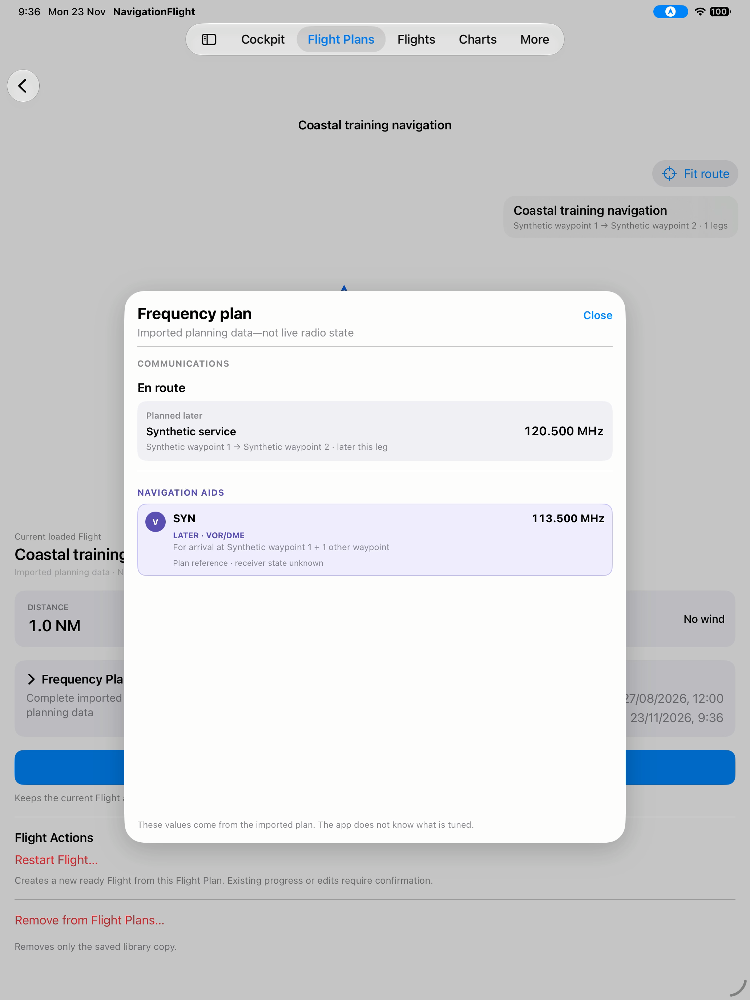

NavigationFlightUITests/testChecklistActionsRemainReachableWithAccessibilityText()

Original recording: `Screen Recording 2026-11-23 at 09.36.09 AM.mp4`; frame at 13.28 seconds.

NavigationFlightUITests/testClosedFlightDeletionCancellationPreservesTheNamedFlight()

Original recording: `Screen Recording 2026-11-23 at 09.37.33 AM.mp4`; frame at 24.243 seconds.

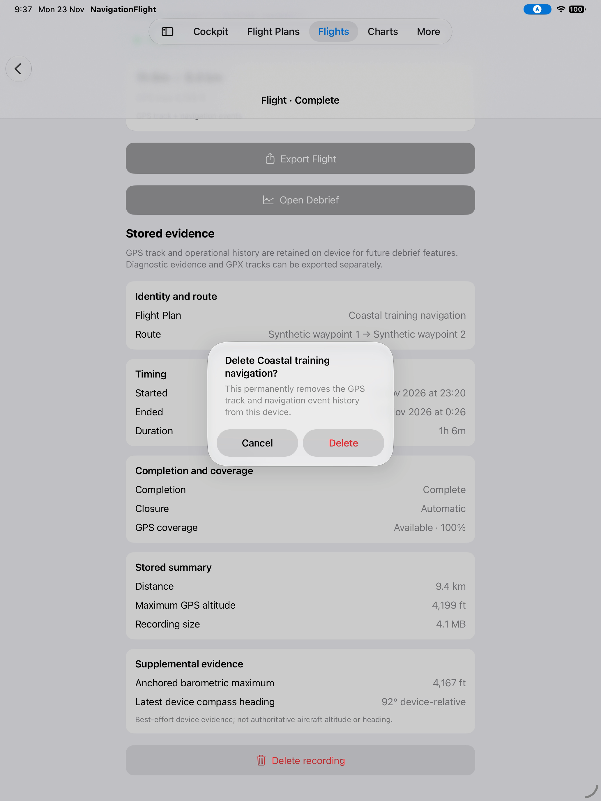

NavigationFlightUITests/testCockpitOperationalCuesExposeSemanticFrequencyAndAltitudeValues()

Original recording: `Screen Recording 2026-11-23 at 09.38.44 AM.mp4`; frame at 11.572 seconds.

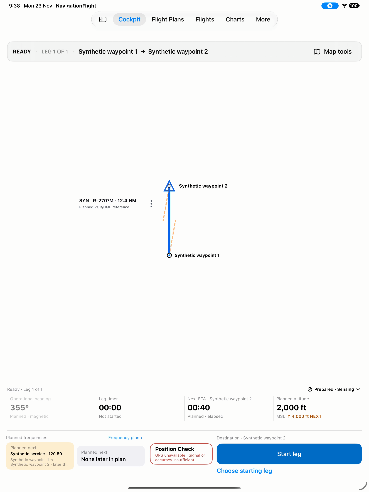

NavigationFlightUITests/testConfirmedClosedFlightDeletionReturnsToListAfterRemoval()

Original recording: `Screen Recording 2026-11-23 at 09.41.40 AM.mp4`; frame at 15.515 seconds.

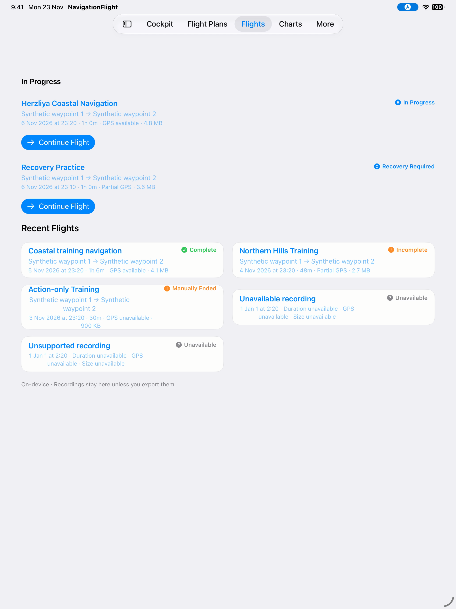

NavigationFlightUITests/testDraftCanSelectAnInteriorDepartureAndKeepItWhenRotated()

Original recording: `Screen Recording 2026-11-23 at 09.42.53 AM.mp4`; frame at 12.88 seconds.

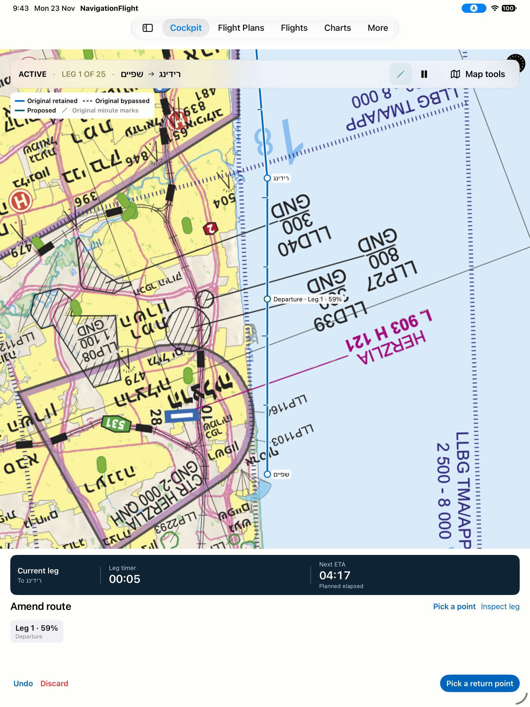

NavigationFlightUITests/testFailedDeletionPreservesDetailAndOffersRetry()

Original recording: `Screen Recording 2026-11-23 at 09.43.34 AM.mp4`; frame at 14.275 seconds.

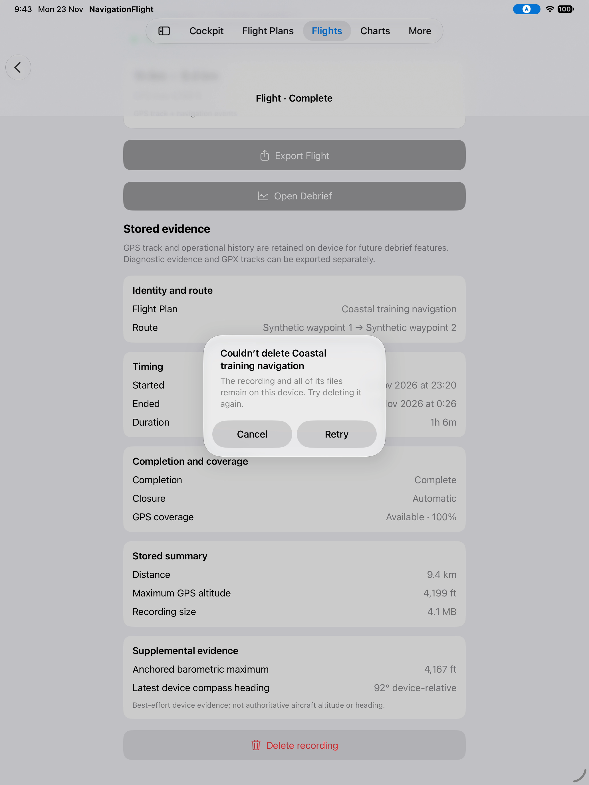

NavigationFlightUITests/testImportedWindPlanLaunchesCockpitWithNoWindValuesAndNoModeSelector()

Original recording: `Screen Recording 2026-11-23 at 09.47.26 AM.mp4`; frame at 18.032 seconds.

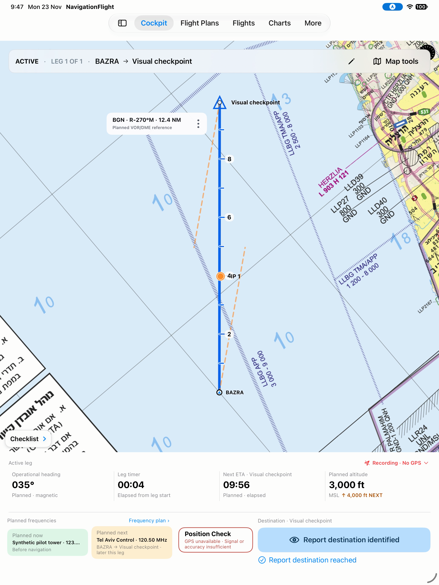

CockpitChartsUITests/testKnownArrivalWithoutChartsAndLargeTextLeaveDepartureUsable()

Original recording: `Screen Recording 2026-11-23 at 09.33.30 AM.mp4`; frame at 16.717 seconds.

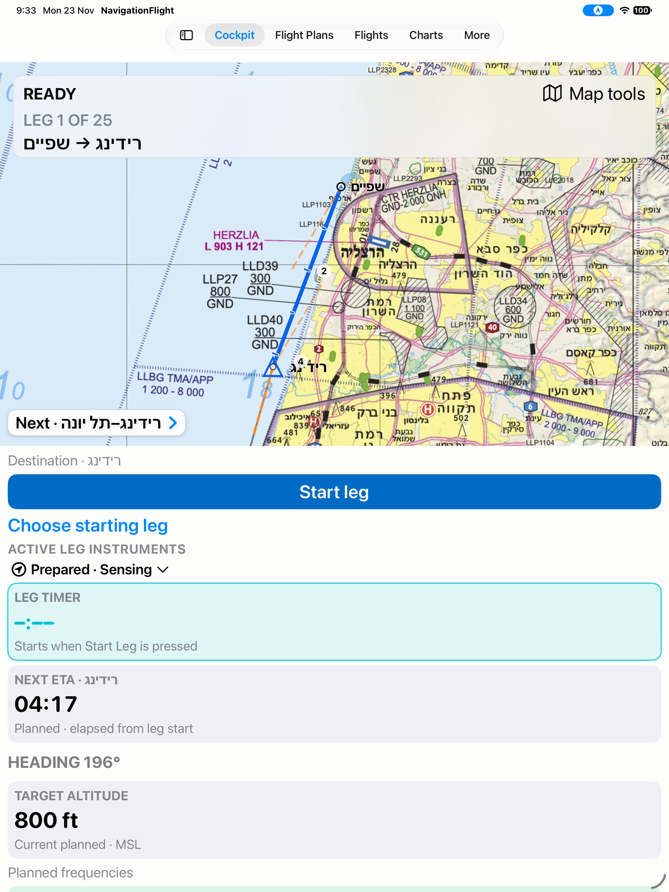

NavigationFlightUITests/testManualAmendmentChartSelectsLegsAndDisambiguatesTheirRoles()

Original recording: `Screen Recording 2026-11-23 at 09.49.58 AM.mp4`; frame at 22.497 seconds.

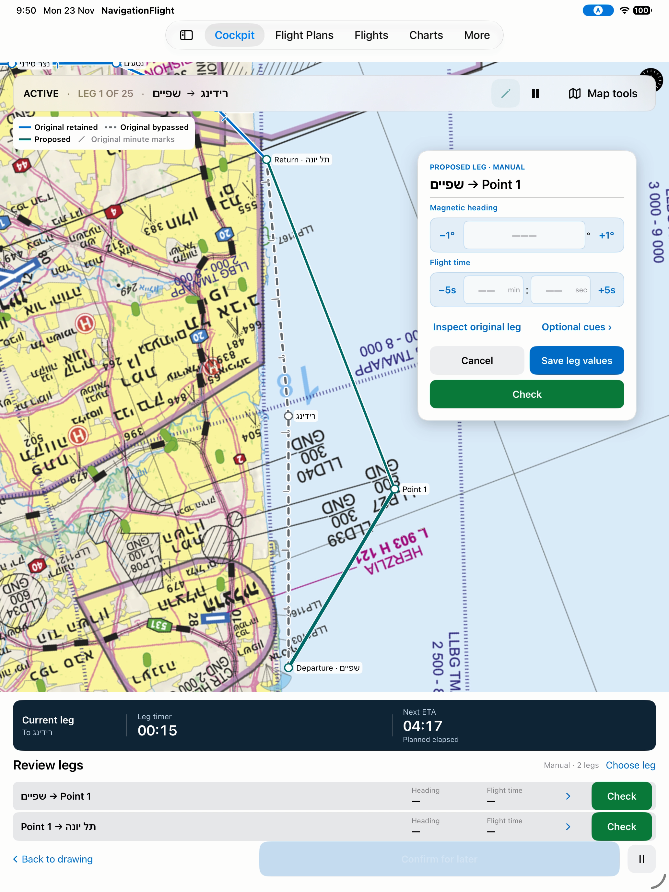

NavigationFlightUITests/testManualAmendmentReviewSupportsLargerText()

Original recording: `Screen Recording 2026-11-23 at 09.52.19 AM.mp4`; frame at 10.102 seconds.

NavigationFlightUITests/testPositionCheckAccessibilityTextStacksDistinctReachableActions()

Original recording: `Screen Recording 2026-11-23 at 09.55.36 AM.mp4`; frame at 7.29 seconds.

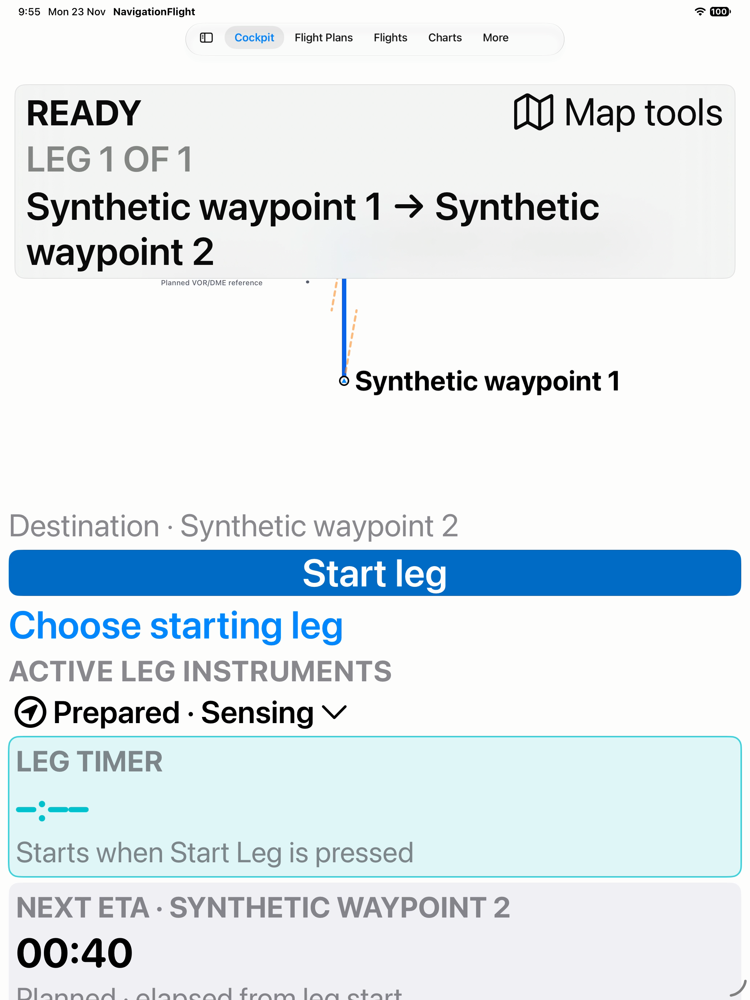

NavigationFlightUITests/testSingleRecoveryRequiresChoiceAndContinueOpensRestoredCockpit()

Original recording: `Screen Recording 2026-11-23 at 10.06.13 AM.mp4`; frame at 8.46 seconds.

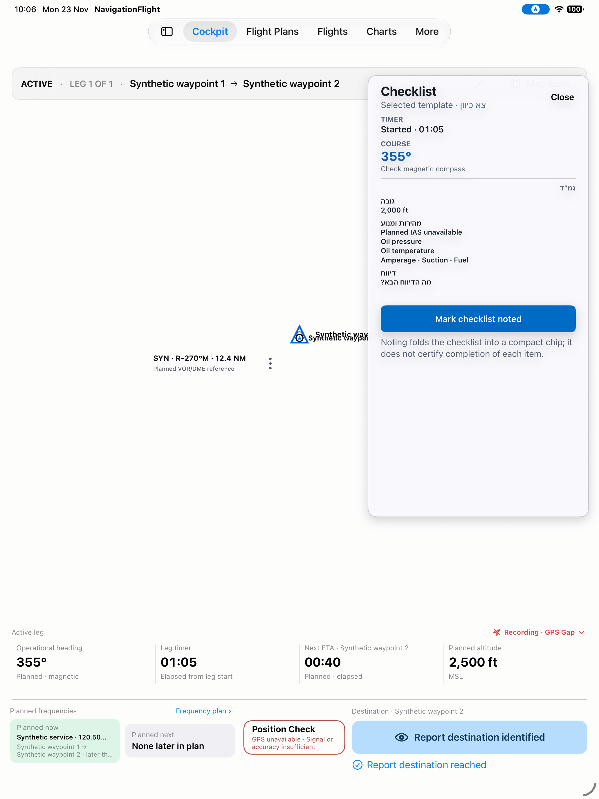

## Skipped test

`NavigationFlightUITests/testCompactPendingAmendmentKeepsLegIdentityAtLargerText()`

## Runtime warnings

- Modifying state during view update, this will cause undefined behavior.
- Type "app.navigationflight.diagnostic-bundle" was expected to be declared and exported in the Info.plist of NavigationFlight.app, but it was not found.

## Investigation limits

Failed assertions are observations, not verified root causes. No fixes, acceptance approvals, or design-match claims are included. The installed skill catalog had no `investigate` skill; the investigation used `diagnosing-bugs`.

The pre-existing changes to `NavigationFlight.xcodeproj/project.pbxproj` and `FlightEvidenceCore/.swiftpm/` are outside this evidence checkpoint.
