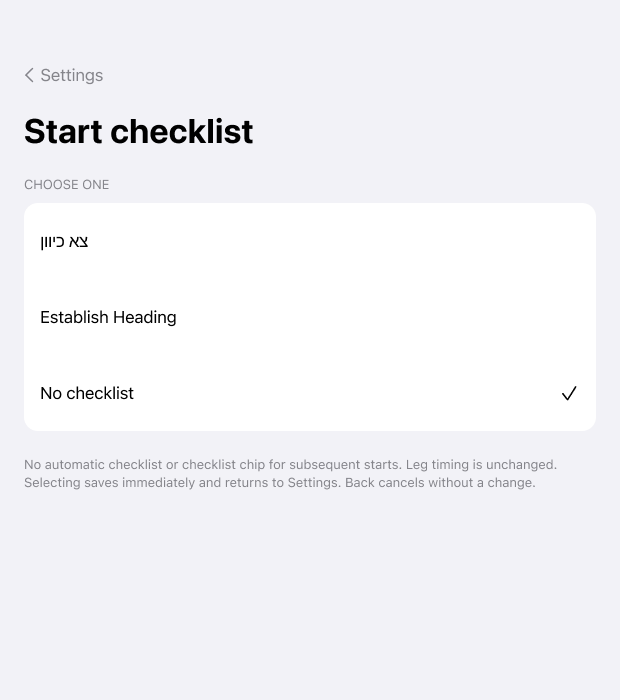
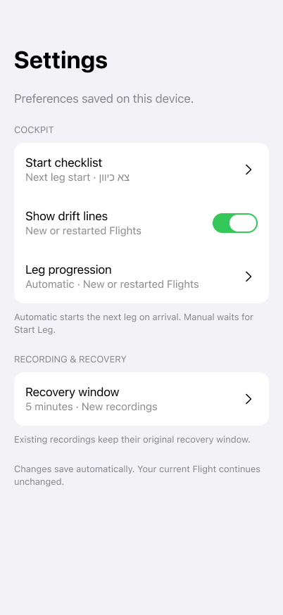
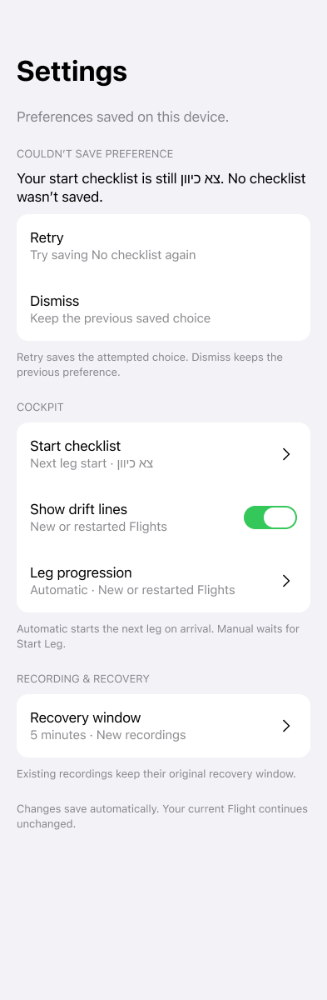
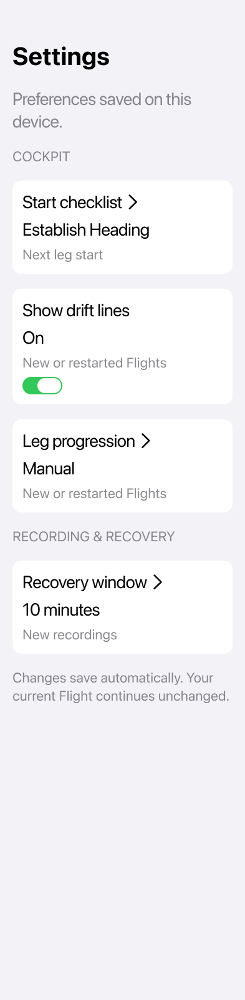

# Settings — Iteration 02 design review

Status: Iteration 02 approved by John on 2026-11-21 (“I approve”). Product and
Iteration 01 main-screen direction were also explicitly approved. No implementation
or technical-design approval is implied. The paired baseline is published and linked in Figma; see Evidence and limits.

Authority: [Settings product spec](SETTINGS_SPEC.md), SET-01–17. Stable Figma file:
[NavigationFlight · Settings](https://www.figma.com/design/HludOIJu7Ko46X4pmkGvTx).
Preserve [approved main-screen direction 3:628](https://www.figma.com/design/HludOIJu7Ko46X4pmkGvTx?node-id=3-628).

## Changes from the approved direction

- Adds exclusive choice screens and clearly marks the current value.
- Retains the same groups; compact layouts place the current value alongside timing
  in the secondary line. iPad portrait retains the approved trailing-value layout.
- Shows save failure near the top, with the previously saved value and Retry/Dismiss.
- Adds system dark appearance, iPad landscape, iPhone portrait, and a Larger Text
  scrolling-content specimen. These do not introduce appearance preferences.
- Choice screens use Settings navigation with Back; choosing saves and returns.
  Back/dismiss without choosing preserves the value. No keyboard is involved.

## Inspectable frame inventory

Each linked preview was retrieved from Figma and visually inspected on 2026-11-21.
All final frame text is SF Pro; structural inspection found editable native nodes
and no image-filled nodes. The retained PNGs are review evidence, not design layers.

| State | Exact Figma target | Retained preview |
| --- | --- | --- |
| Checklist: Hebrew selected | [7:42](https://www.figma.com/design/HludOIJu7Ko46X4pmkGvTx?node-id=7-42) | [PNG](settings-assets/iteration-02-checklist-hebrew.png) |
| Checklist: English selected | [7:127](https://www.figma.com/design/HludOIJu7Ko46X4pmkGvTx?node-id=7-127) | [PNG](settings-assets/iteration-02-checklist-english.png) |
| Checklist: No checklist selected | [7:204](https://www.figma.com/design/HludOIJu7Ko46X4pmkGvTx?node-id=7-204) | [PNG](settings-assets/iteration-02-checklist-none.png) |
| Progression choices | [7:281](https://www.figma.com/design/HludOIJu7Ko46X4pmkGvTx?node-id=7-281) | [PNG](settings-assets/iteration-02-progression.png) |
| Recovery choices | [7:335](https://www.figma.com/design/HludOIJu7Ko46X4pmkGvTx?node-id=7-335) | [PNG](settings-assets/iteration-02-recovery.png) |
| iPad landscape | [7:435](https://www.figma.com/design/HludOIJu7Ko46X4pmkGvTx?node-id=7-435) | [PNG](settings-assets/iteration-02-ipad-landscape.png) |
| iPhone 16 Pro portrait | [8:381](https://www.figma.com/design/HludOIJu7Ko46X4pmkGvTx?node-id=8-381) | [PNG](settings-assets/iteration-02-iphone-16-pro.png) |
| Compact iPhone portrait | [7:546](https://www.figma.com/design/HludOIJu7Ko46X4pmkGvTx?node-id=7-546) | [PNG](settings-assets/iteration-02-iphone.png) |
| Compact checklist selector | [7:657](https://www.figma.com/design/HludOIJu7Ko46X4pmkGvTx?node-id=7-657) | [PNG](settings-assets/iteration-02-iphone-checklist.png) |
| Dark appearance / non-default values | [7:734](https://www.figma.com/design/HludOIJu7Ko46X4pmkGvTx?node-id=7-734) | [PNG](settings-assets/iteration-02-iphone-dark.png) |
| Save failure, retained value and actions | [7:845](https://www.figma.com/design/HludOIJu7Ko46X4pmkGvTx?node-id=7-845) | [PNG](settings-assets/iteration-02-save-failure.png) |
| Larger Text scrolling content | [7:1007](https://www.figma.com/design/HludOIJu7Ko46X4pmkGvTx?node-id=7-1007) | [PNG](settings-assets/iteration-02-larger-text.png) |
| Coverage index | [7:1029](https://www.figma.com/design/HludOIJu7Ko46X4pmkGvTx?node-id=7-1029) | [PNG](settings-assets/iteration-02-index.png) |

## Requirement and workflow coverage

| Inventory item | Contract | Design target or explicit rule | Verification boundary |
| --- | --- | --- | --- |
| Entry, groups, four current values, exit | SET-01–02, SET-05–07 | Approved 3:628; adaptations 7:435, 8:381, 7:546 | Shell stays native and existing; active/no-Flight entry has the same Settings content. |
| Three checklist choices and exclusive selection | SET-03, SET-08 | 7:42, 7:127, 7:204, compact 7:657 | Choices visible; current checkmark is not color-only. |
| Drift enabled/disabled | SET-09 | On: 3:628, 8:381; Off: 7:734 | Switch changes the default for new/restarted Flights, never current-Flight visibility. |
| Automatic/manual progression | SET-10 | Selector 7:281; Automatic main 8:381; Manual main 7:734 | Choice semantics and timing copy; runtime timer/map handoff requires tests. |
| Bounded recovery choices | SET-11 | 7:335; default 5-minute main 3:628; 1-minute main 7:734; 10-minute Larger Text 7:1007 | Four options visible; existing deadline preservation is nonvisual. |
| Immediate save, selection completion and cancellation | SET-12 | 7:1029 flow: main → selector → choose → saved main; Back → unchanged main | Saved main reuses the same row with the chosen value, not a new success screen. |
| Save failure, retry and dismiss | SET-13 | 7:845; successful retry → 7:734’s No checklist value in the main pattern | Previous choice remains effective; no false success. Retry/dismiss behavior requires injected failure tests. |
| Defaults, invalid values, relaunch | SET-07, SET-12–13 | Default main 3:628; recovered/saved values use the same main pattern | No empty/loading screen: defaults exist. Independent fallback and persistence are test contracts. |
| Current Flight unaffected; checklist capture, undo and recovery | SET-08–11, SET-14, SET-16 | Written state rules in 7:1029; existing checklist rendering [198:250](https://www.figma.com/design/yvLXb8bUFBiZHqsag4hq6I?node-id=198-250) | No new cockpit composition: No checklist omits only its checklist presentation/chip. Existing navigation, timing, and unrelated disclosures remain governed by their authorities. No new runtime evidence is claimed. |
| Adaptive geometry and resizing | SET-05, SET-15 | iPad portrait 3:628; iPad landscape 7:435; iPhone 16 Pro 8:381; compact 7:546/7:657 | Content frames exclude existing system shell geometry. Preserve chooser location/selection through resizing. |
| Larger Text and long content | SET-15 | 7:1007, wrapping at compact width in 7:657/7:845 | Expanded specimen is scroll content, not a 1600-point device. Use actual system text styles and controls; do not prescribe fixed scale factors. |
| VoiceOver and selected/toggle traits | SET-15 | 7:1029 accessibility rule plus selected checkmarks and switch state | Announce label, current value, control trait, and timing. Actual focus/readout requires simulator/device validation. |
| Dark and Reduced Motion | SET-15 | Dark 7:734; no new animation-dependent information | Dark follows the system. Reduced Motion adds no new animation; runtime still requires verification. |
| Adding future settings | SET-04, SET-17 | Existing grouped pattern, no empty categories | Stable keys, ownership, migrations, and independent persistence belong to technical review. |
| Input and exclusions | Scope | No text entry/keyboard, new localization, iPhone landscape, custom checklist editing, global reset or deferred settings | Excluded intentionally; not missing flows. |

## Review previews

### Checklist selector

### iPhone 16 Pro portrait

### Save failure

### Larger Text scroll content

## Evidence and limits

This is static design review. No application build, test run, simulator launch,
persistence check, or assistive-technology runtime check was performed or claimed.
Current code inspection remains anchored at `3c59aa835aeff27c558c7279ea649faa5c2439c0`.
A Figma node does not prove any timing, storage, migration, undo, or recovery behavior.

The approved product text is published at
[9d2628a](https://github.com/johnbenz13/NavigationFlight/blob/9d2628a5cf1db9a551f1852271f2b48f33747efd/docs/features/SETTINGS_SPEC.md).
Both Figma indexes link to this immutable revision. Product and design approvals
were granted by John on 2026-11-21; paired-baseline publication was recorded that
date under his separate commit/push/PR/merge authorization. This publication does
not resolve the separately identified Cockpit persistence-warning copy blocker.

Final screenshot SHA-256 values:

| Preview | SHA-256 |
| --- | --- |
| iteration-02-checklist-hebrew.png | `6a51fc6010e9c9298072df52764f0b2938b3928cdc8c307f8416a8d2a30fb13b` |
| iteration-02-checklist-english.png | `f90c5dfa57c4c9389ea6d3e2e601841af998133d9ac93240c5708dd62be73bc4` |
| iteration-02-checklist-none.png | `6a645781b9555d26a2956cbaa00f967885bce8f8e3ec17cea2628844017c8967` |
| iteration-02-progression.png | `7fc669fe57432de62900234ee7db29b2545650100a64d3d86df2e8d6934a3f65` |
| iteration-02-recovery.png | `25362d688634a1abe7839ac5d6d774d7186815c49de9fa9828e30bf9866c0a49` |
| iteration-02-ipad-landscape.png | `88b0ae5953991c2d0562618eb8c5df18ed05665f3ee8cf8d7b5374603ec9b219` |
| iteration-02-iphone-16-pro.png | `325f34d1e27b32c8b2d1788639faca5e1031d13836f97e309072a249ebf6175d` |
| iteration-02-iphone.png | `97ee2dbcdecf1cfa04b26f8aa2296a619b5564423b231426fa94e578c897caf8` |
| iteration-02-iphone-checklist.png | `b26e809fe2ecf70b03740936a0e64cfb347df25f8cbffa7489b140e6917e01f1` |
| iteration-02-iphone-dark.png | `66e98ad638e9c740a90904fc41b8c8111128eeabbd9d88c9fb1155b83aad4da3` |
| iteration-02-save-failure.png | `e522dc9c21b2565a1b5d21ce11af8565f8c93e8c02938099d390bcf9a111c2a1` |
| iteration-02-larger-text.png | `81cbdf95c9983ab21ba713d55889a315ba27d596c1a123e3c2db2ee39fa6f9e9` |
| iteration-02-index.png | `1dd2309cb165792a9ced8a382b8d5333abffe15b12583ebc6af2a8bb630d7c77` |
