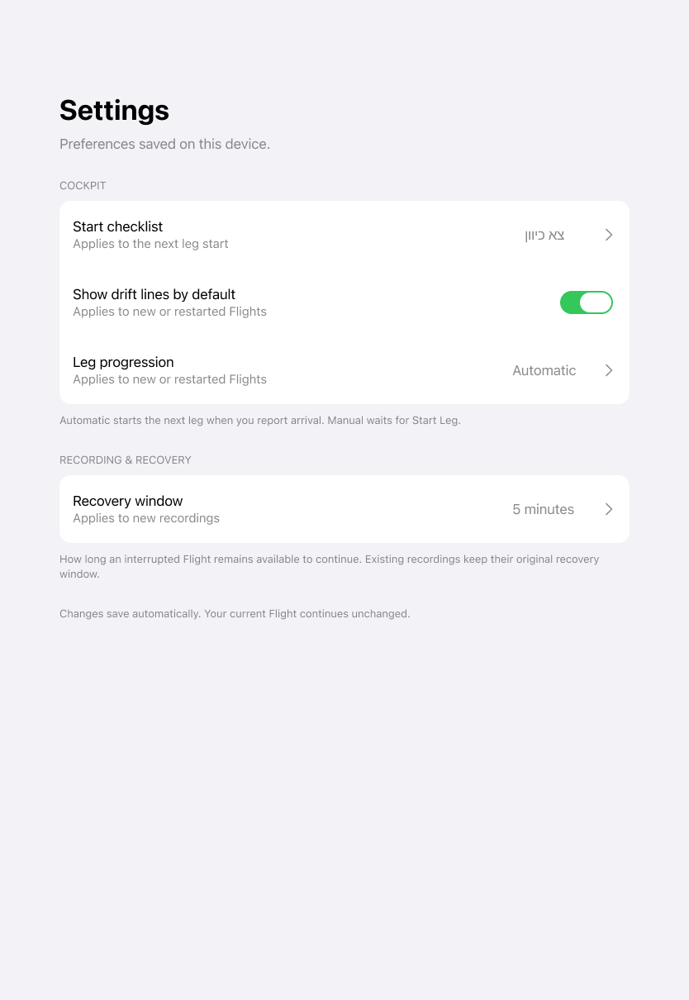

# Settings — Product Specification

Implementation update, 2026-11-21: John authorized #161 and approved the
presentation-only persistence-warning copy in
[#161's readiness decision](https://github.com/johnbenz13/NavigationFlight/issues/161#issuecomment-7052413098).
The earlier unapproved-implementation and warning-blocker statements below are
historical planning status, superseded by that decision. The other three settings
remain separate slices; implementation acceptance remains pending.

Status: product approved by John on 2026-11-21, including SET-16 legacy fallback.
Design and technical design approved by John on 2026-11-21. Ticket breakdown and GitHub publication approved by John on 2026-11-21.
Implementation remains unapproved; readiness gates are recorded in the delivery plan.

## Planning checkpoint

- Inspected baseline: `3c59aa835aeff27c558c7279ea649faa5c2439c0` on `main`.
- Started: 2026-11-21.
- Current stage: tickets published; external readiness gates remain.
- Product approval: John, 2026-11-21, “I approve,” after consolidated review.
- Main-screen direction approval: John, 2026-11-21, “I approve,” for Iteration 01 node `3:628`.
- Complete design approval: John, 2026-11-21, “I approve,” for Iteration 02 and its coverage map.
- Technical approval: John, 2026-11-21, “approved,” for the technical design.
- Delivery/publication approval: John, 2026-11-21, “I approve.”
- Published parent: [#189](https://github.com/johnbenz13/NavigationFlight/issues/189);
  children [#161](https://github.com/johnbenz13/NavigationFlight/issues/161),
  [#190](https://github.com/johnbenz13/NavigationFlight/issues/190),
  [#191](https://github.com/johnbenz13/NavigationFlight/issues/191),
  [#192](https://github.com/johnbenz13/NavigationFlight/issues/192).
- Paired baseline published: product/design approvals linked to commit `9d2628a5cf1db9a551f1852271f2b48f33747efd` on 2026-11-21.
- Next: resolve Cockpit warning treatment per the
  [delivery plan](SETTINGS_DELIVERY_PLAN.md); implementation approval remains separate.
- Related ticket: [#161](https://github.com/johnbenz13/NavigationFlight/issues/161).
  Updated to the approved three-choice contract; original G16 trace preserved.

## Owner requirements

- SET-01: Replace the explanatory Settings placeholder with functional settings
  organized into meaningful groups/categories.
- SET-02: Save preferences on the device and restore them across app relaunch.
- SET-03: Provide three start-checklist choices: **צא כיוון**, **Establish Heading**,
  and **No checklist**. This is two bundled templates plus an opt-out, not a third
  template. Custom checklist editing remains outside the existing contract.
- SET-04: Allow future features to add settings within the established grouping,
  persistence, and integration conventions. Detailed interfaces await technical
  agreement; this does not require a generic plugin framework.

## Evidence inventory

| Candidate | Source | Current status and planning implication |
| --- | --- | --- |
| Start checklist | [Flying a Leg §§112–116](FLYING-A-LEG_SPEC.md#active-leg-map-orientation-and-checklist-templates), [#161](https://github.com/johnbenz13/NavigationFlight/issues/161) | Explicit pending Settings integration. Bundled templates exist in `CockpitPresentationAdapter.swift`; Settings has no selector. Owner now requests a No checklist option. |
| Default drift-line visibility | [Flying a Leg §§45–54](FLYING-A-LEG_SPEC.md#drift-lines) | Explicit future app preference. Current flights default to visible and retain cockpit toggles between legs. |
| Recording recovery window | [Recording and Recovery §62](AUTOMATIC-FLIGHT-RECORDING-AND-RECOVERY_SPEC.md), [#105](https://github.com/johnbenz13/NavigationFlight/issues/105) | Explicit future bounded choices: 1, 2, 5, 10 minutes; current default five. Each recording captures its effective window; changes cannot alter existing recordings. |
| Automatic/manual leg progression | [Progression Policy](PROGRESSION-POLICY_SPEC.md) | Historical intent for a general preference and possible per-flight override, not an approved Settings contract. Release currently uses automatic progression. |
| Position Check disclosure duration and quality/recovery thresholds | [Position Check §61](POSITION-CHECK_SPEC.md#privacy-and-future-extension) | Possible future configuration. Current release uses fixed approved policies; allowed user-facing values are undefined. |
| Progression action colors | `NavigationFlight/Map/AviationMapVisualStyle.swift:30` | Code explicitly anticipates future visual preferences, but no palette or interaction contract exists. |
| Map label and callout font sizes | `NavigationFlight/Map/AviationMapVisualStyle.swift:58` and subsequent font constants | Fixed implementation values, not a discovered promise of an app setting. Existing Dynamic Type requirements remain applicable. |

Reviewed current feature specifications, technical documents, reconciliation
Markdown, investigation Markdown, relevant Swift references, and related GitHub
issues. Evidence above distinguishes explicit commitments from possible extensions;
centralized constants alone do not authorize new settings.

## Approved first-release scope

John answered “yes to all” to the first product round on 2026-11-21.

| Group | Controls | Approved application boundary |
| --- | --- | --- |
| Cockpit | Start checklist: צא כיוון, Establish Heading, No checklist | Subsequent leg starts; preserve already-created checklist state. No checklist suppresses the automatic checklist and its chip for those starts. |
| Cockpit | Default drift-line visibility | Newly loaded/restarted Flights; cockpit toggle remains a current-Flight override. |
| Cockpit | Automatic/manual progression | Newly loaded/restarted Flights; current Flight policy remains unchanged. |
| Recording & Recovery | Recovery window: 1, 2, 5, 10 minutes | New recordings only; existing captured windows remain unchanged. |

Preserve current defaults: **צא כיוון**, drift lines **visible**, **automatic**
progression, **five-minute** recovery. These defaults were checked against the
current presentation adapter, Cockpit state, and recording contract.

Appearance controls (colors and font sizes) and Position Check threshold controls
are explicitly deferred. Do not show empty categories. Existing contracts exclude
recording disable controls, pilot-adjustable detector thresholds, and customizable
app-section ordering. Keep-awake behavior remains feature-owned.

## Approved behavior — second product round

John answered “yes to all” to the second product round on 2026-11-21.

1. Save each selection immediately, without a Save button. Show the saved value
   and explain whether it applies to the next leg, next Flight, or next recording.
   No account or cross-device synchronization; ordinary OS backup behavior is not
   a new app sync feature.
2. Omit a global reset action in this release: each of the four controls can be
   returned individually to its documented default.
3. Unknown/invalid stored values fall back only for the affected preference; keep
   other valid values. A detected save failure retains the previous saved value
   and offers a clear error and retry; do not falsely confirm persistence.
4. Automatic progression starts the next leg timer on the arrival report; manual
   progression leaves the next leg ready until Start Leg. Neither option changes
   the pilot's authority to report arrival or permits arbitrary active-Flight
   policy switching.
5. Checklist choices also apply to automatically started successor legs. An undo
   restores the original leg's checklist choice and state, even if Settings has
   since changed. No checklist never fabricates a Noted acknowledgement or gates
   leg timing.
6. Recovery restores the recovered Flight's progression policy and any retained
   per-Flight presentation/checklist state; it must not reinterpret that Flight
   using newly changed defaults. Any missing legacy state needs an explicit
   compatibility rule in technical planning before approval.

## Approved product contract

These requirements combine both approved rounds. SET-16 makes the remaining
legacy compatibility rule explicit; John approved it with the complete contract.

- SET-05: Keep Settings in the existing app shell. Opening, leaving, rotating, or
  resizing Settings preserves the current Flight, timers, recording, and cockpit
  work. Settings is usable with or without a loaded Flight. Existing recovery
  gates retain priority over ordinary navigation.
- SET-06: Present **Cockpit**, then **Recording & Recovery**. Each setting shows
  its current selection, allowed choices, and application timing. Selection is
  exclusive; opening and dismissing a chooser without selecting changes nothing.
  Do not show deferred or empty groups.
- SET-07: A fresh installation or upgrade without saved preferences uses
  **צא כיוון**, drift lines **visible**, **automatic** progression, and **5 minutes**.
- SET-08: Start-checklist choices are exactly the two bundled templates and
  **No checklist**. Capture the choice when a leg starts, including automatic
  successor starts. Preserve that leg's template identity/content definition and
  review/presentation state across later preference changes. Dynamic values still
  resolve from the appropriate leg state. No checklist produces no checklist chip
  or automatic presentation, no fabricated acknowledgement, and no timing gate.
- SET-09: Default drift-line visibility is captured for each newly loaded or
  restarted Flight. The existing cockpit toggle changes only that Flight's
  visibility. It never writes back to the saved default or changes navigation data.
- SET-10: Progression choices are **Automatic** and **Manual**. Automatic starts
  the successor timer at the arrival report; Manual leaves the successor ready
  until **Start Leg**. Both retain existing map transitions, final-leg behavior,
  pilot reporting authority, and undo semantics. Capture policy when loading or
  restarting a Flight; changes in Settings never change an existing Flight.
- SET-11: Recovery choices are exactly **1**, **2**, **5**, or **10 minutes**.
  Capture the preference when a recording starts. Do not change existing recovery
  deadlines, captured windows, recording lifecycle, or expiry validation. Never
  offer unlimited recovery or a recording-disable control.
- SET-12: Save a selected value immediately on this device and restore it after
  relaunch. Returning to Settings shows the saved choice. Explain **Next leg
  start**, **New or restarted Flights**, or **New recordings**, as applicable.
  There is no Save button, account, app-managed cross-device sync, or global reset.
- SET-13: Missing/invalid values use the affected preference's documented default
  while preserving other valid preferences. On a detected save failure, retain
  the previous effective value, show a clear error, and allow retry or dismissal.
  Navigation and active Flight work remain available; do not claim the failed
  choice was saved. A retry uses the attempted choice; a later deliberate choice
  replaces that pending attempt.
- SET-14: Undo restores the original leg's checklist choice and state, including
  the absence of a checklist, even after Settings changes. Recovery preserves the
  Flight's captured progression policy, recovery window, and retained per-Flight
  visibility/checklist state; saved defaults cannot reinterpret existing work.
- SET-15: Settings controls, choices, current selection, explanatory text, and
  error/retry actions support Dynamic Type, VoiceOver, and established iPad/iPhone
  layouts. Hebrew template identity remains readable with its natural direction.
  Larger text may scroll; essential controls and values must remain reachable.
- SET-16: For a recovered legacy Flight lacking newly
  retained settings state, use its recorded progression/recovery policy where
  present. Missing visibility uses the historical **visible** default. Missing
  checklist choice uses historical **צא כיוון** for an active leg; never invent a
  Noted acknowledgement. Subsequent leg starts use the current saved checklist
  selection. Preserve existing legacy recovery behavior for missing policy data
  rather than deriving a new policy from current Settings. This does not require
  reconstructing historical checklist acknowledgements that were never recorded.
- SET-17: Future settings follow a documented extension convention: owning feature,
  category, stable stored identity, default, allowed values, application boundary,
  compatibility/failure behavior, and tests. Adding a preference must not reset
  unrelated saved values or silently change an active Flight's captured policies.

## Contract changes and exclusions

This feature replaces the Settings placeholder required by the original app
navigation feature. It extends Flying a Leg checklist selection with **No
checklist**, and replaces the unconditional new-Flight visible drift default with
an initial value from Settings. It promotes historical general progression intent
into a user-facing default; no per-Flight policy selector is introduced. It
activates the bounded recovery-window preference seam without changing recovery
rules. Earlier specifications retain their delivery history; approval of this
contract records the scoped supersession rather than rewriting historical evidence.

No custom checklist editor, new templates, new Position Check controls, appearance
controls, text-size override, recording-disable setting, detector tuning,
keep-awake preference, cloud sync, or shell customization is included.

## Product verification map

| Requirements | Required implementation evidence |
| --- | --- |
| SET-01, SET-05–06, SET-15 | Simulator review of grouped Settings, selection/dismissal, no-Flight and active-Flight navigation, accessibility, primary/secondary device layouts, and exact approved Figma targets. |
| SET-02, SET-07, SET-12–13 | Isolated preference tests for defaults, independent values, persistence/relaunch, invalid values, injected save failure, retry/dismissal, and later choices; simulator relaunch evidence. |
| SET-03, SET-08, SET-14 | Tests and simulator transitions for both templates and No checklist, explicit/automatic starts, existing-leg preservation, dynamic values, and undo. |
| SET-09–11 | Tests for capture boundaries, preserved current-Flight overrides, both progression modes, final leg behavior, and unchanged existing recovery eligibility after preference edits. |
| SET-14, SET-16 | Recovery round-trip and legacy fixtures covering retained values and missing fields independently of changed device defaults. |
| SET-04, SET-17 | Technical review of the extension convention and compatibility tests proving new/missing keys preserve other preferences. |

Tests, builds, and simulator checks listed here are future implementation work,
not executed planning evidence. Product approval, design approval, technical
approval, implementation authorization, and acceptance remain separate.

## Figma

- Design status: approved; paired baseline published and linked in Figma.
- Approved product revision: [9d2628a](https://github.com/johnbenz13/NavigationFlight/blob/9d2628a5cf1db9a551f1852271f2b48f33747efd/docs/features/SETTINGS_SPEC.md), John’s 2026-11-21 approved product text.
- Direction status: Iteration 01 approved by John, 2026-11-21.
- Candidate complete iteration: [Iteration 02 coverage index](https://www.figma.com/design/HludOIJu7Ko46X4pmkGvTx?node-id=7-1029).
- Coverage map and previews: [Settings design review](SETTINGS_DESIGN_REVIEW.md).
- Stable feature file: [NavigationFlight · Settings](https://www.figma.com/design/HludOIJu7Ko46X4pmkGvTx), in the configured project.
- Candidate main screen: [Iteration 01 · iPad portrait](https://www.figma.com/design/HludOIJu7Ko46X4pmkGvTx?node-id=3-628).
- Review index: [Iteration 01 index](https://www.figma.com/design/HludOIJu7Ko46X4pmkGvTx?node-id=3-754).
- Approved main-screen direction: Iteration 01, node `3:628`, John, 2026-11-21.
- Complete state/adaptive design approval: Iteration 02, John, 2026-11-21.
- Destination: [Navigation Flight project](https://www.figma.com/files/folder/676737789).
- Existing checklist rendering reference from #161:
  [198:250](https://www.figma.com/design/yvLXb8bUFBiZHqsag4hq6I?node-id=198-250).
  This does not define the Settings selector.
- Product and main-screen direction approved by John, 2026-11-21.
  Complete Iteration 02 design approved by John, 2026-11-21.
- Device baseline: iPad Pro 11-inch portrait first; iPad landscape and iPhone 16 Pro
  portrait next. Cover supported resizing, Dynamic Type and VoiceOver. iPhone
  landscape is excluded by the existing repository baseline.

### Iteration 01 — main-screen direction

Created and visually inspected 2026-11-21. Uses the Apple **iOS and iPadOS 27**
library's Row and Toggle - Switch instances, imported semantic background/label
variables and text styles. All inspected text uses SF Pro. The main frame contains
56 descendants (26 frames, 21 text nodes, 9 instances), with no image-filled nodes.

This is a content proposal on the 834 × 1210 iPad portrait baseline; existing native
app-shell geometry remains governed by its existing platform rule and is not
redesigned here. The upper region reserves shell space. Review grouping, selected
values, row/disclosure hierarchy, switch treatment, and application-timing text.

Visible requirements: SET-01–03, SET-05–12 (main-screen presentation), SET-15
(standard-size typography only). John approved this direction on 2026-11-21.
Expanded states now appear in Iteration 02; see its coverage map for the precise
distinction between inspected presentation and future runtime verification.

The Figma indexes now link to the immutable approved product revision
[`9d2628a`](https://github.com/johnbenz13/NavigationFlight/blob/9d2628a5cf1db9a551f1852271f2b48f33747efd/docs/features/SETTINGS_SPEC.md).
Product, main-screen direction and Iteration 02 were approved by John on
2026-11-21; the paired baseline was linked on the same date under his separate
commit/push/PR/merge authorization. Cockpit presentation-persistence warning copy
remains a separate implementation blocker.

## Later planning stages

Technical design must define preference ownership, stable persisted identities,
defaults, compatibility, feature-specific application boundaries, and deterministic
test seams while preserving existing Flight and recording contracts. Ticket
planning follows explicit product, design, and technical approvals. Planning does
not authorize application changes, builds, tests, or simulator launches.
