# Continue navigation, report an IP, and adapt the interface

[Back to the map](../README.md) · [Differences and decisions](../proposed/continuity-and-adaptations.md)

**Status:** observed 2026-11-14; account approved by John on 2026-11-14. iPad Pro 11-inch (M5),
iOS 27.0, portrait 834 × 1210 points, baseline `1a2d7e7`.
[Capture details](../evidence/capture-batch-06.md) identify separate recovered/fresh
Flights and the largest accessibility text-size override.

## S39 · Visit Flight Plans without pausing navigation

**Goal/start:** Consult another section during an active Flight. Continue the recovered
Flight from [S35](flights-and-recovery.md#s35--continue-a-recently-interrupted-flight).
**Action/result:** Select Flight Plans; its disposable library is empty. Select Cockpit
again: the same active route returns and the timer has advanced to **01:40**. The route
strip is now below the tabs rather than overlapping them.

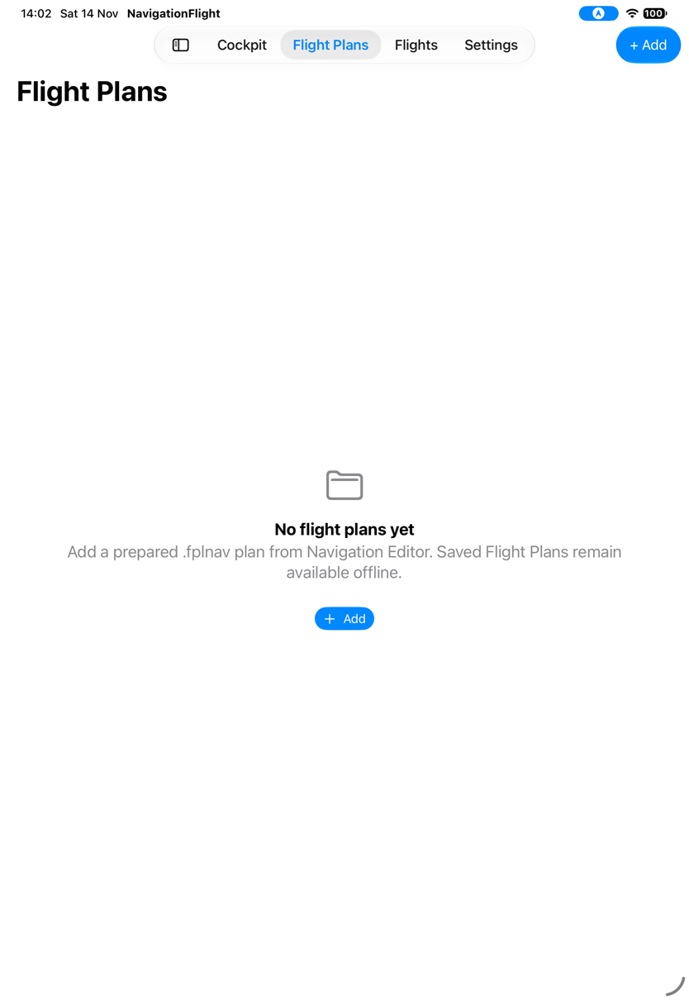

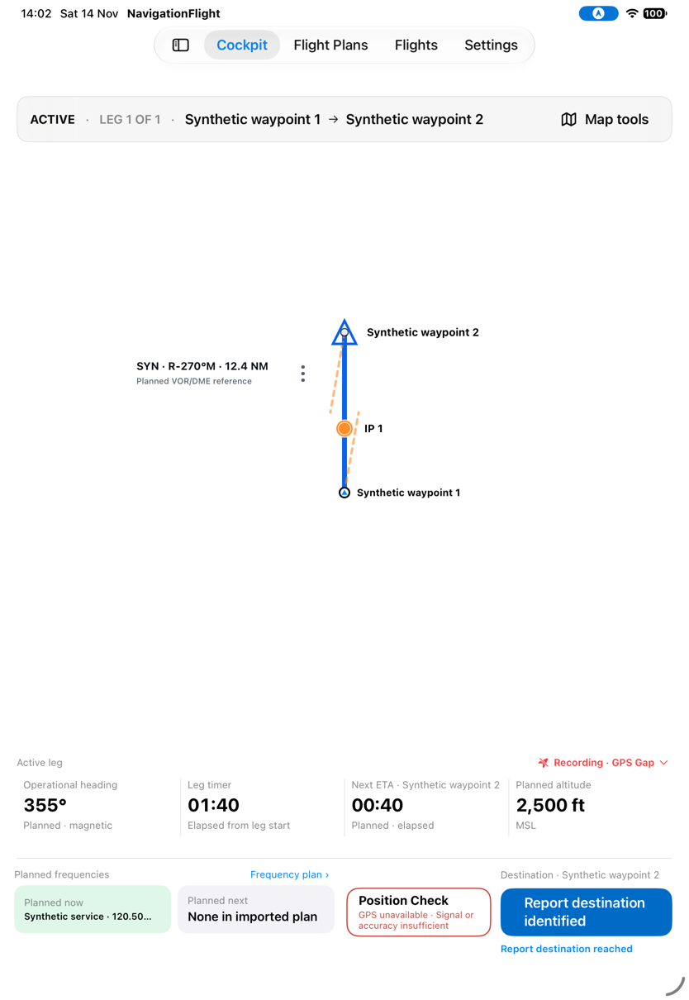

*This establishes visible timer continuity through a tab roundtrip, not every draft,
selection or persistence field. Layout differs from the inspection-return path.*

## S40 · Return from background with timing intact but labels missing

**Goal/start:** Resume the same active Cockpit after briefly using the device Home screen.
**Action/result:** Press Home, wait five seconds, reactivate NavigationFlight. The timer
advances to **01:53**. Route and drift lines remain, but waypoint symbols/names, IP marker
and VOR/DME label are no longer rendered.

Wait again. At **02:00** the labels are still absent, while their semantic entries remain
in the captured accessibility hierarchy. This is not merely the earlier off-chart white
background; compare the visible annotations in S39 at the same map location.

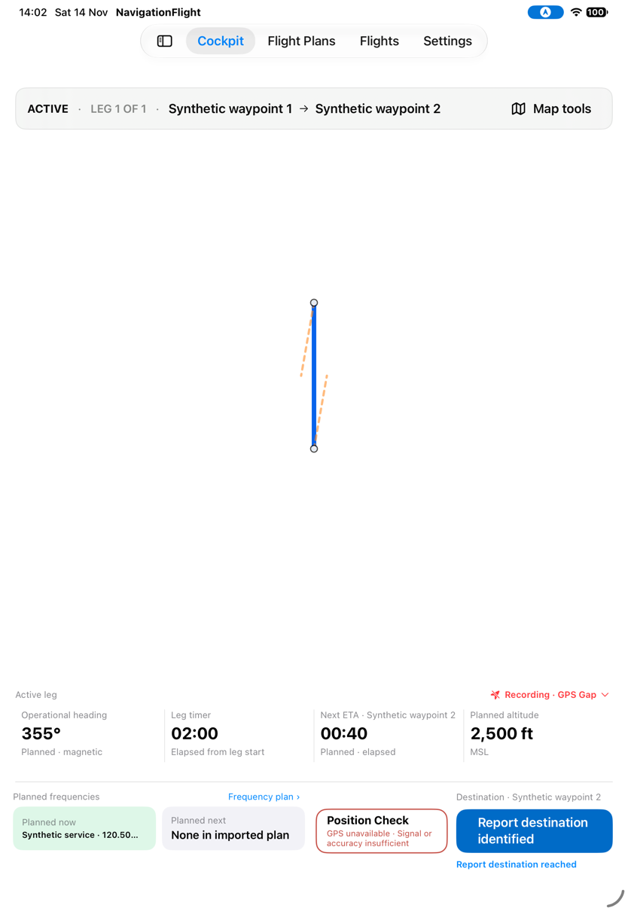

*An attempted hierarchy-targeted IP tap did not open its callout; the retained additional
capture is [05](../assets/current/batch-06/05-ip-callout.png). The observation is simulator-
specific and does not establish permanent loss of navigation data. [G14](../proposed/continuity-and-adaptations.md#g14--restore-visible-map-annotations-after-background)
records the rendering discrepancy.*

## S41 · Report an identification point reached

**Goal/start:** Record a pilot-observed position fix without using GPS as proof.
Start a separate fresh fixture Flight. Tap the visible IP1 label; the tool's reported
hit point missed, so the reviewer used the screenshot's visible target.
**Result:** A callout shows future-target/pilot-report-only wording, planned ETA **00:16**,
Revise ETA and Report IP1 reached.

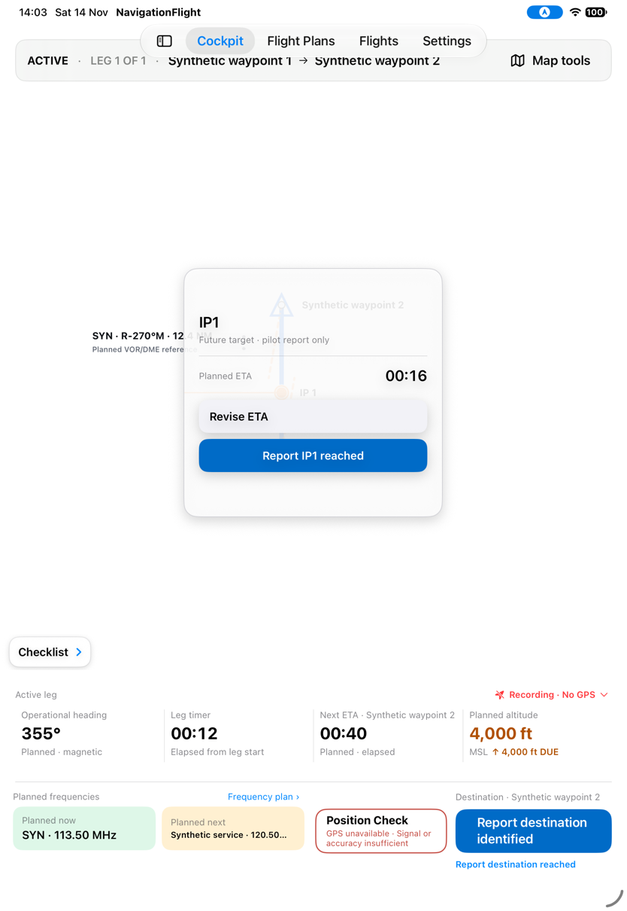

Report reached. The callout shows Actual ETA **00:18**, expected **00:16**, **2 seconds late**,
and “Pilot-reported position fix · not GPS verified.” Revise Next ETA is offered.
No Undo control is visible in this immediate callout or its hierarchy.

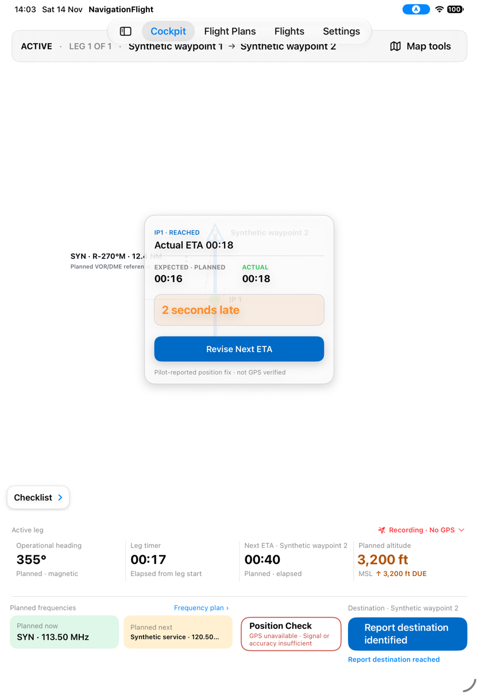

*The timer's rendered tick is one second behind the captured actual-event value; this
single frame is not a timing calculation defect. Undo absence on this path needs the
targeted follow-up in [G15](../proposed/continuity-and-adaptations.md#g15--make-ip-reach-correction-discoverable).*

## S42 · Dismiss ETA work and cancel a heading draft

**Goal/start:** Explore a revision without replacing operational values.
From S41, Revise Next ETA opens the destination editor with draft **00:40** and minimum
**00:30**. It offers steps and Commit; cancellation is explained in text rather than
a visible named button in this panel.

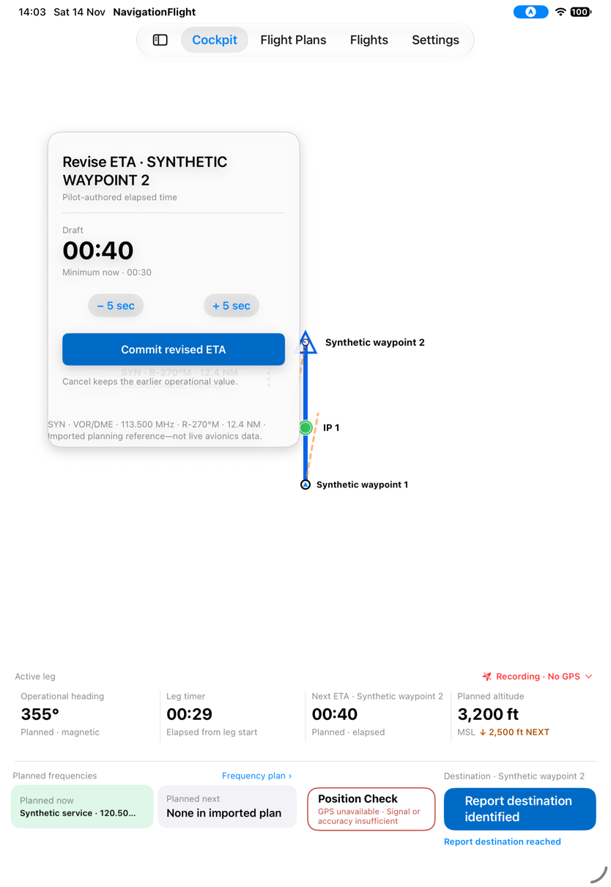

Dismiss outside the panel. The operational ETA remains **00:40**.

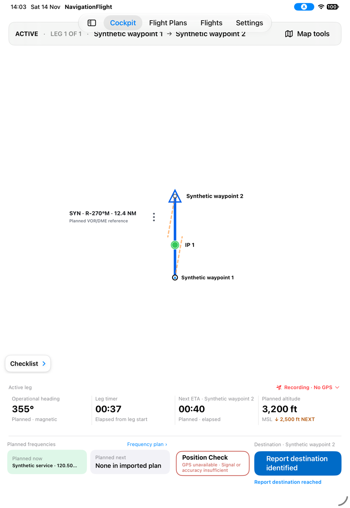

Reopen from the console later. The new draft is **00:45** with minimum **00:45**, while
the operational console still shows **00:40** until commit.

*The capture filename “check-available” is historical naming, not proof of a visible
Check action. No revision was committed on this branch, so its absence inside the draft
editor does not establish a missing reference-Check capability.*

Open heading revision, increase the draft from 355° to 356°, then choose Cancel.
The operational heading remains **355° · Planned**.

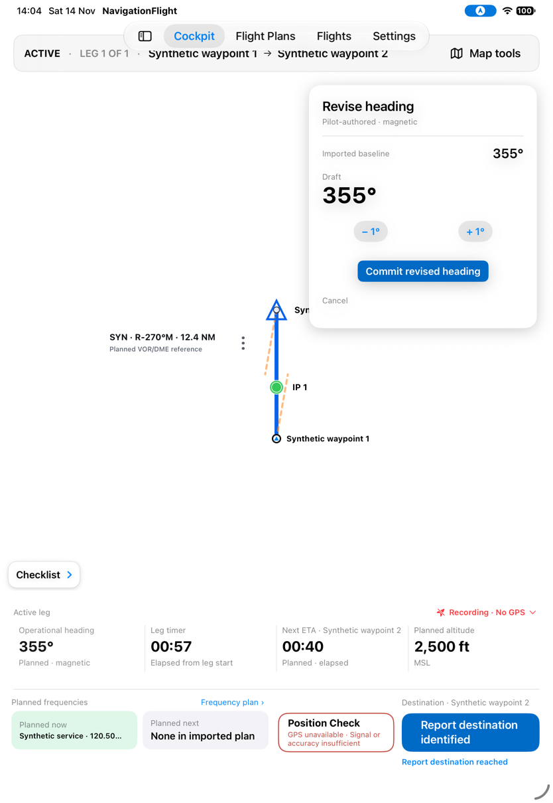

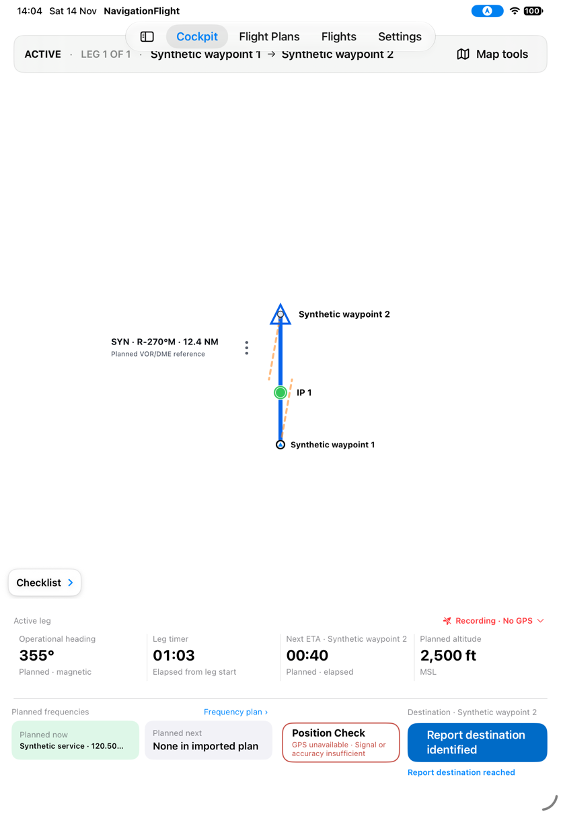

## S43 · Open Settings

**Goal/start:** Look for app preferences such as the start-checklist template.
**Action/result:** Select Settings. The section contains only a placeholder saying
settings will be available here, with no functional controls.

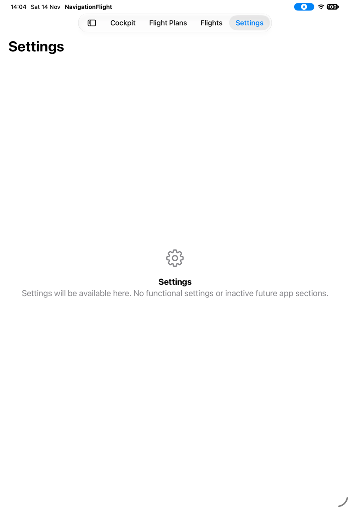

*This is an observed missing entry point for the approved checklist-selection behavior;
future recovery-duration preferences are separately deferred. [G16](../proposed/continuity-and-adaptations.md#g16--choose-a-bundled-start-checklist)
distinguishes them.*

## S44 · Use the largest accessibility text size

**Goal/start:** Read the app with Accessibility XXXL text. Relaunch a disposable plan
using the existing content-size override, first in Plan Inspection.
**Result:** Text scales substantially, but the route names break into narrow fragments
between oversized Previous/Next controls.

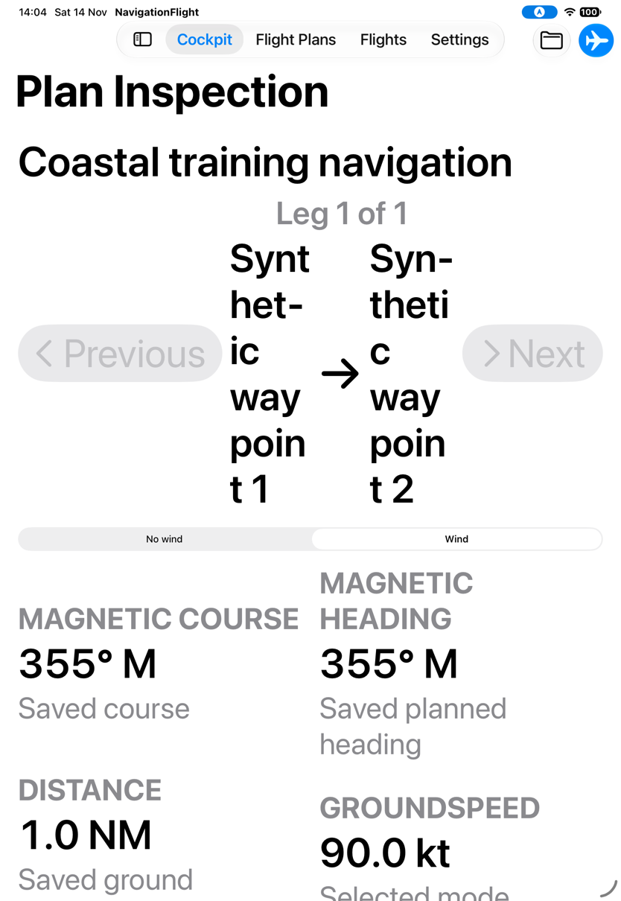

Enter Cockpit. A different vertically scrolling instrument arrangement appears; Start
leg is prominent, but the IP map label is clipped and the large route strip uses much
of the map area. Only part of the instrument stack fits in this capture.

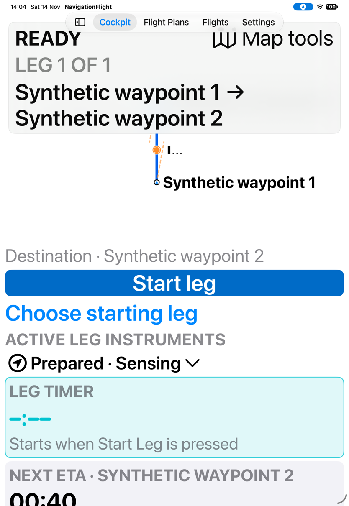

*Scrolling itself is not a defect or proof of inaccessible content. This bounded visual
check establishes fragmented/clipped labels, not a full Dynamic Type, VoiceOver, contrast,
Reduce Motion or switch-control audit. [G17](../proposed/continuity-and-adaptations.md#g17--retain-readable-labels-at-accessibility-sizes)
tracks the observed reading problems.*
