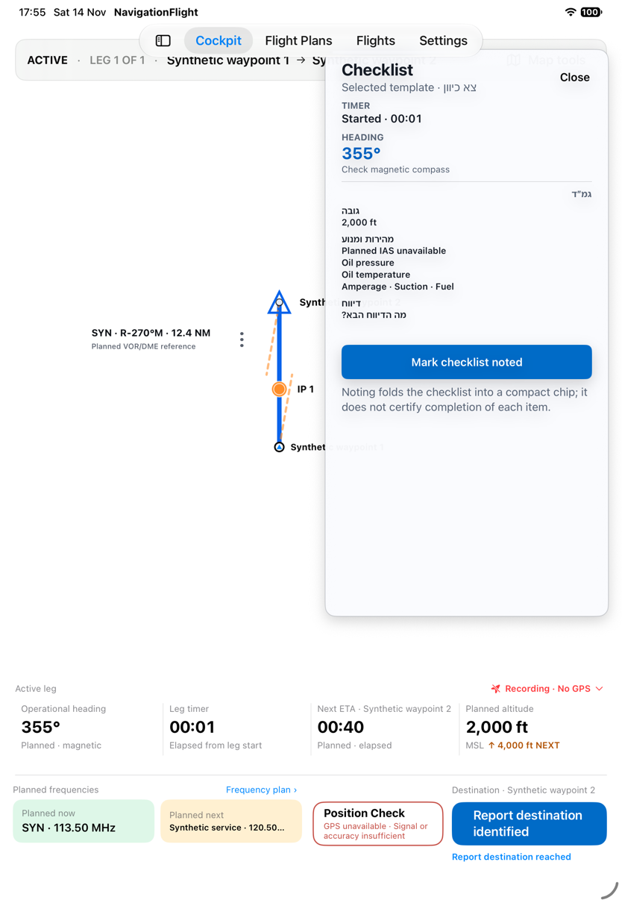
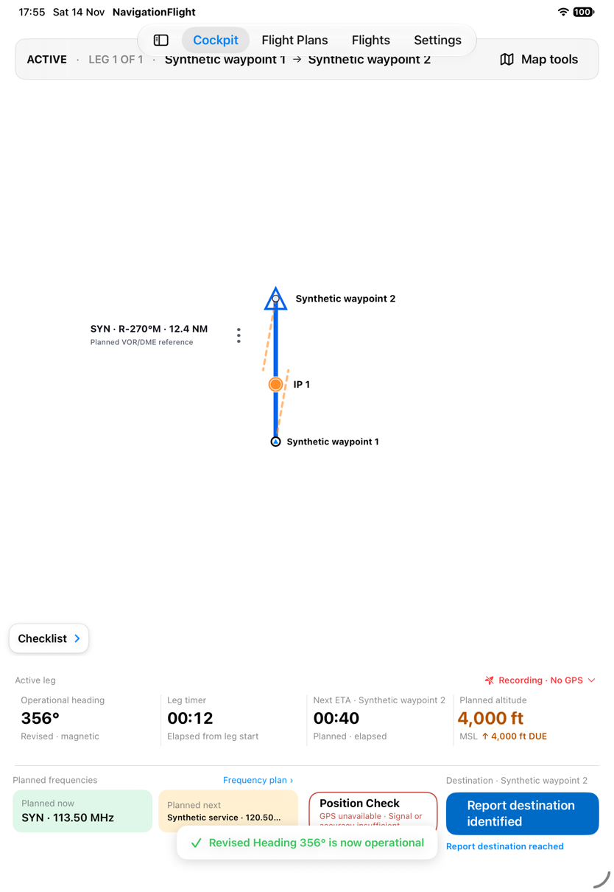
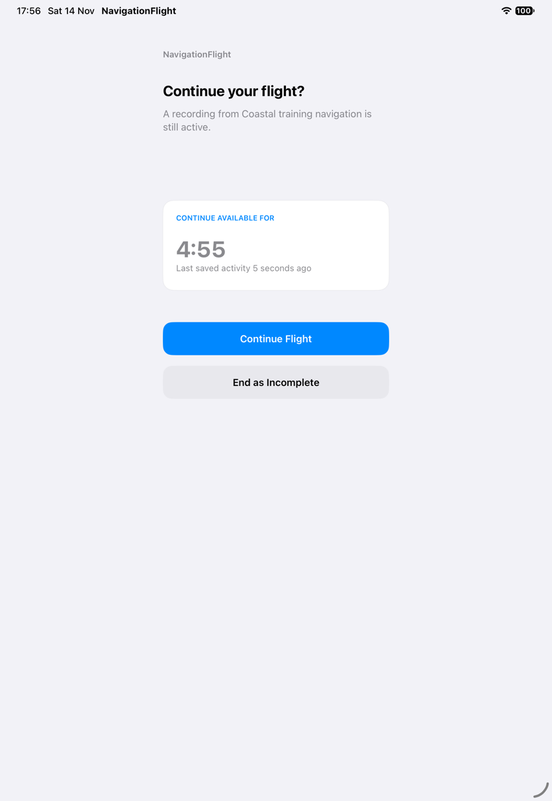
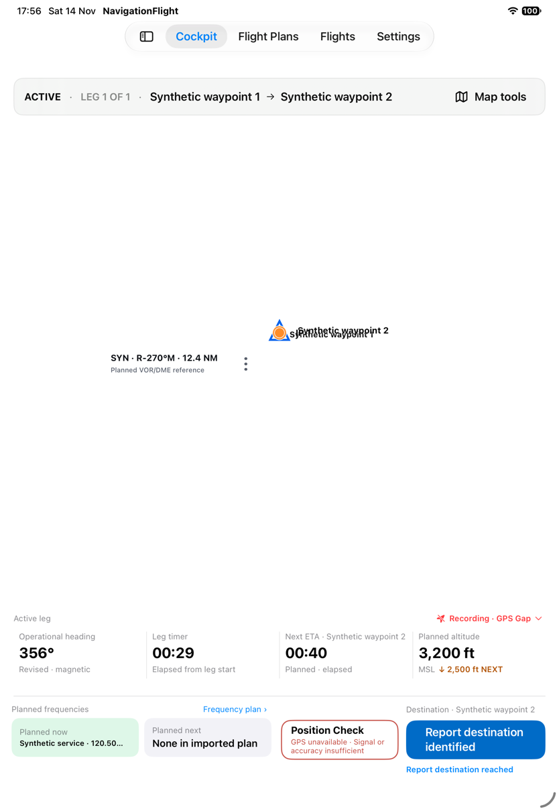
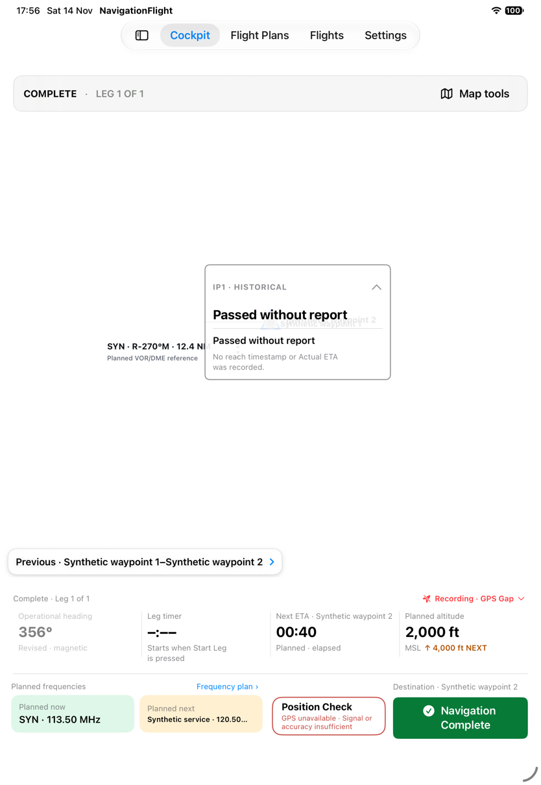
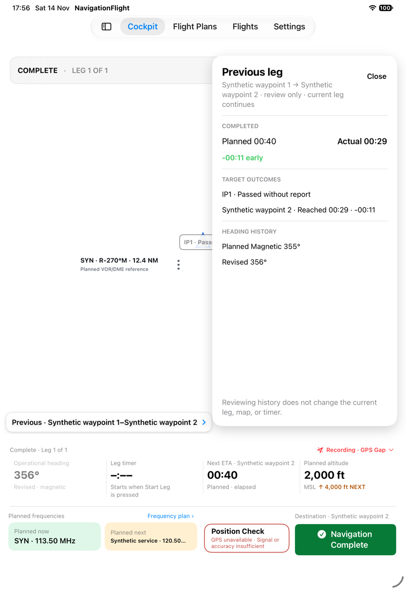
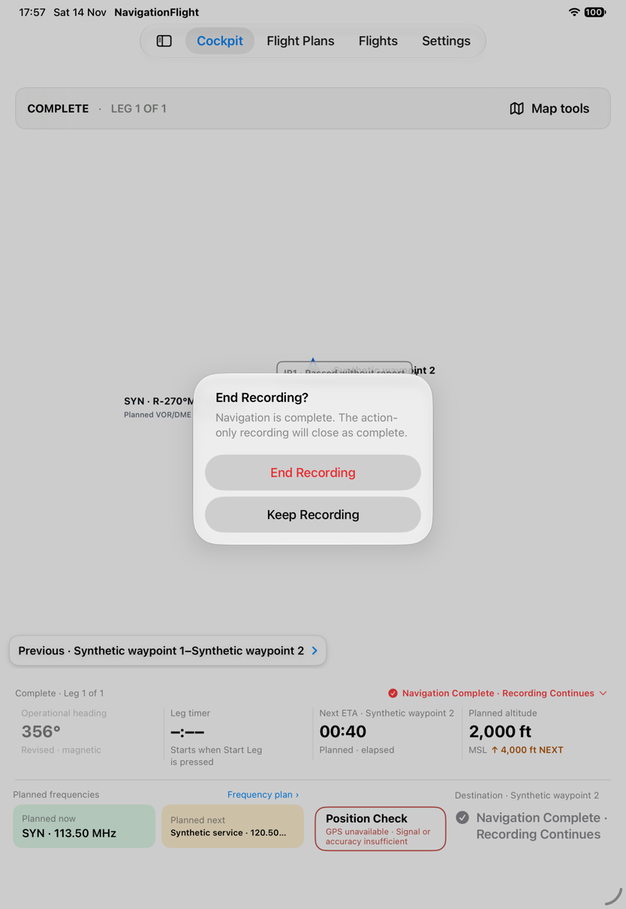
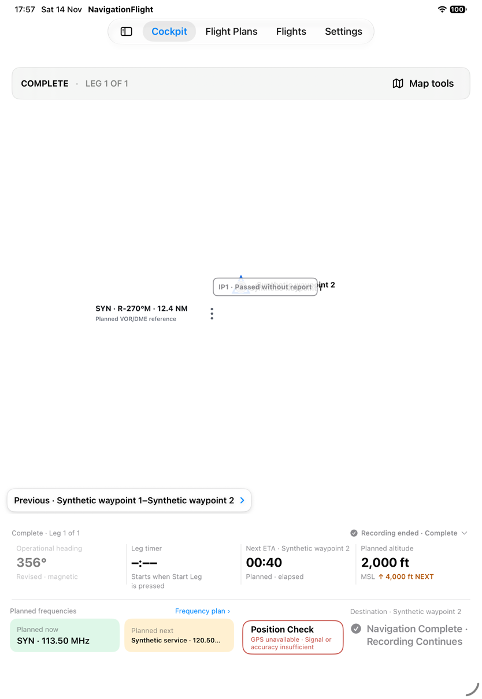
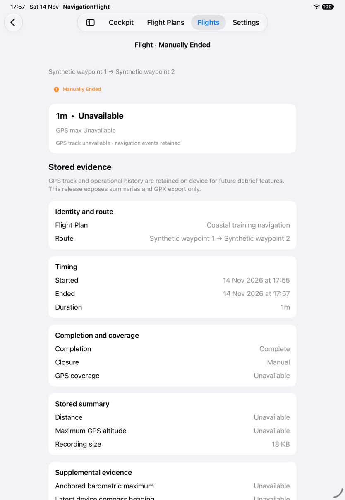
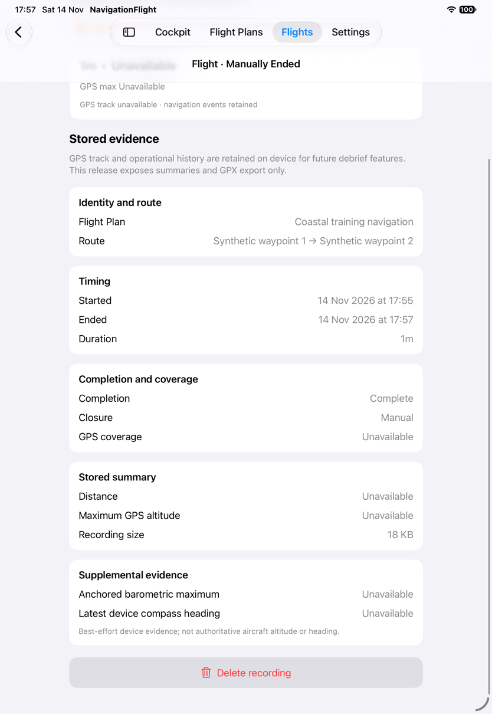

# Resume a real checkpoint and close an action-only Flight

[Back to the map](../README.md) · [Recording proposals](../proposed/flights-and-recovery.md)

**Status:** new observations awaiting account review. [Batch15](../evidence/capture-batch-15.md),
2026-11-14, baseline `1a2d7e7`, iPad Pro11-inch(M5), iOS27, portrait. A stable disposable
library uses the disk store; location input remains unavailable throughout. No recovery
package seed is used for relaunch.

## S79 · Resume a checkpoint created by actual navigation actions

Start, then commit heading356° at elapsed00:12. Relaunch with the same library ID and
without a plan, recovery or Flights seed. The gate offers Continue with4:55 remaining.
Continue restores heading356° Revised and elapsed00:29. Thus actual recorded state
survives this clean process relaunch; the map's route markers collapse on restoration.
This does not establish crash, reboot, lock or long-term durability guarantees.

## S80 · Reach the destination without reporting an earlier IP

Report final destination reached without reporting IP1. The IP becomes Passed without
report. Its historical callout explicitly says no reach timestamp or Actual ETA was
recorded and offers no revision controls. Previous leg shows the IP's passed outcome,
destination reached00:29, planned00:40 and revised heading356°. No ETA revision or
reference Check was committed in this run, so this is not evidence for those histories.

The first hierarchy hitpoint missed the IP and exposed map controls. The successful
callout uses the visible Passed without report label; that distinction is in the manifest.

## S81 · Close completed navigation with no GPS track

After destination reach, press Navigation Complete, open recording status and choose
End Recording. The confirmation promises action-only Complete; confirming produces
Recording ended · Complete. Flights labels the record Manually Ended; detail separately
shows Completion Complete, Closure Manual, GPS coverage Unavailable and18KB stored.
There is no GPX export action for this trackless record. The bottom destination control
still says Recording Continues after closure, reproducing the stale wording in G19.

This confirms the no-GPS completion exception in the observed path. It does not imply
that partial-GPS recordings without landing evidence should also close Complete.
