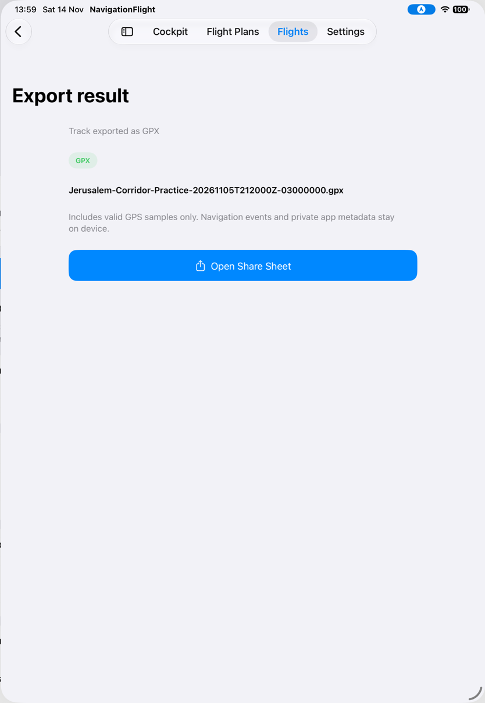

# Inspect what GPX export produces

[Back to the map](../README.md) · [Original export journey](flights-and-recovery.md#s32--prepare-gpx-and-open-the-system-share-sheet)

**Status:** new supporting observation awaiting account review. The UI capture is the
original batch05 export at baseline `1a2d7e7`; its generated file was retrieved read-only
from the simulator app's temporary directory on 2026-11-14. No file was sent externally.

## S70 · Export a closed Flight and inspect the generated track

In S32, exporting the seeded Jerusalem Corridor Practice recording produced the named
GPX and opened system sharing. The retained temporary file has the same full filename
as that export result's hierarchy. It parses as GPX 1.1 and contains one track, one
segment and two points, matching the seeded recording's coordinates, timestamps,
elevation, speed and course. Metadata identifies the Flight Plan, Complete status,
automatic closure and available GPS coverage. No navigation events or waypoints appear.

| Point | Coordinate, latitude / longitude | UTC time | Elevation | Speed | Course |
| --- | --- | --- | --- | --- | --- |
| 1 | 32.1 / 34.8 | 2026-11-05 21:20:00Z | 500 m | 42 m/s | 90° |
| 2 | 32.1 / 34.9 | 2026-11-05 22:26:00Z | 1,280 m | 44 m/s | 90° |

The [exact generated file](../evidence/export-artifact/Jerusalem-Corridor-Practice-20261105T212000Z-03000000.gpx)
is retained with [inspection metadata](../evidence/export-artifact/inspection.json).
It is synthetic evidence, not an operational flight track. Its deterministic filename
supports association with the UI capture but is not immutable creation provenance.
This single-segment input does not establish gap segmentation, invalid-value omission,
or interoperability in another application. Those limitations remain explicit.
