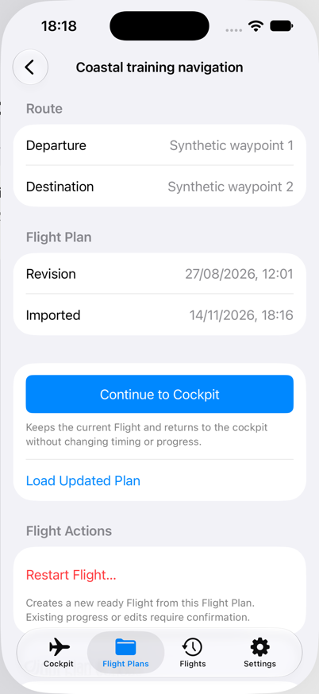
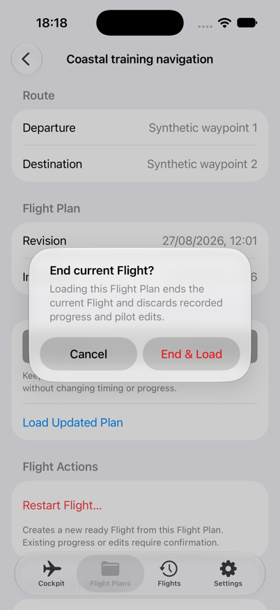
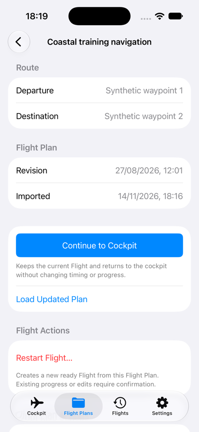
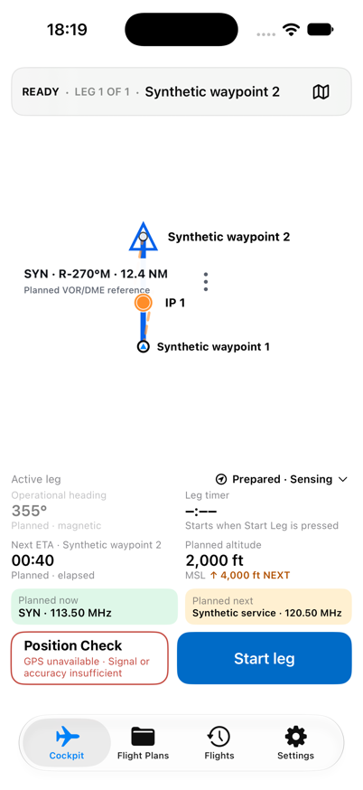
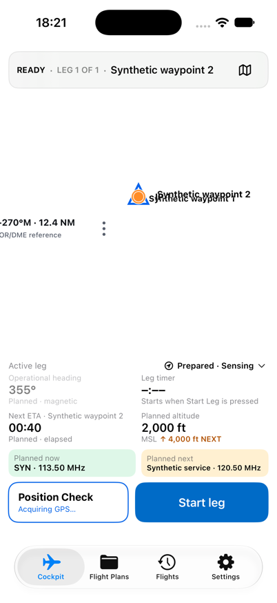

# Replace the loaded revision and bound real permission recovery

[Back to the map](../README.md) · [Observation ledger](../evidence/remaining-exploration.md)

**Status:** new observations awaiting account review; baseline `1a2d7e7`,2026-11-14.
Both batches use iPhone17, iOS27(24A434),402×874 portrait.

## S91 · Apply the saved updated plan

The saved12:01 revision offers Continue to Cockpit and Load Updated Plan. With protected
work present, Load Updated Plan asks whether to end the current Flight and discard
progress and pilot edits. Cancel returns to that same review. Repeating the action and
choosing End & Load opens a ready Flight with Start leg, planned heading355° and ETA00:40.
This establishes the replacement transition; the fixture's protected-work epoch is not
evidence of a real long-running flight or GPS recording.

[Batch21](../evidence/capture-batch-21.md) retains exact inputs and actions.

## S92 · Attempt real system permission recovery

Without the Position Check location-state hook, entering Cockpit produces no new system
permission prompt. The retained frame shows Acquiring GPS; the runtime observer reports
it later becomes GPS unavailable. Attempting to open Settings then fails with “Session
not found.” No permission setting was changed. This is an environment-limited attempt,
not evidence of denial/regrant recovery, nor an app permission defect. Existing granted
permission is only a possible explanation for the absent prompt.

[Batch22](../evidence/capture-batch-22.md) distinguishes the captured state from the later
observer report. Successful permission recovery remains unverified.
