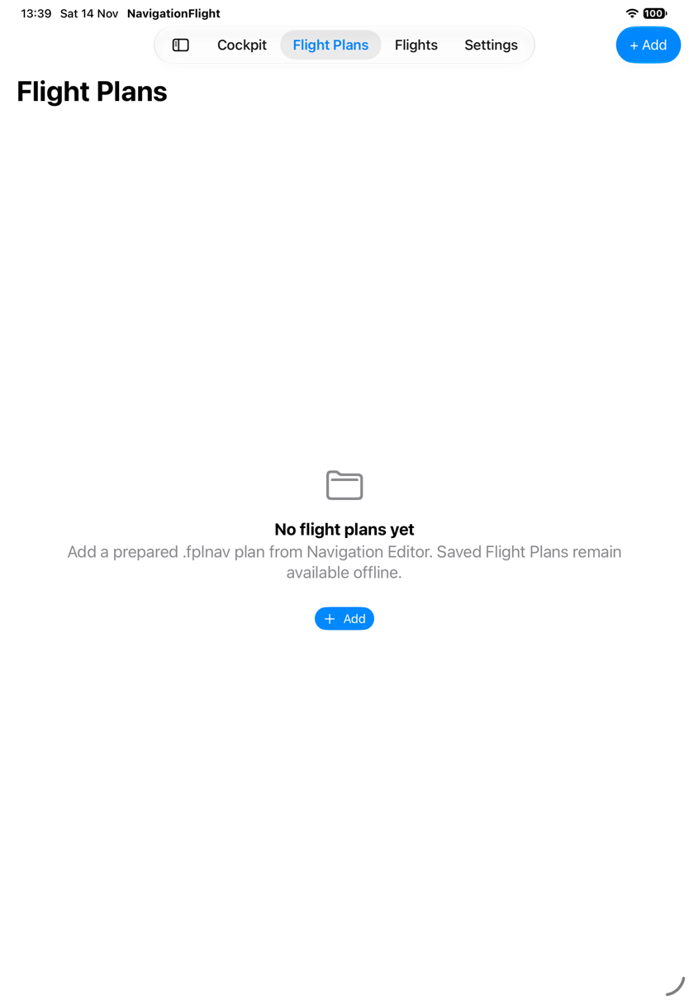
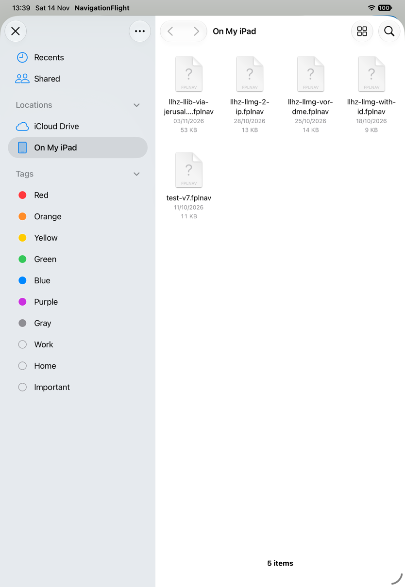
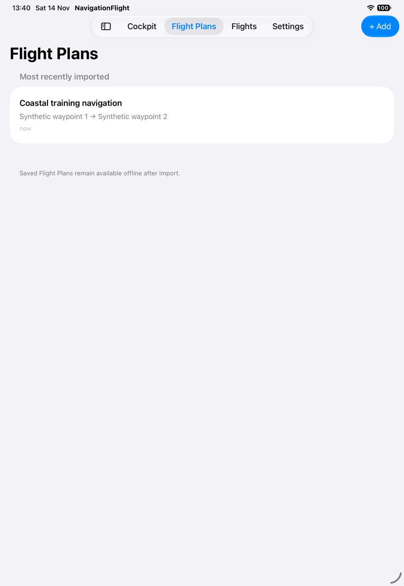
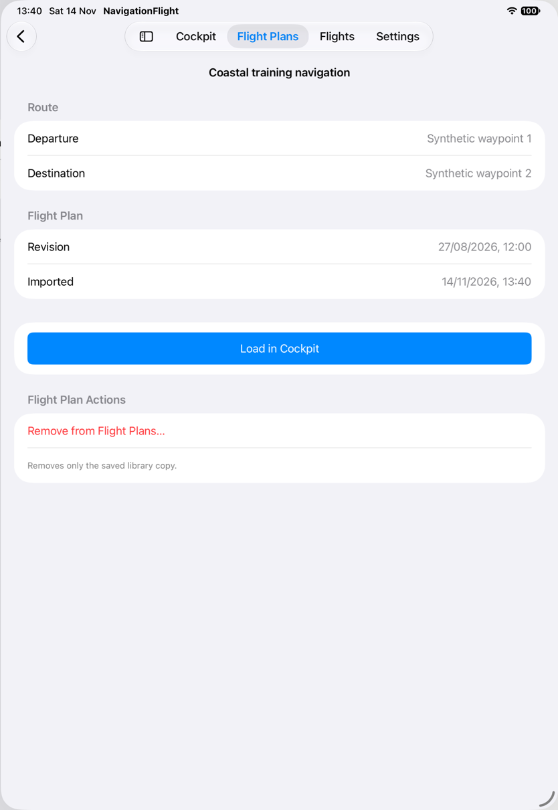
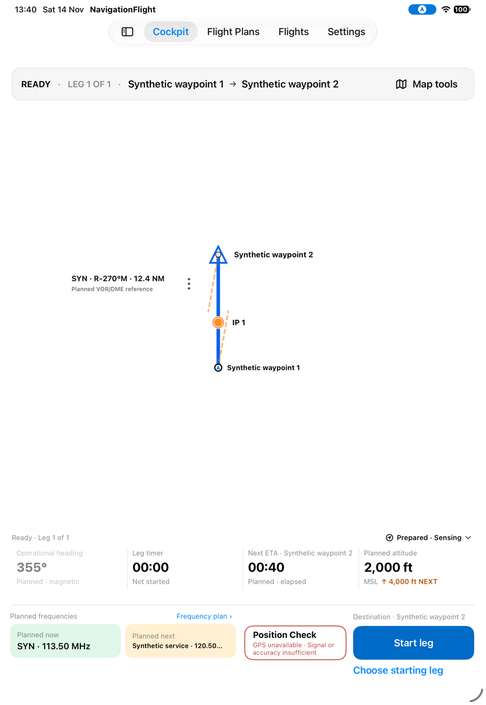
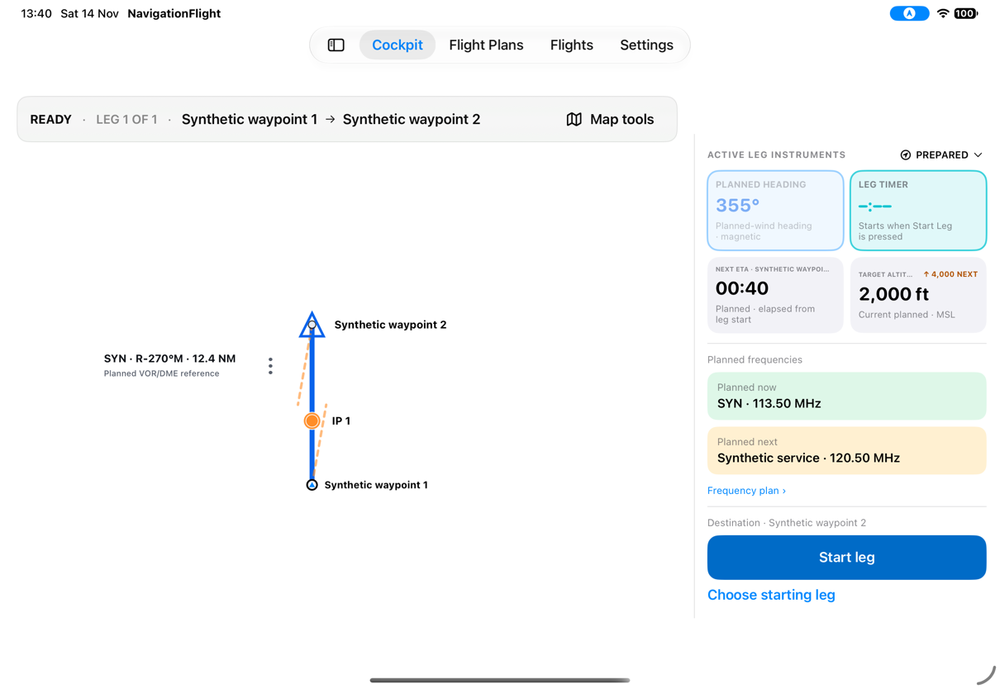
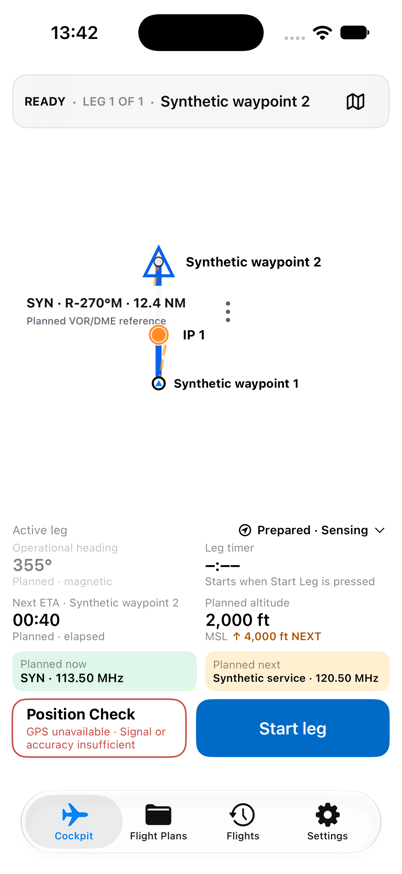
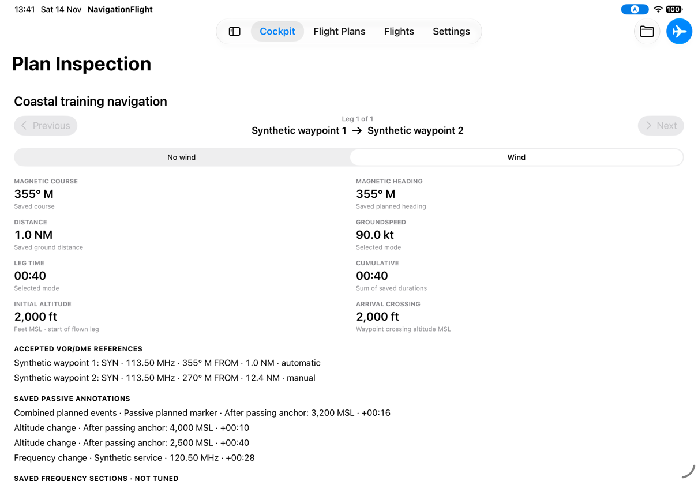
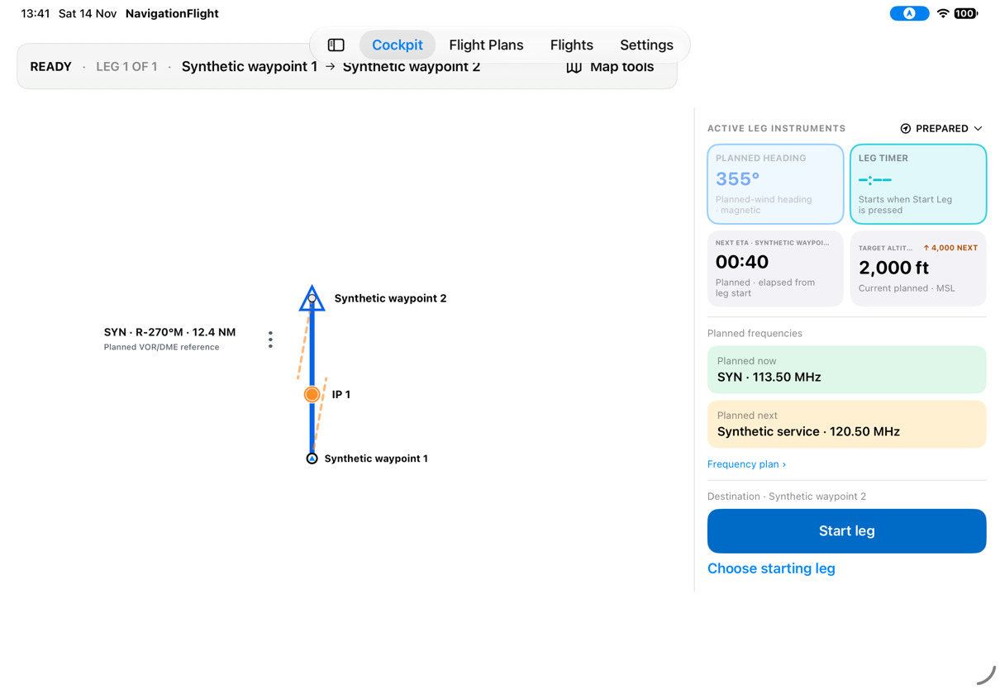
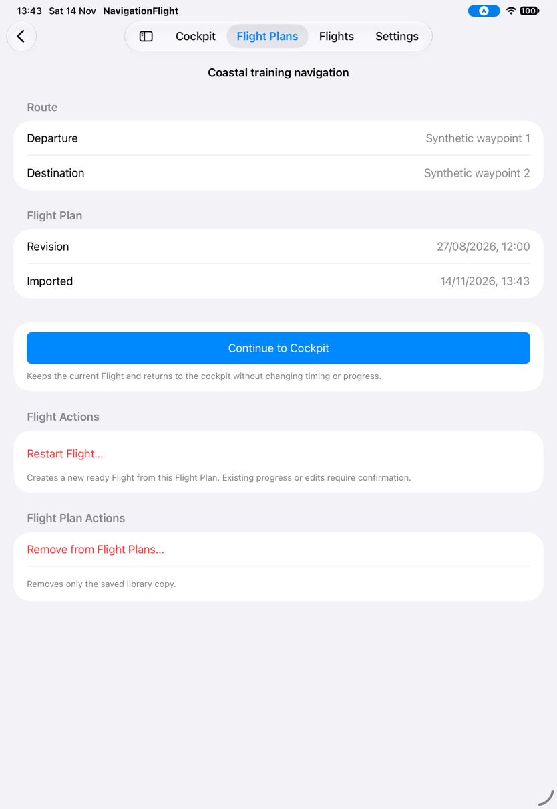

# Choose a Flight Plan and enter Cockpit

[Back to the map](../README.md) · [Differences and decisions](../proposed/flight-plans-to-cockpit.md)

**Review status:** observed on 2026-11-14; account and format approved by John on
2026-11-14. Proposed fixes and design decisions remain pending.
The app uses four sections: Cockpit, Flight Plans, Flights, Settings. Flight Plans
holds preparation; Flights holds actual executions. This chapter follows the first.

The capture batch uses a disposable library and a synthetic plan named **Coastal
training navigation** on baseline `1a2d7e7`. Primary device: iPad Pro 11-inch (M5),
iOS 27.0, portrait 834 × 1210 points and landscape 1210 × 834. Compact reference:
iPhone 17, portrait 402 × 874; the canonical iPhone 16 Pro was not captured.
The synthetic route lies near latitude/longitude zero, outside the bundled chart
area. White map backgrounds here do not establish a chart-loading defect.
[Capture details and limits](../evidence/capture-batch-01.md) apply throughout.

## S01 · Open an empty Flight Plans library

**Goal:** Know where to begin when no plans have been saved.
**Starting point:** Fresh launch with a new disposable empty library and no loaded Flight.
**Action and result:** Launching opens Flight Plans. The screen says “No flight plans
yet,” explains adding a prepared `.fplnav` plan, and offers Add both in the toolbar
and empty-state body. Cockpit, Flights, and Settings remain available in the app tabs.

*The first action is adding a plan. The offline-availability text is an app promise;
offline persistence was not tested in this chapter.*

Next: [open the picker](#s02--open-the-file-picker). A populated starting state is
shown separately in [S03](#s03--choose-a-saved-flight-plan).

## S02 · Open the file picker

**Goal:** Choose a prepared Flight Plan from Files.
**Starting point:** The empty library in S01.
**Action and result:** Tapping Add opens the system file picker. The observed location
is On My iPad, with `.fplnav` files visible. No file was selected or modified.

*Existing provider filenames are incidental simulator content, not fixtures imported
by this review.*

**Unverified branch:** cancellation was attempted, but the captured hierarchy's Cancel
hit point did not dismiss the picker, and no settled post-dismiss screen was captured
after a fallback tap. The review relaunched into a separate seeded library. This is
an evidence gap, not proof that Cancel is broken. Successful import, invalid input,
revision replacement, and save failure remain in the [unreviewed tree](../README.md).

**Later evidence:** [S10](manage-flight-plans.md#s10--leave-files-without-adding-a-plan)
captures settled cancellation. S11–S14 cover injected import and error/revision branches;
the real Files-provider import path remains unverified.

## S03 · Choose a saved Flight Plan

**Goal:** Identify the preparation to use for this Flight.
**Starting point:** A separate disposable library seeded with one plan through the
existing debug hook; this is not evidence of successful Files import.
**Action and result:** Opening Flight Plans shows “Coastal training navigation,” its
departure and destination, and a relative import time. Selecting the row opens its
review, rather than Cockpit.

*The row exposes the expected title → route → import-time hierarchy. One record cannot
verify sort order, duplicate handling, or the loaded-revision badge.*

Next: [review and load](#s04--review-a-plan-before-loading).

## S04 · Review a plan before loading

**Goal:** Check the selected plan and deliberately choose to use it.
**Starting point:** Select the row in S03; no Flight is loaded.
**Action and result:** The review shows departure, destination, revision, and imported
time. **Load in Cockpit** is the prominent action. **Remove from Flight Plans…** is
separated in Flight Plan Actions with text explaining it removes only the saved copy.
Selecting the row alone has not started a timer.

*Removal was not activated. This capture establishes the offered action and explanation,
not its confirmation or persistence behavior.*

Next: [load Cockpit](#s05--load-a-ready-flight), or return to the library.

## S05 · Load a ready Flight

**Goal:** Bring the plan into Cockpit without starting navigation prematurely.
**Starting point:** The unloaded plan review in S04.
**Action and result:** Tapping Load in Cockpit selects Cockpit. The route strip says
READY, Leg 1 of 1; the lower console presents planned heading, ETA, altitude and
frequencies. The timer reads 00:00 / Not started, and **Start leg** remains an explicit
action. **Choose starting leg** is also offered. The route strip is below the app tabs.

*The plan is ready, not actively timed. The next-frequency text visibly ends in an
ellipsis in this portrait capture. Position Check reports unavailable GPS; no Position
Check was requested. “Prepared · Sensing” is visible, but recording internals were not
verified.*

Next: [rotate](#s06--use-the-ready-cockpit-in-landscape-or-on-a-phone), inspect the
loaded plan through [Map Tools](#s07--inspect-planning-details-from-map-tools), or
start navigation (outside this chapter).

## S06 · Use the ready Cockpit in landscape or on a phone

**Goal:** Read the same Flight information in the available screen space.
**Starting point:** The ready iPad Flight from S05.
**Action and result:** Rotating to landscape moves instruments and frequencies into
a right rail. The map occupies the left side, the timer remains not started, and
Start leg stays visible. The native top tabs remain; this is not automatically a
missing-sidebar defect because the system owns adaptive tab/sidebar presentation.

*Both full frequencies are readable. The Next ETA destination title and Target Altitude
title truncate. Numeric instrument values remain visible.*

**Phone branch:** A fresh disposable seeded library was opened on iPhone 17. Selecting
the plan and tapping Load in Cockpit produced this ready screen with bottom tabs,
two rows of instruments, both full frequency values, and Start leg.

*This verifies the observed compact layout, not every supported iPhone size. The timer
uses an unstarted placeholder here; READY remains visible. Phone rotation and the
inspection-return path were not exercised.*

Next: [inspect planning details](#s07--inspect-planning-details-from-map-tools).

## S07 · Inspect planning details from Map Tools

**Goal:** Look up the loaded plan's navigation calculations before starting.
**Starting point:** The ready iPad landscape Cockpit in S06.
**Action and result:** Map Tools → Inspect flight plan opens **Plan Inspection** inside
Cockpit. It shows the route, leg selector, No wind/Wind modes, saved magnetic values,
distance, groundspeed, duration, altitude, VOR/DME references and planned annotations.
A toolbar airplane action returns to Cockpit. This is a different screen from the
library review in S04.

*The visible plan information is observed. Mode changes, additional scrolling, and
selection changes were not exercised. The visible “NOT TUNED” frequency-section heading
is retained as an observation for the later frequency-language review.*

Next: [return to Cockpit](#s08--return-from-plan-inspection). The [matching gap](../proposed/flight-plans-to-cockpit.md#g02--review-the-loaded-plan-consistently)
compares this entry point with the approved canonical review.

## S08 · Return from Plan Inspection

**Goal:** Resume the ready Cockpit after looking up the plan.
**Starting point:** The Plan Inspection screen in S07, same landscape orientation.
**Action and result:** Tapping the toolbar Cockpit action returns to the ready Flight;
the timer remains unstarted and Start leg remains available. However, the route strip
has moved upward beneath the floating app tabs. The tabs overlap the route text and
Map Tools area. Compare this image with the unobscured landscape state in S06.

*Hierarchy bounds place the strip at y=53 after return versus y=117 before inspection.
The screenshots show visible occlusion; they do not prove whether every overlapped
tap target remains operable. This was observed on the ready landscape path only.*

Next: continue using Cockpit or [return through Flight Plans](#s09--return-through-the-flight-plans-review). [G01](../proposed/flight-plans-to-cockpit.md#g01--return-to-cockpit-with-route-information-unobscured)
records the presentation difference without modifying the app.

## S09 · Return through the Flight Plans review

**Goal:** Revisit the saved plan without replacing the loaded Flight.
**Starting point:** A separate disposable run seeded with the same saved and loaded
plan. The reviewer opened the row, continued to Cockpit, then selected the Flight Plans
app tab. This checks retention of that inspection; it does not reuse S08's process.
**Action and result:** Flight Plans returns to the loaded plan review. **Continue to
Cockpit** is primary, with text saying it keeps timing and progress. **Restart Flight…**
is in a separate Flight Actions section with consequence text. Removal remains separate.

*This action hierarchy is visibly consistent with the approved loaded-review direction.
Restart, removal, and preservation of active timing or committed edits were not tested.*

Tapping Continue returns to a READY Cockpit with the same displayed plan and leg,
unstarted timer, and an unobscured route strip below the tabs.

*The two return paths have different observed layout outcomes. Internal Flight identity
was not instrumented; this observation establishes visible ready-state continuity.*

Next: start navigation (later chapter), revisit [S07](#s07--inspect-planning-details-from-map-tools),
or review [the proposed reconciliation](../proposed/flight-plans-to-cockpit.md).
