# Review recorded Flights and resolve recovery

[Back to the map](../README.md) · [Differences and decisions](../proposed/flights-and-recovery.md)

**Status:** observed 2026-11-14; account approved by John on 2026-11-14.
iPad Pro 11-inch (M5), iOS 27.0, portrait 834 × 1210 points, baseline `1a2d7e7`.
Existing disposable recording fixtures supply the records and recovery candidates.
They demonstrate user flows, not a real takeoff, landing or crash recovery.
[Capture and fixture limits](../evidence/capture-batch-05.md).

## S30 · Distinguish recorded executions in Flights

**Goal/start:** Find a past execution rather than its preparation. Open Flights with
the populated recording fixture.
**Result:** In Progress and Recent Flights separate current/recovery-labelled entries
from Complete, Incomplete, Manually Ended and Unavailable examples. Rows show plan name,
route, start time, duration, GPS coverage and approximate size. Text says recordings
stay on-device unless exported.

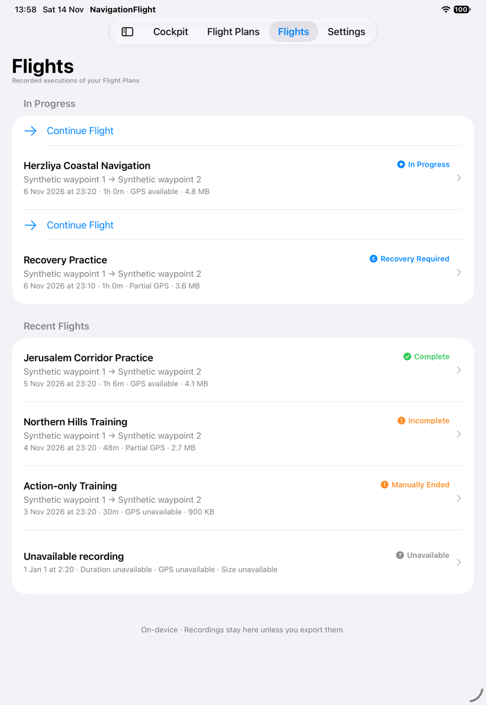

*This fixture deliberately bypasses launch recovery and contains a Recovery Required
row. Its presence is not evidence that ordinary launch permits orphan recovery through
the library; that would conflict with the gate contract. The fixture was not produced
by six real flights.*

## S31 · Inspect a closed Flight and its evidence summary

**Goal/start:** Review a completed execution. Select Jerusalem Corridor Practice.
**Result:** Flight · Complete shows duration, distance, maximum GPS altitude, export,
identity/route, timestamps, completion/closure and coverage. It explains that this release
offers summaries and GPX export rather than a historical track map or event timeline.

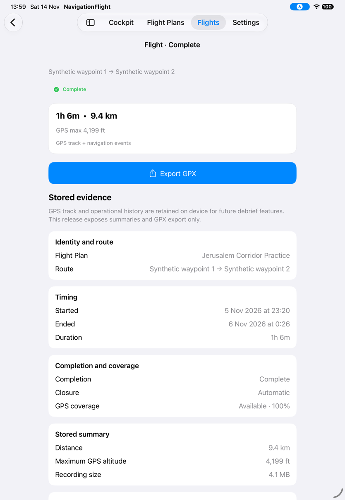

Scroll down. Supplemental barometric and device-relative compass evidence has an
explicit best-effort disclaimer, followed by Delete recording.

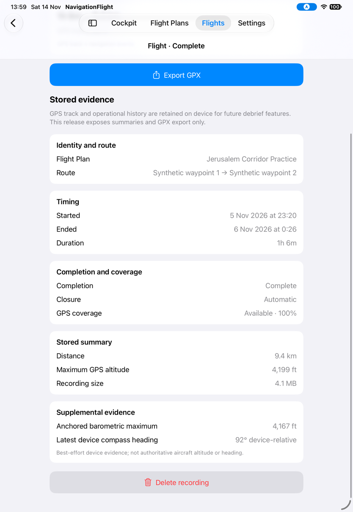

*Numeric summaries come from seeded evidence; this review has not recalculated their
accuracy. Device-relative heading is visibly distinguished from authoritative aircraft heading.*

## S32 · Prepare GPX and open the system share sheet

**Goal/start:** Deliberately export the closed readable track in S31.
**Action/result:** Export GPX opens Export result, names a `.gpx` file, and explains
that valid GPS samples are included while navigation events/private metadata stay on-device.

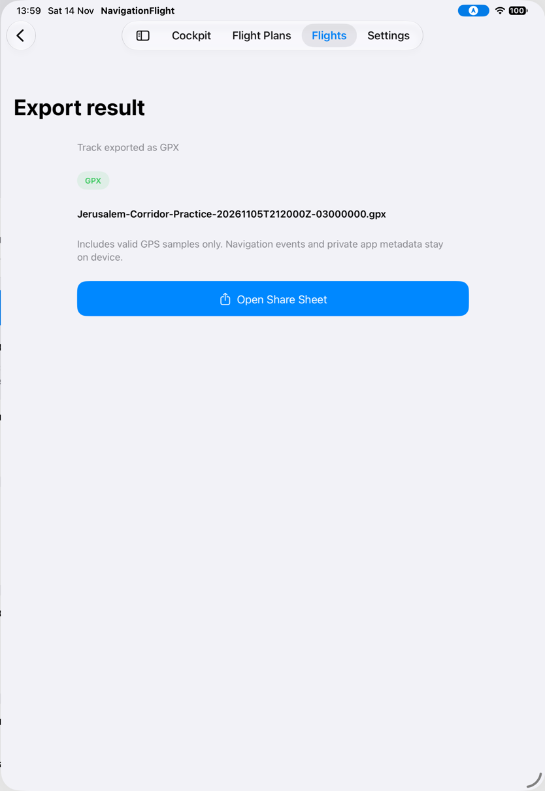

Open Share Sheet presents the native sharing popover, including Copy and Save to Files.
Dismiss it without choosing a destination, then return to the recording detail.

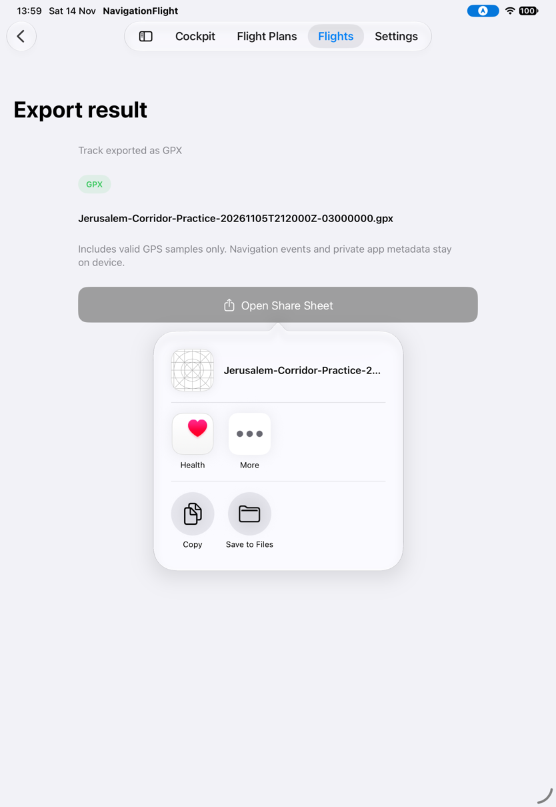

*No file was sent externally or saved to a user destination. The generated bytes,
segment boundaries and interoperability were not inspected; the UI's export claims
are not independently verified by this screenshot.*

**Later evidence:** [S70](export-artifact.md#s70--export-a-closed-flight-and-inspect-the-generated-track)
inspects the matching generated file; the original capture limitation above is preserved.

## S33 · Confirm deletion, then encounter a stale row

**Goal/start:** Permanently remove the disposable closed recording in S31.
**Action/result:** Delete recording asks “Delete Jerusalem Corridor Practice?” and
explains permanent removal of GPS track and navigation-event history from the device.

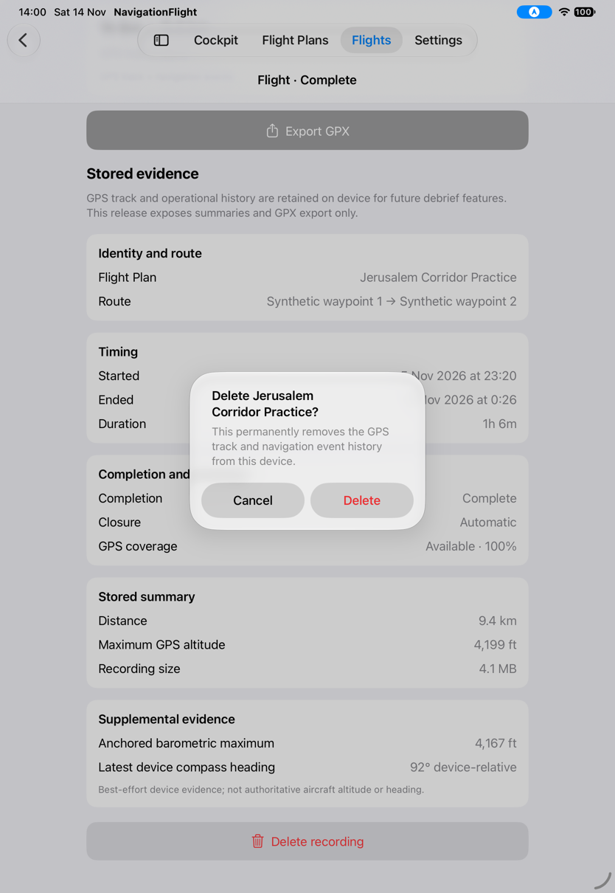

Confirm Delete. The app returns to Flights, but Jerusalem Corridor Practice remains
visible after settling. No deletion error is shown.

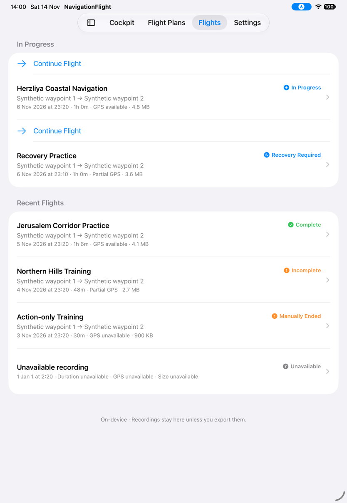

Open that same row without relaunching. The detail now says “Flight unavailable —
This recording cannot be read.”

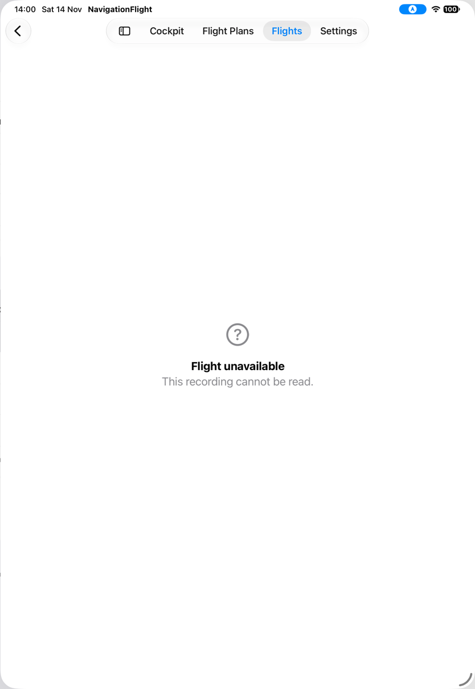

*The fixture store is expected to remove the record; relaunch reseeding is not involved.
This is an observed list/detail discrepancy, tracked in [G10](../proposed/flights-and-recovery.md#g10--remove-a-deleted-flight-from-the-visible-library).
The root cause and durable-store behavior remain unverified.*

## S34 · Review a Flight without GPS track data

**Goal/start:** Understand an action-only manually ended recording. Open Action-only Training.
**Result:** Duration is available, but distance and GPS maximum explicitly say Unavailable.
The detail says navigation events are retained and omits the GPX export action. Closure
is Manual and completion is Incomplete.

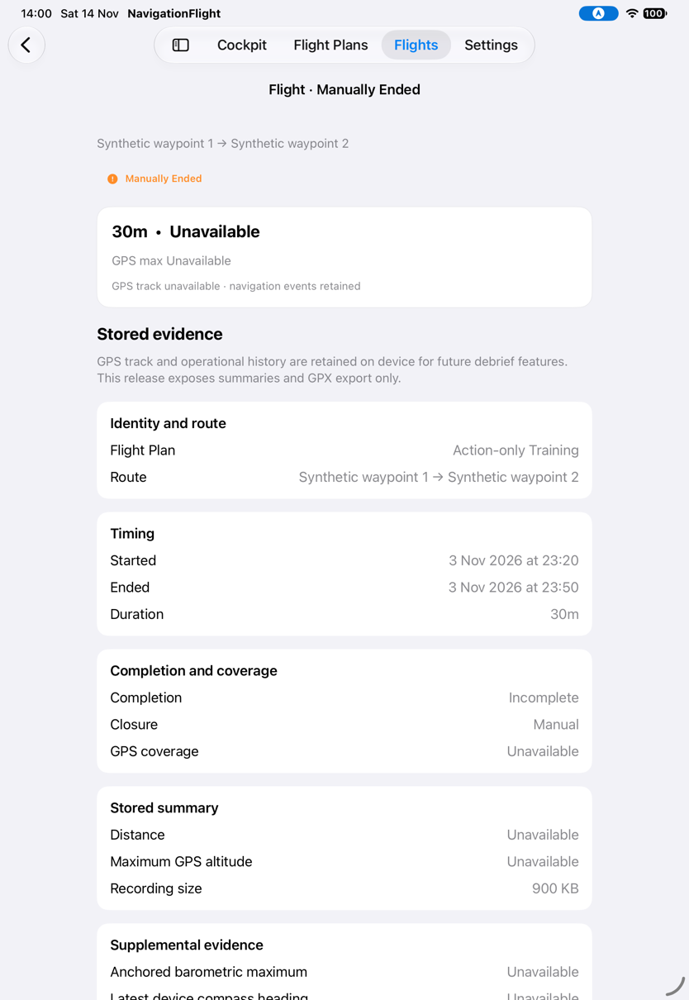

*This is a seeded closed-record presentation, not proof of an observed no-GPS recording lifecycle.*

## S35 · Continue a recently interrupted Flight

**Goal/start:** Decide whether a fresh recoverable Flight is the one to continue.
Launch a separate fixture containing one fresh orphan.
**Result:** A gate replaces normal app navigation. It names Coastal training navigation,
shows last activity one minute ago and **4:00** remaining, with Continue Flight and End
as Incomplete. The route is not shown in this observed gate.

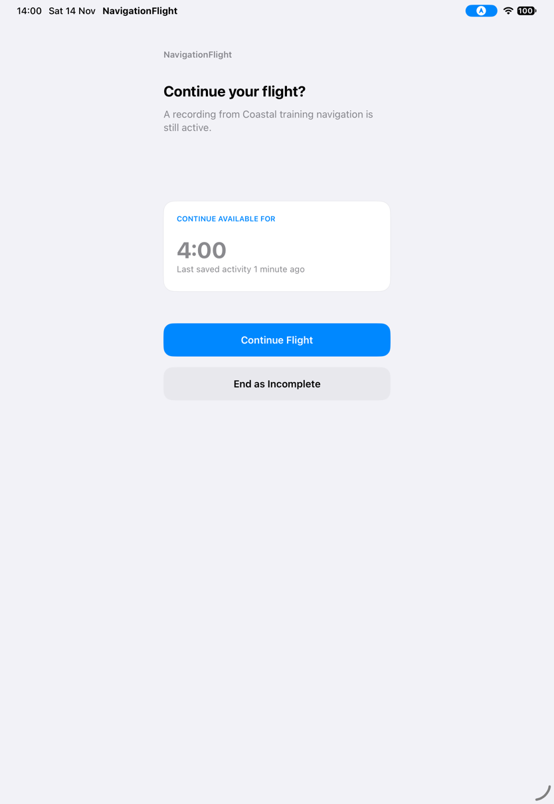

Choose Continue Flight. An immediate transition capture briefly shows Plan Inspection;
the later settled capture shows ACTIVE Cockpit, timer **01:02**, and “Recording · GPS Gap.”

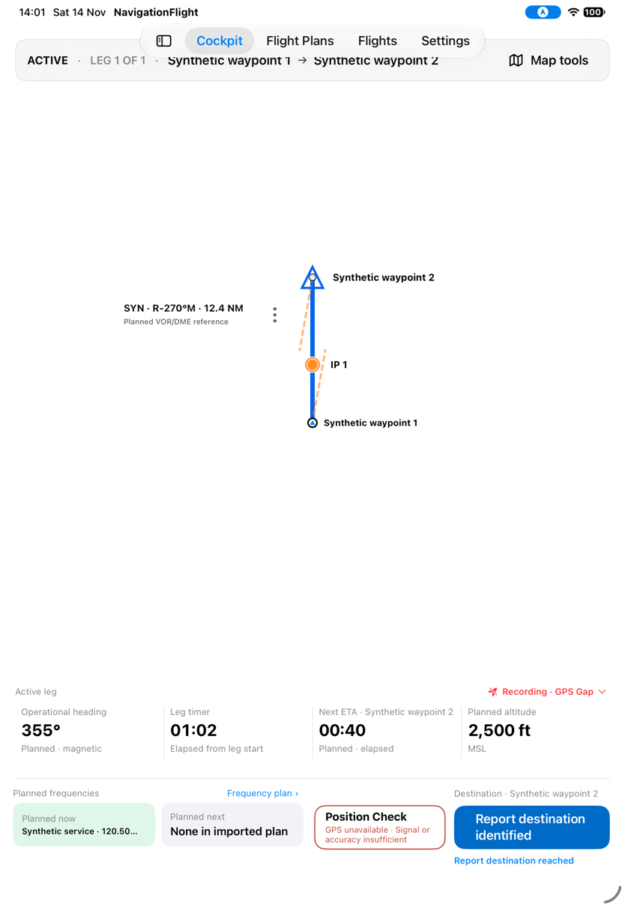

*The settled frame, not the transient one, establishes the destination. The original
timing basis is represented by the fresh fixture; actual process-death checkpoint
durability, gap segmentation and restoration of all committed edits remain unverified.*

## S36 · End recovery as incomplete

**Goal/start:** Keep the recording but decline continuation. In a new single-recovery
fixture, choose End as Incomplete.
**Result:** A confirmation says the recording remains stored and can no longer be continued.

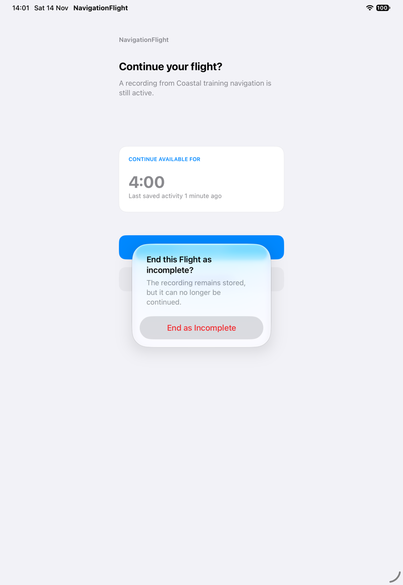

Confirm. The settled destination is **Plan Inspection** in Cockpit, not the saved Flight
detail. No record detail is shown by this action.

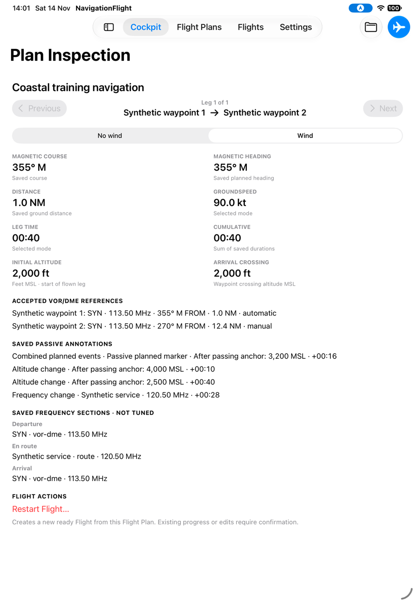

*The destination differs from the approved recording contract ([G11](../proposed/flights-and-recovery.md#g11--finish-recovery-in-the-promised-place)).
This capture alone does not inspect the newly saved recording's closure metadata.*

## S37 · Resolve multiple recovery candidates

**Goal/start:** Avoid silently continuing the wrong Flight. Launch the two-candidate fixture.
**Result:** “Choose a flight to continue” lists two names and offers each candidate
plus End All as Incomplete. Routes, last activity and an earliest-expiry countdown are
not visible in this captured gate.

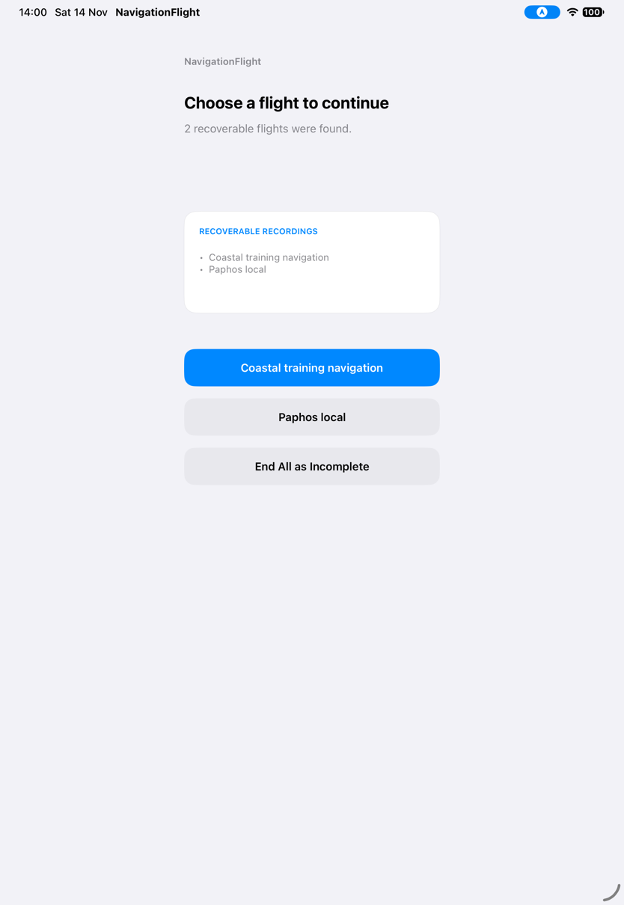

Tap End All as Incomplete once. The gate immediately exits to Plan Inspection; no
confirmation was observed between the action and the resulting screen.

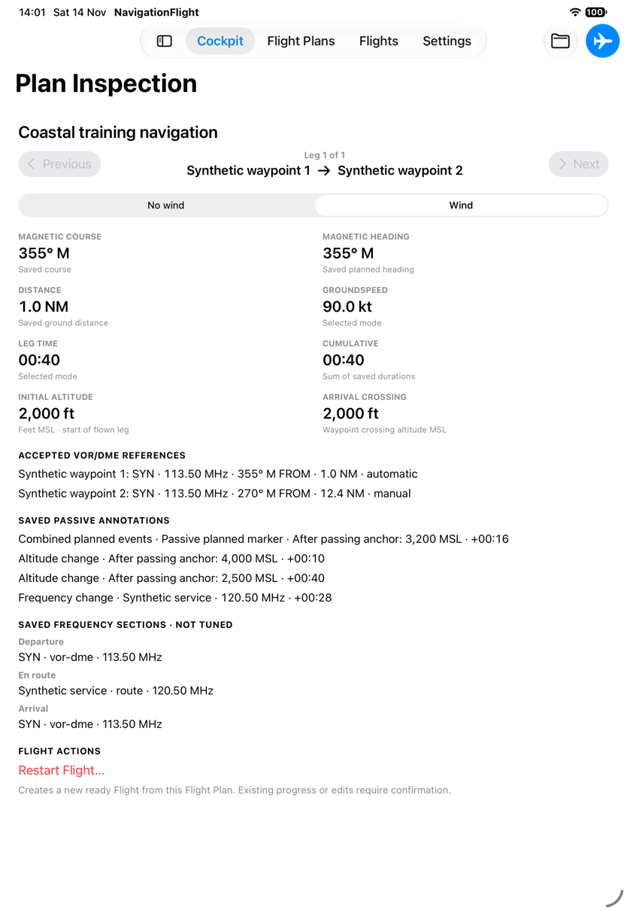

*This contrasts with S36's single-record confirmation and the explicit multiple-record
confirmation requirement ([G12](../proposed/flights-and-recovery.md#g12--confirm-ending-multiple-recoverable-flights)).
Selecting one candidate and disposition of the other were not exercised here.*

## S38 · Handle unsupported or corrupt recovery safely

**Goal/start:** Understand why a saved Flight cannot be continued.
In the unsupported-version fixture, the gate explains that a newer app created the
Flight, says the package is preserved, and offers Keep in Flights or Start New Flight.

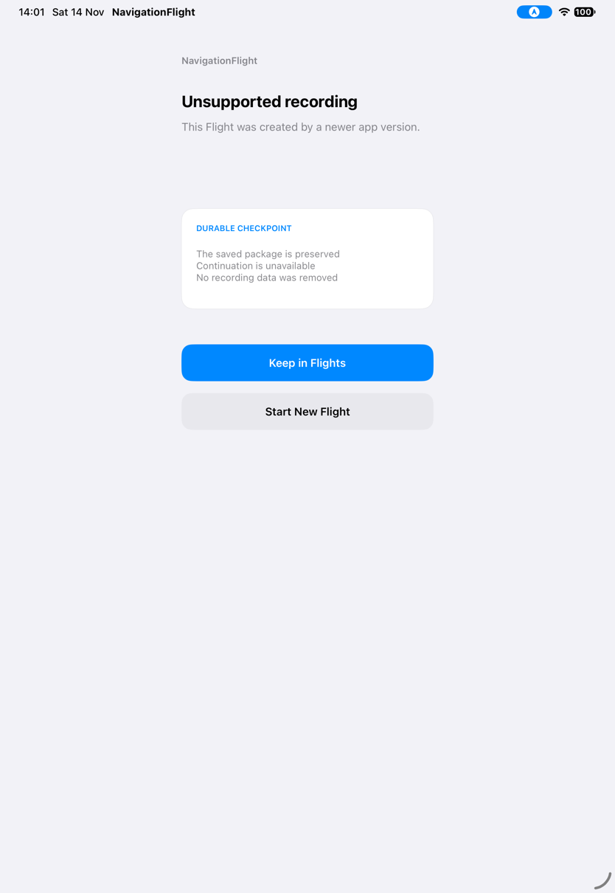

Choose Keep in Flights. The resulting section is **Flight Plans**, empty in this
fixture, rather than Flights.

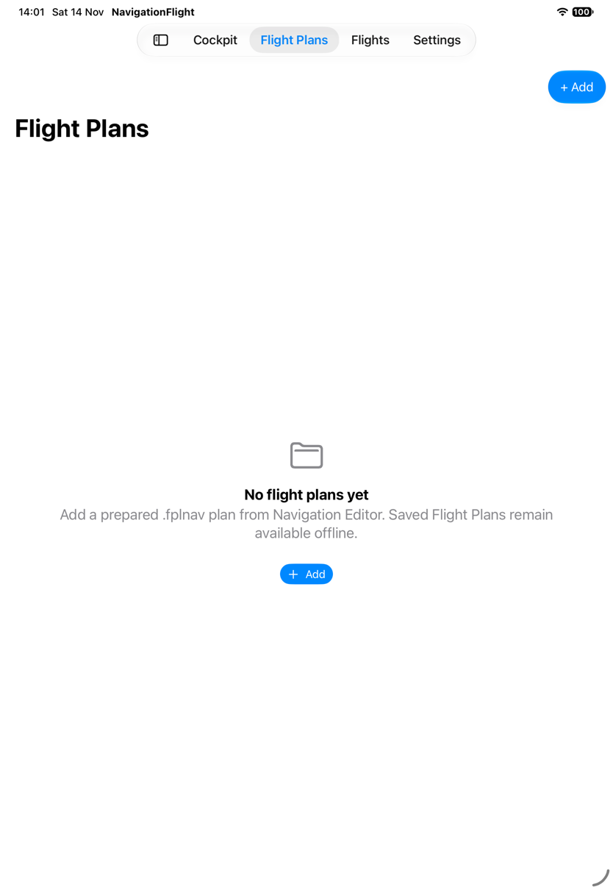

A separate corrupt-state fixture instead shows Recovery unavailable, says no package
data was removed, and offers Continue to App.

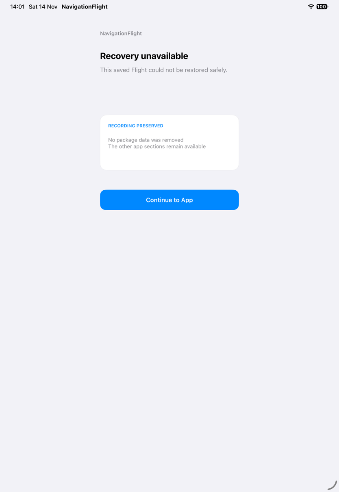

*The preservation text is observed; package-byte preservation and export eligibility
were not independently checked. Unsupported handoff wording/destination is included
in [G11](../proposed/flights-and-recovery.md#g11--finish-recovery-in-the-promised-place).*
