# Fly a leg and revise navigation

[Back to the map](../README.md) · [Differences and decisions](../proposed/fly-and-revise.md)

**Status:** observed 2026-11-14; account approved by John on 2026-11-14.
Primary device: iPad Pro 11-inch (M5), iOS 27.0, portrait 834 × 1210 points, baseline
`1a2d7e7`. Synthetic one- and two-leg plans use off-chart coordinates; white backgrounds
are not chart-loading evidence. [Capture details](../evidence/capture-batch-03.md).

## S17 · Start navigation and note the checklist

**Goal/start:** Begin timing a ready leg deliberately. Open Cockpit from the injected
plan's inspection and tap Start leg.
**Result:** ACTIVE replaces READY, the timer begins, and the checklist opens with a
selected-template title, live timer, magnetic heading and instructional items. The
recording status reads “Recording · No GPS.”

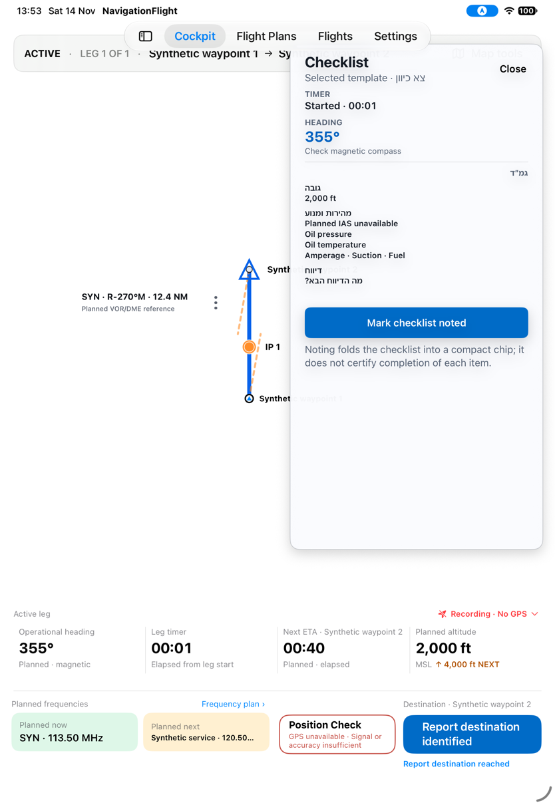

Choose **Mark checklist noted**. It closes to a “Checklist · Noted” chip, visible in
S18. The on-screen explanation says this does not certify every item as completed.
The route strip remains beneath the app tabs on this inspection-entry path ([G01](../proposed/flight-plans-to-cockpit.md#g01--return-to-cockpit-with-route-information-unobscured)).

## S18 · Commit a revised magnetic heading

**Goal/start:** Use a pilot-chosen heading while preserving the imported baseline.
With the leg active, tap Operational heading.
**Result:** Revise heading opens with imported baseline **355°**, a separate draft,
one-degree adjustment buttons, explicit Commit and Cancel.

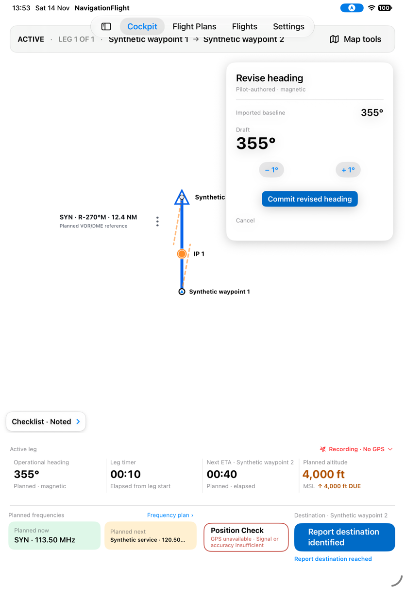

Increase once and commit. The console becomes **356° · Revised · magnetic** and
confirms that this heading is now operational; the timer continues advancing.

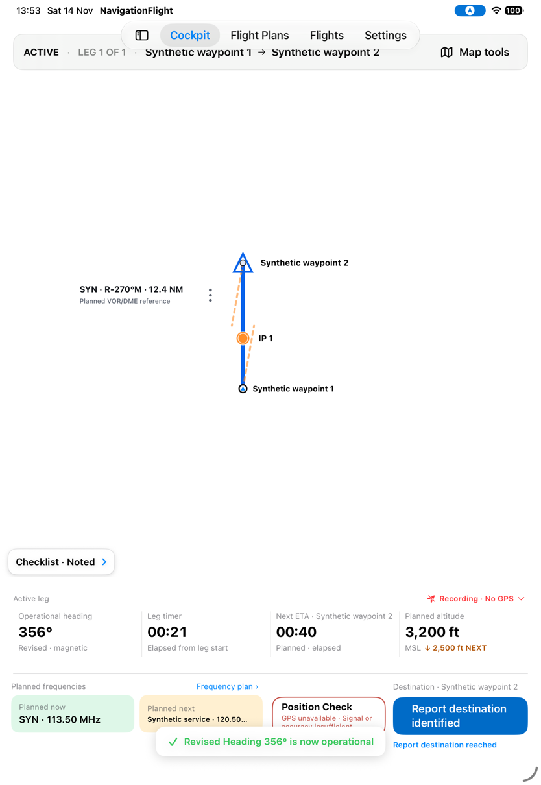

*The two captures also show the timed altitude cue changing from 4,000 ft due to
3,200 ft with 2,500 ft next. They do not measure pulse duration or prove every cue boundary.*

## S19 · Commit a revised ETA and understand unavailable Check

**Goal/start:** Revise the next target's elapsed-time estimate while flying.
Tap Next ETA in the same active Flight.
**Result:** The editor shows a **00:40** draft, minimum-now **00:25**, five-second
steps and explicit Commit revised ETA. The timer continues independently.

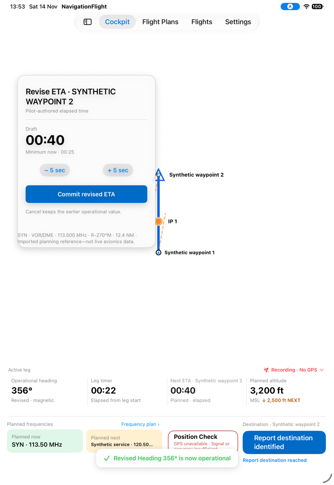

Increase once and commit. Both target callout and console show **00:45 Revised**,
while the callout retains planned **00:40**. Check is disabled with the reason that a
preceding identification point must have been reached.

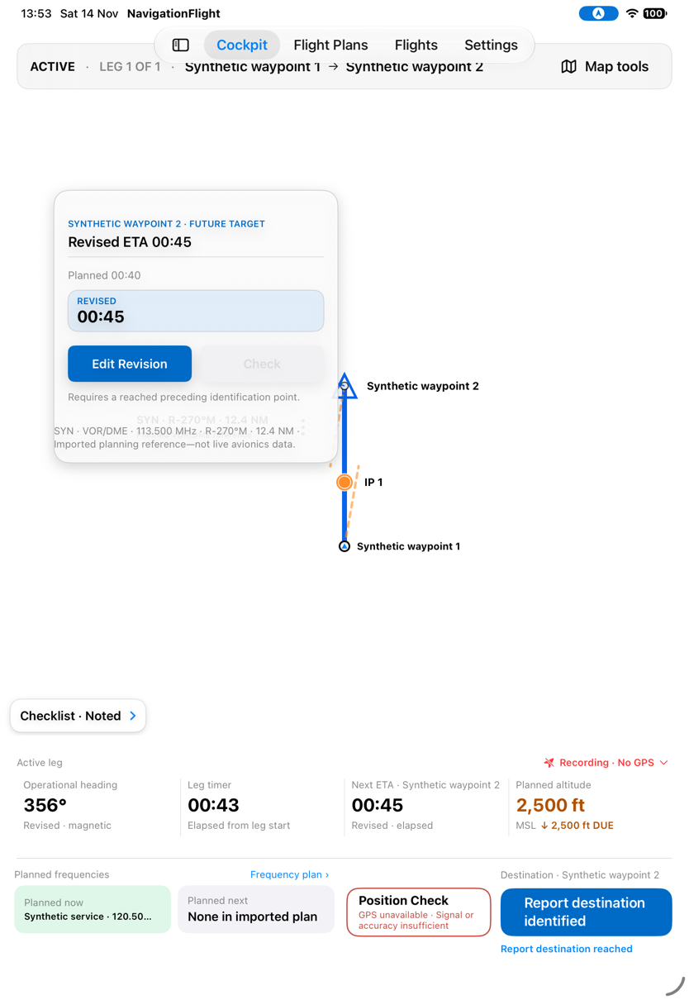

*This verifies the visible draft/commit distinction and one unavailable-Check case.
Moving-floor rejection, cancel, valid reference calculation and heading normalization
are not established by these captures.*

## S20 · Consult the full Frequency Plan

**Goal/start:** Read the imported sequence while keeping immediate operational references
in view. Open Frequency plan at elapsed **00:44**.
**Result:** The panel says imported planning data, not live radio state, and explains
the app does not know what is tuned. However, it labels **SYN 113.500** Planned now and
**Synthetic service 120.500** Planned next, while the console simultaneously labels
**Synthetic service 120.50…** Planned now and **None in imported plan** Planned next.

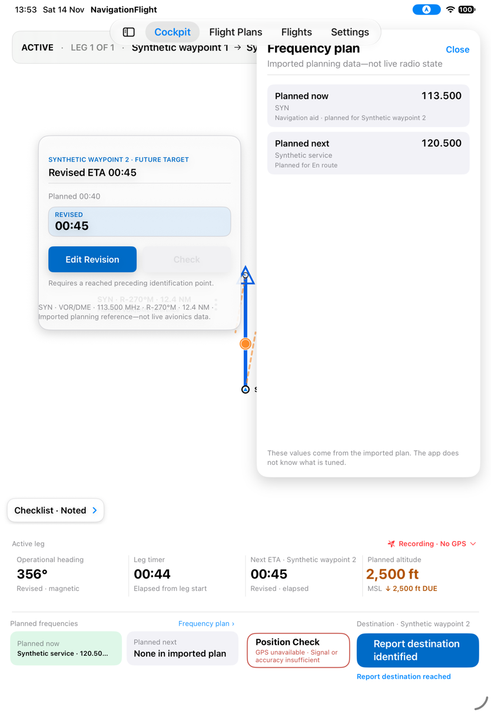

*The disagreement is in the labels and sequence, not decimal precision. Both regions
are visible in the same capture; no radio tuning is claimed. [G07](../proposed/fly-and-revise.md#g07--read-one-consistent-planned-frequency-sequence)
tracks this separately from conflicting design hierarchy.*

## S21 · Identify the destination without reporting arrival

**Goal/start:** Record visual identification while still flying toward the destination.
Close the disclosure and choose Report destination identified.
**Result:** The strip says ACTIVE · DESTINATION IDENTIFIED. The timer continues;
**Report destination reached** becomes the primary action. Revised heading and ETA remain.

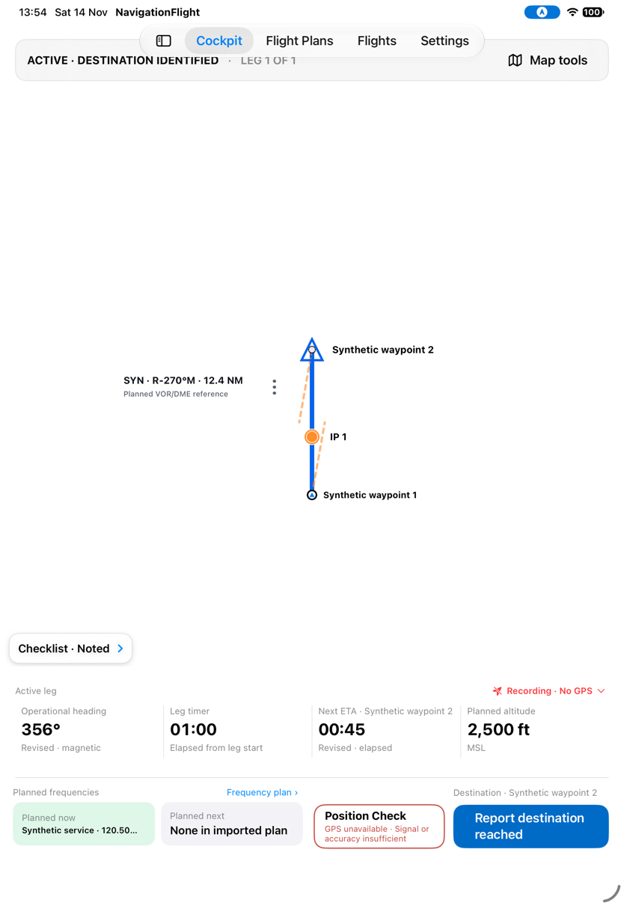

## S22 · Complete the final leg and undo the reach report

**Goal/start:** Report arrival at the final destination, then correct an accidental report.
From S21, choose Report destination reached.
**Result:** The Flight becomes COMPLETE, a Navigation complete banner appears with
a 20-second Undo, and Previous Leg replaces the checklist chip. The unreported IP is
marked “PassedWithout report.” Recording still says No GPS; navigation completion is
not physical recording closure.

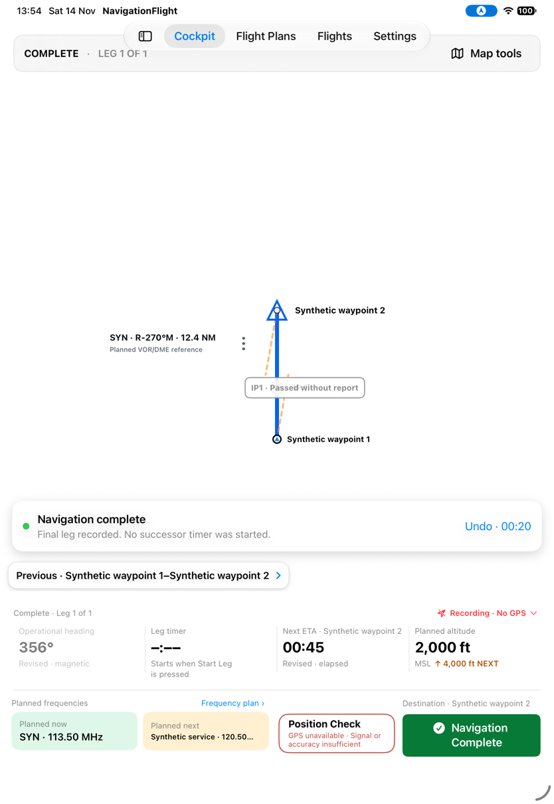

The completed console shows a timer placeholder with “Starts when Start Leg is pressed,”
and the initial 2,000 ft/next 4,000 ft cue and original frequency order reappear.
These visible completed-state differences are recorded in [G08](../proposed/fly-and-revise.md#g08--keep-completed-navigation-distinct-from-not-started).

Choose Undo before the window expires. ACTIVE · DESTINATION IDENTIFIED returns,
with heading **356°**, ETA **00:45**, Checklist · Noted, and a timer showing **01:21**.

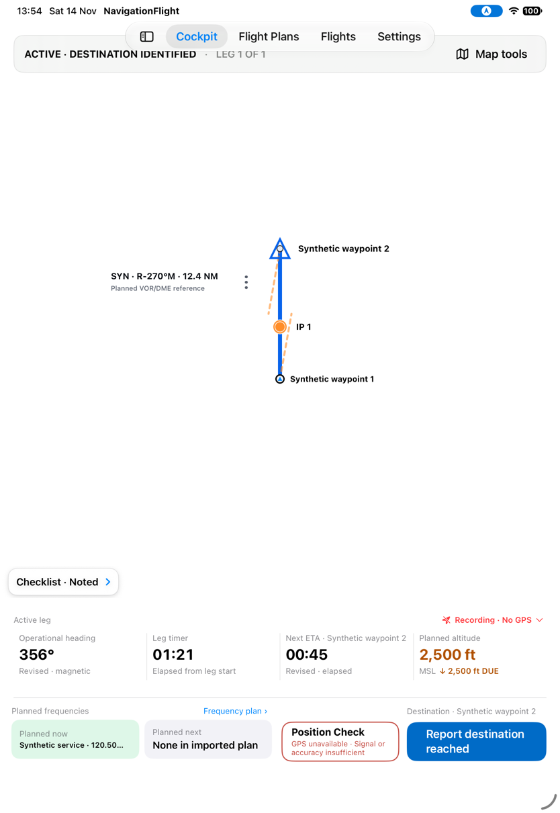

*This observes visible restoration and elapsed-time continuity, not an instrumented
proof of every atomic state field, exact timestamp or all invalidation/expiry cases.*

## S23 · Toggle drift aids and try Chart layers

**Goal/start:** Adjust map aids without reporting a navigation event.
In Map tools, switch Drift lines Off, then select Chart layers.
**Result:** The orange drift rays disappear; the route and active timer remain.
Chart layers opens “Charts Unavailable — Chart presentation is a later delivery.
The imported plan remains unchanged.”

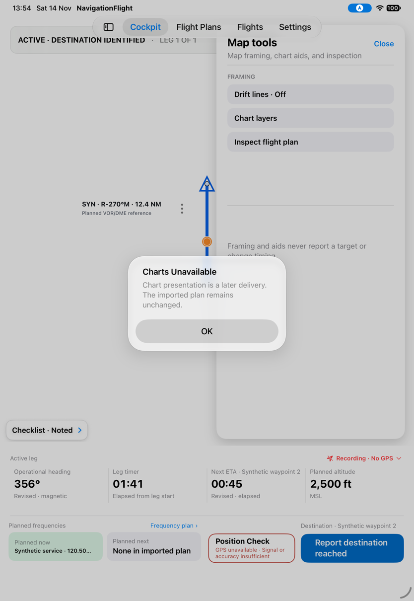

*The unavailable layer-control action is observed. This does not establish that the
bundled chart base is absent: the fixture lies outside its area. [G09](../proposed/fly-and-revise.md#g09--make-chart-tools-an-explicit-product-choice)
keeps those claims distinct.*

## S24 · Preview the next leg and progress automatically

**Goal/start:** Look ahead without starting successor timing. A separate synthetic
two-leg Flight is active on leg 1; close its checklist and open Next Leg.
**Result:** The preview shows successor route, heading, altitude, duration and communication,
plus Show next leg on map and an explicit preview-only explanation. Leg 1 remains active.

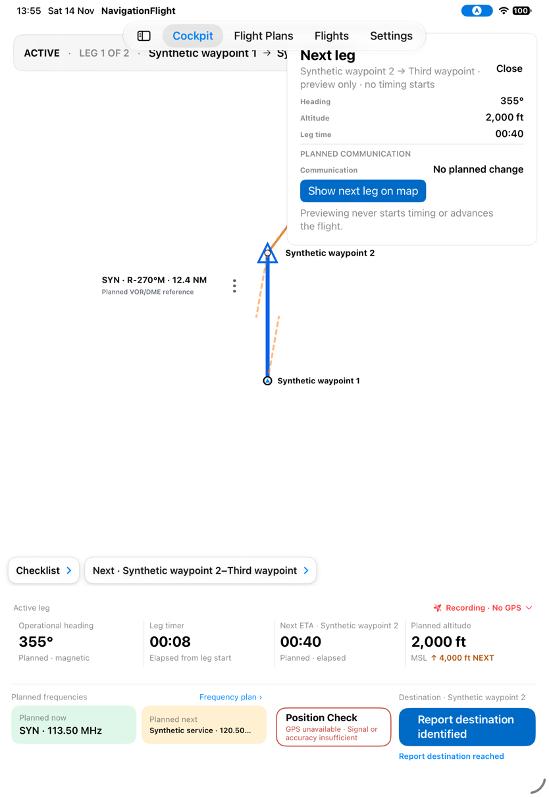

Show next leg on map, close the preview, then report the current destination reached.
Leg 2 becomes active automatically with timer **00:00**, its checklist opens and a banner
states that the successor started. No separate Start tap was made.

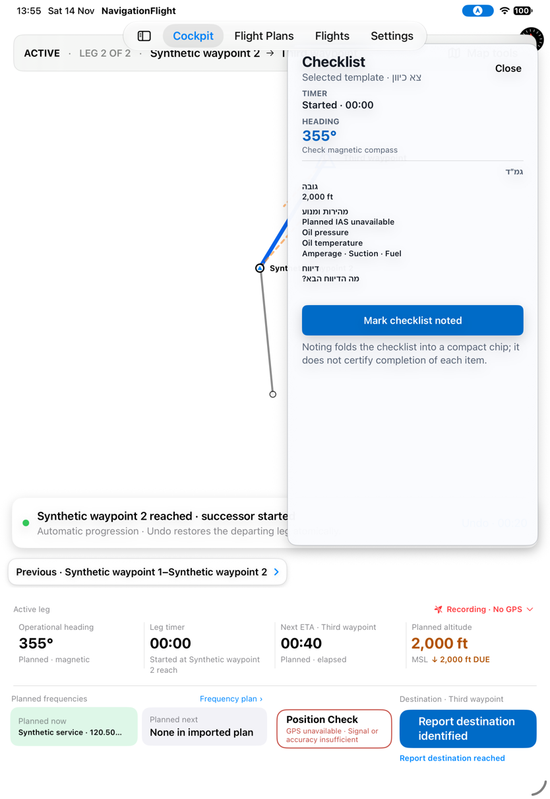

*The second leg clones test-fixture execution data; do not use its geometry or numeric
heading as a real-route calculation check. The screenshot may catch the map transition
before settling. Manual progression is a debug variant, not an observed Settings option.*

## S25 · Review the previous leg while the current timer continues

**Goal/start:** Compare a completed leg's result without disturbing the successor.
Close the new checklist and open Previous Leg.
**Result:** History shows planned **00:40**, actual **00:23**, **00:17 early**, the
reached target and planned heading. Leg 2 remains active with its timer at **00:19**.
Closed Checklist and Previous chips coexist beneath the map.

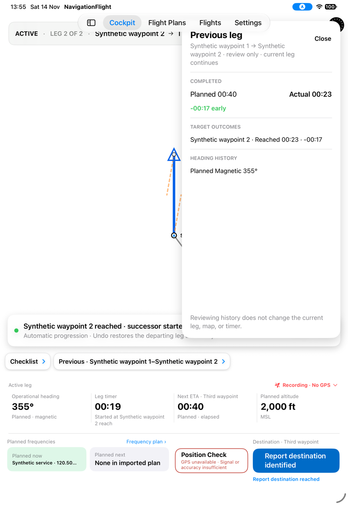

*Opening history is visibly review-only in this sequence. This capture does not exercise
long history, all target outcomes or a completed leg containing heading revisions.*

Next: Position Check and recording/recovery. [Remaining cockpit evidence](../proposed/fly-and-revise.md#e03--cover-remaining-navigation-branches)
records the limits of this pass.
