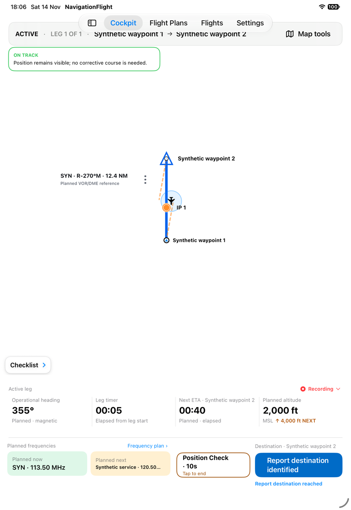
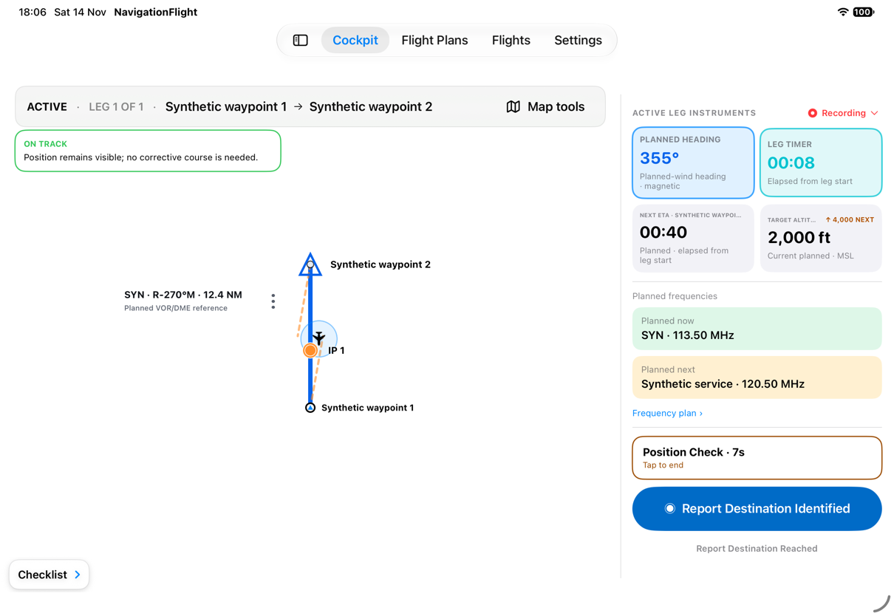
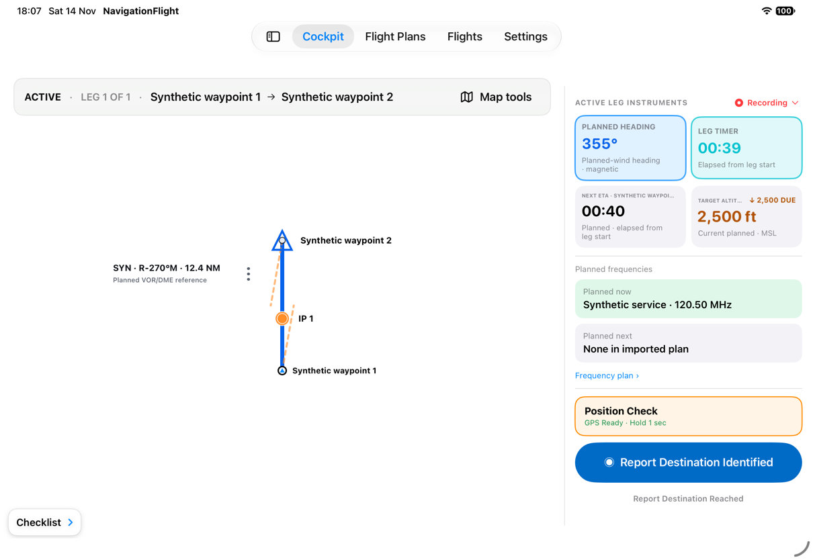
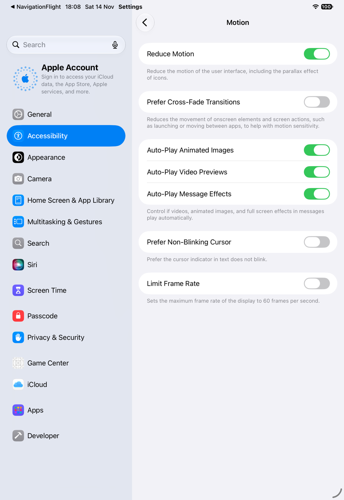
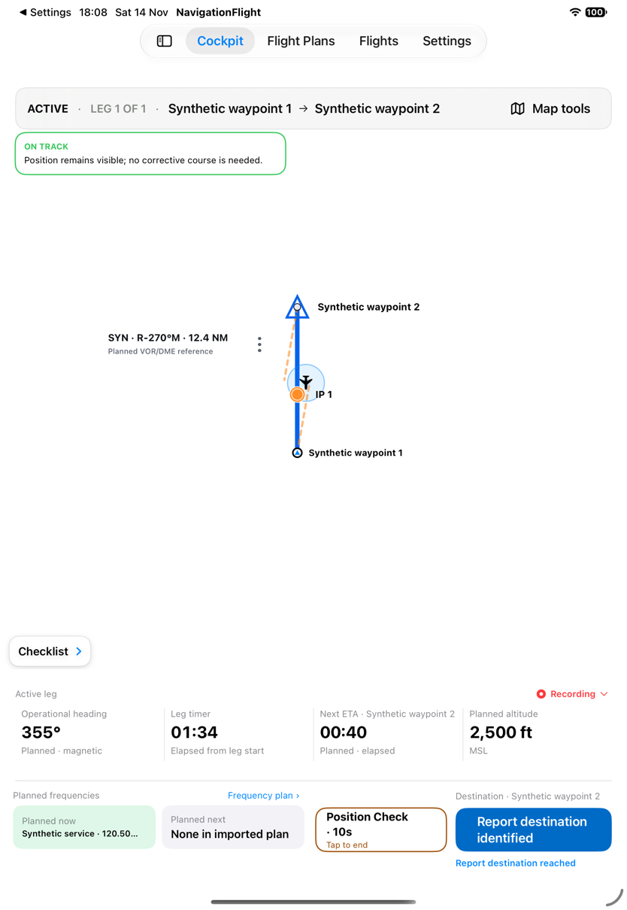
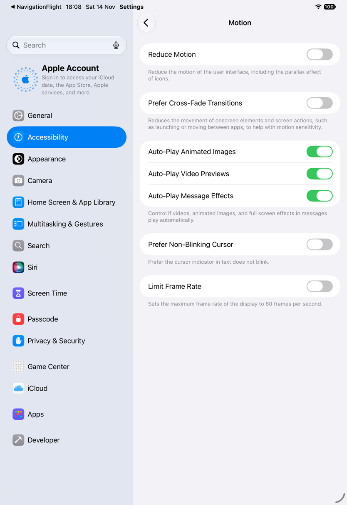
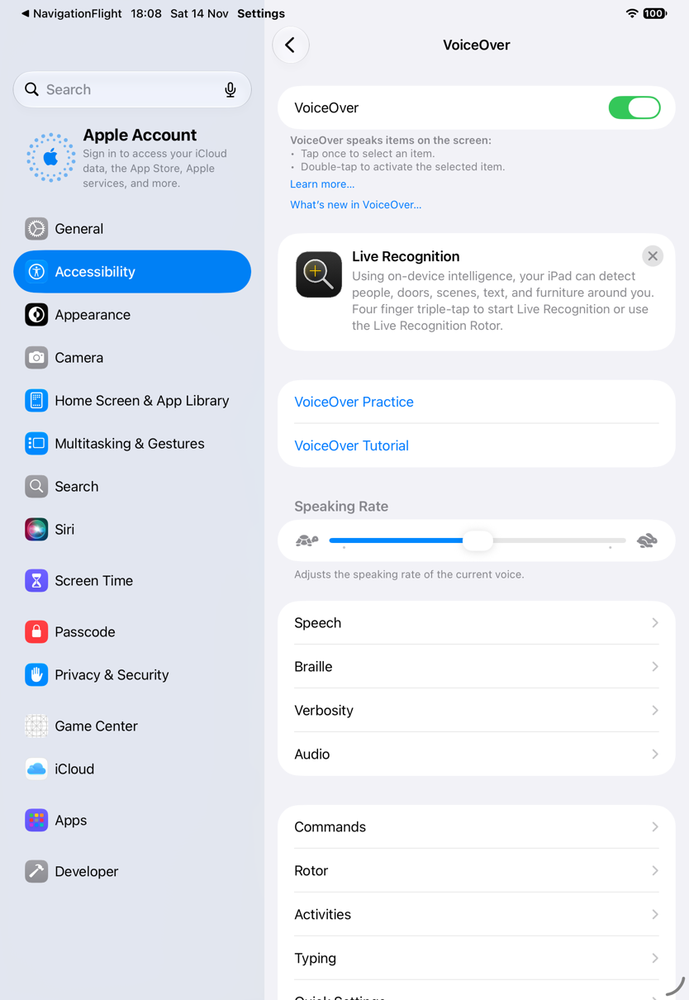
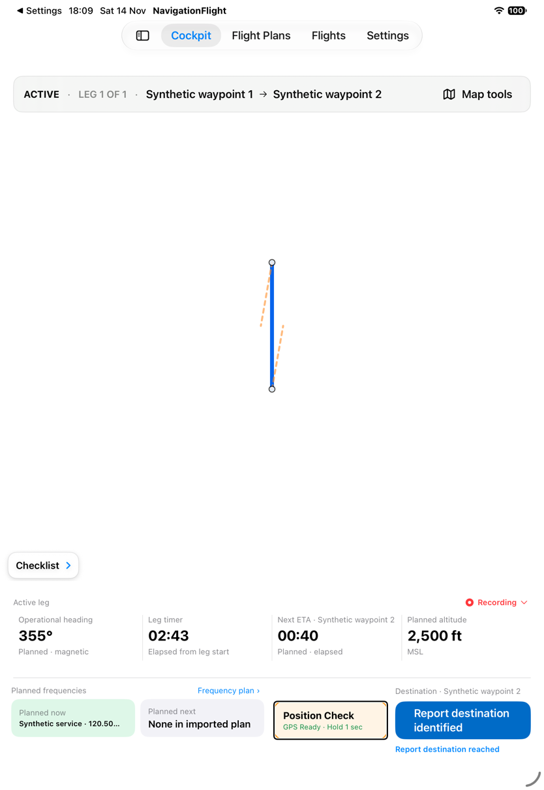
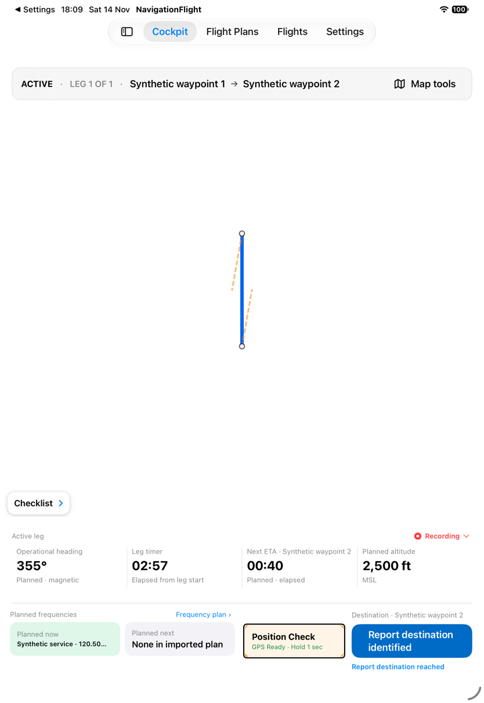
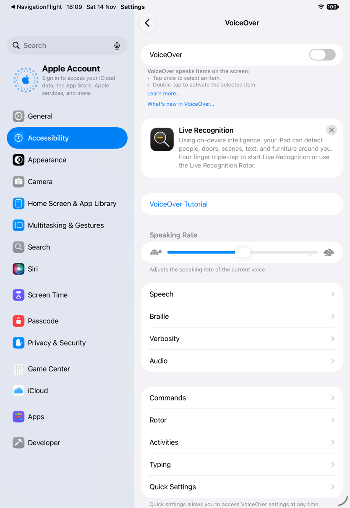

# Continue in landscape and exercise accessibility settings

[Back to the map](../README.md) · [Evidence ledger](../evidence/remaining-exploration.md)

**Status:** new observations awaiting account review. [Batch18](../evidence/capture-batch-18.md),
2026-11-14, baseline `1a2d7e7`, iPad Pro11-inch(M5), iOS27. Synthetic on-track input.

## S86 · Hold again during a Position Check and rotate while active

Hold to disclose on-track position at elapsed00:04 with10s shown. A second hold while
active leaves disclosure active and again shows10s at elapsed00:05. Rotate to landscape:
the route and position remain visible, instruments move to the right-hand console and
Position Check shows7s. Later, disclosure has ended and the landscape console shows a
DUE altitude cue. This demonstrates the repeated gesture and active landscape layout;
the sequence does not isolate the extended deadline enough to prove that timers never
stack or establish the exact restart instant.

Truncated instrument titles are visible in the right console, extending the existing
label-readability concern G03. This is representative coverage, not every landscape editor.

## S87 · Use Position Check with system Reduce Motion enabled

In system Settings, change Reduce Motion from Off to On. Return to the active Flight
and hold Position Check: on-track disclosure, the aircraft and10s control are visible.
Restore Reduce Motion to Off afterward. Still frames establish successful disclosure
under the setting, not the absence of every animation, pulse or motion effect.

## S88 · Focus Position Check with VoiceOver enabled

Enable system VoiceOver from Off. The first interaction attempts are blocked by the
system VoiceOver Gestures onboarding alert, so they say nothing about app activation.
After dismissing onboarding, Position Check receives the visible VoiceOver focus ring.
The attempted default double-tap leaves the captured control Ready, without a disclosed
position. This bounded attempt does not establish successful accessible activation or
its failure mechanism. Spoken announcements, focus order and haptics were not captured.
Restore VoiceOver to Off. Foreground annotation loss is also visible, consistent with G14.

