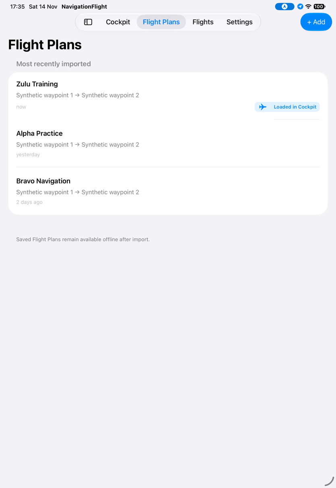
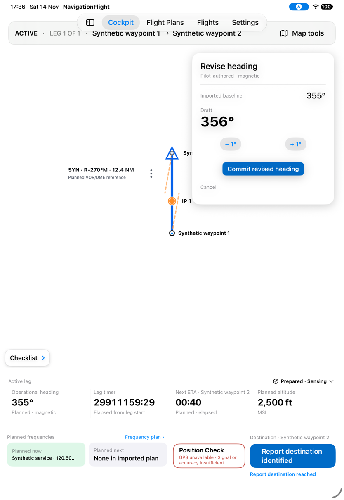
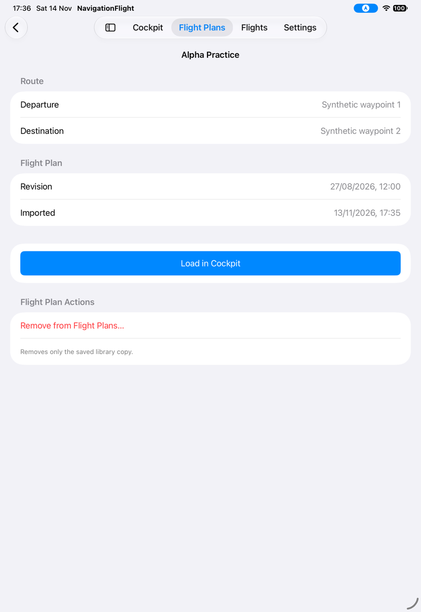
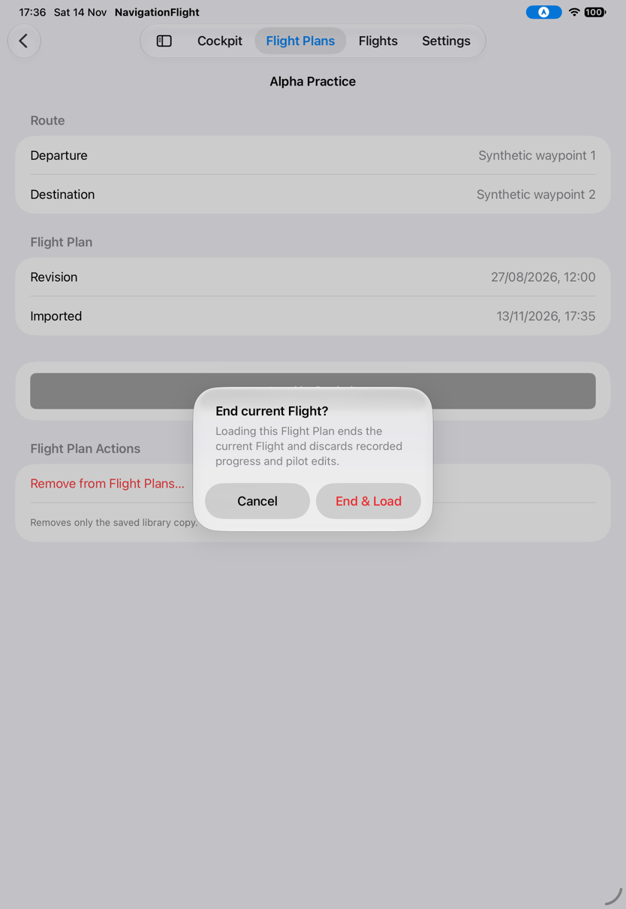
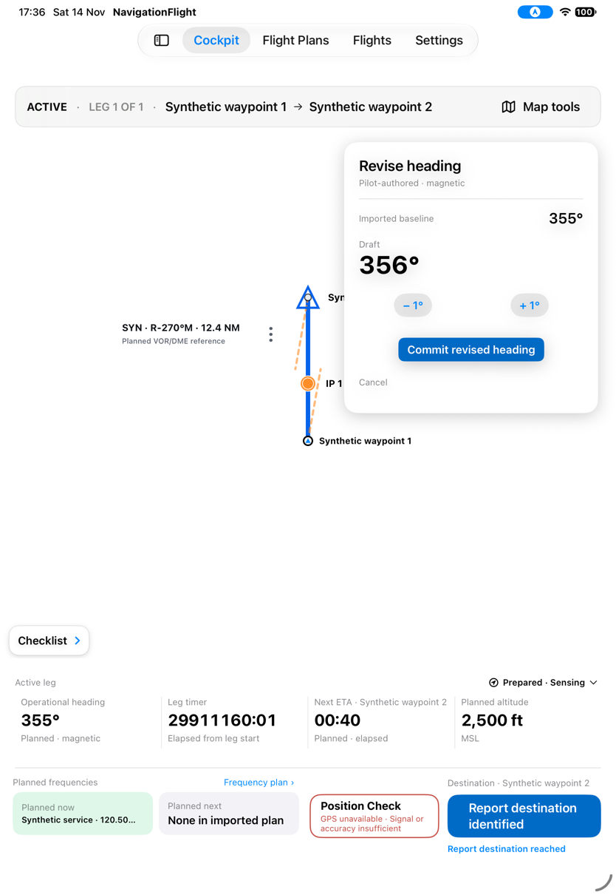
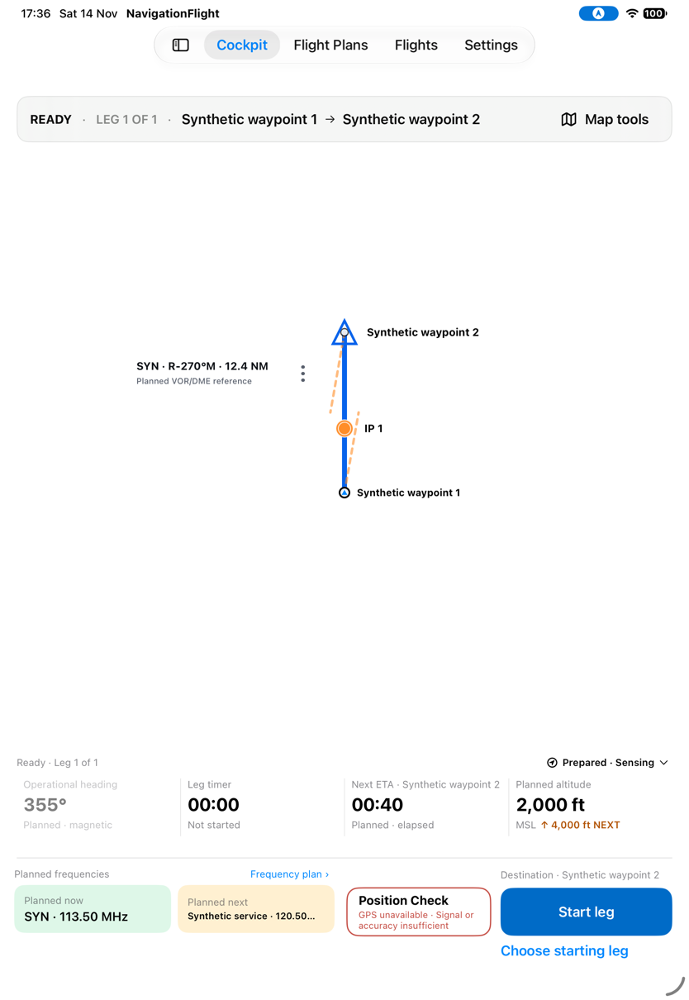
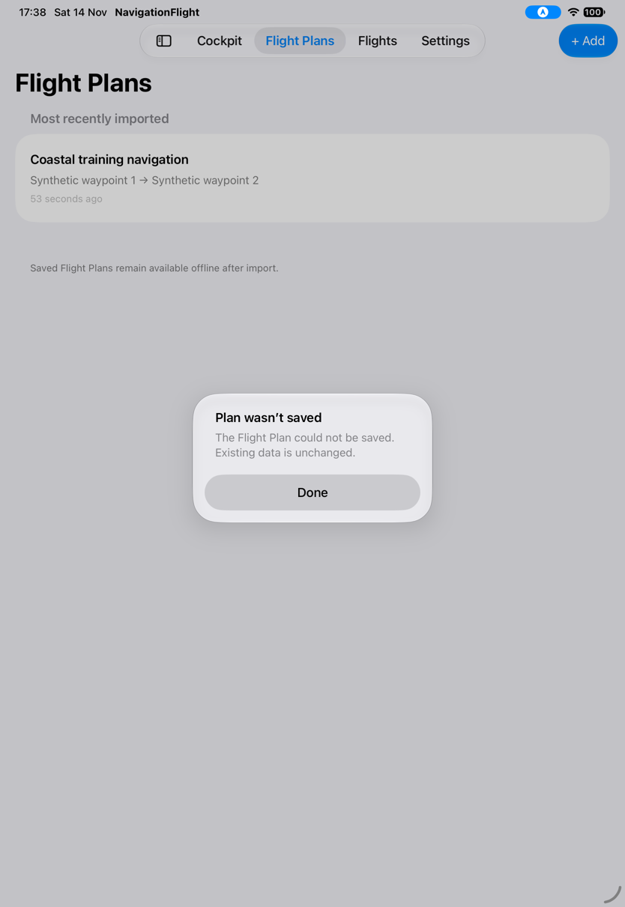
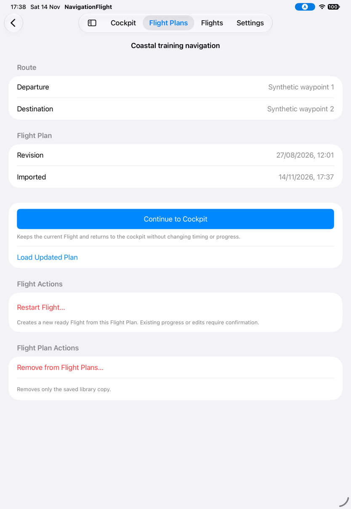

# Keep saved plans and active work distinct

[Back to the map](../README.md) · [Library evidence limits](../proposed/manage-flight-plans.md)

**Status:** new observations awaiting account review. [Batch11](../evidence/capture-batch-11.md),
2026-11-14, baseline `1a2d7e7`, iPad Pro 11-inch (M5), iOS 27.0 (24A434), portrait.
All plans are disposable synthetic inputs. The protected-flight fixture starts at a
fixed historical timestamp; its very large elapsed timer is a fixture artifact, not
evidence that an ordinary newly started flight has that duration.

## S66 · Find several plans by import recency

Open a seeded library containing Zulu Training, Alpha Practice and Bravo Navigation,
with import ages now, yesterday and two days ago. The list follows that recency order,
not alphabetical order. Zulu's exact loaded version carries Loaded in Cockpit.

## S67 · Cancel or confirm loading a different plan over protected work

With Zulu active, open heading revision and leave an uncommitted 356° draft. Open
Alpha Practice in Flight Plans, then Load in Cockpit. End current Flight? explains
that loading discards progress and edits. Cancel and return to Cockpit after the
alert settles: Zulu remains active, its 356° draft is still open, and its checklist
chip remains available. This observes that draft/chip, not every possible checklist
state or combination of unsaved editors.

Next choose Bravo and confirm End & Load. The new loaded Flight is Ready at 00:00;
the old heading draft is no longer shown. These plans share route geometry, so the
route labels alone cannot establish plan identity: the action transcript records Bravo.
The former Flight's recording closure was not inspected in this sequence.

## S68 · Save a newer revision while retaining the older loaded snapshot

Replace the saved plan with revision 12:01 while the older snapshot is loaded. The
success alert appears and the list no longer marks that saved revision Loaded in
Cockpit. In a subsequent launch using the same saved library and explicitly loading
the older snapshot, review offers Continue to Cockpit and a separate Load Updated Plan.
Continue's explanation promises to retain current timing/progress. This demonstrates
the distinction; pressing Load Updated Plan is not part of this captured branch.

## S69 · Fail to replace a saved revision and inspect what remains

With the existing saved 12:01 version, attempt to replace it with an older revision
under the storage-failure input. Plan wasn't saved states existing data is unchanged.
After dismissal, review still shows 12:01 and the loaded-snapshot choices. This observes
retained library data after the injected failure; it does not simulate physical disk
exhaustion or prove every filesystem failure is atomic.

