# Manage saved Flight Plans

[Back to the map](../README.md) · [Differences and remaining evidence](../proposed/manage-flight-plans.md)

**Status:** observed 2026-11-14; account approved by John on 2026-11-14.
This chapter extends [choosing a plan](flight-plans-to-cockpit.md). It uses isolated
synthetic libraries on iPad Pro 11-inch (M5), iOS 27.0, portrait 834 × 1210 points,
baseline `1a2d7e7`. [Capture record](../evidence/capture-batch-02.md).

## S10 · Leave Files without adding a plan

**Goal and start:** Return to an empty library after opening Add and deciding not to import.
**Action/result:** Dismiss the system picker. The library returns to “No flight plans
yet,” with Add still available and no row created.

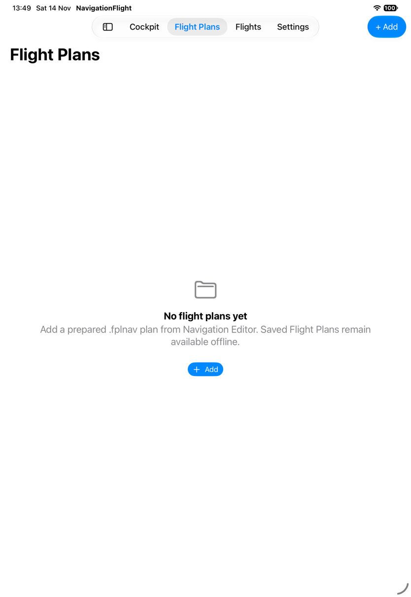

*The capture tool's reported Cancel coordinate opened View Options; tapping the visible
close control first dismissed that menu, then the picker. The settled result is now
verified; the earlier [S02](flight-plans-to-cockpit.md#s02--open-the-file-picker) evidence
is retained with its original limit.*

## S11 · Save a valid plan and find it after relaunch

**Goal and start:** Keep preparation available for a later app launch, starting from
an empty disposable library.
**Action/result:** Supply the valid V7 fixture through the existing debug import input.
The app adds one row and confirms “Flight Plan added,” explaining it is saved locally.

Terminate and relaunch with the same library identifier and **without** the import or
seed input. The saved row remains, with its original import time now shown as elapsed.

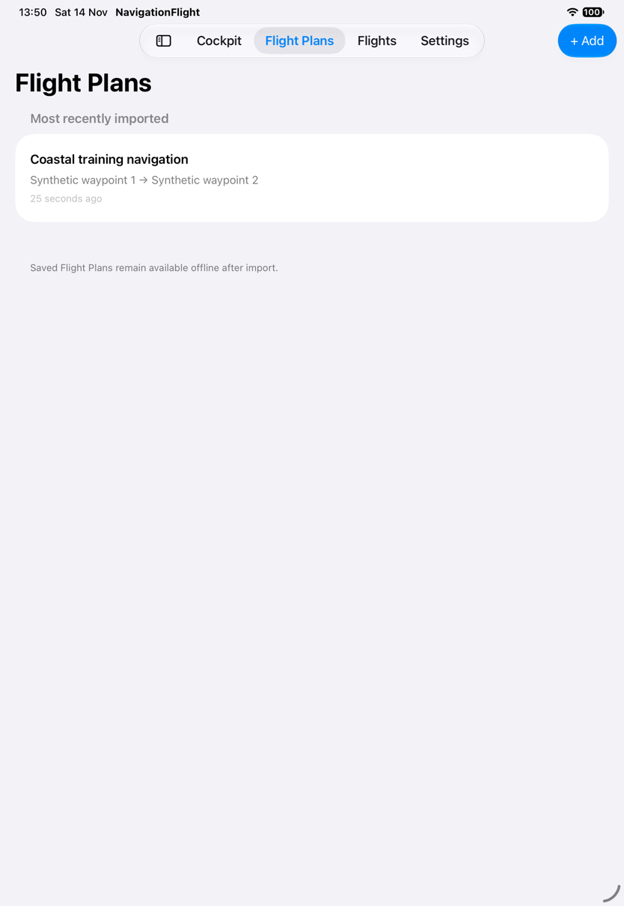

*This directly observes persistence across relaunch. It does not establish real Files
provider access, all supported formats, or behavior with network access disabled.*

## S12 · Reimport the same revision

**Goal and start:** Avoid creating duplicates when adding the same preparation again.
**Action/result:** Import identical fixture bytes into S11's persisted library.
“Already imported” explains that this revision is already saved; one row remains behind
the message. Done dismisses it.

## S13 · Review newer or older replacement and cancel

**Goal and start:** Understand the consequence before replacing the saved revision.
**Action/result:** Import the same plan identity with a modification timestamp one
minute newer. The app asks “Replace saved plan?” and says Cockpit will remain unchanged.

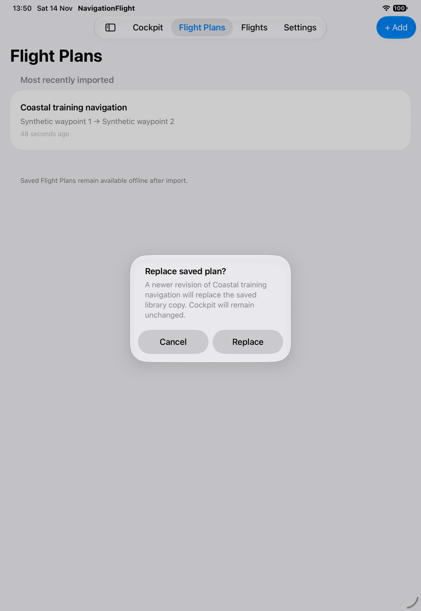

Cancel, then import a version one minute older than the original. The message explicitly
says “Replace with older revision?” and gives Replace destructive emphasis.

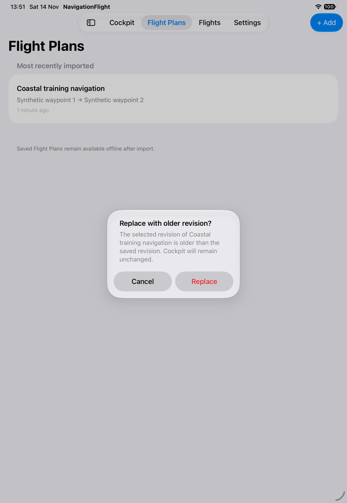

Cancel again and inspect the row. The original revision, **27/08/2026, 12:00** in the
simulator locale, remains. The import timestamp also remains the original saved time.

*Cancellation preservation is observed. Neither Replace action was confirmed in this
batch; the alert's promise about an active Cockpit was not tested by these unloaded cases.*

## S14 · Understand why a plan was not added

**Goal and start:** Recover from bad input or a save failure without mistaking it for success.
**Action/result:** Inject malformed bytes into a new empty library. “Couldn't add this
plan” explains malformed, unsupported, or missing execution data; the library remains empty.

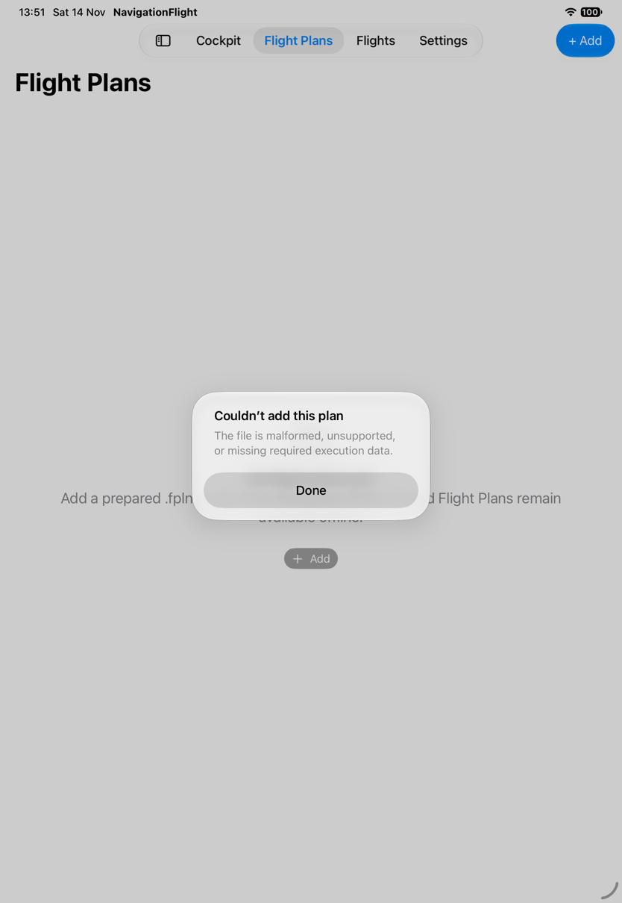

In a separate empty library, supply the valid plan with the existing save-failure hook.
“Plan wasn't saved” says existing data is unchanged.

*These are distinct observed error presentations. They do not prove every malformed
format case, real provider read failure, full-disk behavior, or preservation of a
previously populated library under failed replacement.*

## S15 · Cancel a restart that would discard Flight work

**Goal and start:** Reconsider restarting an already active Flight from its loaded-plan review.
The protected-Flight fixture starts navigation at a synthetic historical timestamp.
**Action/result:** Restart Flight opens “Restart this Flight?” and warns that recorded
progress and pilot edits will be discarded. Cancel returns to the loaded review.

*After subsequent library removal, S16 still shows ACTIVE and the original large
elapsed timer. This establishes that cancellation did not reset the visible Flight;
it does not prove preservation of every possible draft, edit and checklist combination.*

## S16 · Remove the saved copy and keep using the loaded Flight

**Goal and start:** Remove preparation from the library without destroying the Flight
already loaded from it. Start from S15 after cancelling restart.
**Action/result:** Remove from Flight Plans explains that only the library copy is
removed and the current Flight remains usable until replacement or app closure.

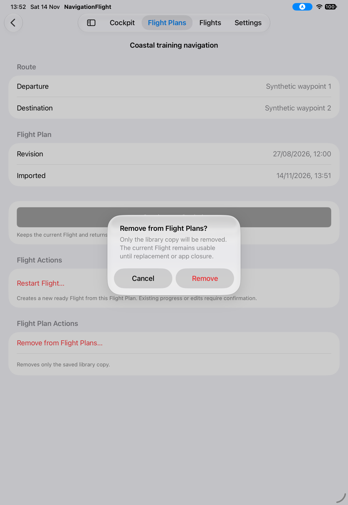

Confirm Remove. The library becomes empty.

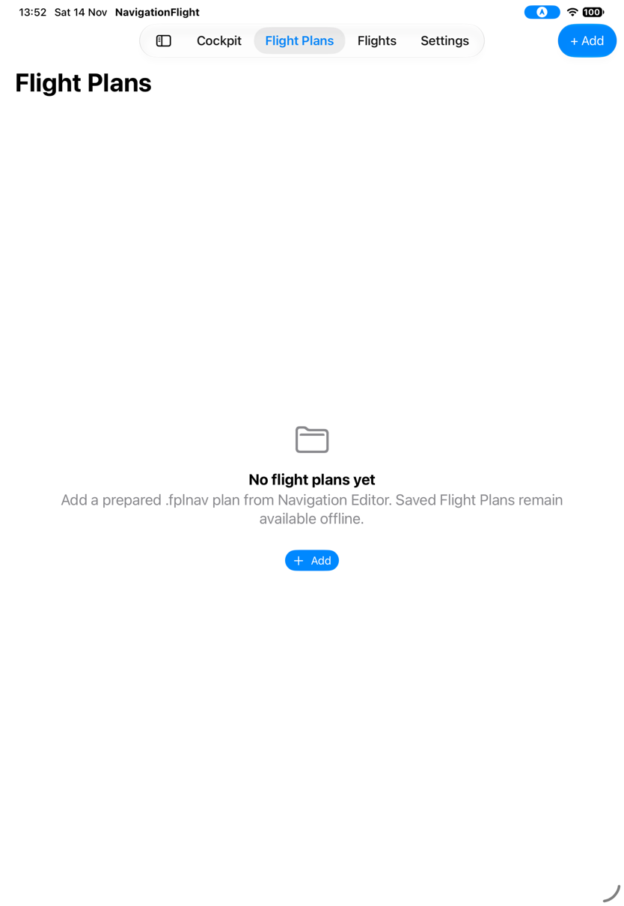

Select Cockpit, then its retained inspection's Cockpit toolbar action. The active leg,
checklist, instruments and running timer remain available.

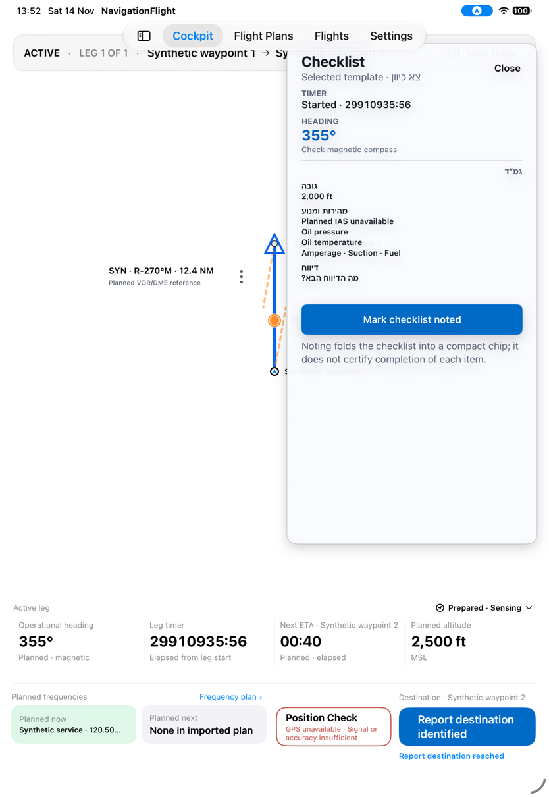

*The enormous timer comes from the fixture's historical start, not real flight duration.
The route strip is again beneath the app tabs, now on portrait active return; this
extends [G01](../proposed/flight-plans-to-cockpit.md#g01--return-to-cockpit-with-route-information-unobscured).
Removal cancellation/failure and relaunch after removal were not observed here.*

Next: fly and revise navigation; [remaining library evidence](../proposed/manage-flight-plans.md)
keeps unchecked branches separate from defects.

## S47 · Confirm a newer revision and an older rollback

**Follow-up, same baseline/date/device; [batch 07](../evidence/capture-batch-07.md).**
Start with the base revision in a disposable library and inject the newer plan.
Confirm Replace rather than Cancel.

The saved detail now shows **27/08/2026, 12:01**, replacing **12:00**.

Relaunch the same persisted library and import the older revision. Confirm the explicit
older-revision warning; the detail becomes **11:59**.

*This completes the saved-copy replacement/rollback branch. It does not verify all
loaded-revision badges or preservation of an active Flight during import replacement.*

## S48 · Cancel removal and understand an injected removal failure

**Goal/start:** Keep a saved plan when reconsidering removal or when deletion cannot complete.
From S47, choose Remove from Flight Plans, then Cancel.

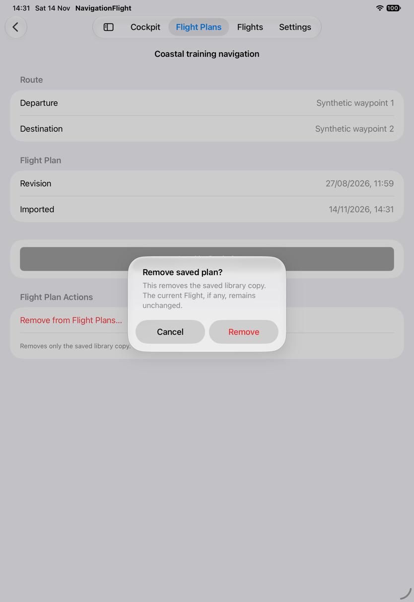

The saved older revision remains visible in its detail.

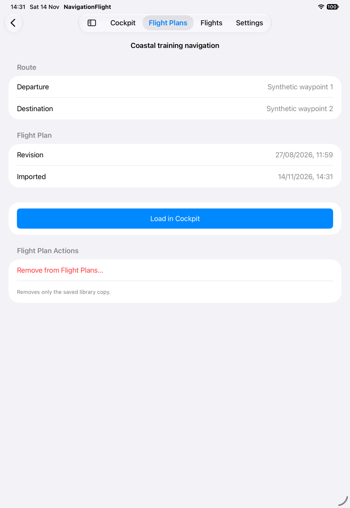

In a separate base-plan fixture with the existing removal-failure hook, confirm Remove.
“Couldn't remove plan” explains that the saved plan, inspection and current Flight are unchanged.

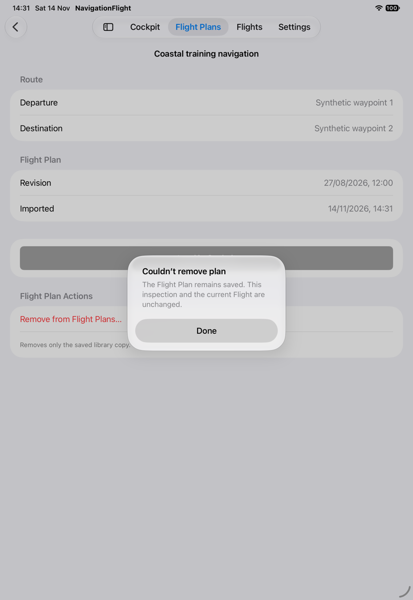

*The error and retained inspection are observed; full durable-state equality was not
independently compared. This failure concerns saved preparation, not recording deletion G10.*

## S49 · Confirm a protected restart

**Goal/start:** Deliberately discard the active execution and begin again from preparation.
Open the protected fixture's loaded-plan review and choose Restart Flight.

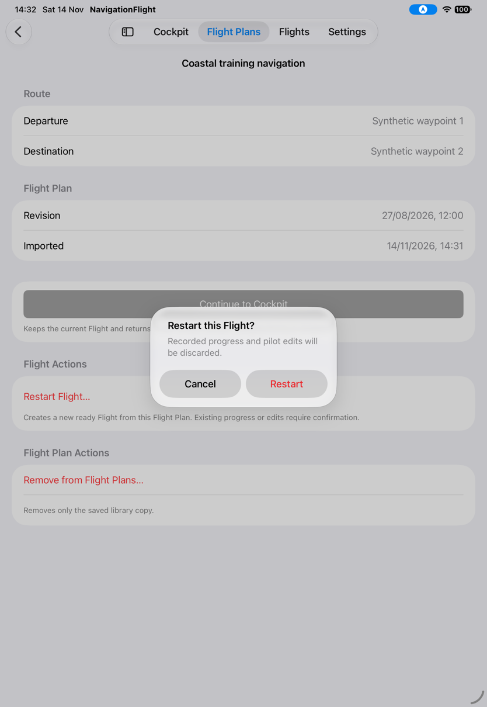

Confirm Restart. Cockpit becomes READY with **00:00 · Not started**, initial planned
values and an explicit Start leg action. The route strip is clear of tabs.

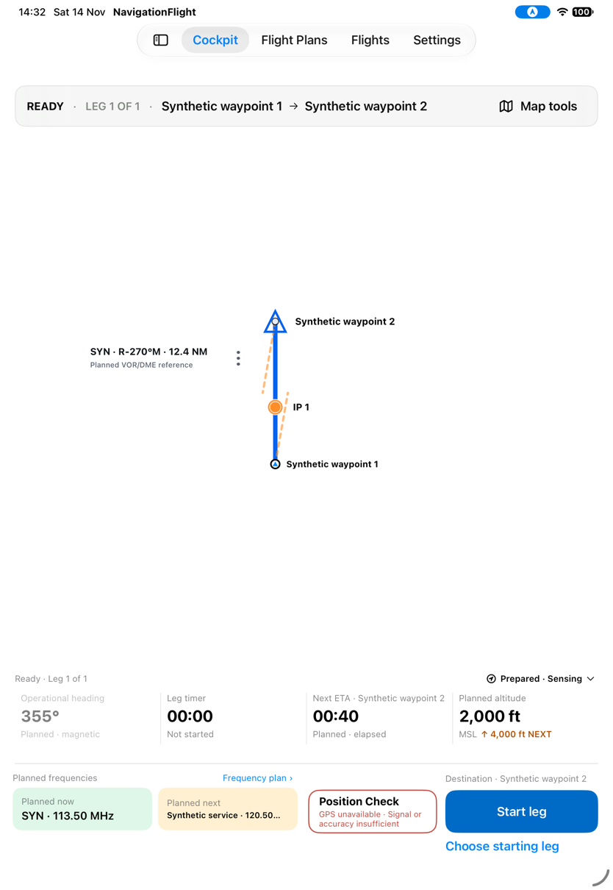

*Visible restart behavior is verified. Recording closure/disposition and every possible
draft/edit reset are not established by this protected-navigation fixture.*
