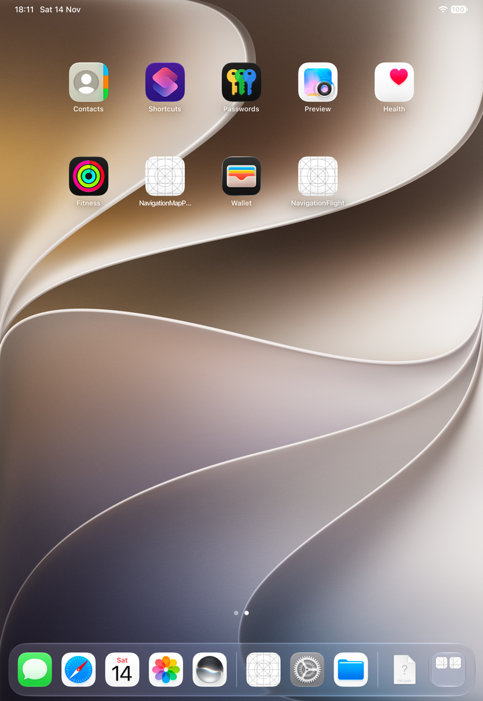
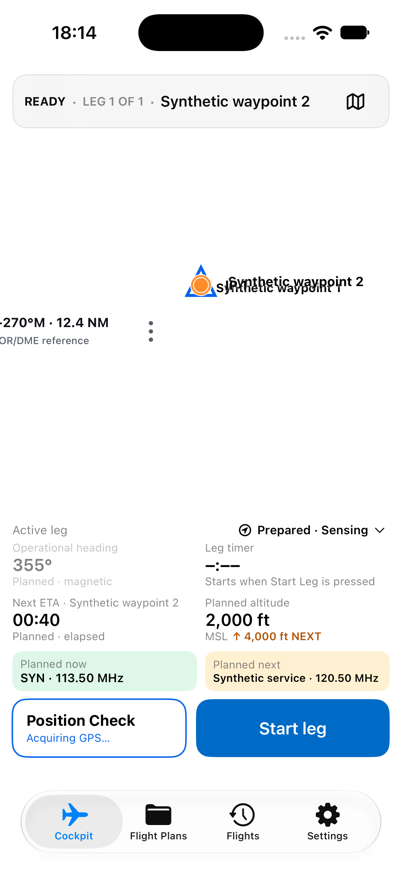
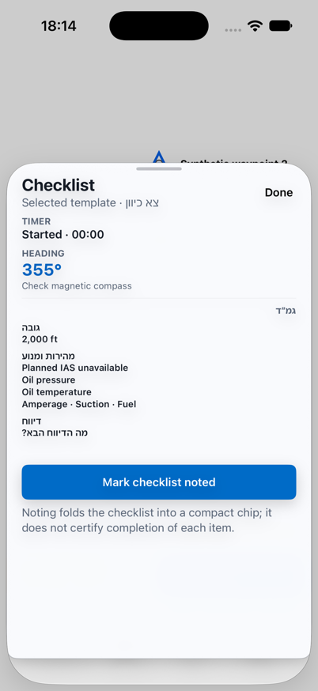
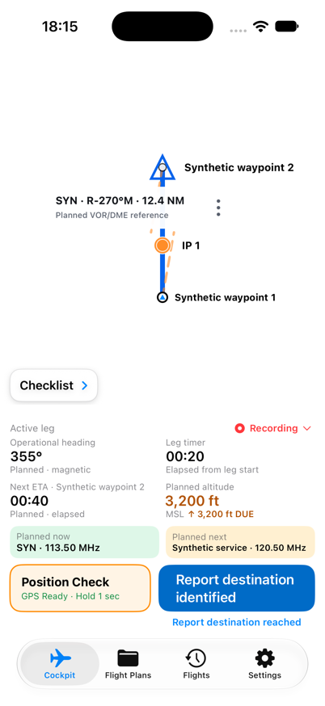
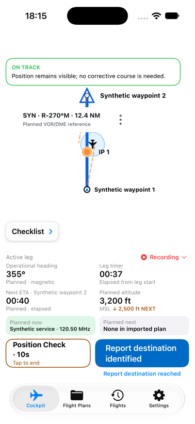
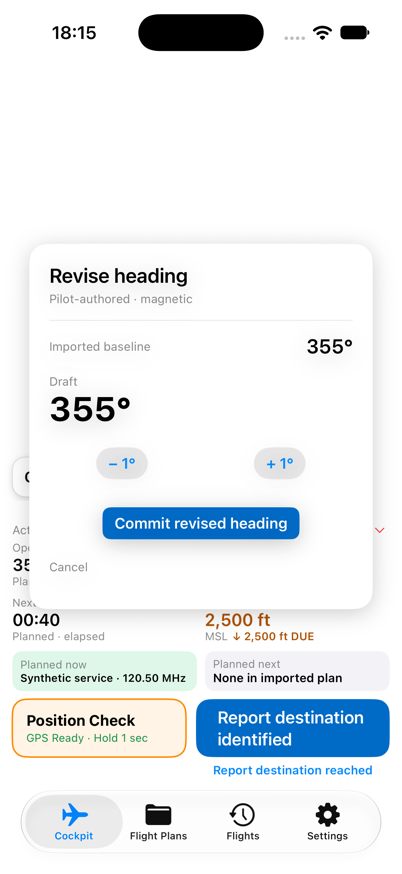

# Try window resizing and continue on the available phone

[Back to the map](../README.md) · [Remaining evidence](../evidence/remaining-exploration.md)

**Status:** new observations awaiting account review, baseline `1a2d7e7`,2026-11-14.
[Batch19](../evidence/capture-batch-19.md) is iPad Pro11-inch(M5);
[batch20](../evidence/capture-batch-20.md) is iPhone17, iOS27(24A434),402×874 portrait.
The tool rejected canonical iPhone16Pro and offered newer phones; iPhone17 is an explicit
substitute, not canonical-device acceptance.

## S89 · Attempt a system window resize

The hierarchy exposes a resize handle owned by SpringBoard. Activating that owner before
performing its drag sends the app to Home; no app resize is established. The retained
capture documents this environment/interaction limit, not a NavigationFlight resizing
failure. No multitasking setting was changed.

## S90 · Start and use the available iPhone cockpit

The ready screen shows the route header; this initial capture also has collapsed route
markers, so it is not a settled ready-map acceptance frame. Start opens a readable
checklist sheet. After dismissal the active map is separated correctly and the console
shows timing and an altitude DUE cue, but the route header and Map tools are absent.
Hold Position Check: on-track position and10s disclosure appear; the header remains
absent. Cancel, then open heading: the editor offers baseline355°, draft355°, increment,
decrement, commit and cancel; the underlying map has collapsed after cancellation.

Header loss is G24; cancellation map restoration extends G18. No heading commit was
performed in this phone run. These representative paths do not establish every phone
orientation, accessibility size or editor behavior.
