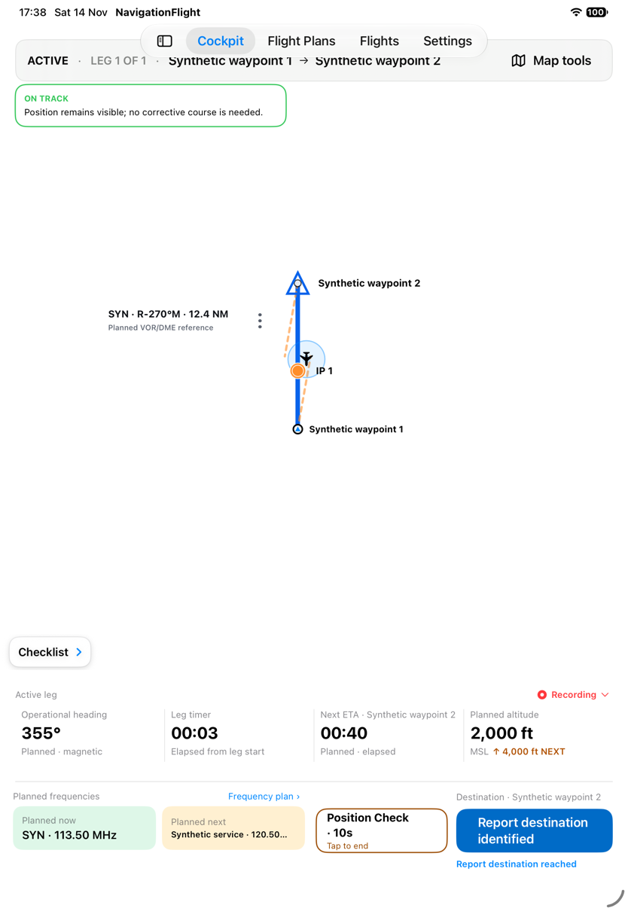
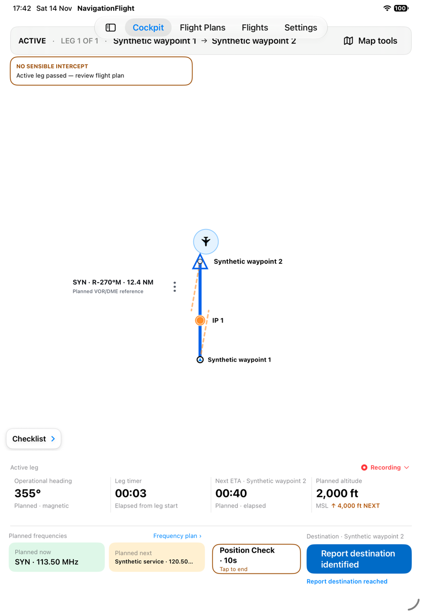
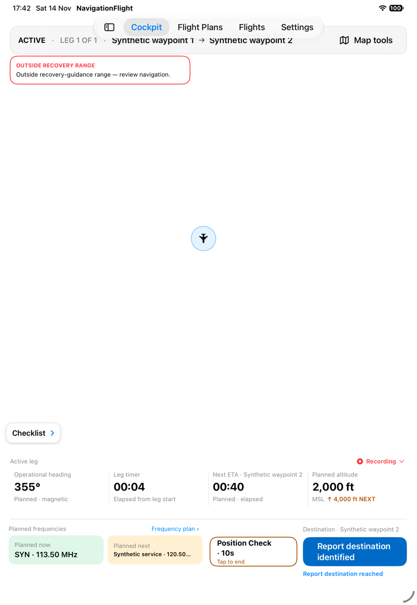
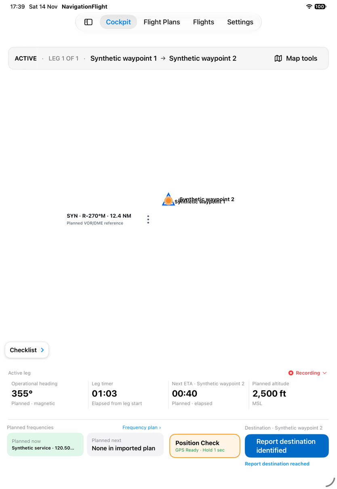
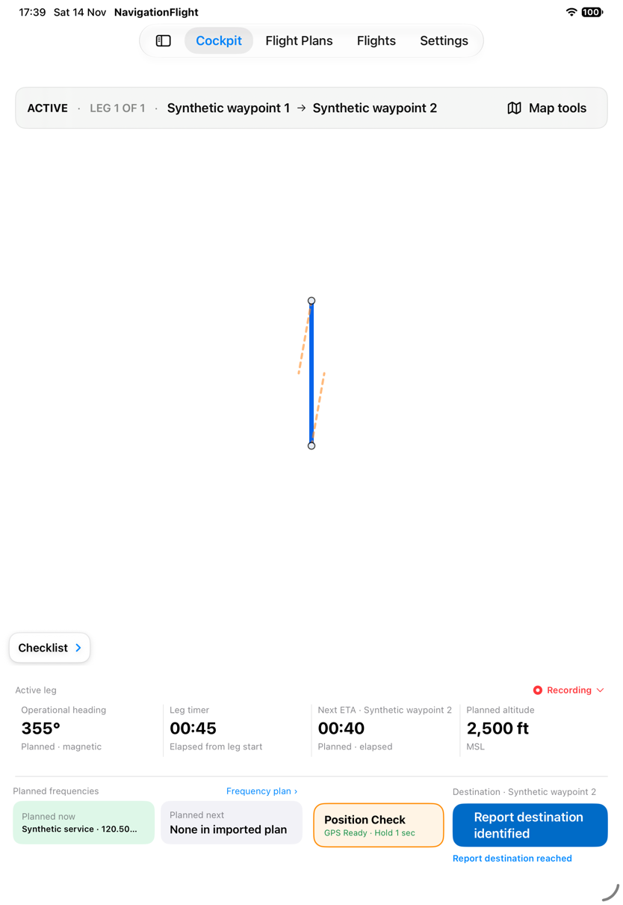
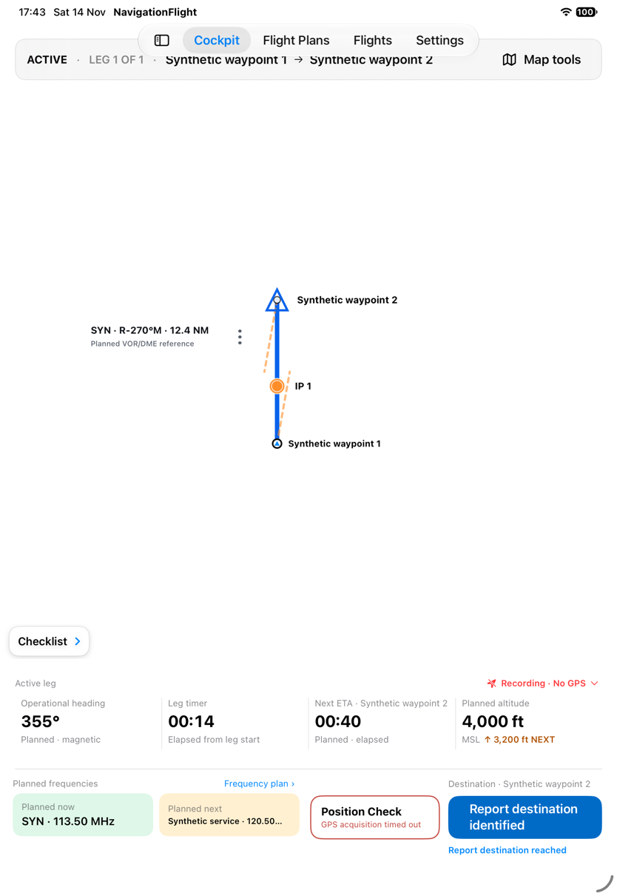
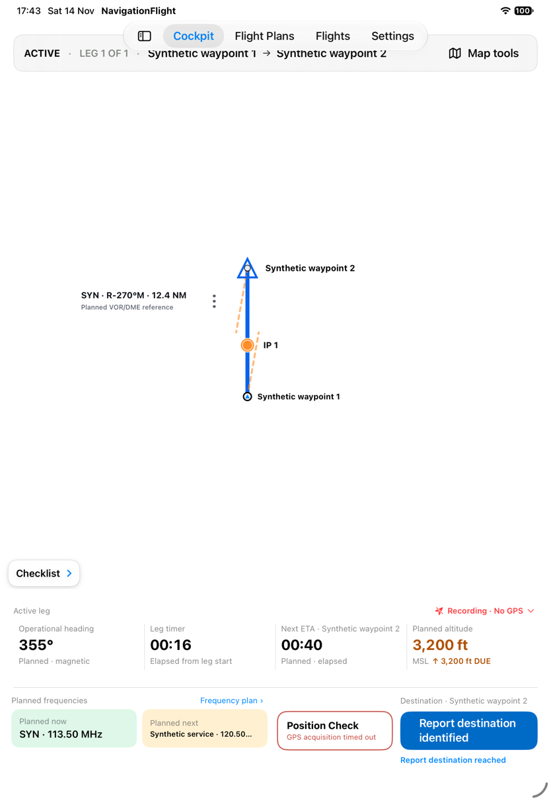
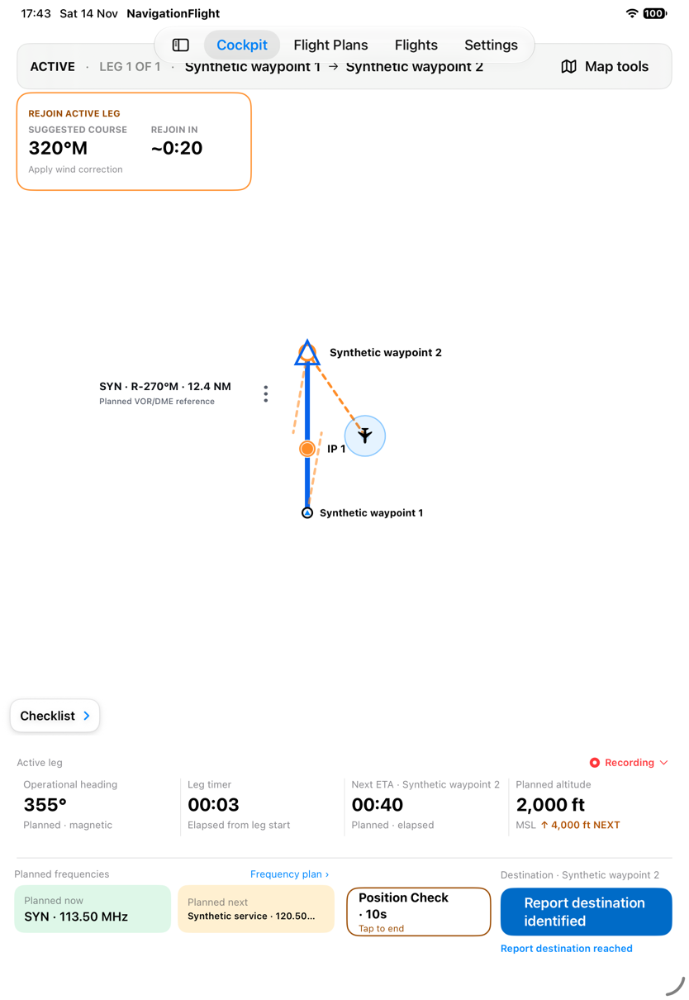
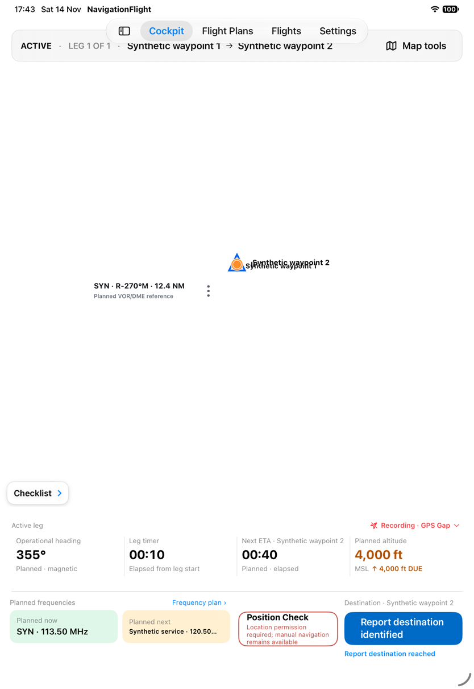

# Understand Position Check outcomes and exits

[Back to the map](../README.md) · [Position Check proposals](../proposed/position-check.md)

**Status:** new observations awaiting account review. [Batch12](../evidence/capture-batch-12.md),
2026-11-14, baseline `1a2d7e7`, iPad Pro 11-inch (M5), iOS 27.0 (24A434), portrait.
Existing synthetic GPS scenarios match the near-zero regression route; these captures
show presentation and transitions, not real sensor accuracy or guidance certification.

## S71 · Distinguish supported position and guidance outcomes

Start the synthetic leg and deliberately hold Position Check in four isolated runs.
On track shows position with an explicit statement that no corrective course is needed.
Position only retains position but says recovery guidance is unavailable. No sensible
intercept says the active leg has been passed and directs review of the plan rather
than directing backward. Extreme displacement opens disclosure with an outside-range
message, withholding tactical course and time guidance. Aircraft visibility depends on
the viewport; the offscreen marker is not claimed visible in that capture. Each shows
the disclosure timer.

## S72 · Leave Cockpit during a fresh disclosure

Start a fresh disclosure, immediately visit Flight Plans and return within ten seconds.
The position and guidance are gone, and a new hold is required; route markers collapse.
In a separate fresh disclosure, Home for one second and app reactivation likewise end
disclosure, but the returned map loses waypoint/IP/VOR annotations while route lines
remain. These extend the observed restoration problems G18 and G14 respectively.

An [earlier tab-return capture](../assets/current/batch-12/02-tab-return-disclosure-ended.png)
occurred after the original disclosure had expired and cannot prove boundary cancellation.
The later fresh-disclosure sequence supplies that evidence.

## S73 · Try again after acquisition times out

With the acquiring input, hold Position Check and wait eleven seconds. GPS acquisition
timed out appears with no position disclosed. Hold again, then tap the timeout control:
the timeout remains and no new acquiring state is visible. The fixture never supplies
a usable fix, so this does not establish successful GPS recovery. It does establish
that the observed attempt does not visibly restart acquisition.
[Batch17](../evidence/capture-batch-17.md) repeats this with a fresh timeout and the
current control hitpoint: both a tap and1.2-second hold leave timeout visible.

## S74 · Lose permission during an active disclosure

Use delayed synthetic permission revocation. Hold while the fix is usable: the map
shows an aircraft and rejoin guidance. Before the ten-second disclosure expires,
permission becomes denied. Position, vector and guidance disappear; the control explains
that permission is required while manual navigation remains available. Recording status
changes to GPS Gap. The underlying route markers collapse, extending G18's restoration
evidence. This is an injected authorization transition, not a real Settings permission change.

