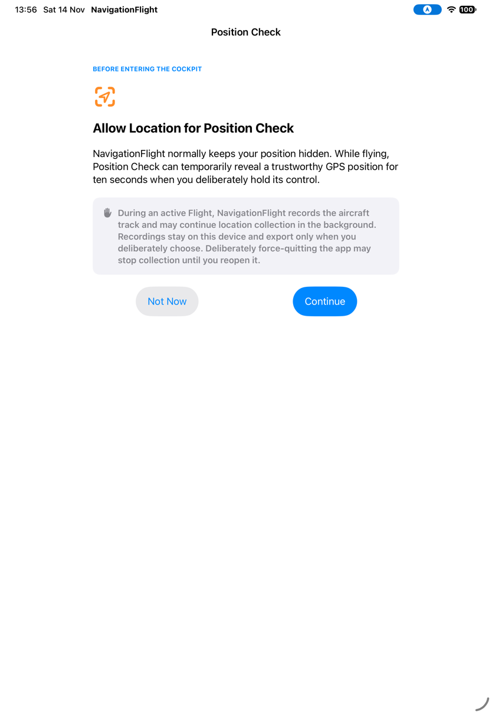
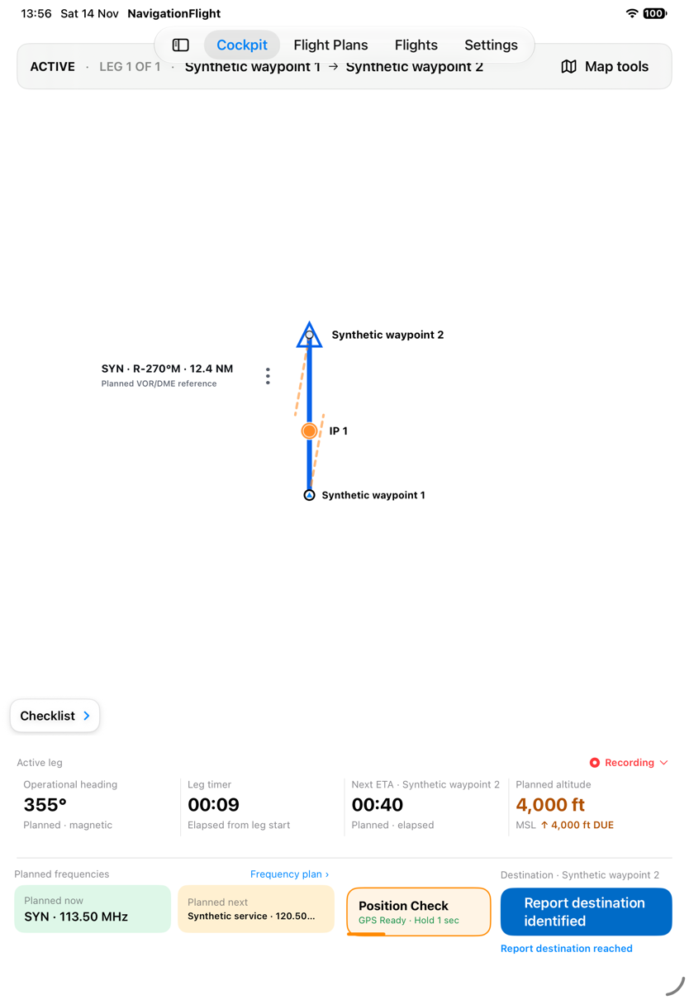
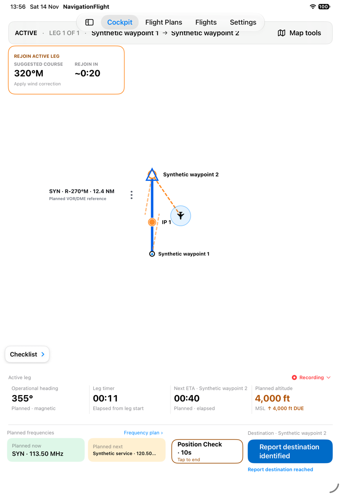
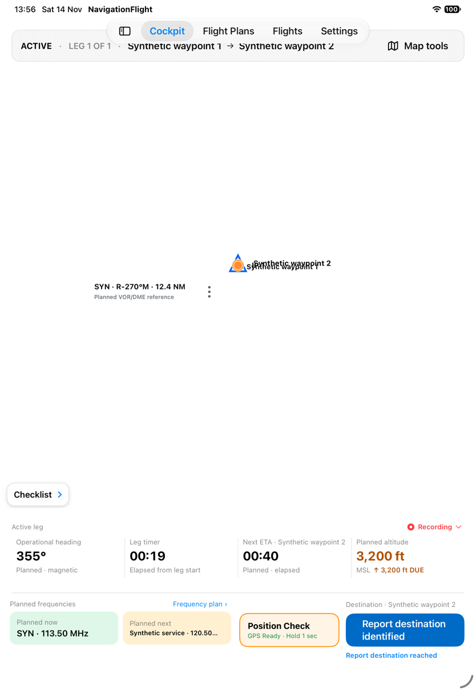
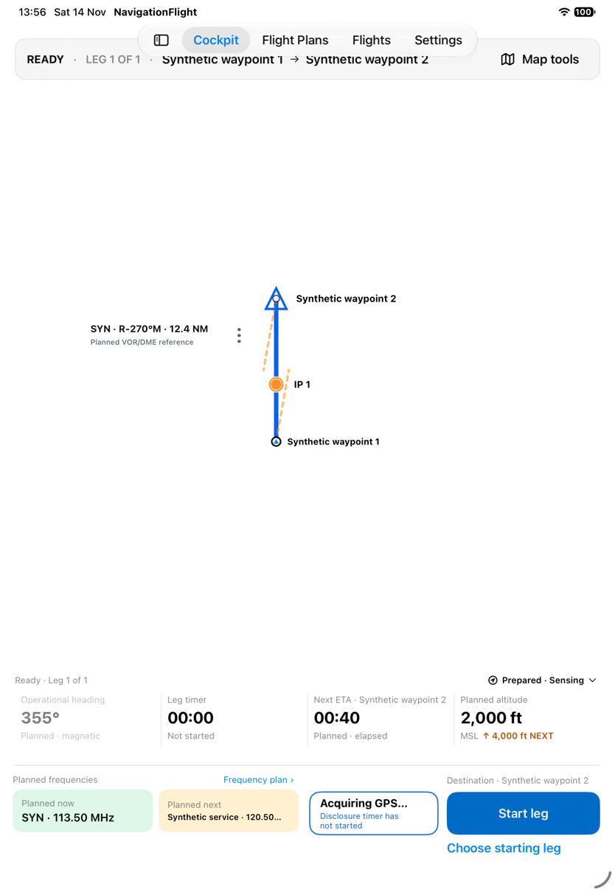
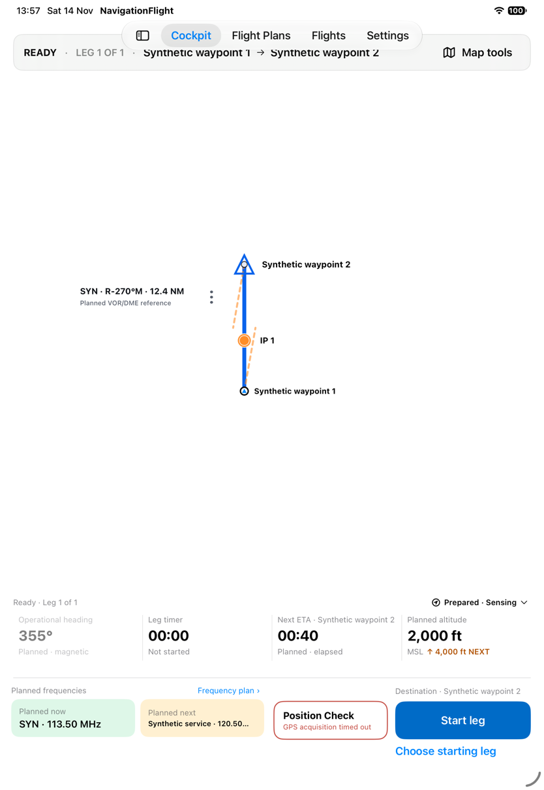
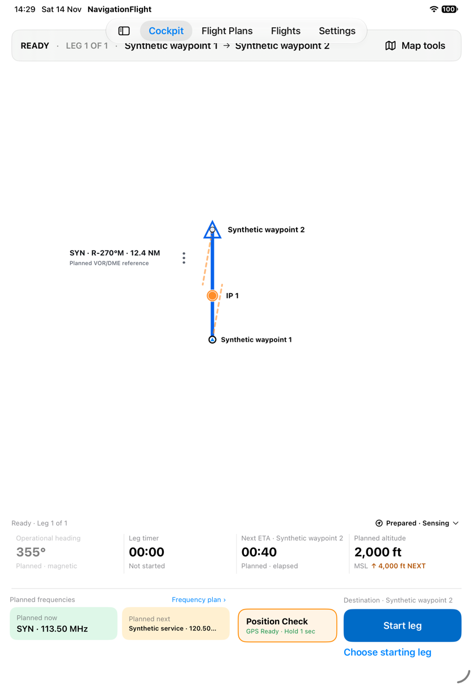
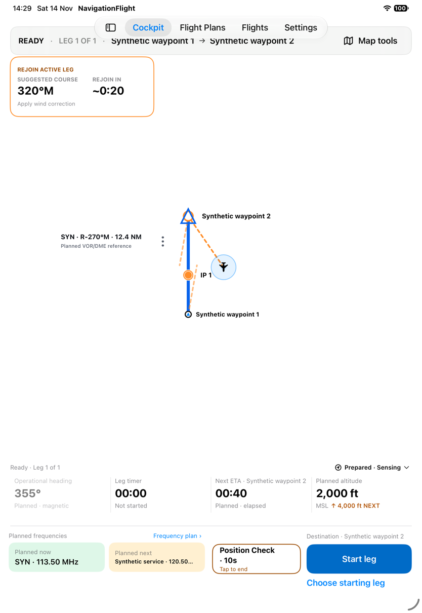
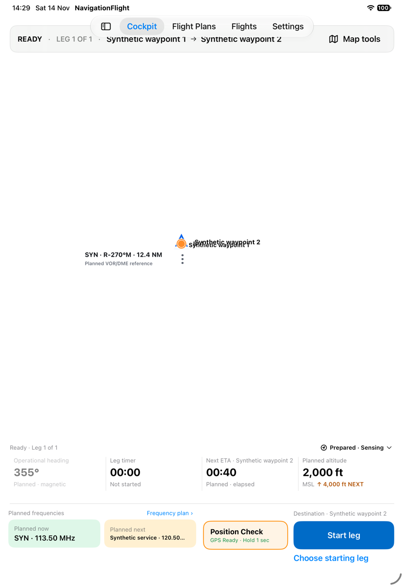
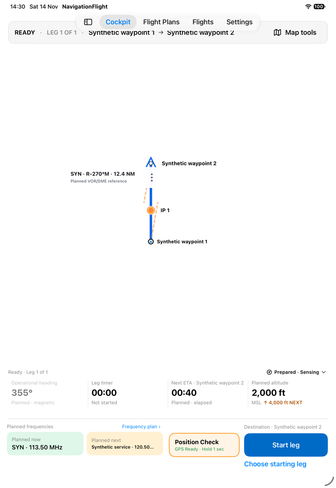

# Request a temporary Position Check

[Back to the map](../README.md) · [Design comparison and limits](../proposed/position-check.md)

**Status:** observed 2026-11-14; account approved by John on 2026-11-14.
iPad Pro 11-inch (M5), iOS 27.0, portrait 834 × 1210 points, baseline `1a2d7e7`.
These captures use the app's existing synthetic location scenarios, not live GPS.
[Capture record](../evidence/capture-batch-04.md).

## S26 · Read the location explanation before Cockpit

**Goal/start:** Understand why location is requested and what is recorded.
A fresh disposable run enables the existing education screen.
**Result:** “Allow Location for Position Check” explains deliberate ten-second disclosure.
Separate text explains that an active Flight records the track, may collect location
in the background, keeps recordings on-device, and exports only on deliberate choice.
Not Now and Continue are offered.

*The visible notice incorporates recording, unlike the older volatile-only Position
Check design footer. This screen is not proof of actual background collection or storage.*

## S27 · Tap for a hint, hold to reveal, then end the check

**Goal/start:** Deliberately request position without showing it during ordinary navigation.
Dismiss education, enter Cockpit, start the leg and close its checklist with the synthetic
recovery-available location source.
**Action/result:** A short tap displays the hold hint; position remains hidden.

Hold for approximately 1.2 seconds. The control becomes “Position Check · 10s — Tap to
end.” An aircraft marker, accuracy halo and dashed vector appear, alongside Rejoin active
leg guidance: **320°M**, approximately **0:20**, with “Apply wind correction.” The active
timer and pilot report action remain visible.

Tap the active control. Position and rejoin guidance disappear, readiness returns, and
the leg remains active with the timer advancing.

*This immediate post-cancel capture shows a much smaller route footprint than the
pre-check view. Exact settled camera restoration is not established here; a later
settled capture is needed before classifying that transition. No physical location,
intercept accuracy, radio state or flight-safety validation is implied by the fixture.*

## S28 · Wait for acquisition and understand timeout

**Goal/start:** Request a check when no usable fix is available. In a separate ready
Flight with the acquiring scenario, hold the control.
**Result:** “Acquiring GPS…” explains that the disclosure timer has not started.
No aircraft position is revealed; Start leg remains available.

After an eleven-second observation interval without a usable sample, the control
returns to Position Check with “GPS acquisition timed out.” The Flight remains READY.

*This observes bounded failure, not a precise timing benchmark. Acquisition cancel,
retry and transition to a newly arriving usable fix are separate branches.*

## S29 · Follow the permission-required route to Settings

**Goal/start:** Reach system settings when location permission is required. In the
permission-required fixture, tap Position Check.
**Result:** The device switches to the Settings app. The captured frame is its launch
transition; the status bar identifies Settings and offers return to NavigationFlight.

**Evidence limit:** This is not a settled settings page, a system authorization prompt,
or a successful permission grant. No device permission was changed. Permission recovery
and denied/restricted states remain unverified beyond this observed handoff.

## S45 · Compare settled cancellation with natural expiry

**Follow-up, same baseline/date/device; [batch 07](../evidence/capture-batch-07.md).**
Start a fresh normal-size ready Flight with synthetic usable location. Before the check,
the full vertical route is visible. Hold to disclose position and rejoin guidance.

Tap to cancel and wait two seconds. Disclosure clears, but the route collapses into
overlapping markers. Wait three more seconds: it remains collapsed.

Hold again, then allow the normal ten-second disclosure to expire, observing after
eleven seconds. Position/guidance clear and a vertical route returns; the VOR label's
placement differs from the initial capture, so exact camera/offset equality is not claimed.

*This resolves S27's transition uncertainty: cancellation's collapsed view persists
beyond settling in a repeated ready-state case. [G18](../proposed/position-check.md#g18--restore-the-map-after-cancellation-or-signal-loss)
records the correction candidate; no GPS disclosure remains after either exit.*

## S46 · Lose GPS during a check

**Goal/start:** Stop showing position/guidance once location becomes unusable.
Use a fresh signal-loss fixture and hold before its scheduled loss.

After the fixture emits signal loss, aircraft/guidance disappear and the control says
“GPS signal lost.” Its text claims cockpit context restored, but the route is again
collapsed into overlapping markers.

*Disclosure cleanup is observed. Context restoration differs from that message and
the approved restoration requirement. This is synthetic loss, not a real receiver test.*
