# Progress manually, review history and follow operational cues

[Back to the map](../README.md) · [Navigation proposals](../proposed/fly-and-revise.md)

**Status:** new observations awaiting account review. [Batch16](../evidence/capture-batch-16.md),
2026-11-14, baseline `1a2d7e7`, iPad Pro11-inch(M5), iOS27, portrait. Synthetic inputs.

## S82 · Wait for explicit successor Start under manual progression

With the existing debug-only manual progression policy, reach the first destination.
The successor is Ready with00:00 and a message that no successor timing starts until
Start next leg. Press Start: leg2 becomes Active and opens its checklist. This is a
supported debug branch, not evidence of a public policy setting.

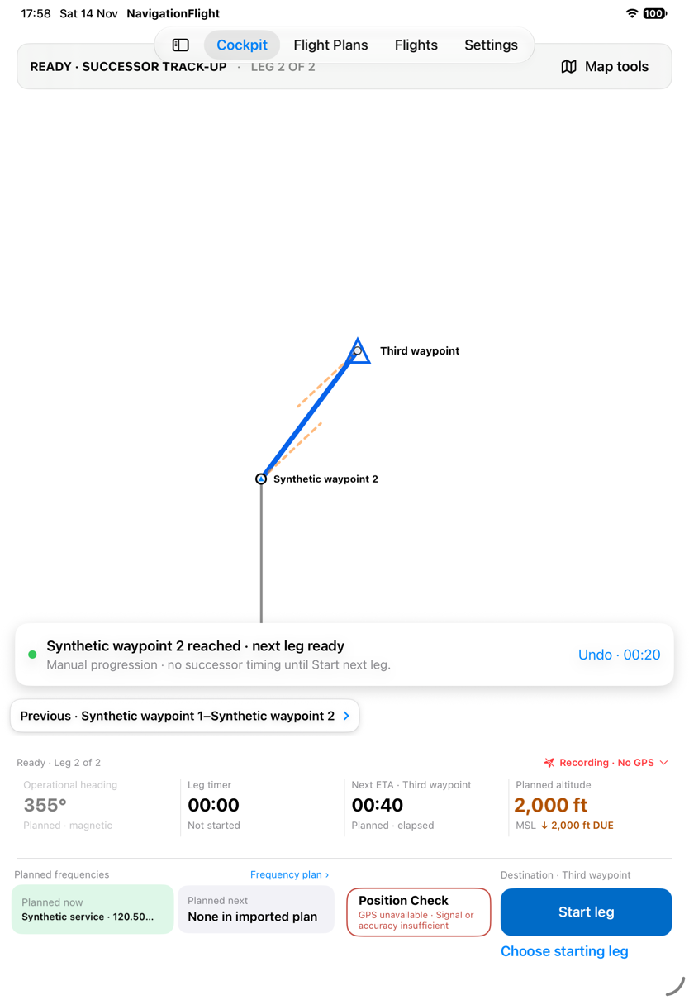

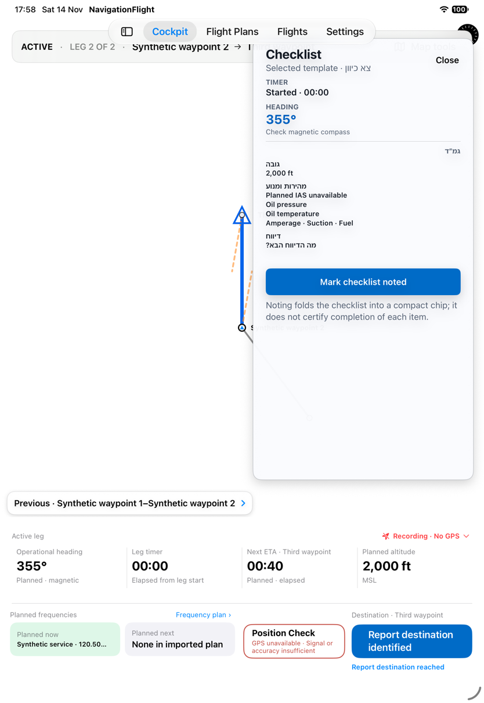

## S83 · Review a completed leg with heading, ETA and requested reference

In a separate run, report IP1 at00:23, commit heading356° and destination ETA01:20,
then request Check. The reference is00:57, while the pilot's01:20 remains operational.
Reach the destination at01:15 and open Previous leg. The panel displays Planned00:40,
Actual01:15 and -00:05 early, plus reached IP/destination and revised heading356°.
The early difference matches the hidden01:20 revision, not the displayed00:40 plan.
Neither the explicit revised ETA nor the requested reference appears in this panel.

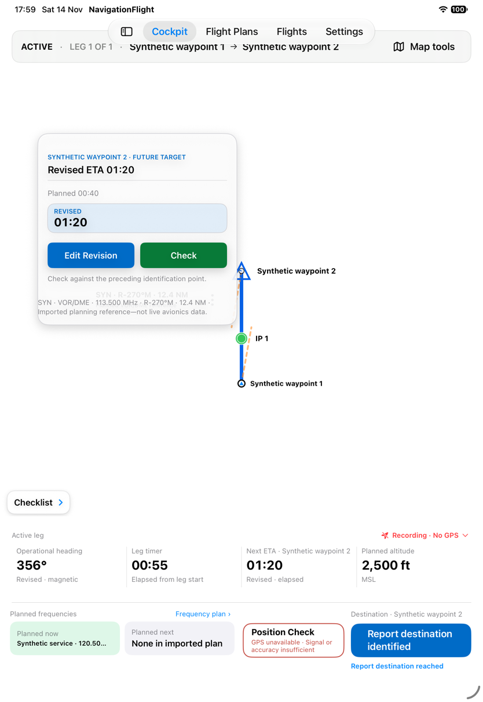

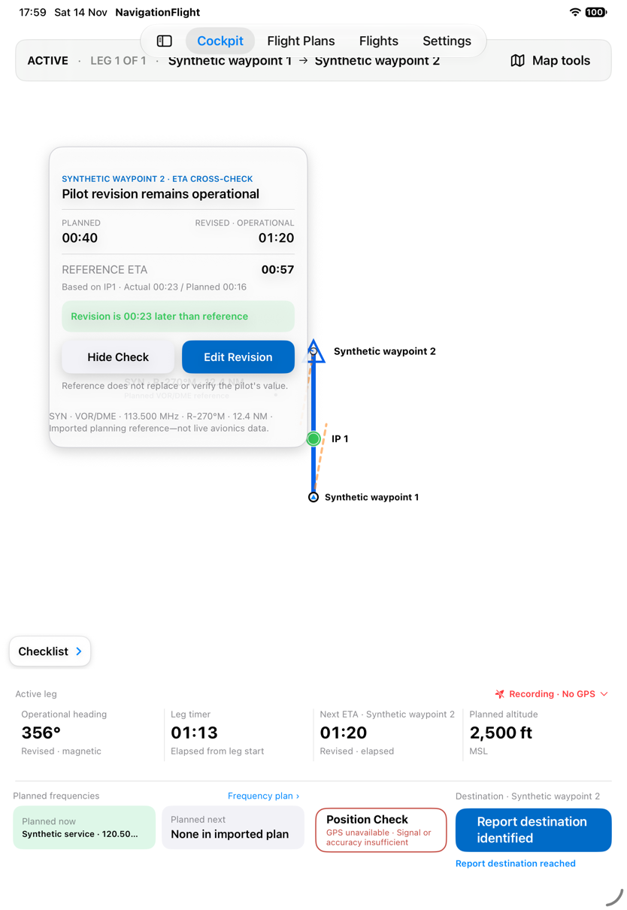

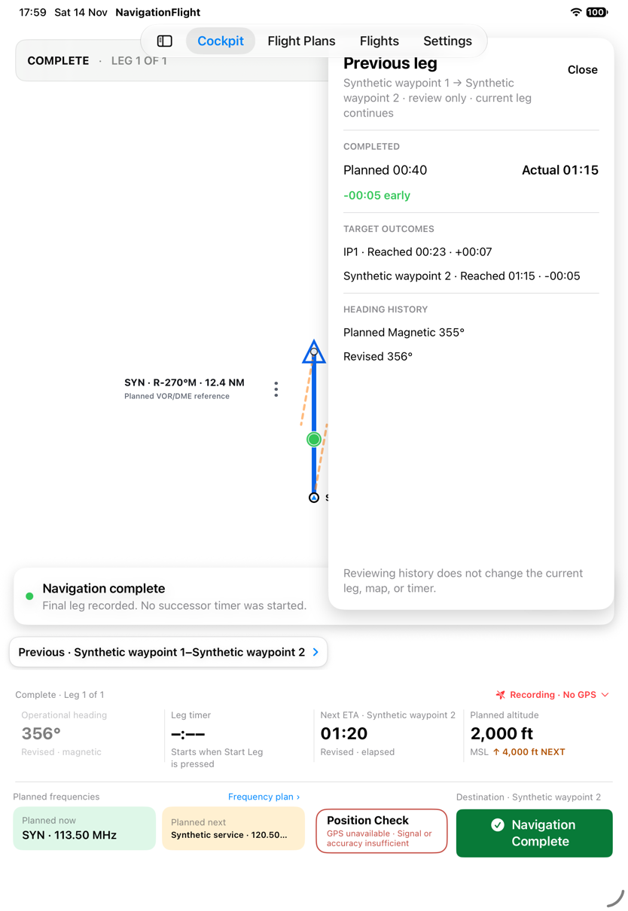

The immediately retained destination callout after final reach still says Future Target
and offers Edit Revision/Check. That capture alone does not prove those actions can
change completed state. [Batch17](../evidence/capture-batch-17.md) reopens the completed
Flight and scrolls Previous leg without revealing more timing fields; ETA/destination
hitpoint and visible-label attempts do not reopen an editor. Historical editing is not
established.
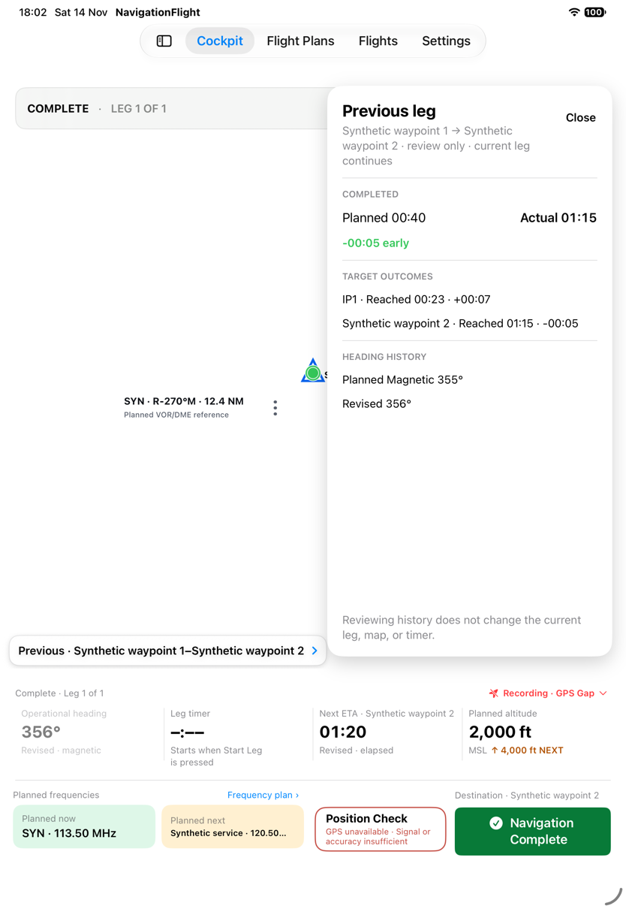

An earlier stale editor hitpoint committed00:40 and a repeat commit produced a dismissed
save alert. The successful01:20 commit is explicitly captured; no fixture value is substituted.

## S84 · Follow altitude and frequency changes across elapsed time

At00:01 the current altitude is2,000ft with4,000ft NEXT. At00:10 it becomes4,000ft DUE.
At00:25, after the combined IP/altitude anchor, it is3,200ft with2,500ft NEXT.
At00:36, after the frequency boundary, Planned now becomes Synthetic service120.50
and Planned next says None in imported plan. Leave Cockpit before the00:40 altitude
boundary and return at00:50: current altitude is2,500ft with no DUE replay visible.

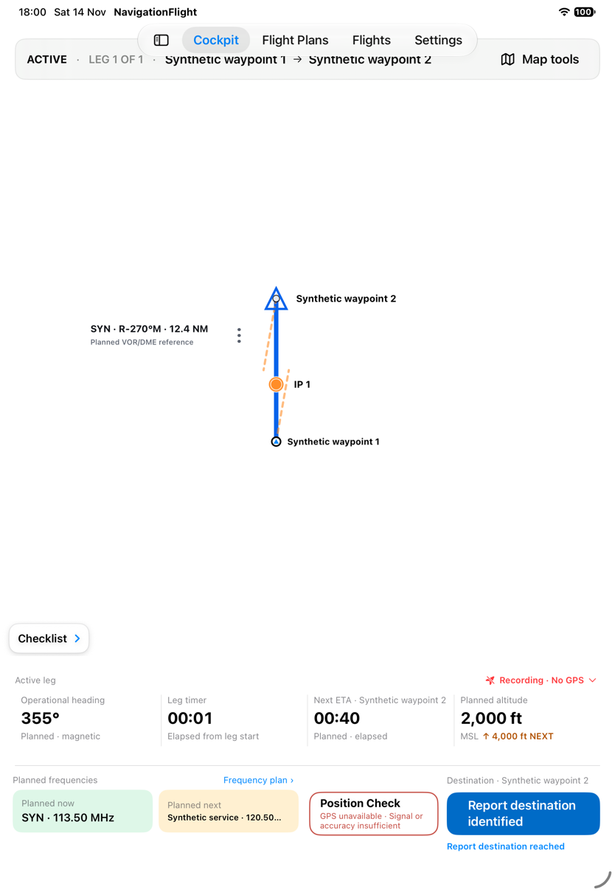

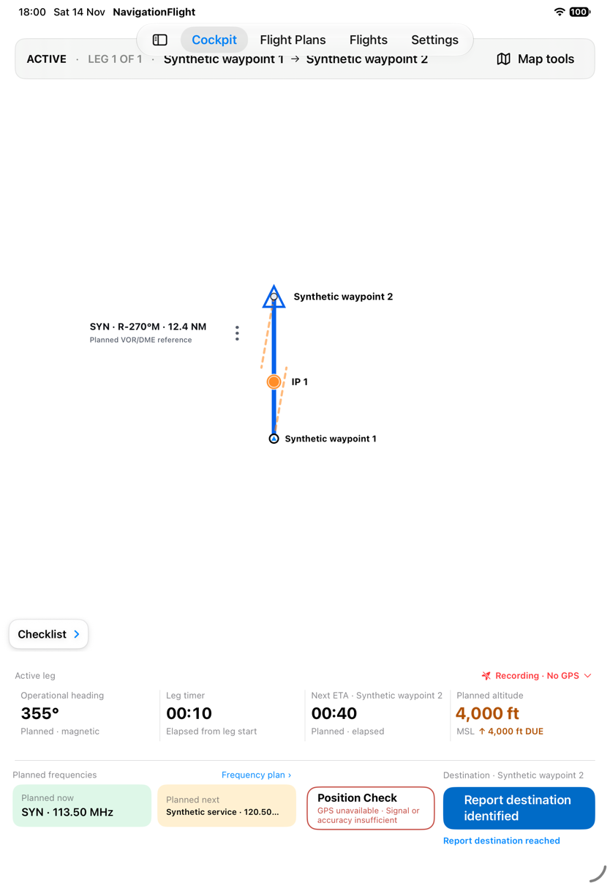

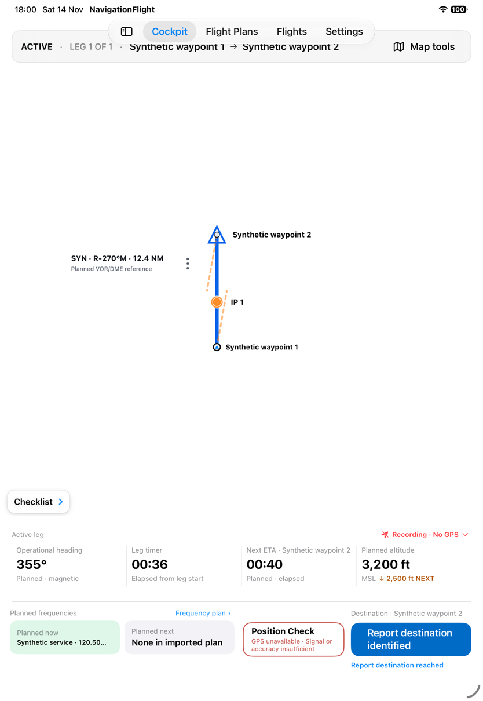

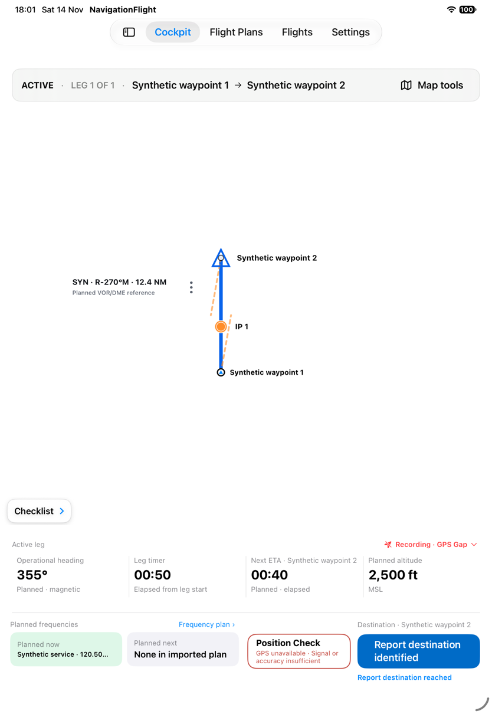

The exact00:16 and00:28 brief animations were missed; filenames containing due/boundary
do not establish those animations. Simultaneous altitude/frequency emphasis, spoken
announcements and haptics are not verified by these still frames.

## S85 · Reveal map controls and leave them untouched

Tap empty map: the three quick focus controls appear at the top right at elapsed01:07.
After six seconds without map interaction, the screenshot at01:13 no longer shows them.
This establishes visible auto-hide in this bounded run, not the exact threshold or
VoiceOver behavior. Prior focus and drag observations remain S62.

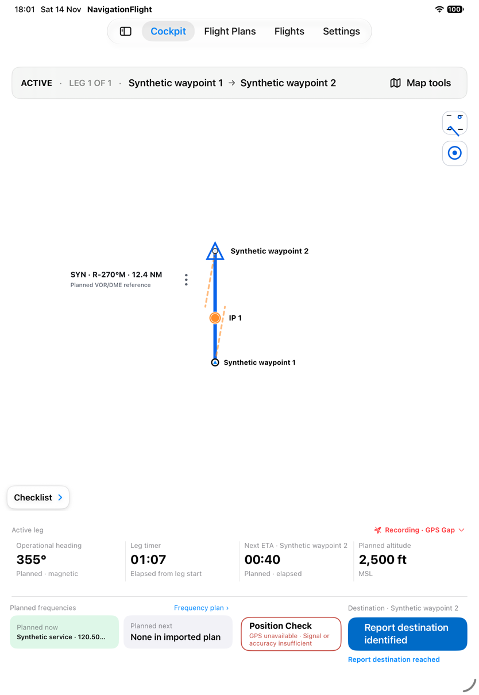

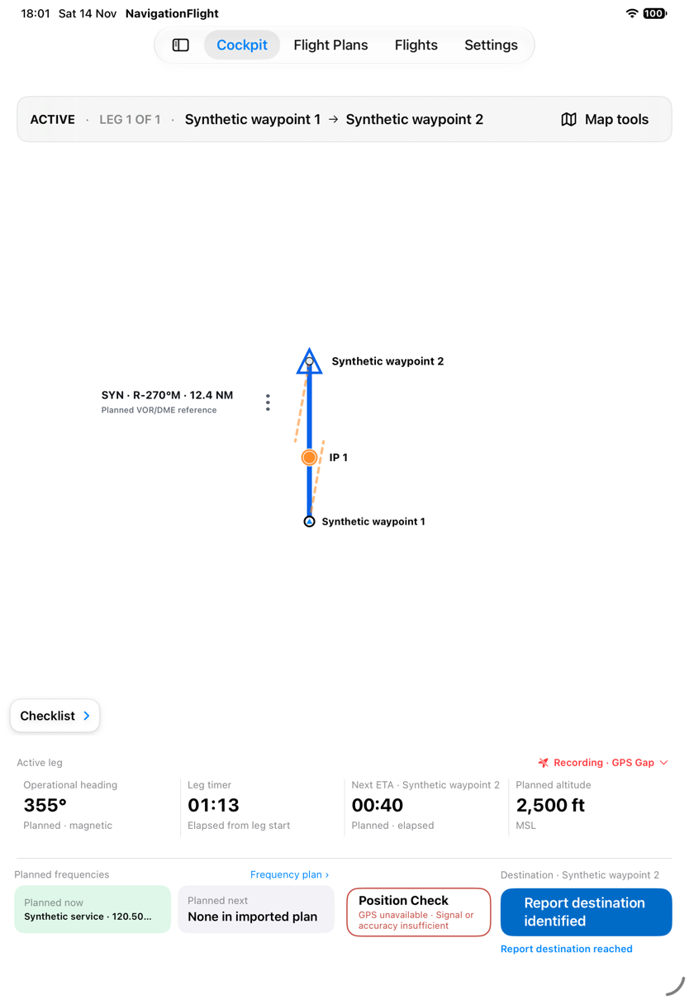
