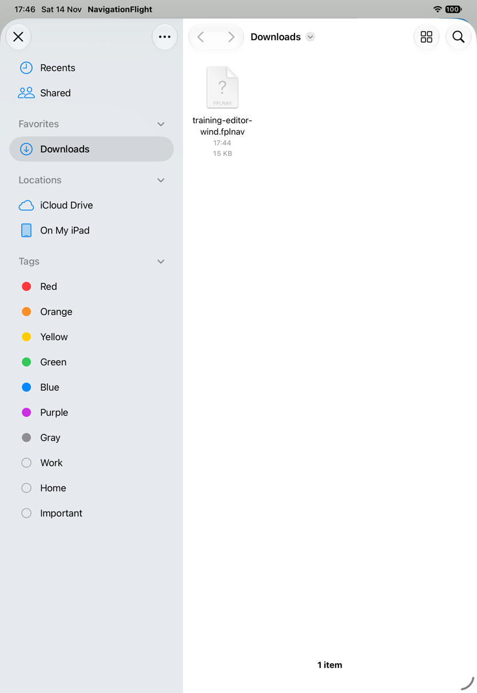
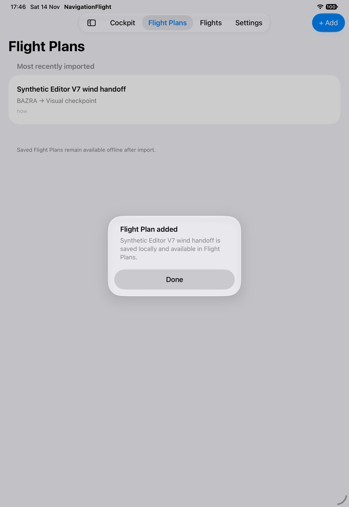
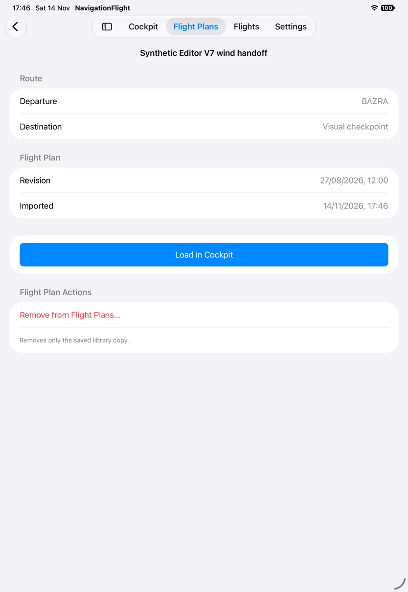
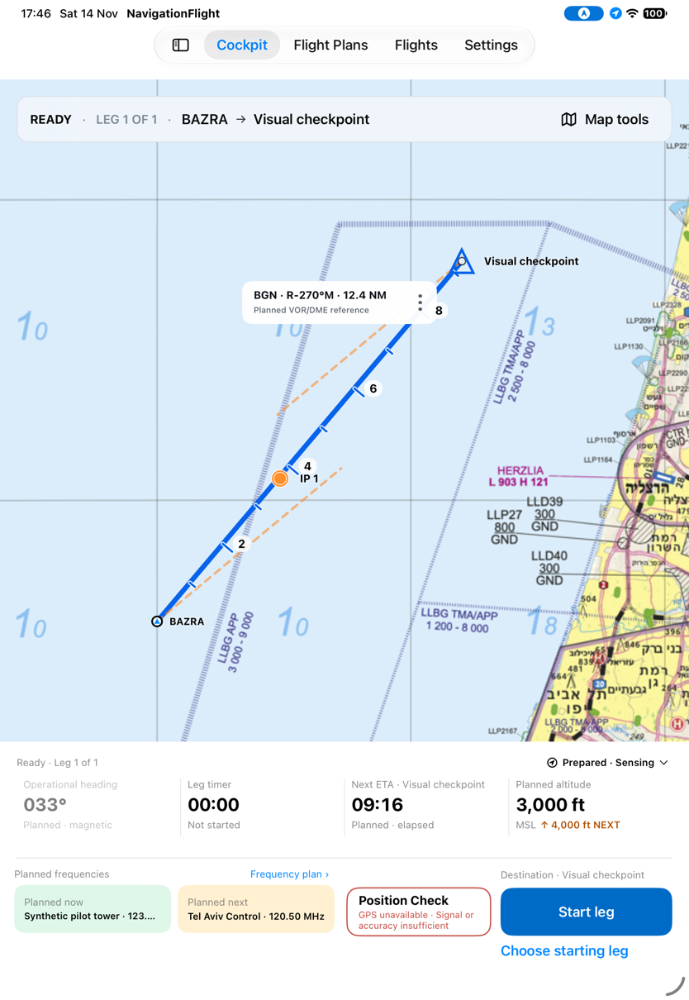
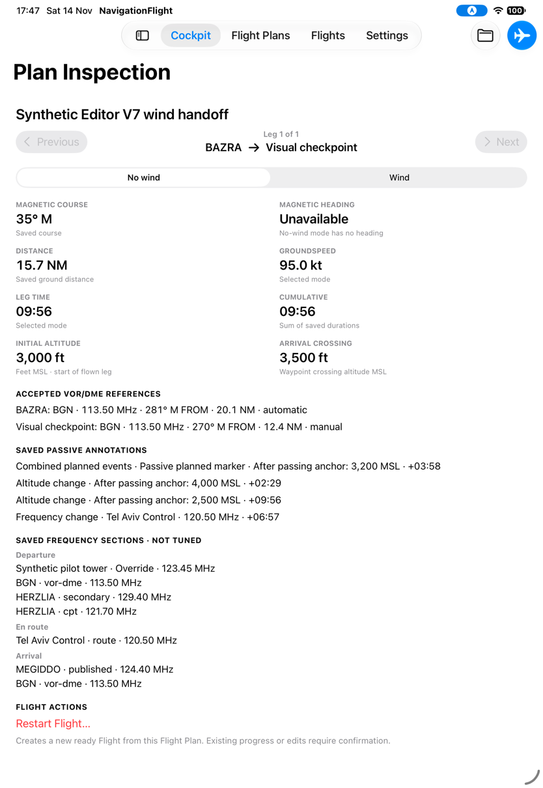
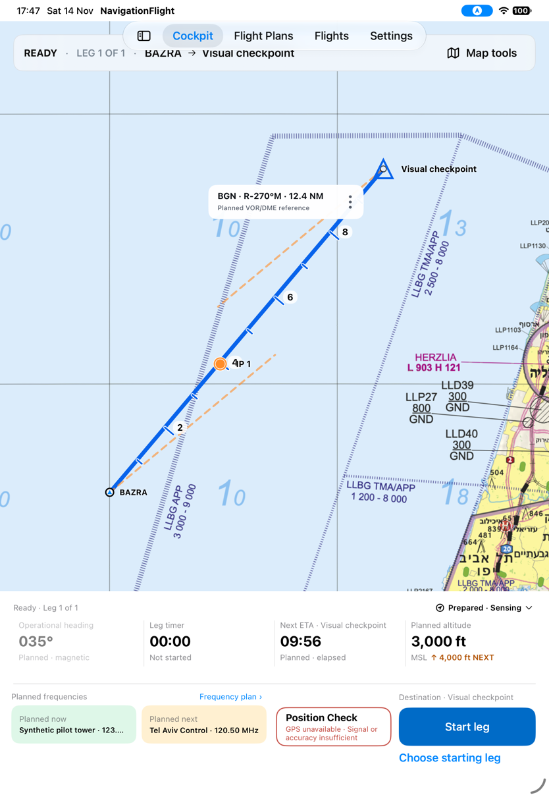
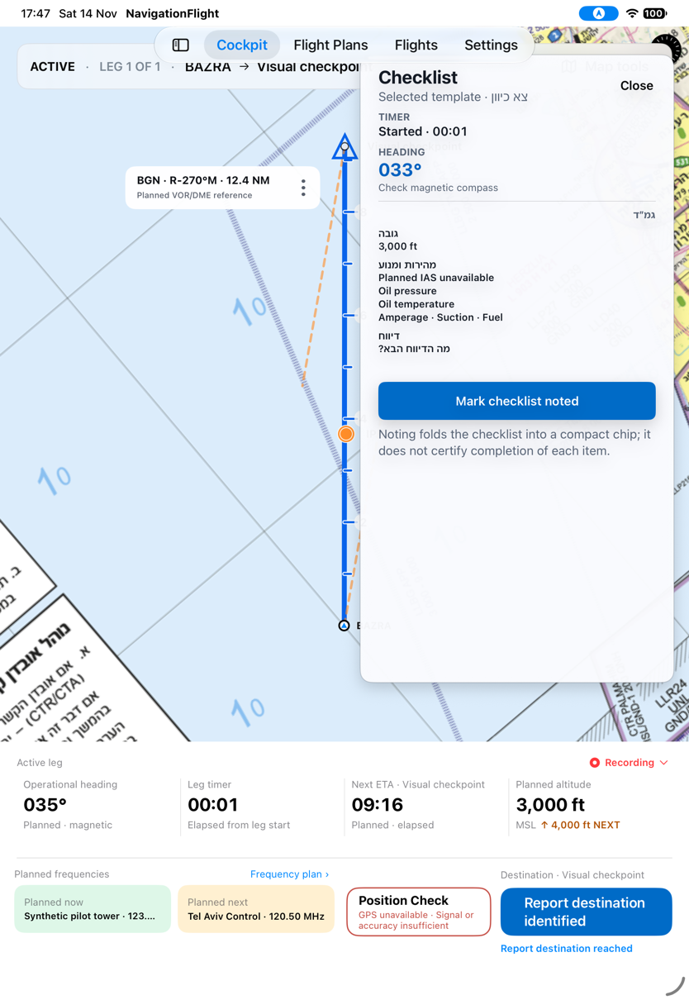
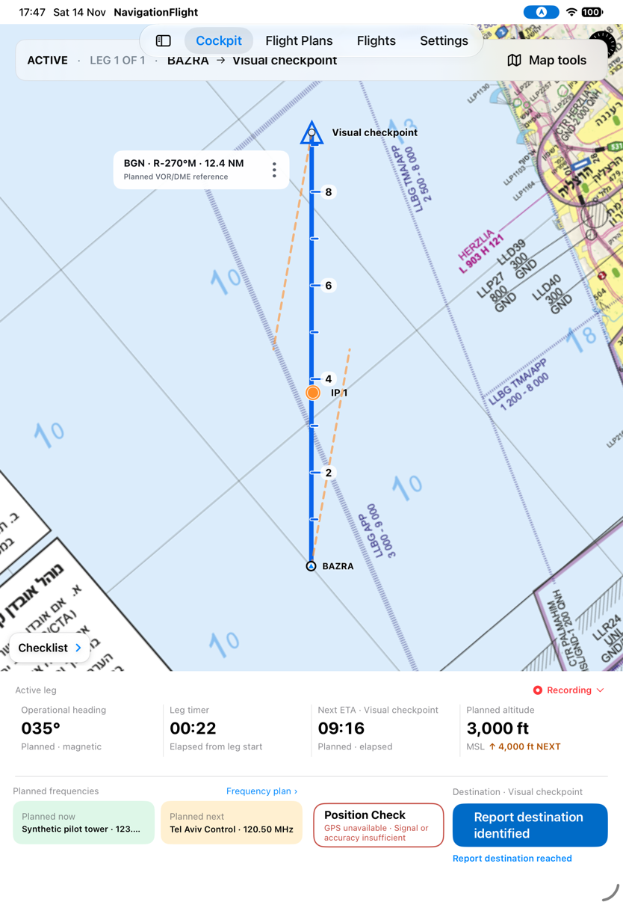

# Import from Files and start the selected calculation

[Back to the map](../README.md) · [Start discrepancy](../proposed/starting-and-correcting.md#g20--start-the-leg-the-pilot-selected)

**Status:** new observations awaiting account review. [Batch13](../evidence/capture-batch-13.md),
2026-11-14, baseline `1a2d7e7`, iPad Pro 11-inch (M5), iOS 27, portrait.

## S75 · Add a plan through the real Files provider

Download the exact synthetic Editor wind fixture from a disposable localhost attachment.
In a fresh empty library, open Add and wait for the system Files picker. Downloads
contains training-editor-wind.fplnav. Selecting it produces Flight Plan added, then a
saved-plan review with the expected name, route and revision. Load in Cockpit displays
the route over the bundled chart. This closes the earlier provider-import evidence gap;
it is not a claim about every third-party provider or operational validity of the plan.

A first attempt used a stale hitpoint during picker presentation and unintentionally
imported an existing provider item into a disposable library. No existing provider file
was modified or its bytes retained. That attempt is excluded from the review captures;
the clean sequence above uses a new library. The localhost server was stopped afterward.

## S76 · Select No wind, then start without reloading

The imported plan initially shows Wind values: 033° and 09:16. Choose No wind in Plan
Inspection: 95 kt and 09:56. Return to Cockpit: ready heading035° and ETA09:56.
Press Start directly. The checklist now says033° and ETA becomes09:16, while the console
still says035°. A settled frame at elapsed00:22 retains the mixed values. There is no
load, restart or replacement between selection and Start. This strengthens G20 with
separate calculation-mode evidence; the earlier equal-values fixture could not prove it.

The synthetic route lies within chart coverage and renders in ready and active states.
It is a test fixture; chart alignment and sensor accuracy are not operationally certified.
