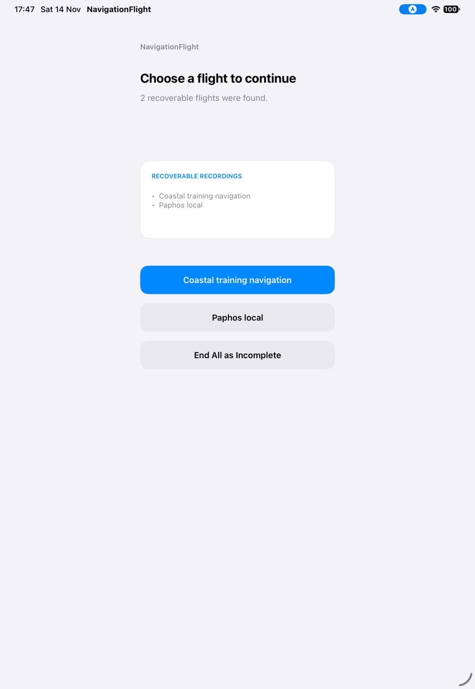
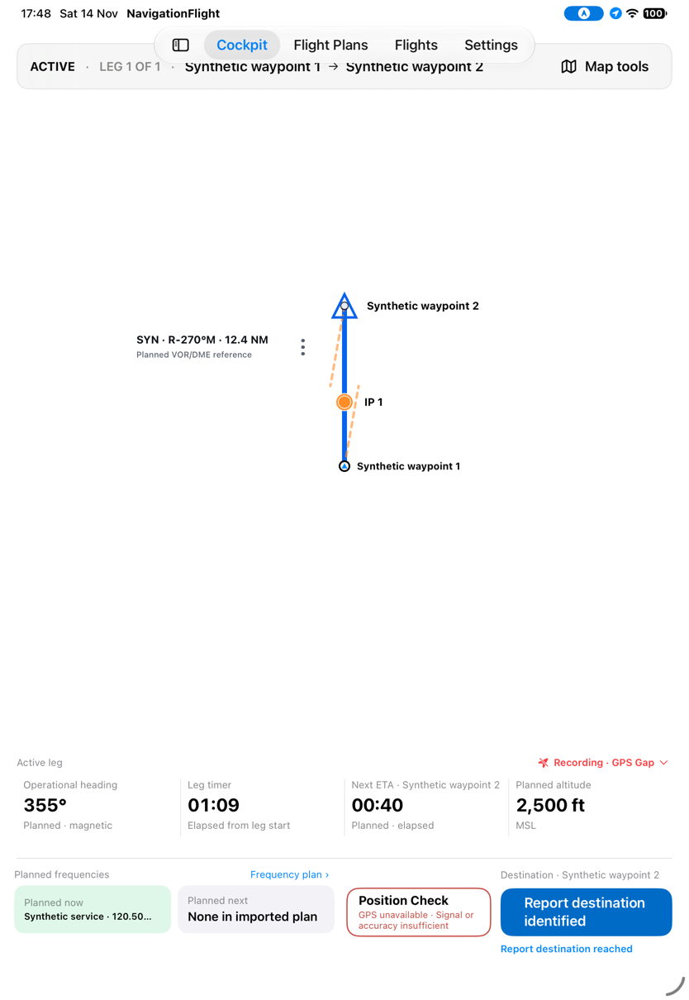
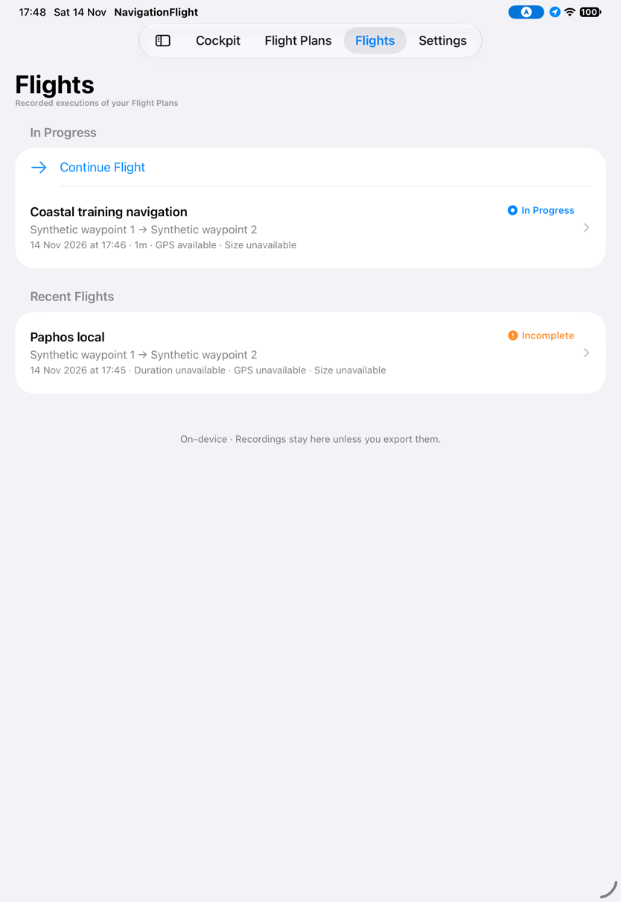
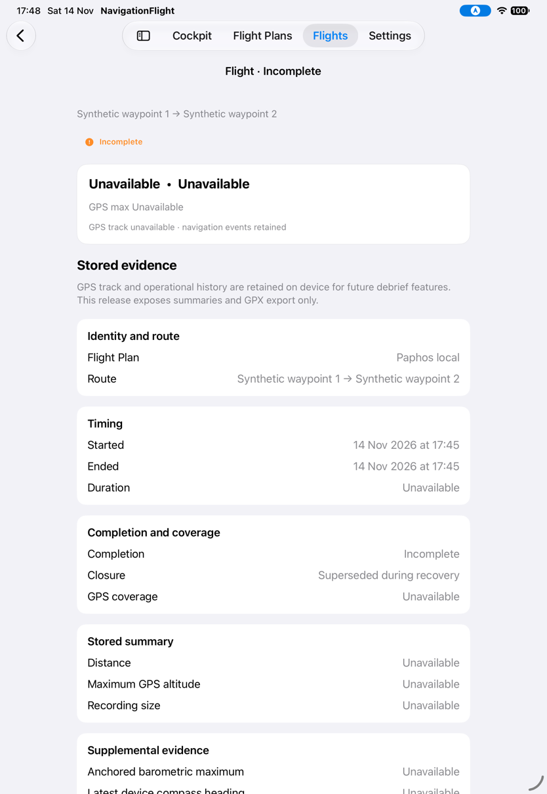
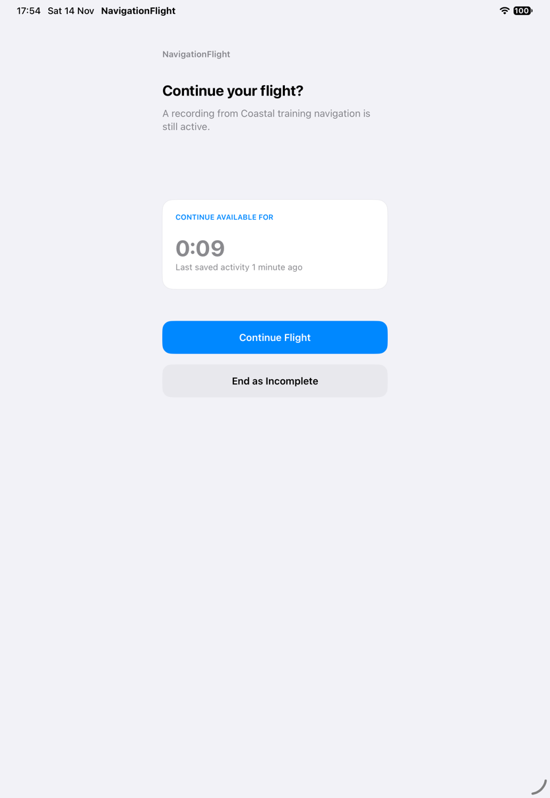
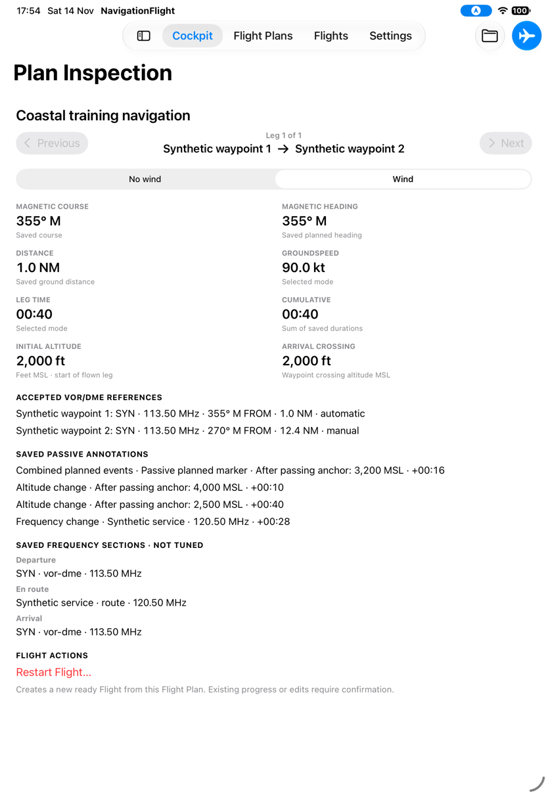

# Choose a recovery candidate or let recovery expire

[Back to the map](../README.md) · [Recovery proposals](../proposed/flights-and-recovery.md)

**Status:** new observations awaiting account review. [Batch14](../evidence/capture-batch-14.md),
2026-11-14, baseline `1a2d7e7`, iPad Pro 11-inch (M5), iOS27, portrait.
Existing synthetic recovery packages establish presentation and transitions, not a
checkpoint created by an earlier real execution.

## S77 · Choose one recoverable Flight and inspect the others

With two candidates, tap Coastal training navigation. Cockpit resumes immediately;
there is no confirmation that the other candidate will close. Flights shows Coastal
In Progress and Paphos local Incomplete. Paphos detail explicitly says Superseded during
recovery. The candidate selection is deliberate, but its consequence is not confirmed.
This extends G12 beyond End All to the individual-selection branch.

## S78 · Leave recovery untouched until its window expires

Open a fresh gate with four minutes remaining and leave Continue and End untouched.
The valid uninterrupted sequence reaches00:09, then opens legacy Plan Inspection.
No expiry explanation, View Flight or Continue to App result is presented. Visiting
Flights manually finds the recording Incomplete; detail gives Recovery expired.
The gate disappears, so stale Continue is no longer tappable in this sequence. A
concurrent tap exactly at expiry and expiry while backgrounded remain unverified.

An earlier attempt was invalidated by device-tool idle session cleanup; it supplies no
app-expiry evidence. Countdown text is partially absent in some captured transition
frames; hierarchy values and other frames retain the countdown, so no separate typography
defect is inferred from those images. This evidence extends G11's recovery-result finding.
