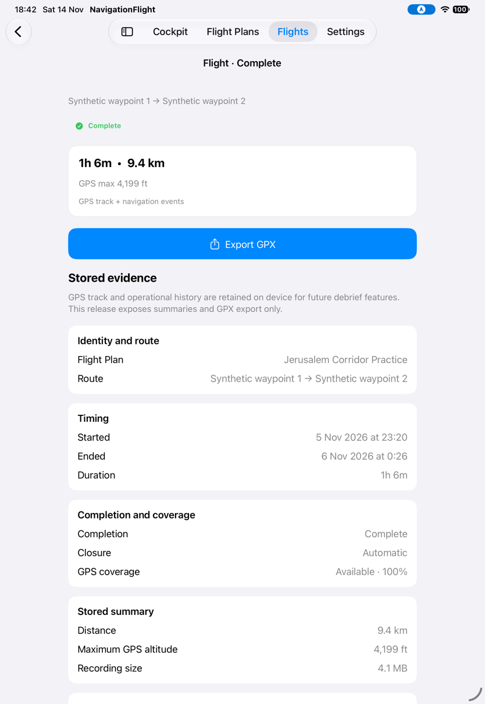
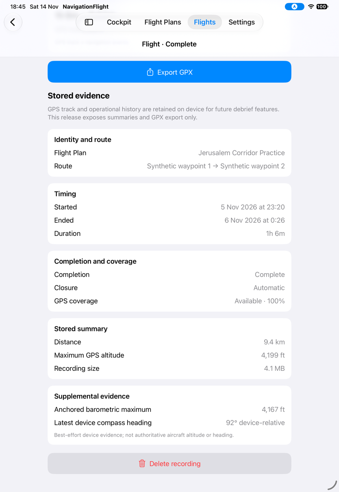
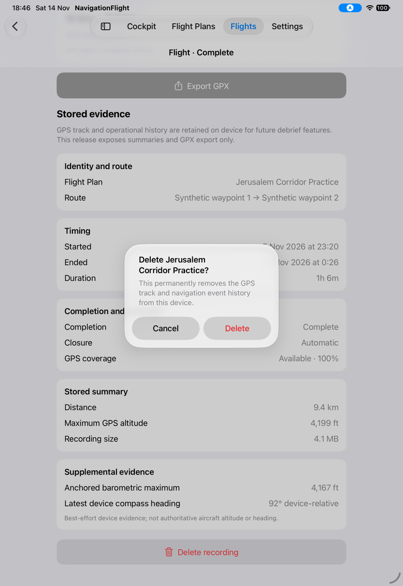

# Repeat recording actions under persistent faults

[Back to the map](../README.md) · [Batch23](../evidence/capture-batch-23.md)

**Status:** new observation awaiting account review; baseline `1a2d7e7`,2026-11-14,
iPad Pro11-inch(M5),iOS27,portrait. Disposable seeded recording; persistent export/delete
failure inputs. This does not reproduce exhausted storage or a transient fault clearing.

## S93 · Retry export and repeat deletion

The runtime observer reports an initial GPX export failed alert with Cancel and Retry.
Selecting Retry returns to detail without a renewed visible error or share sheet.
Confirming Delete likewise returns to detail without a visible failure alert. The next
Delete opens confirmation again; confirming it leaves the same detail visible. A later
Export tap also leaves detail without an alert or share sheet.

The final filename contains “alert” but no alert is visible; actions in the manifest
record the actual outcome. These observations narrow E05: repeated actions were tried,
but successful recovery, renewed failure feedback and persistence after relaunch are
not verified. A retained detail view alone does not establish package existence. Treat
the missing repeated feedback as an investigation lead, not a proven data-loss defect
or an approved new behavioral contract.
