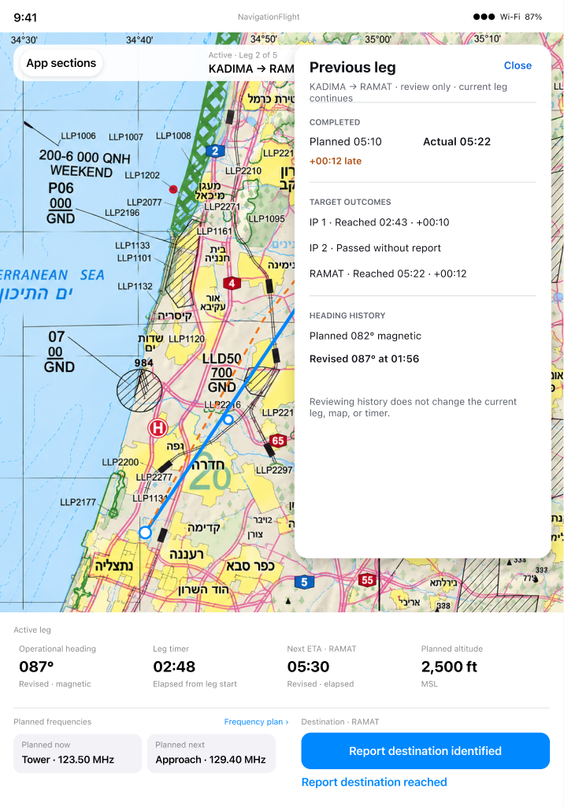

# Completed history: retain the comparison context

[Back to the map](../README.md) · [Observed history](../current/progression-history-and-cues.md#s83--review-a-completed-leg-with-heading-eta-and-requested-reference)

**Status:** new finding; owner decision remains pending until exploration review finishes.

## G23 · Show revised and requested reference timing in completed history

**Goal:** Understand how actual arrival compares with the plan and each committed revision.
**Today:** S83 commits ETA01:20, explicitly requests reference00:57, and reaches at01:15.
Previous leg displays Planned00:40, Actual01:15 and -00:05 early, without displaying the
01:20 revision behind that difference. The requested reference is absent. Heading356°
is retained, so the finding concerns incomplete timing history and comparison context,
not wholesale loss of the completed leg. A settled panel-scroll attempt in
[batch17](../evidence/capture-batch-17.md) exposes no additional timing fields.

**Intended outcome:** Flying §70 requires planned, every committed revised and actual
ETA, with actual-versus-planned and actual-versus-revised differences. §74 requires
reference results only when explicitly requested; §75 prohibits retroactive calculation.
This scenario should identify +00:35 versus plan and -00:05 versus revision01:20,
alongside the requested reference00:57. Any earlier committed revision also remains history.

*Exact Iteration10 node [198:320](https://www.figma.com/design/yvLXb8bUFBiZHqsag4hq6I?node-id=198-320)
shows target outcomes and heading history, but its example does not show revised-ETA or
requested-reference history. The complete timing-history variant is **design needed/
unverified**; copying the sparse example cannot satisfy the written contract.*

**Recommendation:** Retain each timing value with an explicit comparison baseline and
include previously requested references without calculating new historical ones. Complete
or locate the paired design for multiple revisions/reference values before implementation.
The immediate Future Target callout after reach is a separate bounded observation; it
does not establish that historical edits can be committed. No source fix is authorized.
