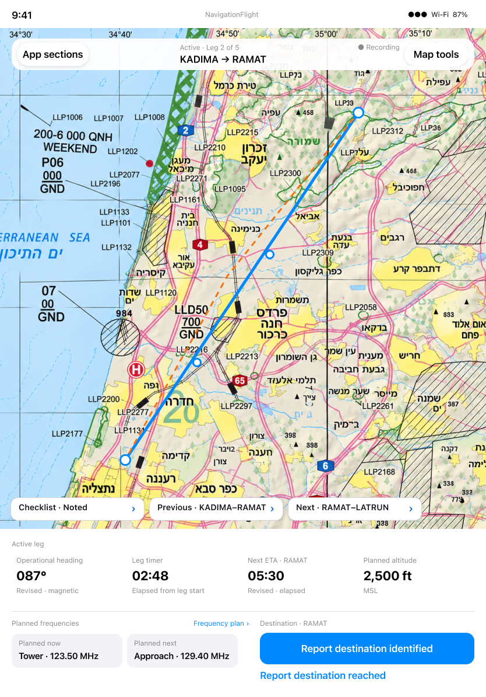
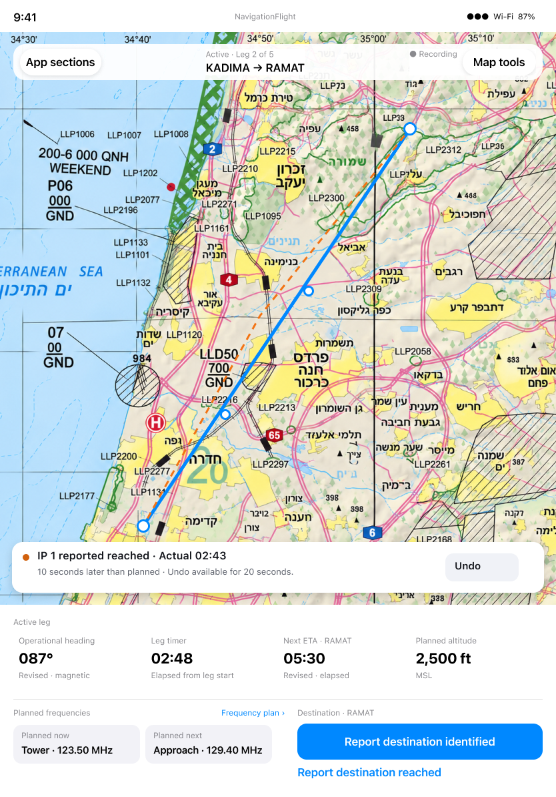
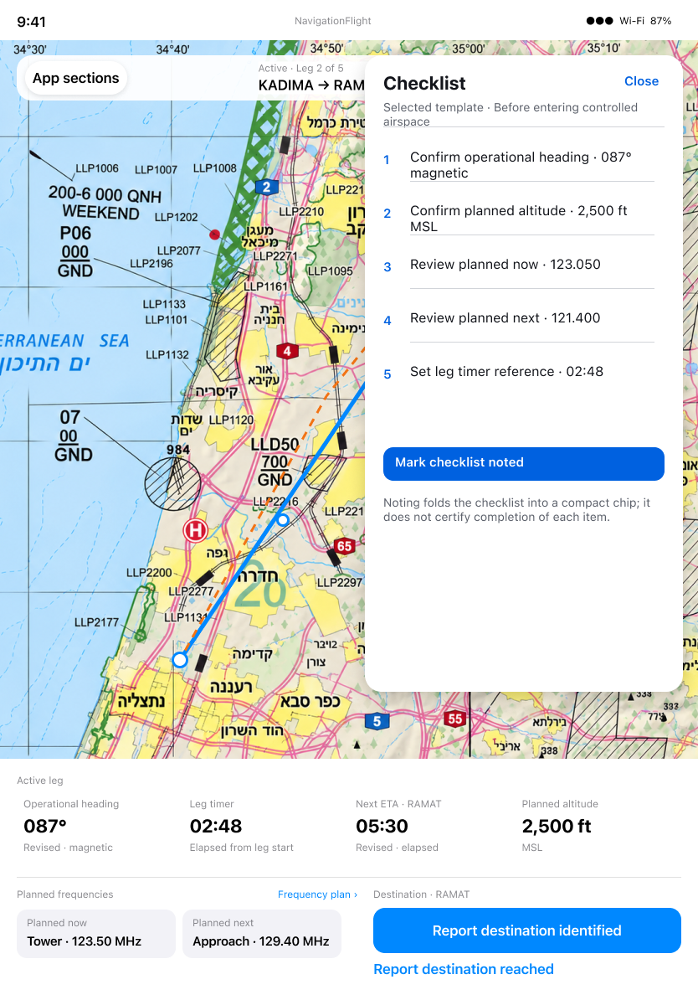
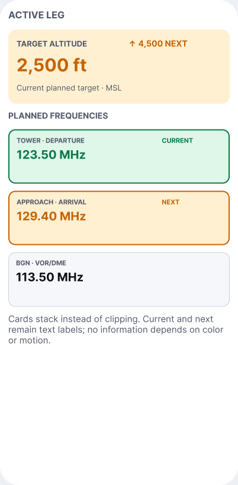

# Continuity, IP correction, Settings and readable layouts

[Back to the map](../README.md) · [Observed chapter](../current/continuity-and-adaptations.md)

**Status:** pending owner review; no source, contracts or designs changed.

## G14 · Restore visible map annotations after background

**Goal:** Resume navigation with the route's identifying information still visible.
**Today:** [S40](../current/continuity-and-adaptations.md#s40--return-from-background-with-timing-intact-but-labels-missing)
preserves the timer and lines but loses rendered waypoint/IP/VOR annotations after
foreground, including a settled second capture. Semantic hierarchy presence does not
compensate for missing visual information.

**Intended:** Flying's chart/overlay and background-continuity requirements preserve
usable navigation context. The approved [closed-disclosure/map direction 206:984](https://www.figma.com/design/yvLXb8bUFBiZHqsag4hq6I?node-id=206-984)
shows the surrounding context, not an exact pixel target for this synthetic route.

**Recommendation:** Prioritize reproducing and correcting the foreground-rendering
path, retaining elapsed-time behavior. Validate a real-chart fixture and both supported
iPad orientations before acceptance. The defect candidate is bounded to the observed
simulator path; root cause and device breadth remain unverified. Fix authorization pending.

## G15 · Make IP-reach correction discoverable

**Goal:** Correct an accidental identification-point reach report within the approved
twenty-second undo period, just as a destination reach can be corrected.
**Today:** [S41](../current/continuity-and-adaptations.md#s41--report-an-identification-point-reached)
shows a reached result with Revise Next ETA but no visible Undo in the immediate frame
or hierarchy. Destination Undo is observed in [S22](../current/fly-and-revise.md#s22--complete-the-final-leg-and-undo-the-reach-report).

[S52 follow-up](../current/recording-lifecycle.md#s52--search-for-ip-undo-and-check-a-committed-eta)
confirms no visible/hierarchy Undo immediately or with the callout dismissed nine seconds
later, inside the approved twenty-second window. **Classification:** observed missing
correction affordance in this path; underlying command availability remains unverified.

*Exact Flying state [199:442](https://www.figma.com/design/yvLXb8bUFBiZHqsag4hq6I?node-id=199-442)
provides the intended correction reference, not a current-app screenshot.*

**Recommendation:** Complete the approved bounded IP correction affordance with parity
of reach semantics, preserving the destination Undo that was observed working. Owner
priority, paired integration review and implementation authorization remain pending.

## G16 · Choose a bundled start checklist

**Goal:** Select the checklist suited to the Flight before starting a leg.
**Today:** [S43](../current/continuity-and-adaptations.md#s43--open-settings)
is a placeholder; no selector is offered. The active cockpit does render a selected
template title and content ([S17](../current/fly-and-revise.md#s17--start-navigation-and-note-the-checklist)).
Flying §§112–116 approves two or three bundled templates selected in Settings.

*Exact rendering reference [198:250](https://www.figma.com/design/yvLXb8bUFBiZHqsag4hq6I?node-id=198-250).
It does not design the missing Settings selector. A complete authoritative selector
state has not been identified: **design needed/unverified**.*

**Recommendation:** Retain the approved selection capability and complete its Settings
design before a delivery ticket. Alternatively defer it explicitly and document the
fixed default, or retire it through a product decision. A template editor is not requested;
future recording-window preferences are not part of this gap. Behavior/design scope pending.

## G17 · Retain readable labels at accessibility sizes

**Goal:** Identify routes, targets and operational references with Larger Text.
**Today:** [S44](../current/continuity-and-adaptations.md#s44--use-the-largest-accessibility-text-size)
shows route names fragmented into narrow columns and an IP label clipped. Text scaling
exists; the observed layouts do not always preserve readable meaning.

*Exact rule/reference [6:82](https://www.figma.com/design/ZTfeKXbhjsqvZMagg9JPyq?node-id=6-82).
Its older full-frequency-list hierarchy is disputed in G06, but the no-clipping principle
remains relevant. This is not a complete approved large-text map/inspection design.*

**Recommendation:** Complete large-text route/target layouts using the canonical review
decision from G02, then inspect interactive scrolling and all essential controls.
Do not reduce the user's text preference as a workaround. Exact adaptation design,
priority and implementation authorization remain pending. VoiceOver and Reduce Motion
need separate evidence; this visual pass does not certify accessibility compliance.
