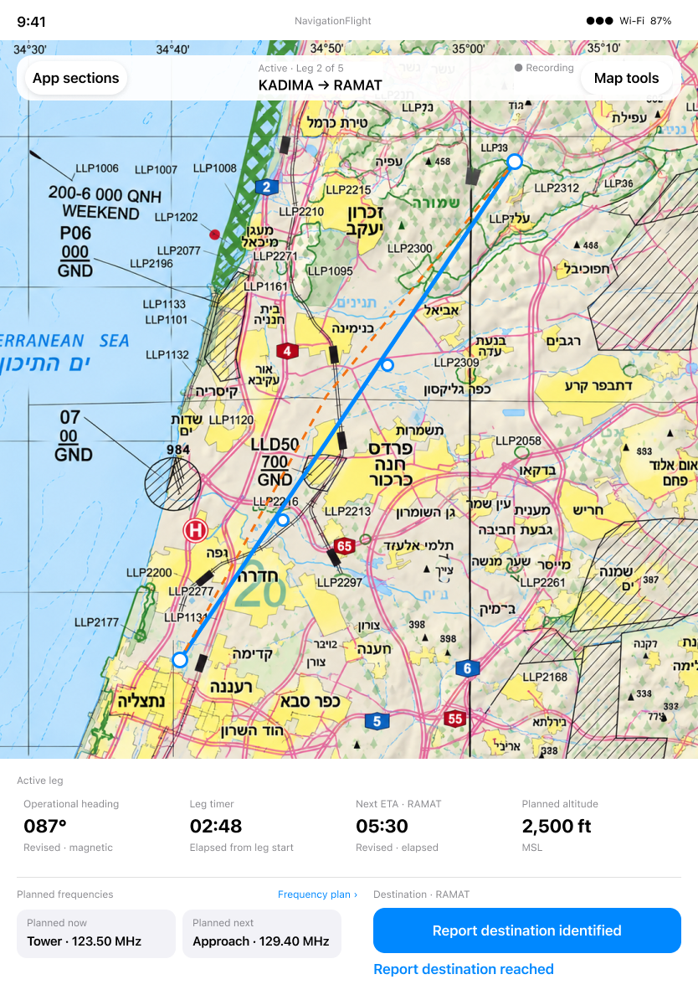
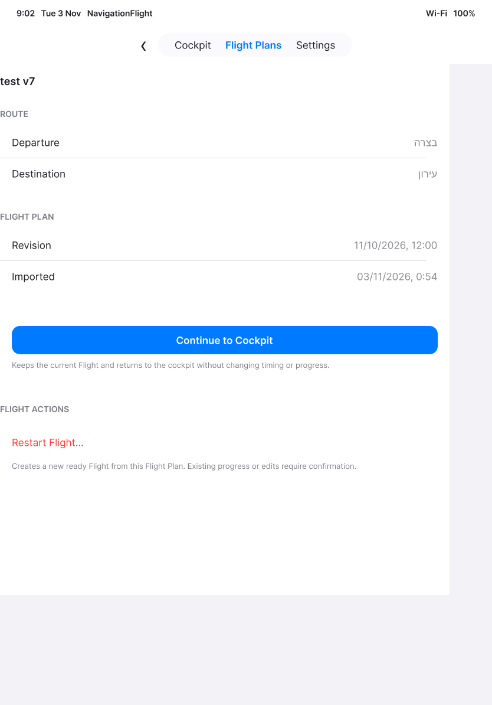
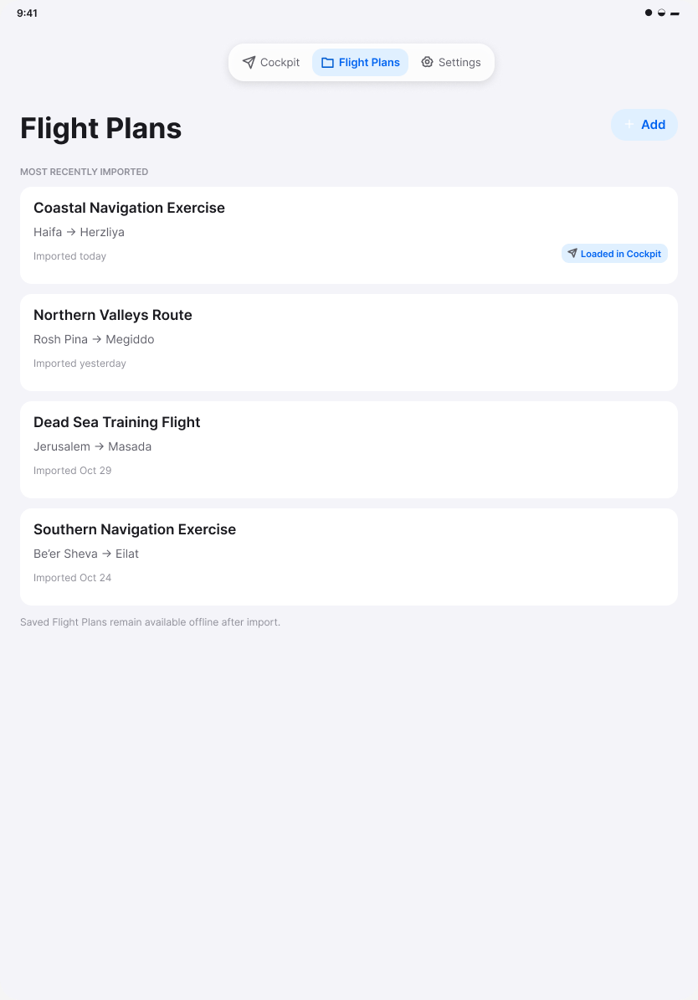
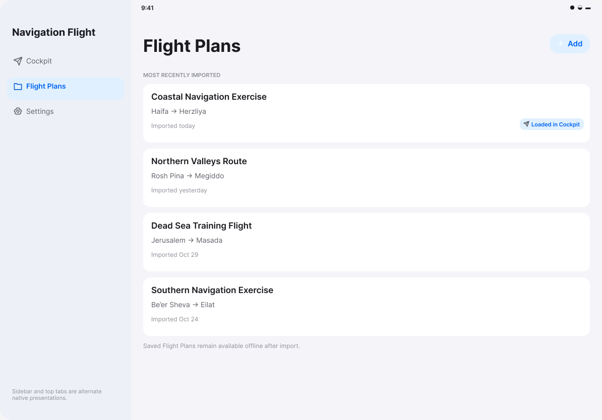
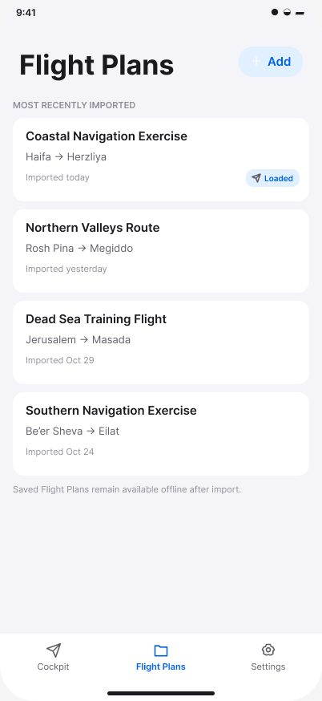

# Flight Plans to Cockpit: differences and decisions

[Back to the map](../README.md) · [Observed user journey](../current/flight-plans-to-cockpit.md)

**Status:** findings and recommendations only; owner decisions pending. No app fixes,
contract updates, new designs, or tickets have been applied. Prior design approval is
not implementation acceptance for this reconciliation.

## G01 · Return to Cockpit with route information unobscured

**Related story:** [S08, inspection return](../current/flight-plans-to-cockpit.md#s08--return-from-plan-inspection),
compared with [S06, before inspection](../current/flight-plans-to-cockpit.md#s06--use-the-ready-cockpit-in-landscape-or-on-a-phone).

**Today:** In the ready iPad landscape Flight, Map Tools → Inspect flight plan →
toolbar Cockpit shifts the route strip beneath the app tabs. The route text and Map
Tools area overlap the tab material. The initial load and library Continue path are clear.

**Wanted outcome:** Returning from either review entry point keeps essential route
information and controls outside the app-navigation occlusion area. This follows
library spec §10; it does not require replacing native tabs or forcing a sidebar.

**Design:** Approved cockpit hierarchy reference
[190:96](https://www.figma.com/design/yvLXb8bUFBiZHqsag4hq6I?node-id=190-96),
with the explicit adaptive-shell rule in library spec §§9–10. The preview depicts an
active portrait state; it supports the unobscured hierarchy, not exact ready-landscape
pixel placement. The existing library landscape reference is shown under G04.

*Intended design, not a running-app screenshot. Current before/after images are in S06/S08.*

**Recommendation / decision:** Plan a focused correction, then recapture both return
paths in both iPad orientations. Owner classification/priority and implementation
authorization remain pending. No claim is made about overlapped hit-target behavior.

**Expanded observation:** [S16](../current/manage-flight-plans.md#s16--remove-the-saved-copy-and-keep-using-the-loaded-flight)
also shows the overlap after a portrait active-Flight inspection return. The original
ready-landscape evidence remains unchanged; the finding is no longer limited to it.

## G02 · Review the loaded plan consistently

**Related stories:** [S07, Map Tools inspection](../current/flight-plans-to-cockpit.md#s07--inspect-planning-details-from-map-tools)
and [S09, loaded library review](../current/flight-plans-to-cockpit.md#s09--return-through-the-flight-plans-review).

**Today:** Flight Plans offers the prominent Continue action and separated Restart
action. Map Tools opens a different Plan Inspection screen, rich in calculations,
mode selection and annotations, with an icon-only toolbar return action. These are
two current entry points, not two versions of one screenshot.

**Wanted outcome:** Library spec §22 and Flying a Leg's cross-feature review authority
call for the canonical pre-flight review to replace the legacy inspection while
preserving valid pre-flight capabilities and selection. Simply deleting the detailed
screen would not satisfy the preservation requirement.

**Design:** [Approved loaded-review action hierarchy, 41:76](https://www.figma.com/design/FDSRcz1yl7bkSoziKvGzQ1?node-id=41-76),
iteration 04, approved 2026-11-03:

*The action hierarchy is represented by the current library review. This preview does
not show how all the detailed planning capabilities should be integrated.*

**Design needed:** A usable combined-state design has not been identified in the
inspected references. That is a bounded design-evidence gap, not proof that no such
design exists elsewhere. Search remaining approved coverage before authoring a replacement.

**Recommendation / decision:** Retain the discrepancy for reconciliation; prefer
completing the canonical review while preserving planning details. Owner options are
plan/design that integration, preserve two explicit review experiences and revise the
contract, defer, or retire selected capabilities explicitly. Behavior choice and any
new design-write scope remain unresolved. No capability is silently retired.

## G03 · Read complete operational labels and frequencies

**Related stories:** [S05, portrait](../current/flight-plans-to-cockpit.md#s05--load-a-ready-flight)
and [S06, landscape/phone](../current/flight-plans-to-cockpit.md#s06--use-the-ready-cockpit-in-landscape-or-on-a-phone).

**Today:** The primary iPad portrait next-frequency card truncates
“Synthetic service · 120.50…”; its full semantic label is present in the hierarchy.
Landscape shows full frequencies but truncates the Next ETA destination and Target
Altitude headings. Phone shows both frequency values in full. Full semantic text does
not establish visual readability or a complete VoiceOver audit.

**Wanted outcome:** Preserve the map-first console while letting the pilot identify
the service, complete frequency/unit, and instrument meaning at a glance. The approved
cockpit direction shows those values in full; no exact long-content overflow rule was
identified in this chapter.

**Design:** Approved [portrait hierarchy, 190:96](https://www.figma.com/design/yvLXb8bUFBiZHqsag4hq6I?node-id=190-96)
is the reference. A long-content treatment remains **design needed/unverified**; do not
invent a smaller font, extra row, or scrolling behavior as an approved target.

**Recommendation / decision:** Keep this as a presentation finding and plan a long-name
design check with real Flight Plans, Larger Text, and all supported layouts. Owner may
plan/design, preserve current truncation with an explicit policy, defer, or retire the
affected inline detail. Priority and desired overflow behavior remain unresolved.

## G04 · Understand which navigation contract is current

**Related stories:** [S01](../current/flight-plans-to-cockpit.md#s01--open-an-empty-flight-plans-library),
[S03](../current/flight-plans-to-cockpit.md#s03--choose-a-saved-flight-plan), and
[S09](../current/flight-plans-to-cockpit.md#s09--return-through-the-flight-plans-review).

**Today:** The app exposes four sections. The original library specification and its
design previews show three; the recording specification explicitly adds Flights and
supersedes the old non-restoration rule. The older parent's issue body still says
changes requested despite a later owner approval comment. These are traceability
problems, not evidence that the fourth section should be removed.

**Wanted outcome:** A reader of the older contract can immediately find the explicit
recording extension, while original approval dates and historical designs remain intact.

**Design:** No new UI design is required for a documentation correction. The inspected
library references below remain useful for title, route, import-time and loaded-state
hierarchy, with their superseded three-section shell labelled as historical.

Exact nodes: [28:187](https://www.figma.com/design/FDSRcz1yl7bkSoziKvGzQ1?node-id=28-187),
[28:239](https://www.figma.com/design/FDSRcz1yl7bkSoziKvGzQ1?node-id=28-239),
[28:295](https://www.figma.com/design/FDSRcz1yl7bkSoziKvGzQ1?node-id=28-295).
Only portrait library runtime is captured here; these secondary previews do not
constitute a secondary-device library match claim.

**Recommendation / decision:** Propose short supersession pointers in the older spec
and reconcile tracker status text with recorded approval. Owner approval for contract
edits and tracker writes remains pending; this report preserves the original artifacts.

## E01 · Finish observing import and state-preservation branches

**Related story:** [S02, picker](../current/flight-plans-to-cockpit.md#s02--open-the-file-picker).
The picker opened, but cancel completion and actual file import were not observed to
completion. Seeded data is not import proof. The later chapter should capture settled
cancel, successful real-picker import, failure/replacement branches, and offline relaunch.
Active-flight continuity also needs an active timer and recorded work, not the ready
Flight used here. These are **missing evidence**, not missing capabilities. Design
comparison for those branches is pending. No product decision is needed to resume
that already scoped observation after the representative-map review.

**Follow-up:** [S10–S16](../current/manage-flight-plans.md) now establish settled
cancellation, injected import, relaunch persistence, revision-cancellation preservation,
and continued use after removal. [E02](manage-flight-plans.md) retains the unverified
provider, replacement and broader protection branches; the original capture limit above
is historical, not a claim that cancellation remains unobserved.
