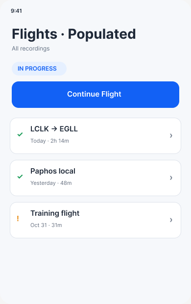
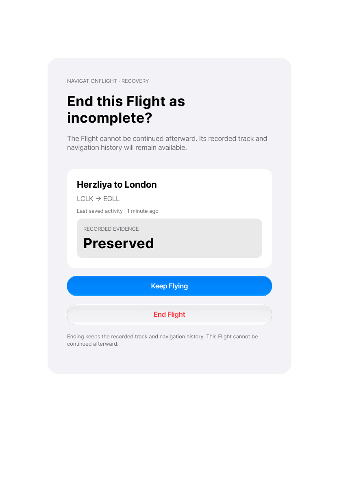
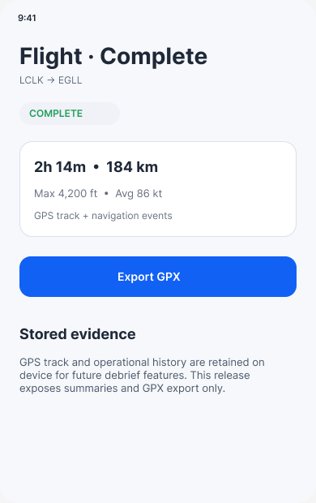
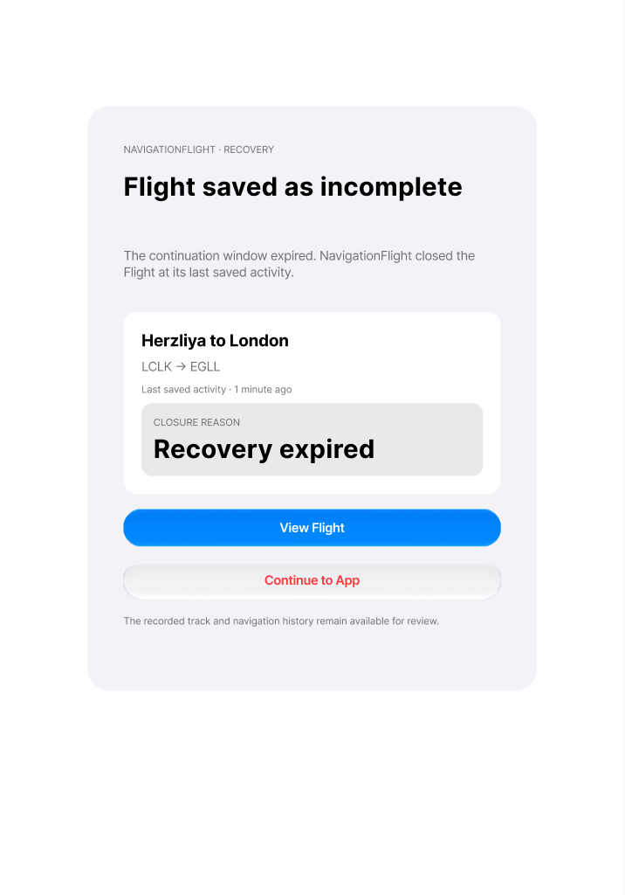
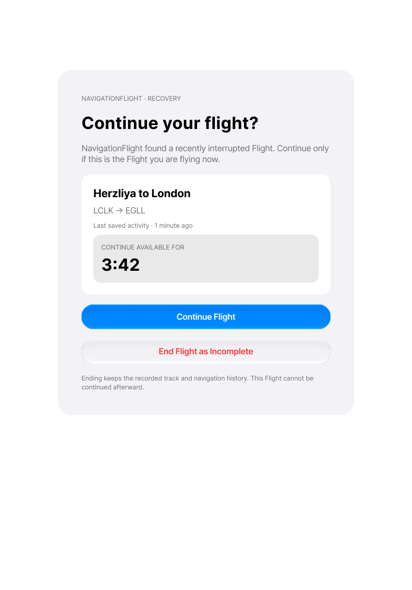

# Flights and recovery: differences and decisions

[Back to the map](../README.md) · [Observed chapter](../current/flights-and-recovery.md)

**Status:** findings awaiting owner review; no fixes or contract edits applied.

## G10 · Remove a deleted Flight from the visible library

**Goal:** Delete a closed recording and see a library that reflects the result.
**Today:** [S33](../current/flights-and-recovery.md#s33--confirm-deletion-then-encounter-a-stale-row)
shows confirmed deletion followed by a stale row that opens “Flight unavailable.”
All steps occur in one process; this is not relaunch reseeding. Source discovery confirms
that the in-memory store is meant to delete and the existing UI test expects row removal.
No root cause or durable-storage failure is claimed.

**Wanted outcome:** Successful removal returns to a refreshed library; failure explains
the failure and preserves a readable item. A deleted item should not remain actionable.

*Intended library hierarchy [11:97](https://www.figma.com/design/ZrGA7ZuOACWtXA4mR7cwdc?node-id=11-97).
It is a panel reference, not an exact post-delete iPad target. No new visual treatment
is required for the expected row removal; the behavioral scenario is the contract.*

**Recommendation:** Prioritize a focused correction and same-process regression
verification, then check the durable store and failure path. Owner priority and
implementation authorization remain pending; no user data was deleted by this review.

## G11 · Finish recovery in the promised place

**Goal:** Know what happened to an interrupted recording and find its preserved result.
**Today:** [S36](../current/flights-and-recovery.md#s36--end-recovery-as-incomplete)
confirms End but opens Plan Inspection. Recording §68 requires the saved Flight detail.
[S38](../current/flights-and-recovery.md#s38--handle-unsupported-or-corrupt-recovery-safely)
chooses Keep in Flights but arrives in Flight Plans; that is a separate wording/destination
mismatch, not evidence that the saved bytes were lost.
[S78](../current/recovery-selection-and-expiry.md#s78--leave-recovery-untouched-until-its-window-expires)
adds natural expiry: the package closes as Incomplete/Recovery expired but the app opens
Plan Inspection, omitting the result explanation and View Flight/Continue to App required
by Recording §69.

*Exact confirmation reference [42:38](https://www.figma.com/design/ZrGA7ZuOACWtXA4mR7cwdc?node-id=42-38).
The written success destination is saved Flight detail; its general presentation is below.*

*Detail reference [11:127](https://www.figma.com/design/ZrGA7ZuOACWtXA4mR7cwdc?node-id=11-127)
shows a Complete example; an ended recovery must truthfully show Incomplete rather than
copying that status. The exact post-recovery detail variant remains uninspected/unverified.*

*Exact expiry node [42:67](https://www.figma.com/design/ZrGA7ZuOACWtXA4mR7cwdc?node-id=42-67), inspected during this follow-up.*

**Recommendation:** Present the approved expiry result and honor the single-End destination and reconcile unsupported
action wording with its actual destination. Complete the paired incomplete-detail state
if the existing designs lack it. Keep preservation, closure and navigation as separately
verified outcomes. Owner approval for correction/design work remains pending.

## G12 · Confirm ending multiple recoverable Flights

**Goal:** Understand that ending all candidates removes every continuation opportunity
while retaining recorded evidence.
**Today:** [S37](../current/flights-and-recovery.md#s37--resolve-multiple-recovery-candidates)
offers End All and exits immediately after one tap, without the confirmation expressly
required by Recording §70. The gate also omits route, last-activity and earliest-expiry
information shown in the approved multiple-candidate design.
[S77](../current/recovery-selection-and-expiry.md#s77--choose-one-recoverable-flight-and-inspect-the-others)
adds selection: one tap resumes the chosen candidate and closes the other as Superseded
during recovery without the confirmation also required by §70.

*Exact node [42:96](https://www.figma.com/design/ZrGA7ZuOACWtXA4mR7cwdc?node-id=42-96).
This is the gate, not an inspected End All confirmation design. The explicit written
confirmation requirement is the authority for that missing step.*

**Recommendation:** Prioritize the destructive-action confirmation and clear affected
identities for both End All and selection of one candidate, then align freshness presentation. Preserve the ability to end all; do not
silently choose a Flight. The exact multi-record confirmation state is **design needed/
unverified** and should be located or completed before implementation. Owner priority,
design-write scope and implementation authorization remain pending.

## G13 · Identify the single recovery candidate clearly

**Goal:** Recognize the correct Flight before deciding to continue.
**Today:** [S35](../current/flights-and-recovery.md#s35--continue-a-recently-interrupted-flight)
shows a name and countdown but no route. The approved gate and Recording §66 require
identity, route and last durable activity. The app's content is much sparser than the
approved gate, although its Continue/End choice and countdown are present.

*Exact approved Iteration 03 node [38:275](https://www.figma.com/design/ZrGA7ZuOACWtXA4mR7cwdc?node-id=38-275).
Native styling may adapt; missing identifying route content is distinct from pixel differences.*

**Recommendation:** Complete the identifying content under the existing approved
direction, with Larger Text and phone verification. No redesign of recovery policy is
implied. Owner classification/priority and implementation authorization remain pending.

## E05 · Verify lifecycle and durable recovery beyond seeded presentations

[S50–S56](../current/recording-lifecycle.md) add empty Flights, UI start/manual closure,
GPS-gap/resumption status, active export/delete restrictions, recording degradation and
export/delete error presentations. That narrows this evidence gap without establishing
real sensor, storage or durability behavior.

Still unverified: real takeoff/landing/stop detection; loss/resumption segmentation correctness; background/lock/force-quit
durability; five-second sensor-loss bound; background expiry,
future timestamps, exact stale-Continue race, failed closure/retry/idempotency; GPX gap segmentation/interoperability; actual storage exhaustion and recovery
from injected failures. These are explicit evidence gaps, not missing capabilities.
[S70](../current/export-artifact.md) now verifies the generated GPX metadata and two
track points from the original UI export; it does not establish segmentation or
invalid-value omission. [S77–S78](../current/recovery-selection-and-expiry.md) add
multiple-candidate selection/disposition and natural foreground expiry.
[S79–S81](../current/durable-action-only-flight.md) add actual disk-checkpoint relaunch
and no-GPS action-only completion through manual closure.
[S93](../current/repeated-recording-errors.md) adds repeated export/delete attempts:
detail remains without renewed visible failure feedback. Successful recovery after
clearing faults, failed-closure retry and durable package persistence remain unverified.

## G19 · Describe recording closure truthfully

**Goal:** Know what ending a recording will do and whether it is still recording.
**Today:** [S53](../current/recording-lifecycle.md#s53--end-after-navigation-completion-and-inspect-the-saved-flight)
promises Complete for an “action-only” recording, saves Incomplete/Manual/Partial GPS,
and retains Recording Continues in the destination action after the status says ended.

**Intended outcome:** The confirmation describes the actual recording's closure rules,
and all cockpit surfaces reflect the resulting ended state. Recording §33 requires
navigation completion plus available landing evidence for manual Complete; §58 allows
the action-only exception when no usable location exists. This synthetic partial-GPS
run did not establish landing. Do not force its result to Complete merely to match the
incorrect promise, or relabel partial GPS as action-only.
[S81](../current/durable-action-only-flight.md#s81--close-completed-navigation-with-no-gps-track)
confirms that the actual no-GPS path does close Complete/Manual/Unavailable. Its bottom
Recording Continues wording also persists after closure.

*Reference [11:127](https://www.figma.com/design/ZrGA7ZuOACWtXA4mR7cwdc?node-id=11-127)
is a general Complete detail sample, not an exact approved partial-GPS manual-End
confirmation. The precise confirmation/ended-cockpit variants are **design needed/unverified**.*

**Recommendation:** Correct the confirmation's state-specific message and remove stale
continuation claims after closure. Preserve completion classification unless separate
evidence establishes it is wrong. Approve the behavioral rule, then align the missing
paired states before implementation. Owner review and fix authorization are pending.
