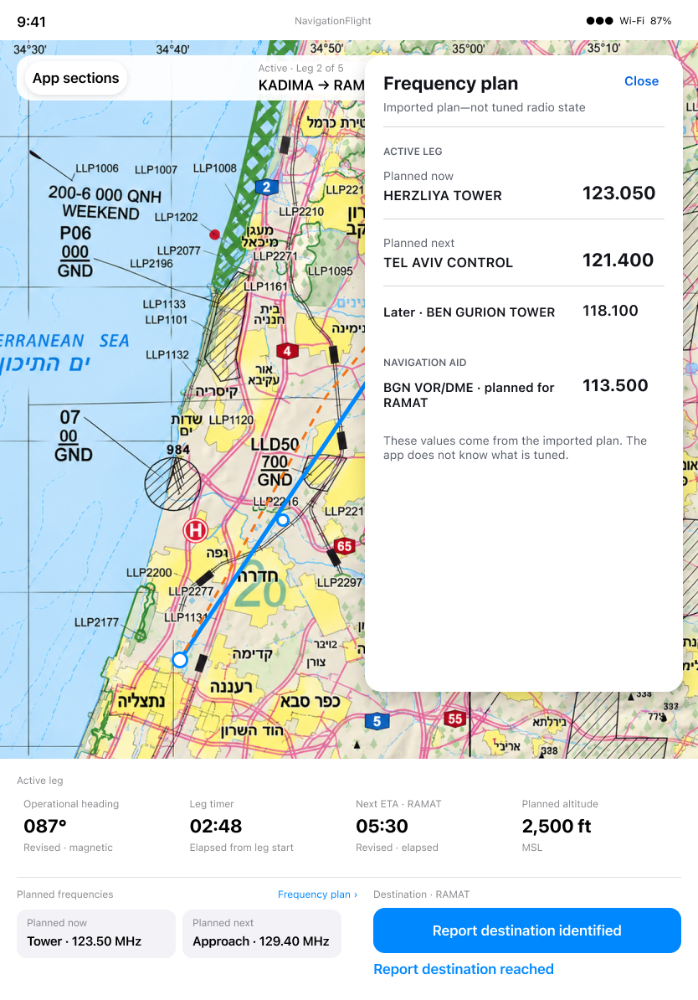
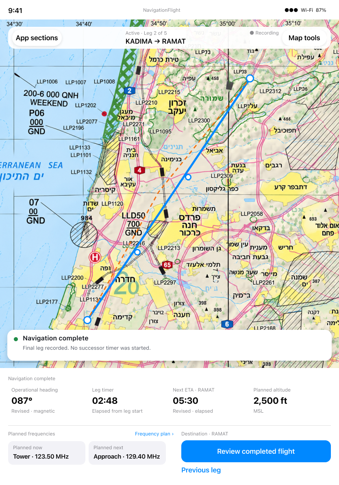

# Flying and revisions: differences and decisions

[Back to the map](../README.md) · [Observed chapter](../current/fly-and-revise.md)

**Status:** current account approved; recommendations pending owner decisions; no fixes applied.

## G07 · Read one consistent planned-frequency sequence

**Goal:** Consult full details without receiving conflicting “now” and “next” answers.
**Today:** [S20](../current/fly-and-revise.md#s20--consult-the-full-frequency-plan)
shows the console advancing to 120.50 MHz while the panel still calls 113.500 Planned
now and 120.500 Planned next. Both are visible at elapsed 00:44 in one capture.

**Intended outcome:** All surfaces use one meaning for immediate planned frequencies,
with later/phase-specific entries labelled distinctly. This does not add live tuned state.
The existing [Frequency Plan design 198:182](https://www.figma.com/design/yvLXb8bUFBiZHqsag4hq6I?node-id=198-182)
is the relevant structural reference, but its sample values are themselves not identical
between panel and console; it is not evidence of an approved numeric mismatch policy.

**Recommendation:** Treat the observed inconsistency as a correction candidate and
agree an explicit same-state sequence rule before implementation. Carry forward cue
timing and planning-only meaning. Preserve phase headings if they add context; do not
call a phase's first item “now” while another surface means elapsed-leg now. Desired
behavior approval and remediation authorization remain pending. [G06](navigation-and-frequency-authority.md#g06--distinguish-planned-frequencies-from-receiver-state)
separately resolves the competing full-list/compact-layout contracts.

## G08 · Keep completed navigation distinct from not started

**Goal:** Understand the completed navigation result while physical recording may continue.
**Today:** [S22](../current/fly-and-revise.md#s22--complete-the-final-leg-and-undo-the-reach-report)
shows COMPLETE alongside an unstarted-timer hint and initial altitude/frequency cues.
Heading and revised ETA remain, and Previous Leg is offered. This is a presentation/state
interpretation discrepancy; no recorded-history loss has been established.

*Exact current Flying node [199:918](https://www.figma.com/design/yvLXb8bUFBiZHqsag4hq6I?node-id=199-918).
It retains numeric instruments, but its reused header still says Active · Leg 2 of 5:
that is inconsistent sample design content, not an instruction to reproduce it.
Recording explicitly extends the completion action/lifecycle, so this older action
label cannot override the newer recording contract.*

**Recommendation:** Agree a completed-navigation console that preserves an intelligible
final result and does not suggest another Start. Clarify whether last cues remain frozen
or are explicitly retired, keeping recording status separate. Align the paired final
state before a fix; do not infer that Navigation Complete should automatically stop
recording. Alternatives are a dedicated completed summary or intentionally muted
instruments with accurate completion labels. Owner choice/design scope remains pending.

## G09 · Make chart tools an explicit product choice

**Goal:** Adjust the chart aids offered under Map Tools.
**Today:** [S23](../current/fly-and-revise.md#s23--toggle-drift-aids-and-try-chart-layers)
shows an enabled Chart layers action opening a later-delivery message. Drift toggling
works in the observed sequence. Off-chart fixture whitespace is a separate evidence limit.

**Intended/reference scope:** Flying §100 includes chart-layer access through Map Tools,
but a complete authoritative layer-picker state has not been identified in the inspected
references. **Design needed/unverified** for that control's promised workflow. This is
observed unfinished capability against desired scope, not proof of a broken chart renderer.

**Recommendation:** Decide whether to complete the chart-aid workflow with a paired
design or deliberately defer it and make availability clear before entry. Preserve the
current placeholder only as an explicit temporary choice; retiring it requires a contract
decision. No new picker behavior is invented here, and design/implementation remain unapproved.

## E03 · Cover remaining navigation branches

Observed: start/checklist, heading and ETA commit, unavailable Check, identify/reach,
final Undo, automatic successor, previous history, drift toggle and chart placeholder.
[Continuity follow-up](../current/continuity-and-adaptations.md) adds IP reporting,
heading cancellation, ETA dismissal and background/section roundtrips. Final batch08
adds a successful reference Check and a second bounded IP Undo search.

[S57–S65](../current/starting-and-correcting.md) add starting-leg choice, baseline-valued
recommits, moving-floor rejection, Undo expiry/invalidation, bounded duplicate Undo,
map focus and VOR label dragging. [S76](../current/provider-and-calculation-mode.md#s76--select-no-wind-then-start-without-reloading)
adds distinct calculation-mode values at Start. G20–G21 record observed discrepancies.
[S80](../current/durable-action-only-flight.md#s80--reach-the-destination-without-reporting-an-earlier-ip)
adds skipped-IP history; [S82–S85](../current/progression-history-and-cues.md) add manual
progression, completed revision/reference history, cue transitions and auto-hide.
[G23](completed-history.md) records missing timing-history context. Exact duplicate-race,
brief simultaneous-cue and other limits remain in the
[observation ledger](../evidence/remaining-exploration.md).
