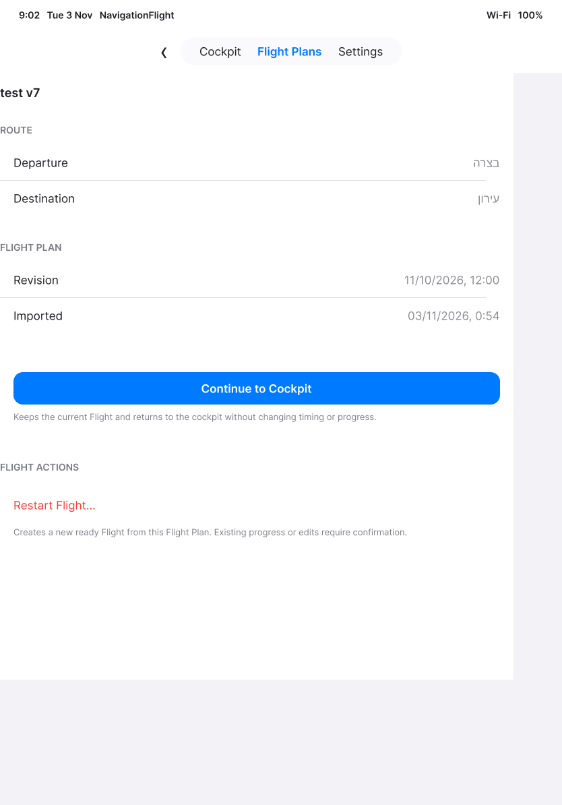

# Saved Flight Plans: reconciliation and evidence limits

[Back to the map](../README.md) · [Observed journey](../current/manage-flight-plans.md)

**Status:** current account approved; gap decisions pending. No new behavioral defect was
established in the observed import/revision/cancellation branches. This is not full
library acceptance: exhaustive provider-failure and protection combinations remain unverified.

## E02 · Complete the import and replacement journey

**Pilot goal:** Add a local preparation, decide whether to replace its saved revision,
and know that cancellation or failed saving has preserved prior work.

**Observed:** [S10–S14](../current/manage-flight-plans.md#s10--leave-files-without-adding-a-plan)
establish settled cancellation, debug-input import, persistence across relaunch,
identical-revision feedback, newer/older warnings, cancellation preserving the original
revision, and two error messages. These reduce [E01](flight-plans-to-cockpit.md#e01--finish-observing-import-and-state-preservation-branches)
without claiming the whole branch is verified.

**Further observations:** [S66–S69](../current/library-protection.md) cover recency ordering,
loaded-version identity, different-plan confirmation, cancellation retaining the heading
draft/checklist chip, and save failure retaining the existing revision.
[S75](../current/provider-and-calculation-mode.md#s75--add-a-plan-through-the-real-files-provider)
adds real Downloads-provider import, review and load.
[S91](../current/final-library-and-permission-checks.md#s91--apply-the-saved-updated-plan)
adds protected Load Updated Plan, cancellation and confirmation. Provider read failures
and exhaustive protected-edit combinations remain unverified.

**Design:** No new UI design is needed merely to complete evidence. Existing approved
loaded-review hierarchy [41:76](https://www.figma.com/design/FDSRcz1yl7bkSoziKvGzQ1?node-id=41-76)
still applies to [S15–S16](../current/manage-flight-plans.md#s15--cancel-a-restart-that-would-discard-flight-work).
Exact confirmation/error geometry has not been declared matched to Figma.

*Intended action hierarchy, not evidence that all destructive branches are accepted.*

**Recommendation:** Retain these as missing evidence, complete reachable isolated
branches using disposable inputs. No behavior change follows solely from a capture limitation.
Observed return overlap and duplicate inspection remain [G01–G02](flight-plans-to-cockpit.md).

**Follow-up:** [S47–S49](../current/manage-flight-plans.md#s47--confirm-a-newer-revision-and-an-older-rollback)
now cover confirmed newer/older replacement, removal cancellation/failure presentation,
and confirmed protected restart. The later observations above further reduce the remainder.
