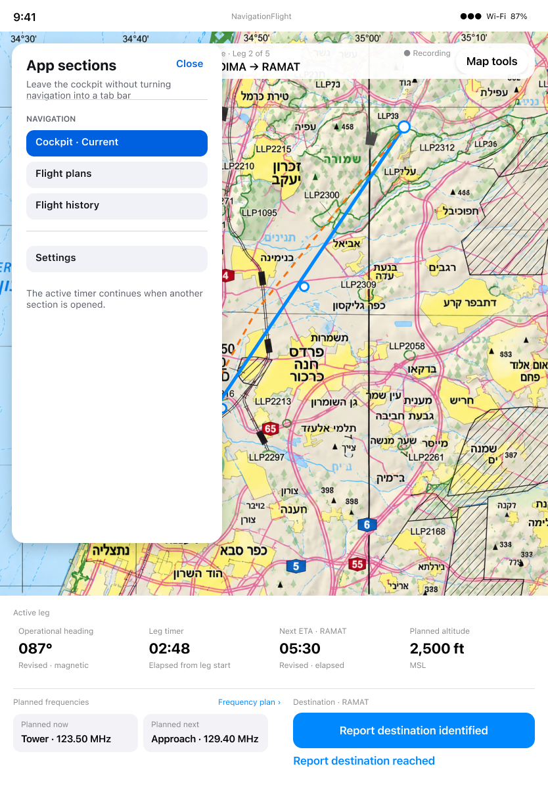
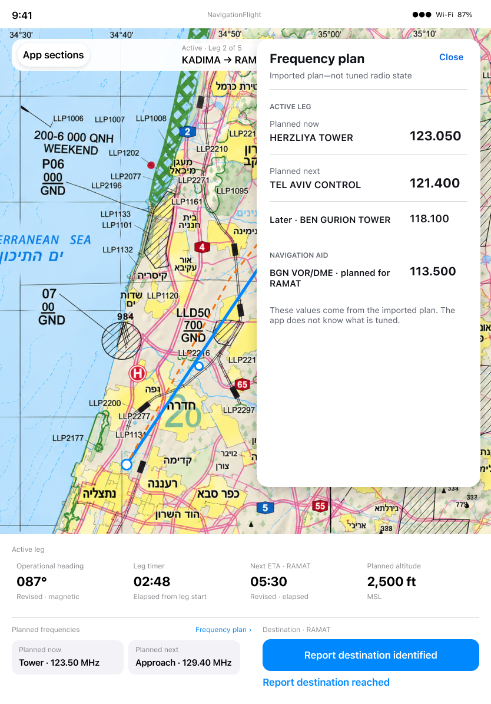

# Navigate sections and interpret planned frequencies

[Back to the map](../README.md) · [Authority and precedence](../evidence/expanded-authority.md)

**Status:** owner decisions pending. These proposals resolve conflicting intent; no
contract changes, new designs, fixes or tickets are authorized by the map approval.

## G05 · Choose how app sections coexist with Cockpit

**Pilot goal:** Move to plans, recorded Flights or Settings while retaining an active
navigation context and unobscured cockpit information.

**Today:** [S05–S09](../current/flight-plans-to-cockpit.md#s05--load-a-ready-flight)
show persistent app tabs on iPad and iPhone. One inspection-return path overlaps the
route strip ([G01](flight-plans-to-cockpit.md#g01--return-to-cockpit-with-route-information-unobscured)).
That overlap is independently actionable; it does not settle which shell is desired.

**Conflicting intent:** App Navigation requires native adaptive tabs/sidebar. Flying
§127 instead specifies an App Sections disclosure without persistent cockpit tabs.
Recording establishes four destinations but does not settle the geometry.

*Intended Flying design, exact node [198:118](https://www.figma.com/design/yvLXb8bUFBiZHqsag4hq6I?node-id=198-118).
Its “Flight history” wording also differs from Recording's “Flights.” The conflicting
approved library shell is retained in [G04](flight-plans-to-cockpit.md#g04--understand-which-navigation-contract-is-current).*

**Recommendation:** Explicitly choose one cross-feature shell, then update the other
contract and paired states. Prefer the map-preserving App Sections cockpit direction
if that remains the intended flying experience, with native library navigation outside
Cockpit. This is a proposal, not an inferred supersession or implementation instruction.
Preserving the current adaptive tabs is also viable if the cockpit contract is revised
and occlusion corrected. Defer the shell decision only with both authorities clearly
labelled unresolved; do not retire any destination accidentally.

**Design needed:** Integrated transitions and loaded-review returns under the chosen
shell require an agreed paired design. Existing screenshots do not establish that
integration. Owner behavior choice and design-write scope remain pending.

## G06 · Distinguish planned frequencies from receiver state

**Pilot goal:** Read immediate planned frequencies and consult the full sequence
without mistaking imported preparation for actual tuned-radio information.

**Today:** [S05](../current/flight-plans-to-cockpit.md#s05--load-a-ready-flight)
shows Planned now/next. [S07](../current/flight-plans-to-cockpit.md#s07--inspect-planning-details-from-map-tools)
shows a legacy “SAVED FREQUENCY SECTIONS · NOT TUNED” heading. That phrase is ambiguous
as a disclaimer but specifically conflicts with Flying §104's prohibition on showing
“Not tuned” from imported data. The app does not have evidence of receiver state in
this journey. Full Frequency Plan interaction is covered by the expanded cockpit review.

**Conflicting hierarchy:** Cues asks for the complete lower-console list with
CURRENT/NEXT; Flying §§102/128 asks for compact Planned now/next and a separate full
Frequency Plan. Both can preserve time-based advisory cues, but both hierarchies
cannot simultaneously describe the fixed console.

*Intended design, exact node [198:182](https://www.figma.com/design/yvLXb8bUFBiZHqsag4hq6I?node-id=198-182).
The design states that the app does not know what is tuned; its panel preserves the
map and fixed operational values. This is not a runtime capture.*

**Recommendation:** Retain the compact Planned now/next direction and full disclosure,
explicitly carry forward the Cues timing and accessibility rules, and replace ambiguous
legacy wording with an imported-planning disclaimer. Resolve the source contracts
before treating every older visual difference as an implementation defect. Alternatives
are to preserve the complete inline list with a revised cockpit design, or defer the
hierarchy decision while preserving all frequency information. No frequency capability
is proposed for retirement. Owner approval and any correction work remain pending.
