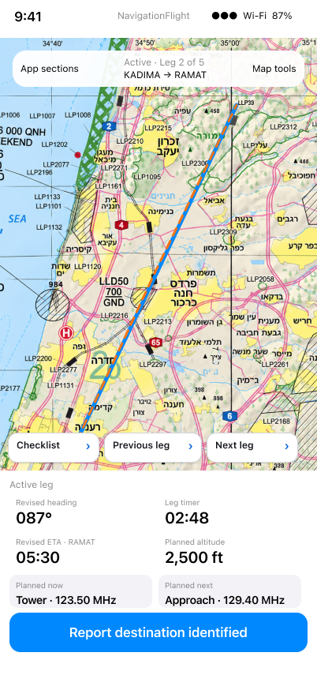

# Active phone navigation: retain route context

[Back to the map](../README.md) · [Observed phone journey](../current/phone-and-resizing.md#s90--start-and-use-the-available-iphone-cockpit)

**Status:** new finding; owner decision pending.

## G24 · Retain active-leg identity and Map tools on the phone

**Goal:** Know the active route and reach its map tools while navigating on a phone.
**Today:** S90's ready header is present, but after Start/checklist dismissal it is absent
at elapsed00:20 and remains absent during Position Check at00:37. Instruments and map
remain visible. The observation is iPhone17, not the unavailable canonical iPhone16Pro.

**Intended outcome:** Flying's approved phone adaptation retains Active, leg index,
route identity and Map tools in the header. Its shell direction remains subject to G05;
that unresolved shell choice does not justify losing active route identity.

*Exact current closed-disclosure phone node [207:876](https://www.figma.com/design/yvLXb8bUFBiZHqsag4hq6I?node-id=207-876).
This is a presentation reference, not a matching synthetic route or numeric fixture.*

**Recommendation:** Preserve leg identity and map-tool access through Start, checklist
closure and Position Check on compact layouts. Verify both available and canonical
phone targets when the latter is accessible. Keep the cross-feature navigation-shell
decision separate. No implementation or design edits have been authorized.
