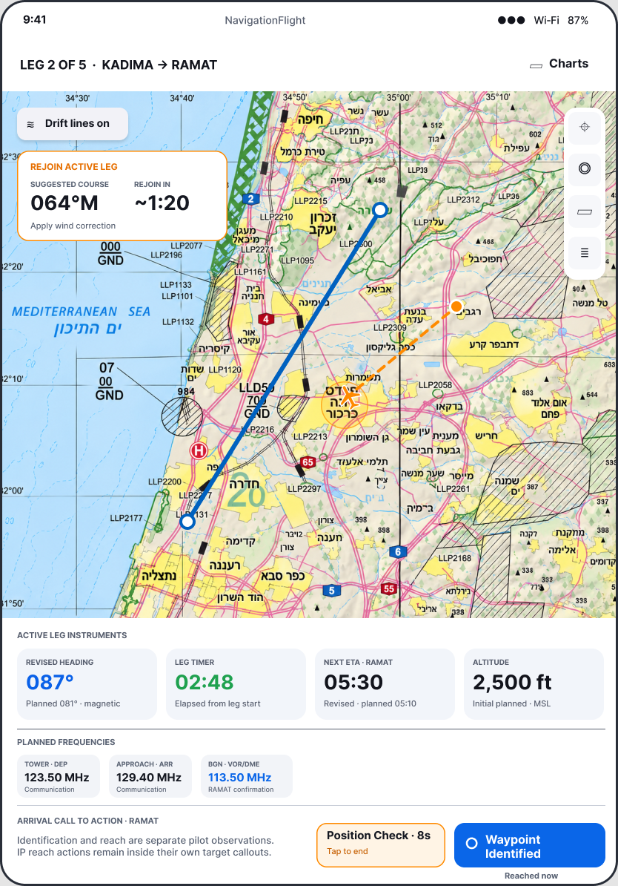
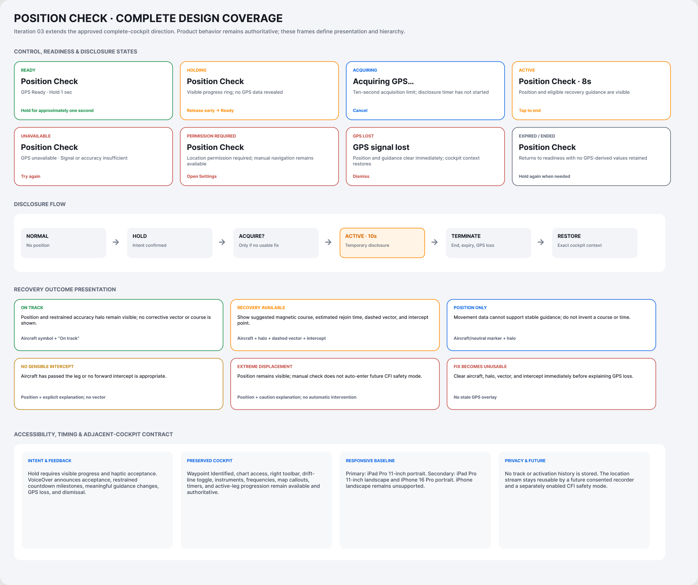

# Position Check: intended flow and remaining evidence

[Back to the map](../README.md) · [Observed journey](../current/position-check.md)

**Status:** S01–S56 account approved; later observations await account review.
Gap decisions remain pending, including the new acquisition-retry finding G22.

## E04 · Verify the full disclosure boundary

**Pilot goal:** Reveal position deliberately, receive only supported guidance, and
return to normal navigation when the check ends or GPS becomes unusable.

**Observed:** [S27](../current/position-check.md#s27--tap-for-a-hint-hold-to-reveal-then-end-the-check)
shows tap versus hold, temporary position/rejoin guidance, and manual dismissal.
[S28](../current/position-check.md#s28--wait-for-acquisition-and-understand-timeout)
shows bounded acquisition failure. [S29](../current/position-check.md#s29--follow-the-permission-required-route-to-settings)
establishes Settings handoff only.

*Intended active state [9:382](https://www.figma.com/design/hllTgfGTAG4cEXyqiDesSu?node-id=9-382),
approved Position Check iteration. Surrounding cockpit hierarchy predates Flying's
later design. Synthetic numeric guidance is not expected to match sample design values.*

*Exact coverage node [16:9](https://www.figma.com/design/hllTgfGTAG4cEXyqiDesSu?node-id=16-9).
Its no-recording footer is explicitly superseded by Recording; deliberate disclosure,
loss handling and restored cockpit context remain relevant.*

**Further observations:** [S71–S74](../current/position-check-outcomes.md) cover on-track,
position-only, no-intercept and extreme-displacement outcomes; fresh tab/background exits;
synthetic permission revocation; and a timeout retry attempt that remains at timeout.
S45–S46 cover natural expiry and signal loss.
[S86–S88](../current/landscape-and-accessibility.md) add bounded repeat hold, landscape,
Reduce Motion and VoiceOver attempts. [S92](../current/final-library-and-permission-checks.md#s92--attempt-real-system-permission-recovery)
records the environment-limited real permission attempt. Exact repeated-hold deadline,
successful permission recovery, VoiceOver activation/announcements and haptics remain
unverified. Synthetic inputs do not certify sensor accuracy or recovery calculations.

**Recommendation:** Preserve the deliberate/time-bounded behavior and complete these
focused observations. Treat any settled restoration difference as a separate finding
only after confirmation. No new design is necessary to investigate the existing
contract; new behavior, design edits or acceptance still require explicit owner decisions.

**Follow-up:** [S45–S46](../current/position-check.md#s45--compare-settled-cancellation-with-natural-expiry)
now observe natural expiry, synthetic signal-loss cleanup and settled cancellation.
The camera discrepancy is confirmed below; real permissions/sensors and accessibility
remain separately bounded.

## G18 · Restore the map after cancellation or signal loss

**Goal:** End temporary GPS disclosure and resume the same usable navigation context.
**Today:** [S45](../current/position-check.md#s45--compare-settled-cancellation-with-natural-expiry)
shows the route collapsing into overlapping markers after tap-to-end, persisting
through two- and three-second waits. [S46](../current/position-check.md#s46--lose-gps-during-a-check)
shows the same collapsed route after loss, despite text saying context is restored.
Position and recovery guidance themselves correctly disappear in these captures.
[S72/S74](../current/position-check-outcomes.md) extend this to immediate tab return
and synthetic permission revocation. [S90](../current/phone-and-resizing.md#s90--start-and-use-the-available-iphone-cockpit)
adds iPhone17 cancellation collapse. Background annotation loss remains G14.

*Exact approved flow [16:9](https://www.figma.com/design/hllTgfGTAG4cEXyqiDesSu?node-id=16-9),
with recording supersession applied only to the historical no-recording footer.
Natural expiry restores a vertical route in the observed comparison but does not prove
every camera/offset field equals the original.*

**Recommendation:** Prioritize restoring pre-check camera/context consistently across
tap-to-end, signal loss and expiry, then compare before/after map framing on real-chart
fixtures. This is an observed correction candidate, not a redesign of GPS disclosure
or recovery guidance. Owner priority and implementation authorization remain pending.

## G22 · Allow a new acquisition attempt after timeout

**Goal:** Deliberately try Position Check again after a failed acquisition.
**Today:** [S73](../current/position-check-outcomes.md#s73--try-again-after-acquisition-times-out)
shows timeout after eleven seconds; another hold and a tap leave the timeout explanation
unchanged, without a visible new acquiring state. The fixture never delivers a usable
fix, so this is a retry-transition finding, not evidence that live GPS can never recover.

**Intended outcome:** Position Check §17 allows another attempt after timeout. A fresh
accepted request should expose acquiring feedback and its bounded deadline without
revealing position until a usable fix exists.

*Existing state/flow [16:9](https://www.figma.com/design/hllTgfGTAG4cEXyqiDesSu?node-id=16-9)
is the contextual reference. This correction can reuse acquisition/failure states;
no new layout is needed to define the required transition.*

**Recommendation:** Make the offered retry restart the deliberate acquisition flow,
with wording consistent with the actual gesture. Verify a second timeout and a later
usable-fix success separately. Source inspection suggests Retry restarts location
monitoring without clearing the Position Check failure or scheduling a fresh deadline;
that is a diagnostic hypothesis, not a verified fix. Owner decision pending.
