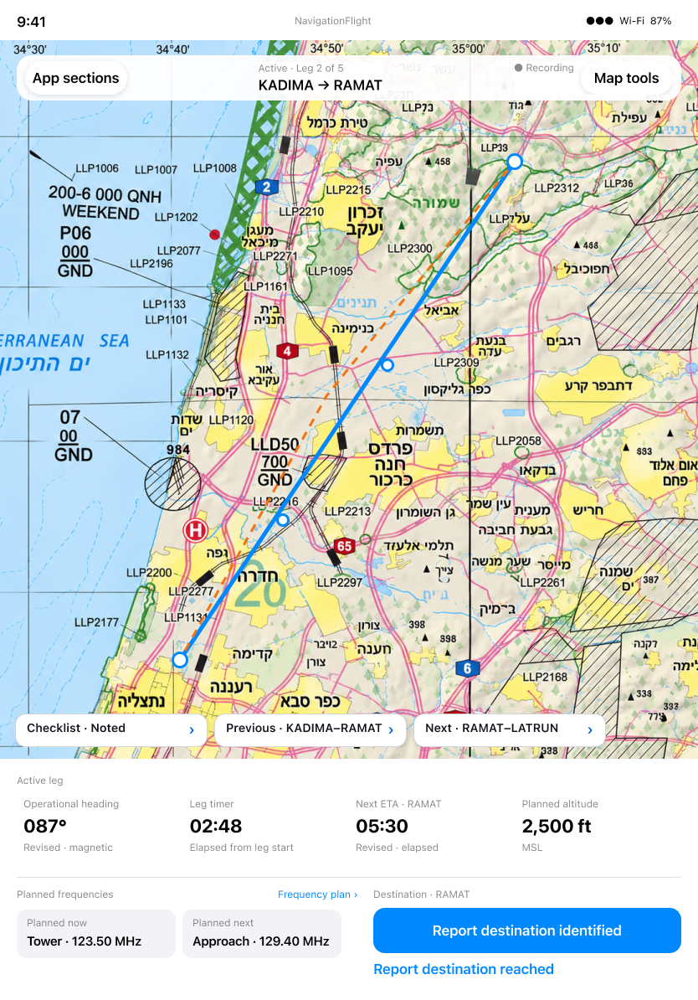

# Starting navigation: observed discrepancy

[Back to the map](../README.md) · [Observed chapter](../current/starting-and-correcting.md)

**Status:** new finding; owner decisions remain parked until exploration finishes.

## G20 · Start the leg the pilot selected

**Goal:** Begin timing on the chosen eligible starting leg.
**Today:** [S57](../current/starting-and-correcting.md#s57--choose-a-later-starting-leg-then-start)
shows Ready · Leg 2 followed immediately by Start producing Active · Leg 1. No reload,
restart or replacement occurs between the two captures.

**Intended outcome:** Flying §§2–4 requires pre-start selection, a selected ready leg,
and explicit Start establishing that leg's time origin. Start must honor the selected
leg and its available calculation mode rather than revert to the initially loaded
configuration. [S76](../current/provider-and-calculation-mode.md#s76--select-no-wind-then-start-without-reloading)
now supplies distinct-mode evidence: ready No wind035°/09:56 becomes active ETA09:16
and checklist033°, while the console retains035°, including a settled frame.

**Design:** This correction is behavioral; no new visual design is necessary to define
the scenario: given Ready · Leg 2, Start yields Active · Leg 2 and its timer/checklist.
The eventual canonical selection/review presentation is the separate unresolved G02
integration decision. It does not justify starting a different leg in the current UI.

**Recommendation:** Preserve and start the actual ready selection consistently across
Cockpit and recording. Verify both nonfirst-leg selection and distinct calculation-mode
values before acceptance. The source suggests stale state in the armed recording engine
as a likely mechanism, but no fix has been implemented or verified. Decision pending.

## G21 · Restore a usable map after final reach Undo

**Goal:** Correct final arrival and continue navigating with the active route visible.
**Today:** [S65](../current/starting-and-correcting.md#s65--undo-final-reach-and-inspect-the-restored-leg)
restores active timing and revised heading but collapses the route into overlapping
markers, including a later settled frame. This is separate evidence from the Position
Check restoration issue; a shared underlying cause has not been established.
[S79](../current/durable-action-only-flight.md#s79--resume-a-checkpoint-created-by-actual-navigation-actions)
adds a separate recovery-entry instance of collapsed route markers despite restored
heading and timing. Include that entry path when verifying usable active-map restoration;
no common cause is asserted.

**Intended outcome:** Flying §§80, 82 and 84–85 require restoration of the prior flight
state and continuing timing. The active route must remain usable after that correction.

*Approved current map direction [206:984](https://www.figma.com/design/yvLXb8bUFBiZHqsag4hq6I?node-id=206-984)
is a contextual reference, not an exact final-Undo variant or numeric fixture match.*

**Recommendation:** Restore usable active-leg framing after final Undo while preserving
the observed time and revision restoration. Verify a settled map on a real-chart route
and supported device variants. No new layout is needed to define this behavioral
correction; broader map integration remains subject to the existing design decisions.
Owner decision pending until the complete exploration review.
