# Preparing an amendment today

These stories separate visible evidence from source-derived behavior. John's
five screenshots were supplied on 2026-11-23 after using the feature in flight.
Screenshot 2 identifies iPad Pro 11-inch (M5), iPadOS 27.2, portrait. The other
attachments are cropped; their complete viewport, orientation and app revision
are not established. They are not fresh captures of the inspected code revision.
See [capture provenance](../evidence/source-crosswalk.md#evidence-provenance).

## S01 · Open amendment mode

**Goal:** Prepare a route change while the Flight continues.

**Starting point:** Cockpit with an underway Flight.

**Visible result:** The pencil has a tinted highlight. The full-context image in
S02 also shows a separate pause action. The still images do not establish the
effects of closing, persistence or timing continuity.

John's screenshot 5: existing amendment-mode indicator, cropped to the pencil.
Continue to [S02](#s02--choose-a-departure) or compare [G01](../proposed/preparing-an-amendment.md#g01--open-leave-and-resume-with-the-pencil).

## S02 · Choose a departure

**Goal:** Select where to leave the operational route.

**Starting point:** Amendment mode before a departure is selected.

**Visible result:** The map remains above a dark current-leg timing strip and a
sparse lower console. The console says “Choose departure” and shows “Pick a
point”, “Inspect leg” and “Cancel”; the toolbar shows pause beside the pencil.
John reports that the leg before the current רידינג → תל יונה leg should be
greyed out. The screenshot alone does not establish every route segment's role.

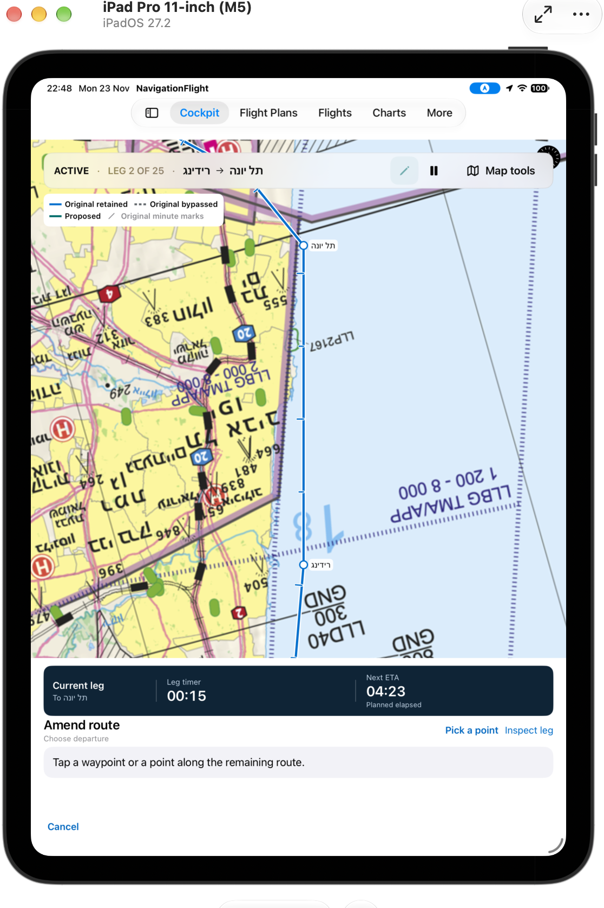

John's screenshot 2: map, toolbar, timing strip, and lower console together.
The sparse layout and competing controls motivated [G02](../proposed/preparing-an-amendment.md#g02--draw-and-review-in-one-workspace)
and [G06](../proposed/preparing-an-amendment.md#g06--read-the-map-and-current-leg-context).

## S03 · Draw, select and review

**Goal:** Build the replacement and review each leg.

**Starting point:** A departure and intermediate points have been plotted.

**Visible result:** The drawing console represents departure, intermediate points
and return horizontally. A selected point has Move and Remove actions; Undo,
Discard and Review legs appear below. The separate review state in S05 uses
vertical leg rows. John reports a “Finish here” transition between drawing and
review; the code confirms separate drawing/review steps, but these still images
do not prove the transition sequence.

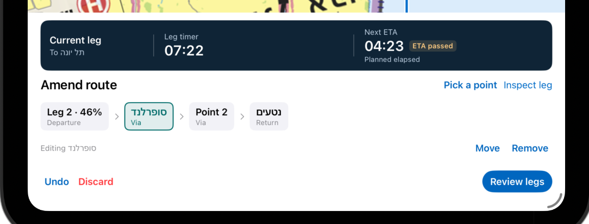

John's screenshot 3: selected intermediate point and drawing actions. Compare
the vertical rows in [S05](#s05--review-confirmation-choices) and proposed
[G02](../proposed/preparing-an-amendment.md#g02--draw-and-review-in-one-workspace).

## S04 · Edit a proposed leg

**Goal:** Enter a usable heading and duration for one replacement leg.

**Starting point:** Proposed leg editor open over the map.

**Visible result:** The modal shows magnetic heading and minute/second entry
boxes, ±1° and ±5s adjustments, Inspect original leg, Optional cues, Cancel,
Save leg values and a prominent green Check button. The values are empty.
John reports the entry method was inconvenient in flight.

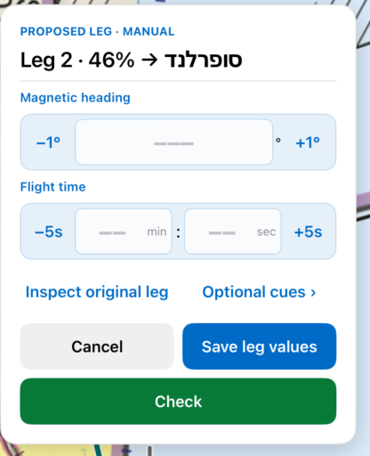

John's screenshot 4: cropped map modal. The source requires complete heading
and positive duration to save a leg; partial entries exist only in the open
editor. Persistence and dismissal behavior require transition evidence.
See [G03](../proposed/preparing-an-amendment.md#g03--enter-values-on-the-selected-leg).

## S05 · Review confirmation choices

**Goal:** Review the amendment and commit to using it.

**Starting point:** Route review with three replacement legs and missing values.

**Visible result:** Vertical rows show empty Heading and Flight time values,
each with a green Check button. The footer shows Back to drawing, disabled
Start now and Confirm for later actions, plus a separate pause button. The dark
strip remains above the rows and shows the current leg, timer and planned ETA.

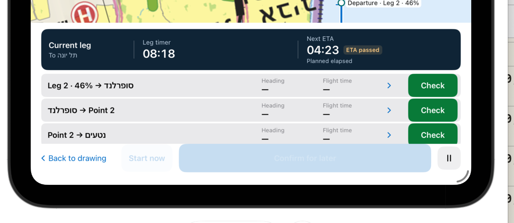

John's screenshot 1: review rows and footer. Disabled controls are visible;
their exact eligibility rules and save effects are source-derived, not proven
by this screenshot. See [G04](../proposed/preparing-an-amendment.md#g04--arm-a-ready-amendment).

## Unobserved branches

These owner screenshots do not verify empty-exit, partial-entry persistence,
app-restart recovery, save failure, Armed/Ready distinctions, original-route
overlap choices, Assisted preparation, VoiceOver, Dynamic Type, or iPhone
adaptation. Proposed behavior for these branches is explicitly future work.
Fresh runtime observations, when available, are recorded separately with their
fixture and revision rather than being attributed to these attachments.

## Fresh simulator chapter · 2026-11-23

The following captures were newly inspected at baseline
`cffba65f08cd8898294c941a4a3291b2fdb7df38`, using a disposable copy of the
LLHZ–LLIB via Jerusalem plan. The Flight was started on leg 1, שפיים → רידינג.
Device: iPad Pro 11-inch (M5), portrait 834 × 1210 points and landscape
1210 × 834 points. Exact runtime OS was not independently established. See the
[action transcript and coverage limits](../evidence/runtime-observation.md).
This fixture does not reproduce John's completed-leg scenario on leg 2.

### S06 · Enter drawing and finish at a route point

**Goal:** Sketch a replacement and review its legs.

**Starting point:** A disposable Flight is underway on its first leg.

**Action and result:** Opening the pencil shows Choose departure, the dark timing
strip, Pick a point, Inspect leg and Cancel. The pencil itself is disabled and
pause is a separate control. This reproduces S01/S02 on the inspected revision.

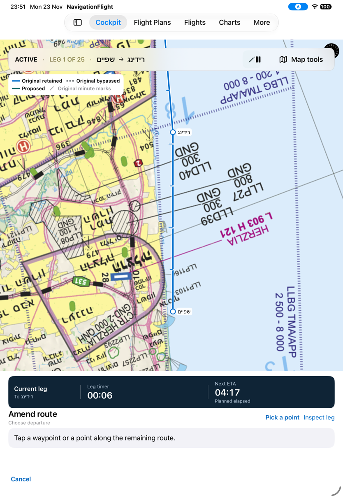

Choosing שפיים as departure and plotting Point 1 produces horizontal chips and
Move/Remove controls, with no heading/time leg rows yet.

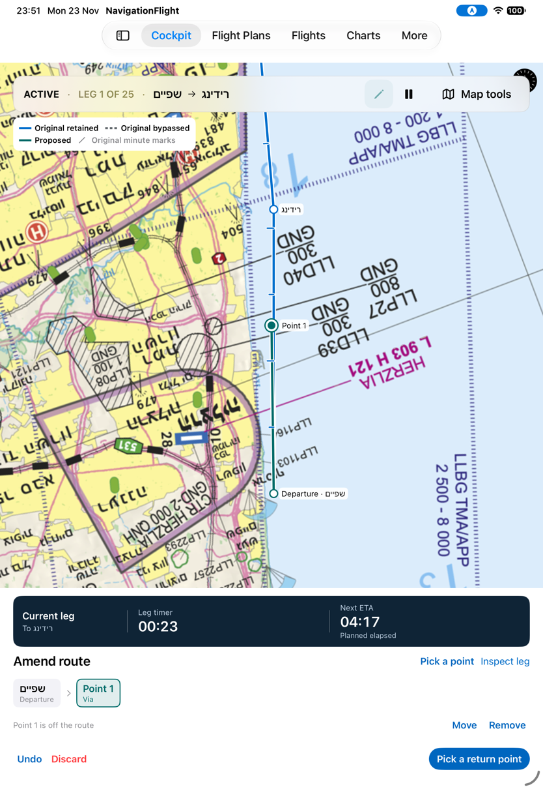

Choosing downstream תל יונה initially adds it as Via. A separate Finish here
button appears; joining is not yet complete.

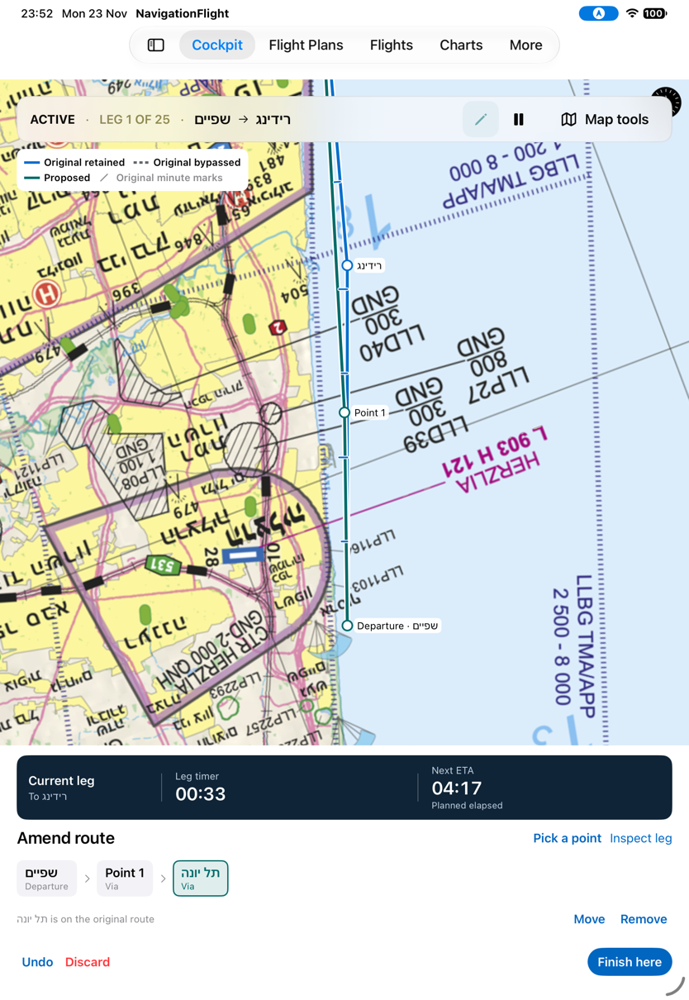

Tapping Finish here converts the console to two vertical review rows. Both
required values are missing, each row has Check, and confirmation is disabled.
A lower pause action duplicates the header's pause. Continue to
[S07](#s07--open-the-leg-editor-and-optional-cues); compare
[G02](../proposed/preparing-an-amendment.md#g02--draw-and-review-in-one-workspace).

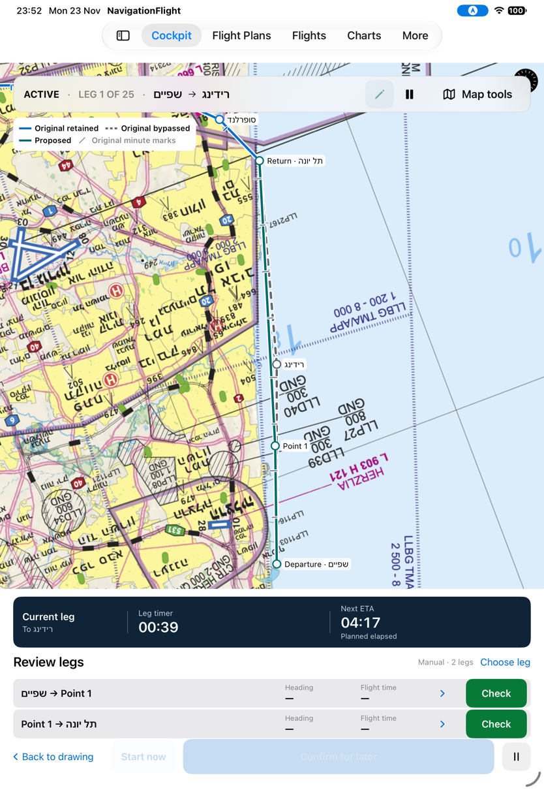

### S07 · Open the leg editor and optional cues

**Goal:** Enter the first replacement leg's planning values.

**Starting point:** The two-leg review in S06.

**Action and result:** Tapping its first row opens a floating Manual editor over
the map, with heading/minute/second fields and step buttons, reference inspection,
optional cues, Cancel, Save leg values and Check.

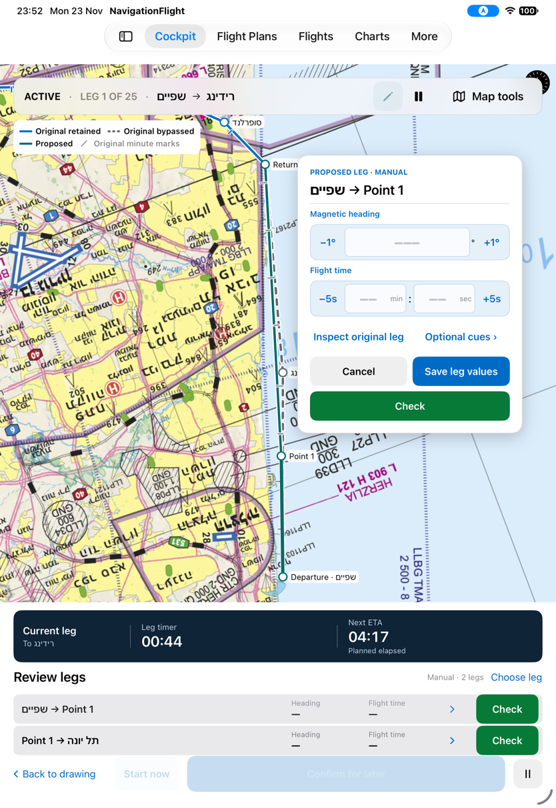

Expanding Optional cues adds altitude, frequency and visual-reference fields.
The modal grows down the map; the action buttons remain visible in this state.
No value entry, save or Check-result transition was exercised.

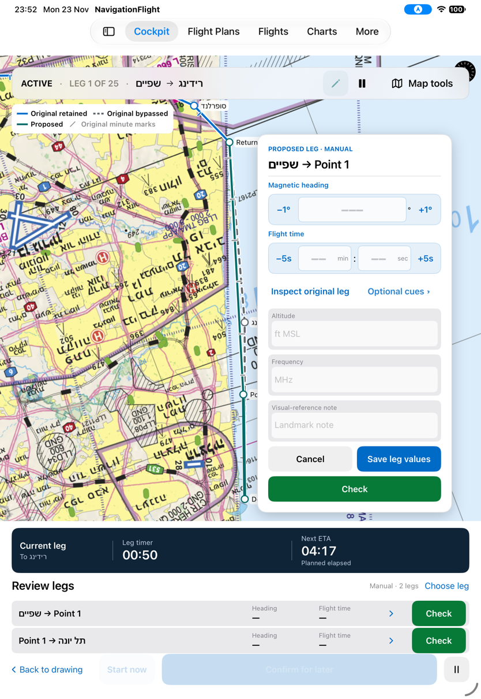

Compare [G03](../proposed/preparing-an-amendment.md#g03--enter-values-on-the-selected-leg).

### S08 · Pause and resume the review

**Goal:** Use regular Cockpit without losing the drawn replacement.

**Starting point:** S07's modal, then Cancel back to review.

**Action and result:** Tapping the bottom pause returns to normal Cockpit, hides
proposal geometry and legend, and exposes a separate highlighted play action.
The disabled pencil's accessible value is Draft paused.

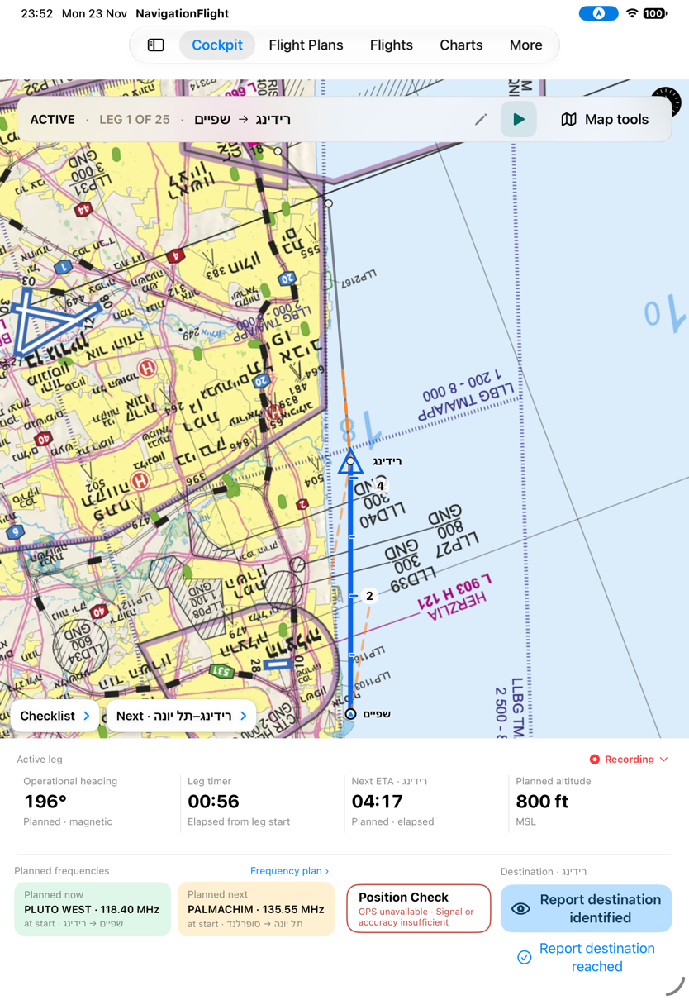

Tapping play resumes the same two-leg review, with missing values unchanged.
The displayed current-leg timer continues from 00:56 to 01:00 across the visible
states; this observation does not establish recovery or every timing invariant.

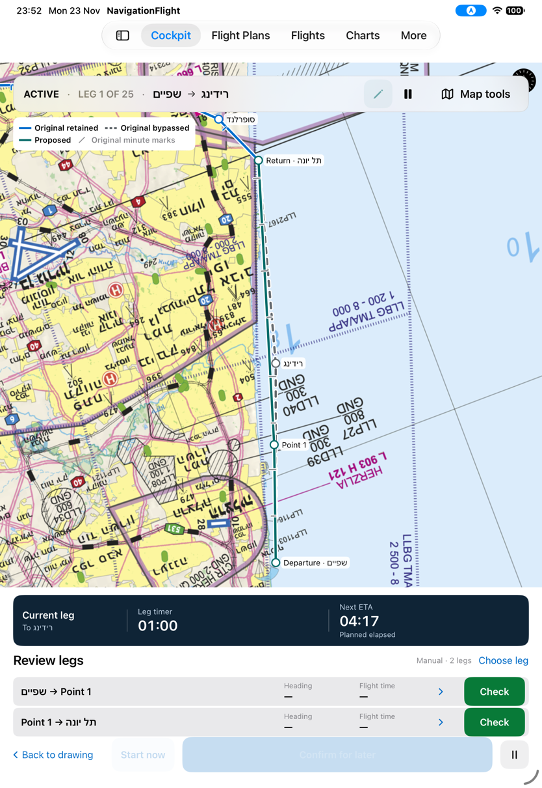

Compare [G01](../proposed/preparing-an-amendment.md#g01--open-leave-and-resume-with-the-pencil).

### S09 · Review in landscape

**Goal:** Keep map and amendment information readable when the iPad rotates.

**Starting point:** S08's review, rotated to landscape.

**Action and result:** App navigation becomes a left sidebar and review moves to
the right. The dark timing strip remains. Row values compress to dashes without
the portrait column labels. The map legend partly covers the leg-position text
in the header. The app stays running; no interaction failure was observed.

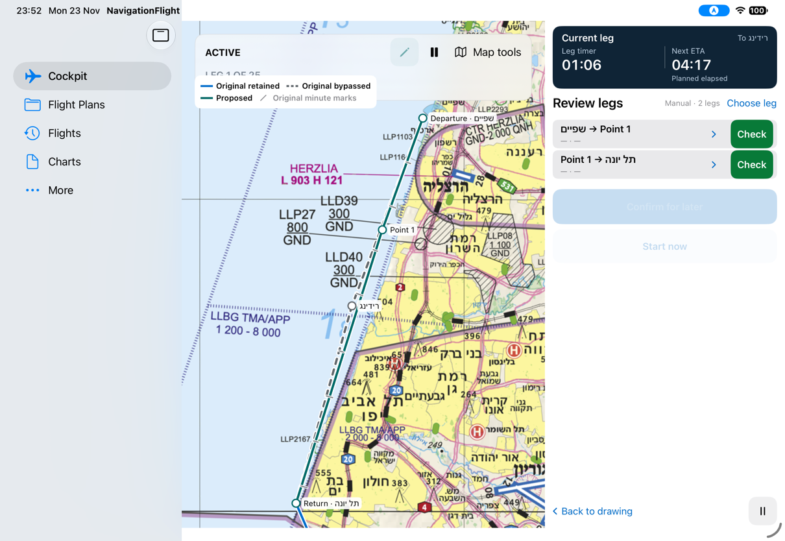

This is a current presentation observation, not an approved target. Compare
[G06](../proposed/preparing-an-amendment.md#g06--read-the-map-and-current-leg-context).
