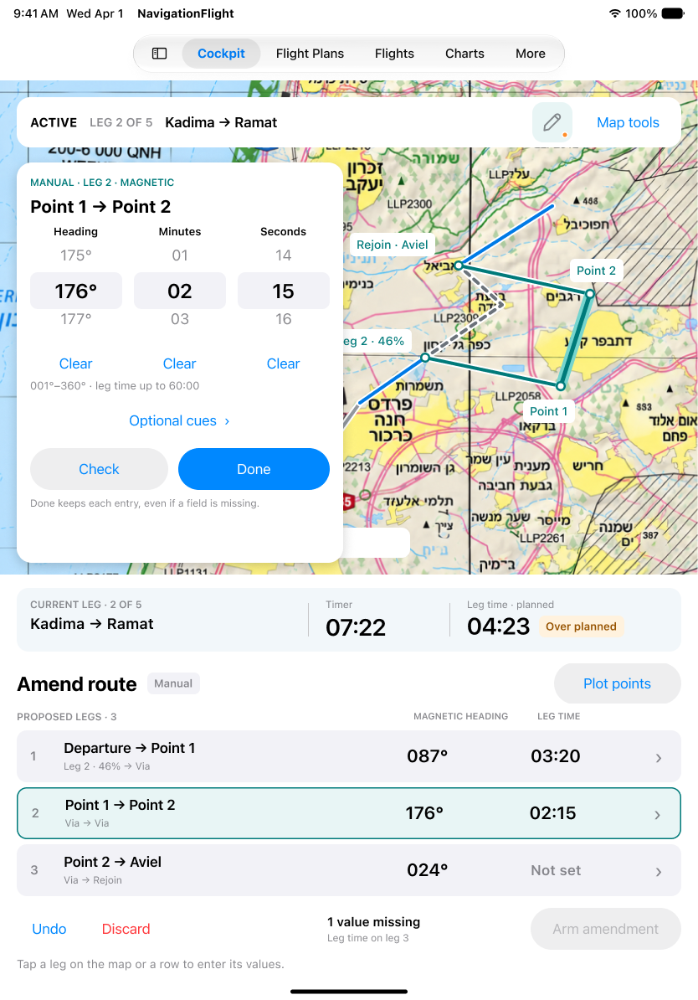
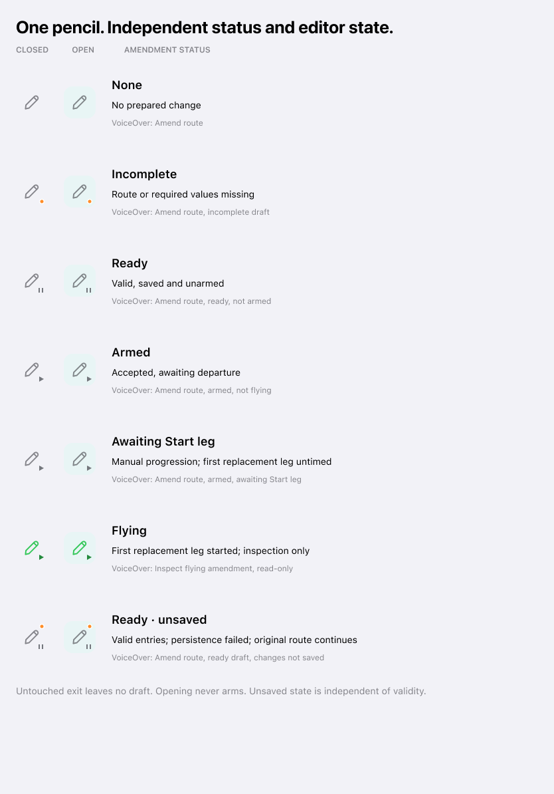
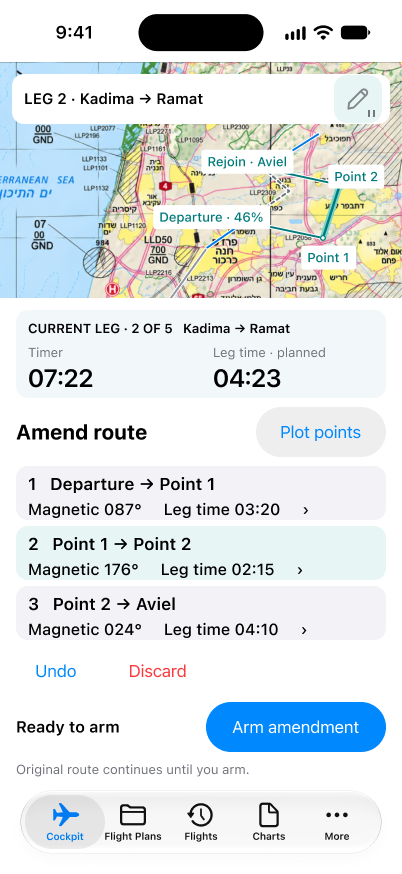

# D02 · Detailed preparation design coverage

## D04 scoped approval · John · 2026-11-24

[Approved D04 frame/notes](https://www.figma.com/design/JCyQhDDzCPfrrbv6SBcwKw?node-id=48-409)
supersede conflicting plotting/continuation controls, plotting-off value gating and
short-point correction only; D03 geometry/unaffected D02 and dated history remain.
Full contract: canonical product spec and D04 reconciliation revision locally;
approved immutable docs permalink awaits authorized commit/push/merge. Design and
behavior approval does not authorize implementation or check acceptance criteria.

The earlier descriptions below are retained as dated history where D04 supersedes them.

D01 direction approved by John on 2026-11-24, reviewing node 3:2 at repository
checkpoint 95f03bf. D02 extends that direction; detailed design approval and
implementation remain separate. D02 status: **changes requested** following owner review.
[D03](design-revision-d03.md) supersedes console geometry and wheel grouping;
other D02 state content remains the reference. D03 is approved with the regular-Cockpit boundary. D02 state content remains
approved under D03 layout rules. Each exact node below extends the approved
direction. Static design inspection does not establish simulator behavior.

| Review view | Coverage | Contract |
| --- | --- | --- |
| F00/F01 · Entry, plotting and partial route | Entry with plotting off; explicit Plot points/Done plotting; departure, growing rows before rejoin; map gestures; no operational action from a plot; no Finish here gate. | G01, G02 |
| F02 · Correct points | Point-versus-leg selection, Move/Remove, explicit replacement placement, affected Manual values unset, unchanged values retained, Undo restores geometry and values. | G02, Q22, Q35 |
| F03 · Rejoin and route validity | Explicit tapped rejoin, automatic plotting exit, Continue plotting, Change return point, same-leg later rejoin, ambiguous occurrence picker, completed/reversed/duplicate rejection. | G02, G06 |
| F04 · Manual leg editor on map | Selected map/row association, heading 001°–360°, minute/second wheels, partial values/Done, missing values, required ranges, no initial-position acceptance, pencil exit/resume. | G03 |
| F05 · Cues and Check | Optional altitude/frequency/note, Not set/clear, 100 ft steps and bounds, valid 25 kHz COM channels, Check comparison/unavailable, entries unchanged. | G03, Q25, Q34 |
| F06 · Assisted preparation | Captured mode, editable defaults/provenance, unavailable estimate fallback, duration edit updates marks, drift toggle independent from marks, no Manual aids after Check. | G03, G06 |
| F07 · Pencil lifecycle | None, Incomplete, Ready, Armed, awaiting Manual Start leg, Flying read-only; highlight independent of badge, unsaved state and accessible names. | G01, G07, Q33 |
| F08 · Ready and Arm | Readiness computed, Arm enabled only with complete valid inputs, no separate Validate or Start now, no unarmed operational-route effect. | G04, Q32 |
| F09 · Armed inspection | Commit success returns to Cockpit, pending operational destination, grey play badge, read-only values, Disarm and edit, Disarm and discard. | G04 |
| F10 · Warnings and recovery | Departure alert Update departure/Later plus persistent warning; save/arm failure and Retry; discard confirmations; restored unarmed draft, per-Flight isolation, unsaved in-memory exit. | G05, Q36 |
| F11 · Cockpit round trip | Hide unarmed geometry; normal navigation stays available; restore same draft/selection with plotting off; recovered draft does not auto-open or arm. | G01, G05, G06 |
| F12 · iPad landscape | 1194 × 834 adaptation; current-leg strip retained, no legend/header overlap, leg values and controls remain readable. | Platform baseline, G06 |
| F13 · iPhone portrait | 402 × 874 adaptation; compact vertical rows, map-associated editor, reachable actions, scroll rather than clipping. | Platform baseline, G03, G06 |
| F15 · Compact editor | Same selected-leg wheel editor over the compact map, partial-entry preservation, context retained behind modal. | G03, platform baseline |
| F14 · Accessibility | Larger Text scrolling/wrapping, VoiceOver order and value announcements, 44 pt targets, non-colour status meanings, Reduce Motion; no claim of runtime compliance from Figma. | Platform baseline, G01–G07 |

Flying execution, departure/rejoin timing, Flight Undo, Debrief, planned-wind
selection, 8.33 kHz, timed amendment identification points and iPhone landscape
remain excluded. Flying read-only inspection and badge semantics are entry/status
boundaries only, not a redesign of flying.

## Exact candidate nodes

[Review index and end-to-end flow](https://www.figma.com/design/JCyQhDDzCPfrrbv6SBcwKw?node-id=23-889).
[Reusable pencil states](https://www.figma.com/design/JCyQhDDzCPfrrbv6SBcwKw?node-id=13-804) and
[wheel column](https://www.figma.com/design/JCyQhDDzCPfrrbv6SBcwKw?node-id=12-458).

D02 state content is approved under D03 geometry and the regular-Cockpit boundary.
These static designs do not establish runtime implementation acceptance. D01 node 3:2
remains the approved main-screen direction. Product baseline: [95f03bf preparation
proposal](https://github.com/johnbenz13/NavigationFlight/blob/95f03bf/docs/reconciliations/2026-11-23-route-amendment-preparation/proposed/preparing-an-amendment.md).

| View | Exact Figma candidate | Retained preview |
| --- | --- | --- |
| F00 · Empty entry | [Node 20:1370](https://www.figma.com/design/JCyQhDDzCPfrrbv6SBcwKw?node-id=20-1370) | [PNG](../assets/figma/d02-f00.png) |
| F01 · Plotting a partial route | [Node 11:73](https://www.figma.com/design/JCyQhDDzCPfrrbv6SBcwKw?node-id=11-73) | [PNG](../assets/figma/d02-f01.png) |
| F02 · Moved point; affected Manual values cleared | [Node 11:245](https://www.figma.com/design/JCyQhDDzCPfrrbv6SBcwKw?node-id=11-245) | [PNG](../assets/figma/d02-f02.png) |
| F03 · Rejoin choices and route validity | [Node 13:595](https://www.figma.com/design/JCyQhDDzCPfrrbv6SBcwKw?node-id=13-595) | [PNG](../assets/figma/d02-f03.png) |
| F04 · Manual wheel editor on map | [Node 11:422](https://www.figma.com/design/JCyQhDDzCPfrrbv6SBcwKw?node-id=11-422) | [PNG](../assets/figma/d02-f04.png) |
| F05 · Optional cues, Check and boundary values | [Node 12:503](https://www.figma.com/design/JCyQhDDzCPfrrbv6SBcwKw?node-id=12-503) | [PNG](../assets/figma/d02-f05.png) |
| F06 · Assisted values and independent map aids | [Node 11:591](https://www.figma.com/design/JCyQhDDzCPfrrbv6SBcwKw?node-id=11-591) | [PNG](../assets/figma/d02-f06.png) |
| F07 · Pencil status matrix | [Node 13:639](https://www.figma.com/design/JCyQhDDzCPfrrbv6SBcwKw?node-id=13-639) | [PNG](../assets/figma/d02-f07.png) |
| F08 · Ready, awaiting explicit Arm | [Node 11:787](https://www.figma.com/design/JCyQhDDzCPfrrbv6SBcwKw?node-id=11-787) | [PNG](../assets/figma/d02-f08.png) |
| F09 · Armed, read-only inspection | [Node 11:959](https://www.figma.com/design/JCyQhDDzCPfrrbv6SBcwKw?node-id=11-959) | [PNG](../assets/figma/d02-f09.png) |
| F10 · Warnings, failures and recovery | [Node 13:806](https://www.figma.com/design/JCyQhDDzCPfrrbv6SBcwKw?node-id=13-806) | [PNG](../assets/figma/d02-f10.png) |
| F11 · Cockpit round trip; unarmed geometry hidden | [Node 11:1139](https://www.figma.com/design/JCyQhDDzCPfrrbv6SBcwKw?node-id=11-1139) | [PNG](../assets/figma/d02-f11.png) |
| F12 · iPad landscape 1194 × 834 | [Node 20:651](https://www.figma.com/design/JCyQhDDzCPfrrbv6SBcwKw?node-id=20-651) | [PNG](../assets/figma/d02-f12.png) |
| F13 · iPhone 16 Pro portrait 402 × 874 | [Node 20:759](https://www.figma.com/design/JCyQhDDzCPfrrbv6SBcwKw?node-id=20-759) | [PNG](../assets/figma/d02-f13.png) |
| F14 · Larger Text and accessibility layout study | [Node 20:1165](https://www.figma.com/design/JCyQhDDzCPfrrbv6SBcwKw?node-id=20-1165) | [PNG](../assets/figma/d02-f14.png) |
| F15 · Compact map-associated wheel editor | [Node 20:1526](https://www.figma.com/design/JCyQhDDzCPfrrbv6SBcwKw?node-id=20-1526) | [PNG](../assets/figma/d02-f15.png) |

## Flow and presentation rules

Cockpit → pencil → Plot points → departure → via points → deliberate later
rejoin → complete missing heading/leg time → Ready → Arm → durable commit →
Cockpit. Done plotting may interrupt drawing for value entry. Opening, leaving,
saving or completing entries never arms. Pencil exit preserves work; an untouched
exit creates no draft. Plotting is off when returning.

The map or row opens the same selected-leg editor. Each wheel selection saves
that field independently; Done preserves partial entries. Heading 001°–360° and
leg time up to 60:00 retain explicit units. Untouched fields remain Not set.
Optional cues and Check are separate disclosures; Check preserves Manual entries.

F03, F05, F07 and F10 are explanatory state sheets, not full app screens. F14
is a Larger Text study showing a scrolling list and reachable Arm action. The
iPad landscape adaptation uses map and console side by side. Compact portrait
keeps the map, vertical rows and explicit Arm action, and overlays the selected
leg editor on the map. The native status/tab components reuse the iOS 27 kit;
iPhone 16 Pro remains the reference device regardless of kit component naming.

The chart and geographic values are illustrative. The raster is chart-only;
controls, text and route overlays remain editable. F11 shows existing normal
Cockpit context to locate the preserved-draft entry, rather than proposing a
redesign of Flight progression. No Start now action is introduced.

## Review boundaries

- Detailed design was approved by John with the D03/regular-Cockpit limitation;
  native wheel feel and runtime alert behavior still need implementation evidence.
- VoiceOver sequence: current identity, Timer, planned leg time, workspace
  actions, each leg with magnetic heading and leg time, readiness, Arm. Status
  has a shape and spoken meaning; colour alone conveys no state.
- Interactive targets must remain at least 44 pt. Larger Text wraps and scrolls;
  modal content and keyboard avoidance require simulator validation during
  implementation. Reduce Motion avoids animated route transitions.
- Manual aids remain off after Check. Assisted minute marks derive from working
  duration; edited duration changes their spacing. Drift lines remain independent
  in existing Map tools, and do not control minute marks.
- No new runtime verification is claimed for these proposed states. Detailed
  design approval, ticket breakdown and implementation authorization are separate.

## Selected previews

