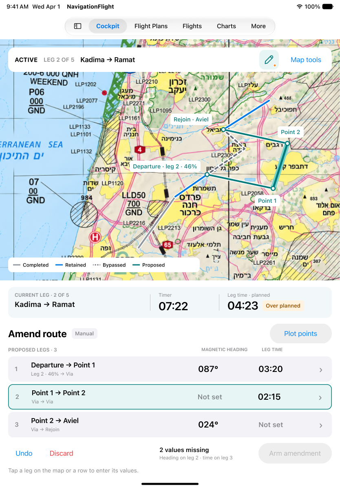

# D01 · Amendment workspace direction

**Status:** direction review · 2026-11-24. Human direction approval pending.
**Primary target:** iPad Pro 11-inch portrait, 834 × 1194.
**Behavioral baseline:** [owner-approved preparation proposal at 740a8b7](https://github.com/johnbenz13/NavigationFlight/blob/740a8b7/docs/reconciliations/2026-11-23-route-amendment-preparation/proposed/preparing-an-amendment.md).
**Implementation:** none. This is a proposed design, not a running application.

## Figma

- Stable reconciliation file: [NavigationFlight · Amendment preparation](https://www.figma.com/design/JCyQhDDzCPfrrbv6SBcwKw).
- [D01 · Main screen, 3:2](https://www.figma.com/design/JCyQhDDzCPfrrbv6SBcwKw?node-id=3-2).
- [Review brief and baseline link, 4:707](https://www.figma.com/design/JCyQhDDzCPfrrbv6SBcwKw?node-id=4-707).
- Named iteration: **D01 · Amendment workspace · iPad portrait · Direction review**.
- Created with project destination `676737789`, Navigation Flight, using the owner's sole Figma team plan. Creation returned file key `JCyQhDDzCPfrrbv6SBcwKw`.
- Approver and approval date: pending. No earlier approval applies to this iteration.

## The screen to review

A Manual amendment has a valid departure/rejoin and three replacement legs.
Plotting is off. Leg 2 is selected on the map and in the list; its heading is
missing. Leg 3's time is also missing, so Arm is unavailable. The original
operational leg's elapsed timer continues independently.

This is the first main-screen direction. Kadima → Ramat and Aviel are illustrative
reference data, not the owner's current Flight. Headings and durations illustrate
field states and are not calculated flight guidance. The chart background is a
reused discrete map asset from historical [6:38](https://www.figma.com/design/7RYloAn7AntwSMe3zz5F4B?node-id=6-38);
route geometry, labels, controls and all UI text are editable Figma nodes.

## Direction choices

| Area | Proposal and purpose | Behavioral trace |
| --- | --- | --- |
| Current-leg context | Pale timing surface with clear dividers: current leg, elapsed Timer, and planned Leg time. Over planned is labelled in amber; the solid dark block is removed. | G06; Q28 |
| Route roles | Completed grey solid, retained blue, bypassed grey dashed, proposed teal. A white casing preserves chart legibility; a stronger halo marks the selected proposed leg. | G02, G06 |
| One workspace | Three vertical leg rows with independent Heading and Leg time values. No horizontal chip sequence, Finish here, Review legs, or per-row green Check. | G02, G03 |
| Plotting | Plot points is the explicit entry to plotting; it is off in this state. Map/row taps select a leg for value entry. | G02; Q27, Q35 |
| Pencil | Existing edit highlight plus an amber draft dot. Pencil is the nondestructive route back to Cockpit; no extra pause/resume action. | G01 |
| Arming | Disabled Arm amendment is accompanied by the two exact missing fields. No Start now action. | G04; Q32 |
| Correction and exit | Undo and Discard remain in the footer. A short hint explains map/row entry. Detailed discard confirmation follows direction approval. | G02, G05 |

## What this direction does not yet cover

Wheel editor and Check, plotting-on, point movement and overlap/rejoin choices,
Ready/Armed/Flying badges, disarm/discard dialogs, saved/unsaved/recovered drafts,
save failure, stale departure, and read-only flying inspection are deferred until
the owner approves this main-screen direction. This is not approval to implement.

Then expand the same direction to iPad landscape and iPhone 16 Pro portrait and
review Dynamic Type, VoiceOver, Reduce Motion, interaction target sizes and
native material behavior. No iPhone landscape design is included. Static Figma
geometry does not establish runtime behavior or accessibility compliance.

## Assembly and validation

No matching whole-workspace design-system component or Swift Code Connect mapping
was found. The file uses the iOS/iPadOS 27 library for native iPad tabs, status/menu
bar and content-area button instances, plus label/background/separator/accent
variables and applicable typography. Product-specific selected surfaces and teal
are local proposal variables. App-specific console spacing follows existing
20-point edges and compact list conventions rather than unrelated library menu
spacing. A local amendment-row main component supplies three row instances.

Structural read-back found 159 descendants: 48 frames, 20 instances, 60 text
nodes, 2 slots, 17 vectors, 7 rectangles and 5 ellipses. The only image-filled node
inside the screen is the discrete chart background, 834 × 590; there is no
flattened complete-UI screenshot inside the editable screen. All text uses SF Pro.
Console content ends at its 508-point bound, within the 1194-point screen.

The full composition was inspected, then targeted fixes corrected badge contrast
and the native app-name placeholder. The post-fix screenshot embedded above is
the retained final preview; exact source node and PNG hash are recorded. No
additional unchanged screenshot was taken. System-owned Liquid Glass material
and typography are platform rules for implementation, not pixel-equality promises.
