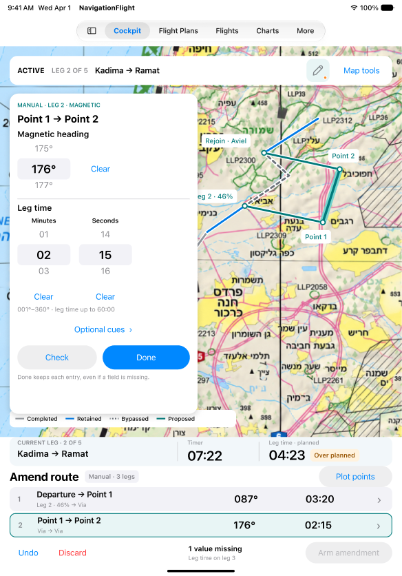
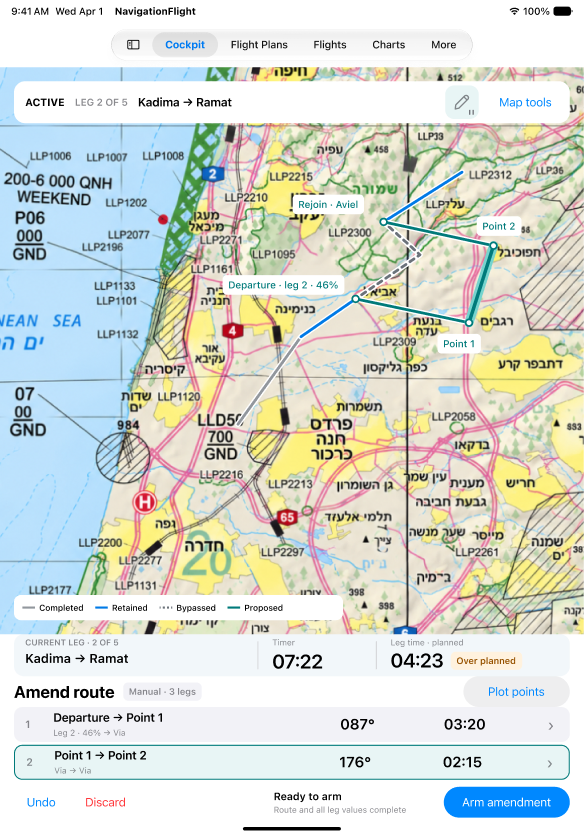
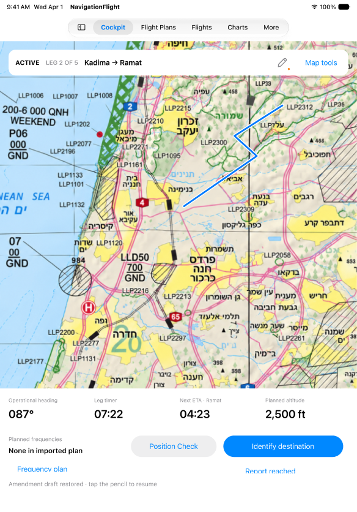

# D03 · Separate fields and a stable console

**Status:** in review. John was globally satisfied with D02 and requested these
two corrections on 2026-11-24. This does not record approval of the revised D03
direction or authorize implementation. D01 and D02 remain historical evidence.

[D03 review index](https://www.figma.com/design/JCyQhDDzCPfrrbv6SBcwKw?node-id=32-408)
extends the [preparation baseline at a74f04c](https://github.com/johnbenz13/NavigationFlight/blob/a74f04c/docs/reconciliations/2026-11-23-route-amendment-preparation/proposed/preparing-an-amendment.md)
with the owner's two corrections below. Other behavior stays as recorded in
[G01–G07](preparing-an-amendment.md) and the [D02 state coverage](design-coverage.md).

## Clearly separate heading from time

Magnetic heading occupies its own labelled section with one degree wheel.
A divider separates it from **Leg time**, whose minutes and seconds wheels
remain together below. Leg time is a planned duration, not a clock ETA. Partial
entry, Clear, optional cues, Check and Done keep their agreed behavior.

[C · iPad editor](https://www.figma.com/design/JCyQhDDzCPfrrbv6SBcwKw?node-id=29-1039)
and [F · iPhone editor](https://www.figma.com/design/JCyQhDDzCPfrrbv6SBcwKw?node-id=29-1298).

## Keep the map and console boundary steady

Opening or hiding amendment mode, plotting, readiness, and opening the leg
editor must not resize the underlying map or console. Keep the current camera
position and zoom when toggling. The console uses the same resting layout policy
as regular Cockpit for the same Flight state, window and accessibility settings.
The current-leg timing strip and preparation actions stay fixed; the replacement
leg list scrolls within the available space, with its count visible.

The dimensions below come from
[CockpitRestingLayoutPolicy.swift](../../../../NavigationFlight/Features/Cockpit/CockpitRestingLayoutPolicy.swift),
rather than the taller D02 proposal. They are baseline extents, not new constants
to duplicate in an amendment-specific policy. Existing operational-state reach
adjustments and safe areas must be applied consistently in both modes. Window
resizing, rotation, keyboard avoidance and accessibility layouts may adapt to
their environment; toggling amendment or opening its editor must not cause the
underlying viewport to change.

| Reference | Shared console extent | Map in the D03 frame |
| --- | --- | --- |
| iPad portrait · 834 × 1194 | 288 pt lower console | 834 × 810, starting at y = 96 |
| iPhone portrait · 402 × 874 | 278 pt lower console | 402 × 439, between 62 pt status and console; 95 pt tab area below |
| iPad landscape · 1194 × 834 | 370 pt side rail | 824 × 738 below the 96 pt navigation area |

[A · Amendment portrait](https://www.figma.com/design/JCyQhDDzCPfrrbv6SBcwKw?node-id=29-883)
and [B · Regular Cockpit portrait](https://www.figma.com/design/JCyQhDDzCPfrrbv6SBcwKw?node-id=29-989)
have the same map size and console boundary at screen y = 906. B supplies existing
Cockpit context for this comparison; it does not redesign its flight controls.

## Responsive candidates and precedence

| Candidate | Exact node | Retained preview |
| --- | --- | --- |
| D · Landscape rail | [29:1167](https://www.figma.com/design/JCyQhDDzCPfrrbv6SBcwKw?node-id=29-1167) | [PNG](../assets/figma/d03-d.png) |
| E · Compact console | [29:1238](https://www.figma.com/design/JCyQhDDzCPfrrbv6SBcwKw?node-id=29-1238) | [PNG](../assets/figma/d03-e.png) |
| F · Compact wheel sections | [29:1298](https://www.figma.com/design/JCyQhDDzCPfrrbv6SBcwKw?node-id=29-1298) | [PNG](../assets/figma/d03-f.png) |

D03 supersedes D02's console geometry and combined wheel row across all
preparation states. D02 remains the content/state reference for plotting,
correction, cues, Check, lifecycle badges, arming, warnings and recovery. Its old
console sizes are no longer candidate geometry. D03's smaller list viewport
scrolls to the selected leg; long lists or warnings must not enlarge the console.
Large Text uses wrapping and scrolling while keeping controls reachable under
the shared accessibility layout. iPhone landscape remains excluded.

All six candidate views and the index were visually inspected. These editable
Figma designs use chart-only raster backgrounds; geographic values are
illustrative. No simulator behavior, native wheel feel or runtime accessibility
compliance is claimed. D03 needs explicit renewed direction approval before
further detailed design or implementation planning.
