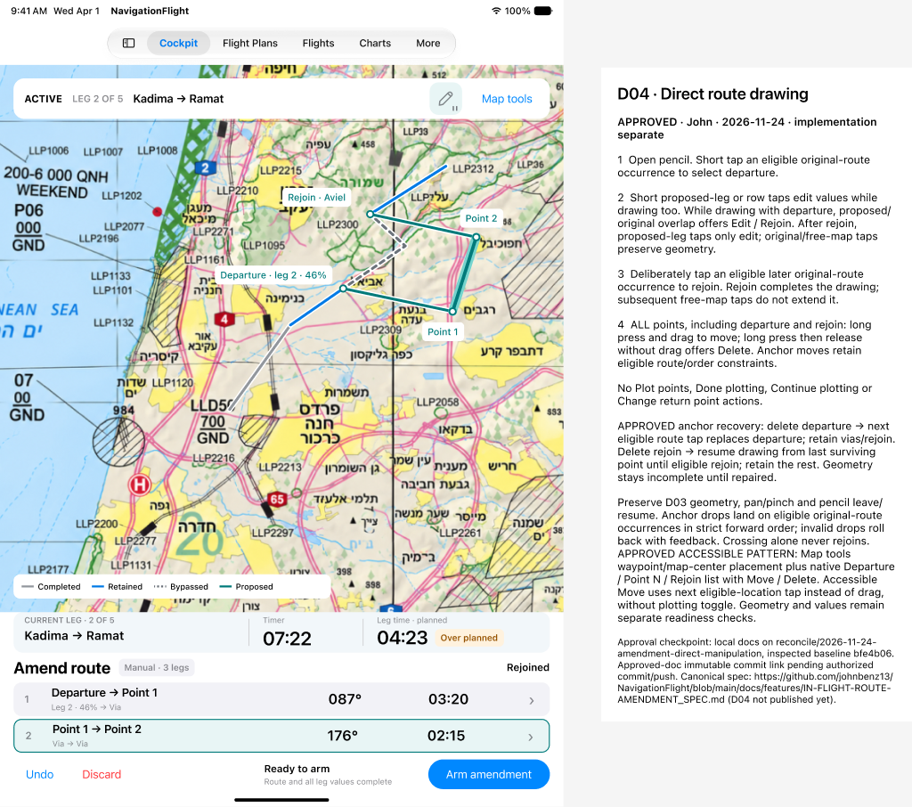

# D04 · Draw directly and correct points with a long press

**Status:** approved · John · 2026-11-24.
John explicitly approved this complete D04 review, including anchor recovery and
accessible actions. It supersedes the scoped conflicting earlier preparation
contract; application implementation remains separately authorized. D02/D03 approvals and implementation
evidence remain historical records.

**Isolated proposal branch:** `reconcile/2026-11-24-amendment-direct-manipulation`.
**Inspected baseline:** `bfe4b068064d075fdef0644cb003af68ad9b7fd3` (local main).
The active AP-03 working tree was preserved separately.

## The pilot draws without mode buttons

John requested removal of **Plot points**, **Done plotting**, **Continue plotting**
and **Change return point**. The earlier continuation deliberately converted the
rejoin into a via point and left the geometry incomplete. This matched the earlier
AP-03 contract; the proposed interaction intentionally supersedes it.

1. Open the pencil workspace. A short tap on an eligible original-route occurrence
   selects the departure. Short map taps then add points and connected legs.
2. A deliberate short tap on an eligible later original-route occurrence rejoins
   automatically. Crossing a line without tapping it does not rejoin. Existing
   forward occurrence, completed-route and same-leg validity rules are retained.
3. Rejoin is the final drawing step for this slice. Further free-map taps do not
   extend the route or start another amendment. Geometry validity remains separate
   from readiness: all required leg values are still needed to arm.
4. A short tap on a proposed leg or its row opens its values, including during
   drawing before rejoin. Closing values preserves the route and entered fields.
5. Long press and drag any point, including departure and rejoin, to move it
   directly. Long press and release without dragging offers **Delete**. Anchor
   drops must land on eligible original-route occurrences with departure strictly
   before rejoin, including same-leg fractions/current progress. Invalid drops
   roll back atomically with feedback; movement/crossing alone never rejoins.
   Keep the existing rules for affected values, cues, atomic rejection and Undo.
6. When a short tap hits both a proposed leg and an eligible original-route
   occurrence while drawing with a departure, show an **Edit / Rejoin** chooser.
   After rejoin, a proposed-leg tap only edits; original/free-map short taps leave
   geometry unchanged. Delete rejoin explicitly reopens drawing.

## Representative review proposal

[D04-A · iPad portrait](https://www.figma.com/design/JCyQhDDzCPfrrbv6SBcwKw?node-id=48-409)
shows the rejoined route in the existing D03 shell, replacing the plotting button
with a noninteractive status. [The adjacent interaction notes](https://www.figma.com/design/JCyQhDDzCPfrrbv6SBcwKw?node-id=48-565)
state the proposed drawing and correction gestures. This is an editable proposed
design, not a simulator capture or a claim of delivered behavior.

The screenshot was exported and inspected on 2026-11-24. Text uses SF Pro; existing
native component instances and the chart-background-only asset were retained.
The console still has fixed timing/actions and an internally scrolling leg list.
iPad landscape and iPhone portrait inherit D03 shell geometry; no new variant
coverage or runtime verification is claimed. iPhone landscape remains excluded.

## Owner decisions and proposed anchor recovery

John's final answers: **overlap → chooser (Edit / Rejoin)**; **long-press drag/delete
applies to ALL points including departure and rejoin**. These settle the two earlier
questions. Approval of the complete design and implementation remains separate.

**Agent-origin recovery proposal approved by John on 2026-11-24:** deleting departure preserves vias, existing rejoin
and unaffected values; geometry becomes incomplete, and the next eligible
original-route tap selects the replacement departure. Deleting rejoin preserves
the departure, vias and unaffected values; resume direct drawing from the last
surviving point until another eligible deliberate route tap rejoins. Required
heading/time values are invalidated only for changed edges. Missing anchors block
Arm; cancellation and Undo preserve/restore the complete draft. Replacing an anchor
never reorders or silently deletes retained points. Reject invalid route/order
choices atomically. An Edit / Rejoin chooser only offers currently eligible Rejoin;
while departure is missing, eligible original-route taps select departure instead.
These recovery details originated as an agent proposal and were included in John’s explicit D04 approval.

**Accessible pattern approved by John on 2026-11-24:** reuse Map tools waypoint/map-center
placement and a native named point-action list (**Departure / Point N / Rejoin**)
with **Move / Delete**. Accessible Move enables the next eligible-location tap as
the existing alternative to drag, without a plotting toggle. Apply the same anchor
constraints, atomic rejection and Undo rules. Preserve pan/pinch (long press starts
movement) and nondestructive pencil leave/resume.

## Scoped contract and ticket impact

| Contract | Proposed change |
| --- | --- |
| G01/G02/G03 and decision register | Replace explicit plotting modes with direct drawing and simultaneous leg-value access; record scoped supersession of the earlier decisions. |
| #227 / AP-03 | Remove continuation/return buttons and their acceptance paths; retain automatic forward rejoin and occurrence validation. Add post-rejoin no-extension checks. |
| #228 / AP-04 | State that proposed-leg and row short taps edit values even before rejoin; retain partial independent heading/time and Check behavior. |
| #231 / AP-07 | Replace plotting-off short waypoint selection and Move placement with long-press drag and release-to-Delete; retain selective invalidation, cues and Undo. All points include anchors; deletion recovery is proposed above. |
| #233 / AP-09 | Replace plotting-off recovery wording with restored geometry determining direct-drawing versus rejoined interaction; preserve Flight isolation, regular-Cockpit recovery and no automatic arming. |
| Shared contract / canonical spec / technical design | D04 addenda are approved and supersede only scoped conflicting baseline behavior. Retain AP-01/AP-02 delivery sections and dated evidence. |

#234's explicit stale-departure recovery and #236's Armed/Flying read-only guards
remain unchanged. #229/#230 heading/time/cue controls require no redesign.
The parent and task index need only the resulting links and scope summary.

Exact proposed issue-text replacements are retained in
[the local issue proposal folder](../evidence/d04-issue-proposals/README.md).
The approved scoped issue contracts were published to #227/#228/#231/#233. No tests/builds were run:
this checkpoint changes documentation and design only. Design/behavior approval is recorded;
implementation authorization, implementation acceptance and issue closure remain
separate decisions.

Approved local docs await an authorized commit/push; the immutable approval-document permalink remains a checkpoint dependency. No commit or push is implied.
