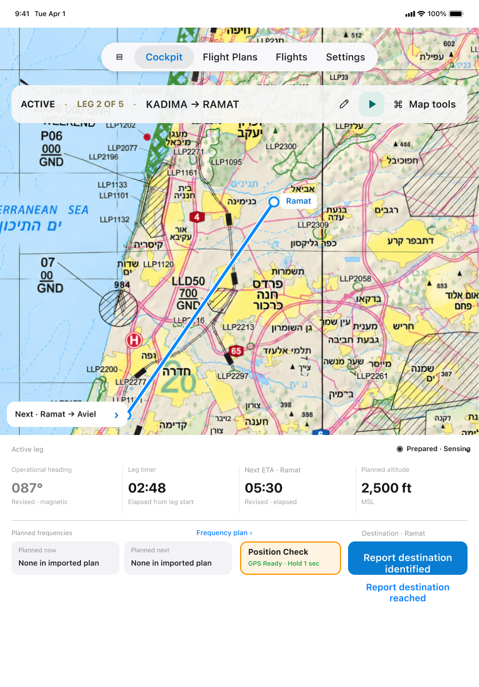
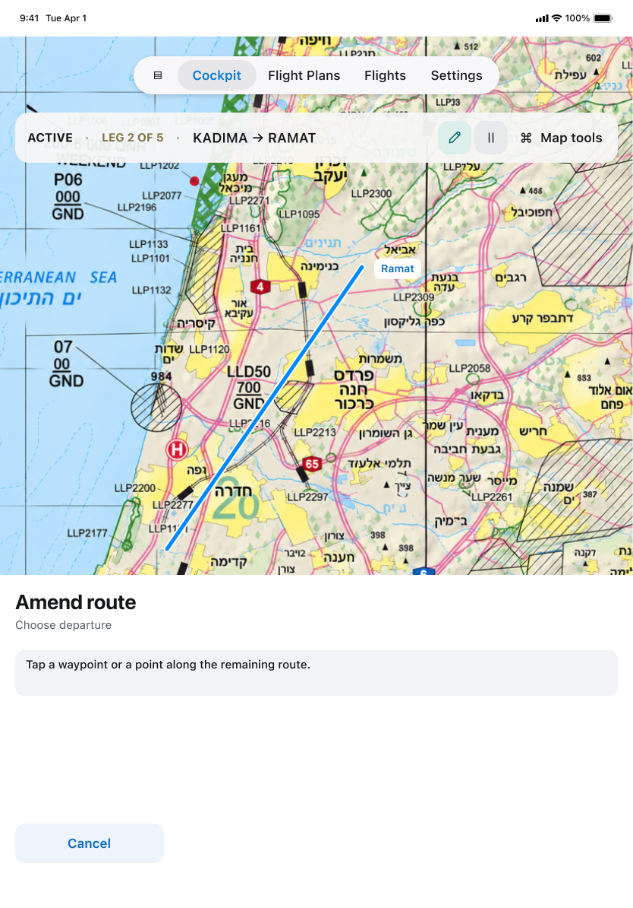
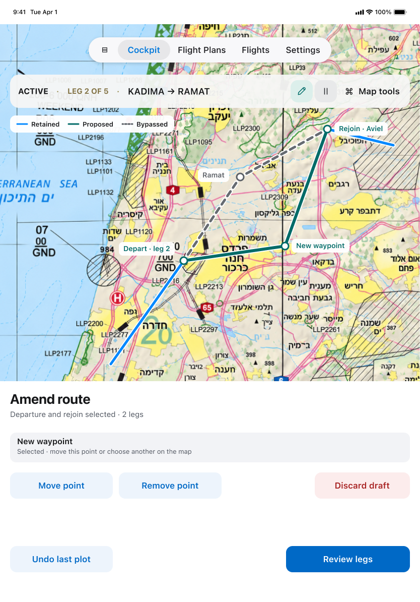
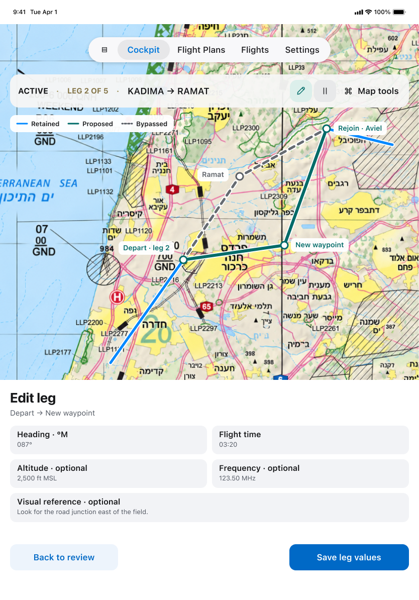
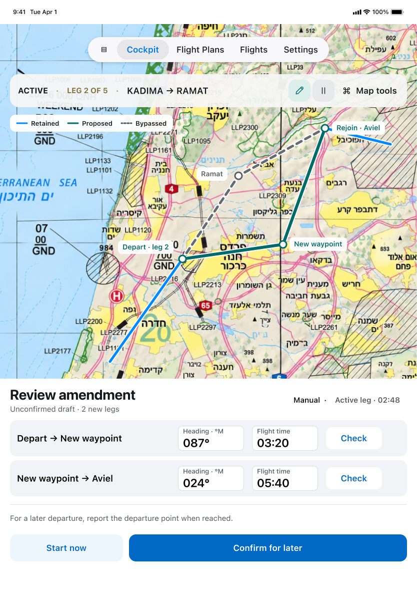

# Prepare the amendment in one workspace

## D04 scoped approval · John · 2026-11-24

[Approved D04 frame/notes](https://www.figma.com/design/JCyQhDDzCPfrrbv6SBcwKw?node-id=48-409)
supersede conflicting plotting/continuation controls, plotting-off value gating and
short-point correction only; D03 geometry/unaffected D02 and dated history remain.
Approved [product contract](https://github.com/johnbenz13/NavigationFlight/blob/5b934ef47c70366d5078995657af2373c675e015/docs/features/IN-FLIGHT-ROUTE-AMENDMENT_SPEC.md) and [D04 revision](https://github.com/johnbenz13/NavigationFlight/blob/5b934ef47c70366d5078995657af2373c675e015/docs/reconciliations/2026-11-23-route-amendment-preparation/proposed/design-revision-d04.md) are fixed at `5b934ef`; merge is pending. Design and
behavior approval does not authorize implementation or check acceptance criteria.

The earlier descriptions below are retained as dated history where D04 supersedes them.

**Status:** behavioral direction approved by John, 2026-11-23, Q1–Q31;
Q32–Q36 resolved on 2026-11-24, including removal of Start now.
**Design:** [D01 main screen](design-proposal.md) was direction-approved by John on
2026-11-24. D02 received two owner corrections. [D03](design-revision-d03.md) was approved by John
on 2026-11-24 with the explicit regular-Cockpit boundary; retained D02 states
inherit D03 geometry. Historical previews below are not
the new target.
Historical Figma references retain their earlier approval dates and are shown
only to explain what this iteration changes. Implementation remains separate.

The pilot opens the pencil, explicitly enables plotting, draws a replacement,
and enters headings and leg times in the same workspace. They can return to
Cockpit at any point without committing to use it. Only **Arm** changes the
operational route. See the [decision record](decisions.md).

## G01 · Open, leave and resume with the pencil

**Related current story:** [S01](../current/preparing-an-amendment.md#s01--open-amendment-mode).

**Today:** The highlighted pencil is accompanied by separate pause/resume
controls; the source disables the ordinary pencil while a draft exists.

**Wanted outcome:** The same pencil toggles amendment mode. Closing an untouched
workspace leaves no draft or badge. Closing after edits preserves the draft,
selection and partial modal values without a discard dialog and returns to the
regular Cockpit. Reopening restores the work with plotting off. The editor-open
highlight is independent of the amendment's status badge.

| Amendment status | Meaning | Agreed indicator direction |
| --- | --- | --- |
| None | No prepared change | Normal pencil |
| Incomplete | Route or required values missing/invalid | Amber dot |
| Ready | Route and all required values valid, unarmed | Grey pause badge |
| Armed | Explicitly committed, awaiting departure | Grey play badge |
| Flying | First replacement leg has started | Green pencil/play badge |

Under Manual progression, awaiting the first replacement leg’s Start leg keeps
the grey Armed indicator and explains “Awaiting Start leg”. Green begins when
that leg starts.

Do not encode the meaning with colour alone. Use the approved D02-F07 status variants and D03 layout rules; runtime
contrast, target sizing and spoken wording still require implementation evidence. An invalid armed state is not a normal
allowed state; readiness and route eligibility are rechecked before arming.

**Historical reference, not the new design:**
[7:94 · Paused draft](https://www.figma.com/design/7RYloAn7AntwSMe3zz5F4B?node-id=7-94)
uses a separate play control; that interaction is replaced by the pencil toggle.

## G02 · Draw and review in one workspace

**Related current stories:** [S02](../current/preparing-an-amendment.md#s02--choose-a-departure)
and [S03](../current/preparing-an-amendment.md#s03--draw-select-and-review).

**Today:** Drawing uses a horizontal point sequence; review uses vertical leg
rows. Review and editing depend on closing the route and changing steps.

**Wanted outcome:** A dedicated **Plot points** toggle controls map plotting.
Opening amendment mode leaves plotting off. The first eligible route tap while
plotting selects departure. Later taps add existing waypoints or free points,
with straight segments between them. Every newly formed segment immediately
adds a vertical leg row. There is no Finish here or Review legs gate. Remove
the current Pick a point and Inspect leg links from this workspace.

The pilot can stop plotting at any time, stay in amendment mode, and edit an
existing segment even while the route has no rejoin. Map gestures still work.
Selecting a row and tapping its map leg open the same editor when plotting is
off. While plotting is on, map taps have plotting semantics rather than value
editing semantics.

A deliberate tap on an eligible later route occurrence sets the rejoin and
ends plotting automatically. Crossing an original line without tapping it
does not join. Offer explicit **Continue plotting** when the intended tap is a
via point rather than a return. With plotting off, tapping a waypoint exposes
Move/Remove; tapping a leg or its row opens its editor. Move explicitly enables
placement of the replacement point. Resolve coincident/crossing candidates by route
occurrence. After a rejoin, extending the route requires **Change return point**.

The departure and rejoin can be waypoints or points partway along legs. Rejoin
must be strictly later in operational route order, including a later fraction
of the same leg: a triangular detour is valid. Completed portions are unavailable
as departure/rejoin anchors. Keep distinct consecutive points and the original
route's final destination. Pilot-reported progress determines what is passed;
neither GPS nor elapsed time automatically selects or advances an anchor.

Move/remove and Undo remain available. Undo restores geometry and associated
values together. Changing geometry clears Manual heading/time on affected legs;
Assisted estimates for affected legs are recalculated and visibly marked updated.
Unchanged legs retain values. Preserve optional cues on surviving legs; removing
a leg removes its cues. The endpoint/leg cue association needs an explicit
technical mapping before implementation, not a guess from row indices.

**Historical references, not the new design:**
[12:90 · Empty drawing](https://www.figma.com/design/7RYloAn7AntwSMe3zz5F4B?node-id=12-90)
and [12:222 · Selected point](https://www.figma.com/design/7RYloAn7AntwSMe3zz5F4B?node-id=12-222)
show the separate drawing console that this proposal replaces.

## G03 · Enter values on the selected leg

**Related current story:** [S04](../current/preparing-an-amendment.md#s04--edit-a-proposed-leg).

**Wanted outcome:** Selecting a proposed leg on the map or in its console row
opens a modal on the map associated with that leg. The selected geometry and
row remain identifiable. D03-C/F define the approved placement and separated wheel sections.

- Magnetic heading uses a wheel labelled in degrees, **001°–360°**.
  Give heading its own labelled section, visually separated from the Leg time
  section containing the minutes and seconds wheels (owner review, 2026-11-24).
- **Leg time** means planned duration, not clock time or the existing revised ETA
  workflow. Use minute and second wheels: 00–60 minutes, 00–59 seconds, total
  capped at 60:00. 00:00 is invalid.
- Required missing fields remain **Not set** until intentionally selected; an
  initial wheel position is not a pilot entry.
- Optional cues remain altitude (100 ft increments, labelled ft MSL), VHF
  frequency (25 kHz channel steps, MHz and fractional wheels), and a visual
  reference note. Altitude spans −1,500 to 20,000 ft MSL; preserve existing
  out-of-range values without silent rounding. Optional wheels have a clear Not set choice. 8.33 kHz support
  is deferred for this slice; see [Q25](decisions.md#decision-register).
- Each field is saved independently, including when other fields are missing.
  **Done** closes and preserves entries. Missing values prevent arming, not exit.
  Closing with the pencil also preserves partial entries.
- **Check** is available inside the modal, with entered values distinct from the
  reference result. It never overwrites Manual values. Remove the green Check
  button from every console row. Keep optional cues progressively disclosed.

Manual remains the Settings default. Capture Manual/Assisted when creating the
draft and show its mode in the workspace. Settings changes affect the next draft.
Existing/recovered drafts retain their captured mode. Assisted supplies editable
available estimates; missing estimates require pilot entry. Readiness requires
usable heading and duration in both modes. Keep existing Manual/Assisted map-aid
rules; do not add a new planned-wind selector.

**Historical reference, not the new design:**
[13:485 · Edit values/cues](https://www.figma.com/design/7RYloAn7AntwSMe3zz5F4B?node-id=13-485).
The new proposal uses on-map wheels and independent field saving, not this
all-or-nothing console form.

## G04 · Arm a ready amendment

**Related current story:** [S05](../current/preparing-an-amendment.md#s05--review-confirmation-choices).

**Wanted outcome:** Readiness is computed automatically from route validity,
current eligibility and all required leg values. There is no separate Validate
action. The single **Arm** action is enabled only when ready; explain remaining
requirements beside the unavailable action.

Arming explicitly commits the pilot to use the amendment. It retains the existing
scheduled-confirmation effect: a future mid-leg departure becomes the shortened
operational leg's destination when current, and the existing timer continues.
The replacement's flight execution begins through the existing pilot-reported
departure flow. Opening, closing, saving or making a draft ready never arms it.

Return to Cockpit with the Armed pencil indicator only after the durable arm
operation succeeds. A failed save preserves work and the last operational route,
shows failure and offers Retry. Do not report success or duplicate operations.

Reopening Armed allows inspection. Before changing route or values, require
**Disarm and edit**. Disarming reverses the pending operational-route change and
preserves the preparation. **Remove Start now from the proposed flow**, including
armed inspection. Preparation ends at **Arm → return to Cockpit**. Any future
immediate-departure action will be reconsidered when reconciling flying. Normal
Reach and other flight execution remain outside this redesign.

**Historical reference, not the new design:**
[6:34 · Manual review](https://www.figma.com/design/7RYloAn7AntwSMe3zz5F4B?node-id=6-34)
has Start now and Confirm for later. These are historical controls; the new
preparation flow ends at Arm and does not retain Start now elsewhere.

## G05 · Preserve work and handle progression

**Related current branches:** pause/resume and recovery are source-derived here;
their complete runtime transitions are not established by the owner screenshots.

**Wanted outcome:** Untouched exit creates no draft. Once work begins, persist
the unfinished route, individual/partial entries, mode and selection with the
current Flight. A process restart restores the draft unarmed, returns to regular
Cockpit, and rechecks departure eligibility. Existing armed amendments retain
their established durable recovery; they are not downgraded to unarmed drafts.
Drafts belong to their specific Flight and resume only with that unfinished
Flight. Loading another Flight never carries a draft into it.

If pilot-reported progression overtakes an unarmed draft departure, preserve the
other work, mark it incomplete and require a new departure. Do not use elapsed
time alone to infer a passed point. Explain the stale departure and retain the
existing armed missed-departure behavior rather than redesigning it here.

Use a contextual departure alert; it does not block the pencil's nondestructive
exit. A draft-save failure must be visible and must not imply restart recovery
succeeded. Preserve the in-memory draft even after pencil exit to Cockpit and
show its unsaved status without blocking exit. Exact retry/exit presentation
needs design coverage.

**Discard amendment** asks for confirmation, removes the stored draft and
returns to Cockpit. On an armed amendment explicitly say **Disarm and discard**;
save the operational reversal successfully before reporting completion.

**Approved design:** D02-F10 recovery, save error, stale departure, discard and
disarm states, with D03 geometry. Earlier recovery contracts remain references;
persistent unarmed drafts are a newly agreed capability.

## G06 · Read the map and current-leg context

**Related current story:** [S02](../current/preparing-an-amendment.md#s02--choose-a-departure).

**Wanted outcome:** Completed legs are greyed out and unavailable as anchors;
keep them distinct from the dashed bypass. Retained and proposed route roles
remain distinguishable through patterns/labels as well as colour. Show only
amendment legs in the lower list, while the current operational leg retains a
visible timing strip. Closing the workspace hides unarmed geometry. Armed
geometry stays visible because it affects navigation.

Opening/hiding amendment mode and its leg editor must retain the regular
Cockpit map/console boundary for the same Flight and environment. Preserve map
camera and zoom. Scroll the leg list within the shared console extent; keep
timing and actions fixed. Apply the existing shared resting-layout policy,
including safe areas and operational/accessibility adjustments, consistently
in both modes. See [D03 sizing and comparison](design-revision-d03.md).

John's final direction adds a presentation change: replace the heavy dark/black
timing block with a more elegant, still distinctive treatment. Preserve readable
current-leg identity, elapsed **Timer**, planned **Leg time** and relevant overdue
status. Final labels and hierarchy must make planned duration and elapsed time
unambiguous. This is a design requirement, not approval of a particular colour,
material or replacement panel. Scope the first proposal to amendment preparation;
do not silently redesign the regular flying console. Node 29:989 is contextual only: implement only its
pencil/status text. All other regular Cockpit presentation and behavior follow
the existing approved design, not this reconciliation’s contextual frame.

**Approved design:** D03 strip/rows/adaptations and retained D02 empty/partial
states. Runtime text scaling, VoiceOver and Reduce Motion remain to be verified.

## G07 · Inspect without redesigning flight execution

**Related current branch:** flown-amendment pencil behavior has no owner image
in this preparation evidence batch.

**Wanted outcome:** A green Flying pencil opens read-only route/value inspection.
Changing or replacing an already flown amendment is deferred from this slice.
This is a scoped change to the editing entry point; existing flight controls,
timers, heading/ETA revisions, departure/rejoin and history retain their behavior.

**Approved design:** D02-F07 Flying status and D02-F09 read-only pattern under
D03 geometry. They must not suggest the existing flight has paused. Amendment Ready/Armed are also separate
from the regular Cockpit's Ready/Active leg states.

## Figma

- **Status:** approved · D03 plus retained D02 state content.
- **Approver/date:** John · 2026-11-24, after reviewing revision 46967c5.
- [Approved D03 index and layout rules](https://www.figma.com/design/JCyQhDDzCPfrrbv6SBcwKw?node-id=32-408).
- [Exact D03 views and scope limitation](design-revision-d03.md) and
  [D02 state coverage](design-coverage.md).
- Regular Cockpit node 29:989 approves only pencil/status text; its remaining
  UI is contextual and must not drive changes to the regular Cockpit.
- Proposed behavior remains unimplemented until separately authorized and verified.
