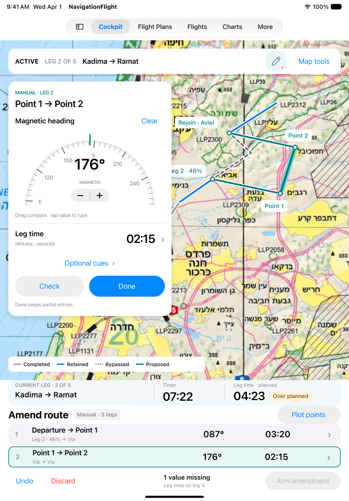
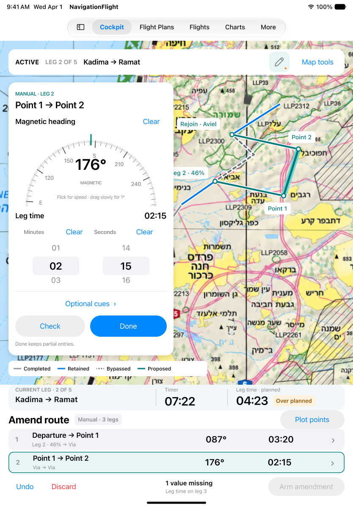

# Heading and leg-duration picker research

Date: 2026-11-25. Historical research and design progression; later implementation and acceptance evidence lives in the [AP-06 ledger](../reconciliations/2026-11-23-route-amendment-preparation/evidence/ap-06-implementation.md). VoiceOver scope follows [AGENTS.md](../../AGENTS.md#accessibility-scope).

Original research scope: interaction and API feasibility research, not an approved product specification or Figma proposal. Apple API findings were checked with Xcode DocumentationSearch and primary Apple web sources. No application code or runtime behavior was changed or verified.

## Recommendation

Explore a **manual compass-inspired heading ring with a large numeric magnetic-heading readout and a precise one-degree adjustment alternative**, paired with **one compact, joined minutes/seconds editor and a composed `03:20` leg-duration readout**. Heading should wrap `359 → 360 → 001 → 002` and reverse without encountering Not set. Keep Clear/Not set outside the numeric cycle. This is a proposed design direction, not an Apple-provided compass-picker style.

A ring should not be the only way to enter an exact heading. At a diameter of 180 points, its circumference is approximately 565 points: one degree occupies only 1.57 points along the outside edge, less at a smaller touch radius. This is geometry, not a measured usability result. Provide explicit fine adjustment or exact numeric entry, and evaluate one-handed use and accidental changes on a moving device before choosing it. A horizontal heading tape is the stronger alternative when reducing editor height is the dominant constraint.

## Current repository evidence

The heading and time controls already use native SwiftUI `.pickerStyle(.wheel)`. Each has a scaled default size of 110 × 108 points and is clipped; the heading offers nil followed by `1...360`, and each time component offers nil followed by its numeric options. Clear buttons and separate component labels add surrounding layout. Sources: [heading section](../../NavigationFlight/Features/Cockpit/RouteAmendmentHeadingSection.swift), [time section](../../NavigationFlight/Features/Cockpit/RouteAmendmentTimeSection.swift).

**Interpretation:** the mechanism is native, but its composition and finite endpoints can feel sparse. With Not set selected at the start of the list, there are no earlier choices above it. Clipping/scaled dimensions may affect the visible native geometry; their actual impact needs a simulator prototype rather than an assumption that a smaller frame will improve it. A new control alone will not resolve excess height in its enclosing editor.

The current contract is explicit: heading is magnetic, whole-degree, `001°...360°`; opening must not enter a value. Duration is minutes/seconds, positive and at most `60:00` for new entries; selecting 60 minutes limits seconds to 00. `00:00` is retainable but invalid for readiness. First deliberate component selection initializes the other to 00; later clearing either preserves the other. Existing accepted durations, including those above 60 minutes, remain exact until deliberately edited. Sources: [route-amendment AP-04/AP-05 checkpoints](../features/IN-FLIGHT-ROUTE-AMENDMENT_SPEC.md), [operational heading rule 59](../features/FLYING-A-LEG_SPEC.md).

## What Apple actually supplies

| Option | Primary evidence | Feasibility and limitation |
| --- | --- | --- |
| SwiftUI wheel `Picker` | [Wheel picker style](https://developer.apple.com/documentation/swiftui/pickerstyle/wheel) presents a selected option and neighboring options. | Best baseline for native wheel behavior. No documented cyclic/wrap switch was found in the inspected picker API. Rendering `1...360` supplies a finite list; native appearance does not imply infinite wrapping. |
| UIKit `UIPickerView` | [Data source](https://developer.apple.com/documentation/uikit/uipickerviewdatasource) supplies row counts; [row selection](https://developer.apple.com/documentation/uikit/uipickerview/selectrow(_:incomponent:animated:)) permits animated or immediate selection. | Repeated rows mapped modulo the value count plus recentering can simulate a continuing wheel. This is an implementation inference, not an Apple guarantee of infinite scrolling. It adds row/value synchronization, VoiceOver and recentering work. |
| Custom SwiftUI tape or wheel | [ScrollTargetBehavior](https://developer.apple.com/documentation/swiftui/scrolltargetbehavior), [ScrollPosition](https://developer.apple.com/documentation/swiftui/scrollposition), and [scroll-phase changes](https://developer.apple.com/documentation/swiftui/view/onscrollphasechange(_:)) support snapping, position control and observing drag/deceleration phases. | Suitable building blocks for a repeated heading tape. They do not create a cyclic collection automatically. Unique physical row identities must remain distinct from repeated logical values; safe recentering must not interrupt momentum, change the selection, or announce a different value. Deployment availability must be checked before implementation. |
| Custom rotary heading ring | [DragGesture](https://developer.apple.com/documentation/swiftui/draggesture) provides touch positions. | Compute a clockwise angle about the center, quantize to a degree and map north to 360. SwiftUI does not supply a documented iPhone compass-style heading picker. Angular unwrapping, drag thresholds, snapping, release behavior and accessibility belong to the app. |
| `UIDatePicker` countdown mode | [countDownDuration](https://developer.apple.com/documentation/uikit/uidatepicker/countdownduration) uses seconds as its storage unit but displays only hours and minutes. | Does not implement this app's minutes-and-seconds duration entry. Its maximum is 23:59; [minimumDate](https://developer.apple.com/documentation/uikit/uidatepicker/minimumdate) and maximumDate are ignored in countdown mode. It cannot directly enforce the app's 60-minute cap. |

There is no proven production implementation in this research. A large finite repeated row set is not mathematically infinite. Avoid treating an enormous row count as a substitute for tested recentering, and do not duplicate a single SwiftUI selection tag across repeated physical rows.

## First-party inspiration versus inference

Apple's [Compass guide](https://support.apple.com/guide/iphone/compass-iph1ac0b663/27/ios/27) documents a direction display and tapping the dial to lock the device's current direction. It does **not** document rotating the dial to enter an arbitrary heading. Borrowing the ring, ticks and numeric emphasis is visual inspiration; making that ring draggable is a new interaction requiring discoverability and testing.

Apple's [Clock timer guide](https://support.apple.com/en-mide/guide/iphone/iph8241d6b2a/ios) is a first-party reference for duration-oriented timer setup. It does not establish a public API contract for Clock's internal wheels, looping, carry behavior or layout. In particular, it is not evidence that `UIDatePicker` can show seconds. No running first-party Clock app was inspected in this research.

Apple's [picker guidance](https://developer.apple.com/design/human-interface-guidelines/pickers.md) recommends predictable ordering and showing the editor in context, near its field. Applying that principle here suggests keeping compact heading/time summaries next to the proposed leg, expanding only the active editor, and avoiding multiple tall empty controls simultaneously. This composition is a design inference, not a mandated system layout.

## Two bounded visual directions

1. **Compass ring + joined duration.** A restrained circular scale with a fixed reference marker, sparse major degree labels/cardinals, central `275° M`, clear one-degree fine adjustment and an adjacent Clear action. Below or beside it, a single compact minutes/seconds group with visible unit labels and the composed `03:20` readout. Editing heading or duration remains explicit. A ring's useful center is preferable to a large decorative empty circle; its overall footprint must be compared with the current editor.
2. **Heading tape + joined duration.** A shallow horizontal compass scale passing a fixed marker, prominent `275° M`, one-degree snapping and seamless north crossing. Use the same duration group. This spends less vertical space and can allocate more linear distance per degree, but needs custom cyclic scrolling and accessible fine adjustment. Improved native vertical wheels remain the lower-risk baseline for comparison, especially for duration.

Neither direction is a reviewed Figma design or an accepted visual result. Compare unset, populated, partial time, maximum time and large-text layouts before choosing.

## Cyclic values and unresolved decisions

- **Heading mapping:** use 360 distinct values. For logical zero-based row `r`, `positiveModulo(r, 360) + 1` gives `001...360`. For a geometric angle, first round to an integer degree and normalize modulo 360; display normalized zero as 360. `000` is never an extra selectable value. Keep an unwrapped drag angle for smooth north crossing so `359 → 360 → 001` does not animate backward through nearly an entire revolution.
- **Not set outside the ring:** nil is absence, not a 361st heading or an angular position. Display an unmistakable unset readout; decorative ticks must not imply a committed north heading. A deliberate drag or tap may initialize a value, but its initialization rule needs approval. Opening, focus changes and layout must not write defaults. Clear must remain reachable without traversing the numeric cycle.
- **Owner decision · 2026-11-25:** minute values are 00...59 and wrap to 00; seconds carry into minutes, so `03:59 → 04:00`. The resulting new-entry range is 00:00...59:59, replacing the proposed 60:00 endpoint for this direction. Reverse borrowing (`04:00 → 03:59`) and full-duration wrapping (`59:59 → 00:00`, reverse `00:00 → 59:59`) are the symmetric interpretation to evaluate, not separately quoted owner decisions. Direct minute adjustment wraps `59:ss → 00:ss`. Retain the current distinction between an unset duration and retainable-but-invalid 00:00 unless explicitly changed. These are recorded design decisions; the current approved specification and application have not yet been revised.
- **Partial and legacy values:** retain independent component clearing and partial state unless deliberately respecified. A composed readout can show `--:20` or `03:--`; it must not claim a complete duration. Legacy values above 60 minutes must stay visible/exact when merely viewing or editing heading, even if the ordinary wheel range is smaller. Preserve retainable-but-invalid 00:00 and readiness validation.

## Accessibility and feedback

Expose a heading control as one adjustable element with a meaningful label/value, not hundreds of separately focusable tick marks. [accessibilityAdjustableAction](https://developer.apple.com/documentation/swiftui/modifiedcontent/accessibilityadjustableaction(_:)) supplies increment/decrement actions for assistive technologies. Reuse the same modulo and cap rules for touch, buttons and accessibility. Speak “Magnetic heading, 275 degrees,” and distinguish Not set; duration components need explicit minutes/seconds labels. Keep fine adjustment and Clear available without circular dragging.

Read [accessibilityReduceMotion](https://developer.apple.com/documentation/swiftui/environmentvalues/accessibilityreducemotion) and avoid decorative spin or long animated recentering when enabled. [Selection sensory feedback](https://developer.apple.com/documentation/swiftui/sensoryfeedback) can reinforce discrete changes; use it sparingly and never make it the only evidence that selection changed. Feedback should follow actual logical user changes, not repeated-row recentering. Native picker accessibility is a useful baseline, but custom repetition and clipped layouts still need VoiceOver, large-text and alternative-input verification.

## Aviation semantics and validation still needed

The ring edits a **pilot-entered magnetic heading**, not the direction the phone happens to face. Core Location's [heading/course documentation](https://developer.apple.com/documentation/corelocation/getting-heading-and-course-information) distinguishes device orientation from movement direction; neither should replace the operational entry. No sensor permission, live compass input or magnetic/true conversion is needed for a manual selector.

Leg time is a duration in seconds, displayed as minutes/seconds; it is not a clock time or ETA. Label the combined readout accordingly. Do not introduce AM/PM, calendar dates, time-zone behavior or an actual countdown merely to obtain a familiar-looking picker.

Before implementation acceptance: reconcile the owner-selected carry/range rules with the product specification; confirm reverse/full-duration wrap and first-edit behavior; prototype compact compositions at actual device sizes; check north crossing in both directions, fast flings and repeated revolutions; verify exact one-degree entry and accidental changes; test unset/clear, partial values, legacy preservation, VoiceOver, Reduce Motion and accessibility text sizes. Repeated-wheel recentering and gesture arbitration require runtime evidence. This documentation-only research did not run builds or tests.

## Half-compass direction · owner proposal · 2026-11-25

The owner proposed a rotating compass wheel showing only its upper 180°, with the selected degree always at 12 o’clock. Inspected the [linked Camera-wheel discussion](https://www.reddit.com/r/SwiftUI/comments/1h7a99g/wheel_picker_ios_camera/) and its actual image: it shows an upper arc of a camera zoom scale with a fixed selection at the top. Treat it as visual inspiration only; community comments do not establish Apple API behavior or production feasibility.

**Recommended next direction:** a full logical 360° compass card rotates behind a fixed upper-semicircle mask. A stationary top index identifies the selected heading; a prominent upright `275° M` readout sits immediately above it. Only the upper half of the card is visible, so the component is approximately one radius tall plus its readout and touch margins. Selection remains 001...360 even though the visible angular span is 180°. Major marks every 30°, minor marks every 5°, and restrained N/E/S/W labels provide compass context; these label intervals are design proposals. Keep the selected numeric readout upright and stable rather than requiring the pilot to read a rotating label. Clear/Not set stays outside the rotating card.

This is a better fit for the owner's density concern than a full circle: at a proposed 320-point diameter, the visible arc is about 160 points tall and each degree is about 2.79 points along its rim. That improves geometric resolution relative to a 180-point full dial but still does not prove easy one-degree touch precision. Provide exact numeric entry or explicit fine adjustment and a generous continuous drag target; do not create tiny individual degree buttons. Avoid assigning an exact heading on initial touch-down; preserve the initial touch offset so grabbing the arc does not jump the value.

**Motion model, proposed:** drag the card tangentially with one finger; moving the card left across its top reveals increasing clockwise compass values beneath the fixed marker. Unwrap the angular motion across north, quantize logical selection to 1°, and use a short settle to the nearest tick on release. Keep presentation rotation continuous while normalizing only the stored heading; `359 → 360 → 001` must not spin backward 359°. Exclude the lower half from both drawing and hit testing. Restrict gesture ownership to the dial so dragging elsewhere still scrolls the editor and does not pan the map accidentally. Momentum/friction, haptics and fine-adjustment sensitivity require a runtime prototype; a Figma image can validate composition but cannot establish their feel.

SwiftUI Shape/Canvas, clipping and DragGesture are plausible drawing/input building blocks; the existing Apple DragGesture source above supports position tracking, not a ready-made camera dial. A scroll-driven angular presentation is an alternative for system-like deceleration, with custom value mapping and recentering still required. No private Camera API or live heading sensor is needed. The next visual comparison should prioritize this half-compass direction against a compact native-wheel baseline, using the primary iPad portrait editor before expanding state/device coverage. No Figma frame, code implementation or approval is claimed here.

## D05 visual proposal · direction review · 2026-11-25

Created in the existing feature Figma file, preserving D03/D04 history:

- [D05-A · iPad portrait main screen](https://www.figma.com/design/JCyQhDDzCPfrrbv6SBcwKw?node-id=61-74).
- [Direction notes and expanded duration detail](https://www.figma.com/design/JCyQhDDzCPfrrbv6SBcwKw?node-id=63-371).
- [Retained main-screen preview](assets/half-compass-direction/ipad-portrait.png) and [notes/detail preview](assets/half-compass-direction/direction-and-duration-detail.png).

The selected heading sits beneath a stationary 12 o’clock index on a 180° visible compass card; one-degree native stepper and proposed tap-to-type entry provide precision. Heading is the expanded field in the main screen; duration collapses to 02:15. Tapping duration is proposed to collapse heading and expand the paired minute/second editor shown in the detail. One expanded field at a time is a new direction proposal, not an already approved interaction. The normal-text editor is 390 × 559 pt versus D03’s 390 × 664 pt (105 pt shorter). No overall map/console dimensions were changed in the cloned illustrative context.

The frame reuses D03 chart-only raster, editable map overlays, native navigation and existing buttons/wheel instances. New text uses SF Pro; the fine stepper and semantic text/background tokens come from Apple’s iOS/iPadOS 27 library. Layer audit found 405 descendants across screen and notes, including 103 text nodes and 29 instances; the only image-filled node is the chart background. Both complete renders were downloaded and visually inspected. No clipped text or overlapping controls was observed in the proposed editor/detail. This is a static normal-text direction check, not runtime, accessibility or motion validation.

Status: **direction review**, no owner direction approval recorded. Product baseline: [b0ff6b3 route-amendment specification](https://github.com/johnbenz13/NavigationFlight/blob/b0ff6b39947aef06aa8b7c2f5550a7749a70f5a8/docs/features/IN-FLIGHT-ROUTE-AMENDMENT_SPEC.md), interpreted with the owner’s time-range/carry decisions recorded above. Current canonical specification and application remain unchanged. D03/D04 remain the approved historical design baseline until a new paired iteration is explicitly approved.

Deferred until direction review: unset/partial/custom-value layouts, exact-entry overlay, expanded-duration full-screen state, iPad landscape, phone portrait, Dynamic Type and assistive-input coverage. Confirm direction before expanding the state matrix, following [the product/Figma main-screen direction gate](../workflows/PRODUCT-SPEC-FIGMA-WORKFLOW.md#3-design-and-review-the-main-screen).

## D05.2 revision · directly adjustable controls · 2026-11-25

Owner feedback supersedes D05’s proposed fine buttons and collapsed time row: heading uses a fast gesture for large changes and slow motion with continuous finger contact for one-degree precision. Both heading and time remain visible without a field-expansion action.

- [D05.2-A main screen](https://www.figma.com/design/JCyQhDDzCPfrrbv6SBcwKw?node-id=67-146).
- [Gesture/behavior notes](https://www.figma.com/design/JCyQhDDzCPfrrbv6SBcwKw?node-id=67-554).
- Retained [main-screen preview](assets/half-compass-direction/d05-2-ipad-portrait.png) and [gesture notes](assets/half-compass-direction/d05-2-gesture-notes.png).

Removed the visible heading stepper and tap-to-type hint. Replaced time disclosure with directly adjustable, paired minute/second wheels, preserving independent Clear actions and a composed duration readout. The normal-text panel is 390 × 643 pt; it remains within the existing map area and does not change the map/console boundary. Earlier D05 frames and previews remain historical, not current direction targets.

The gesture proposal uses fast tangential travel/flick for coarse changes, slow contact for 1° detents, immediate stopping on touch during momentum, and no added coasting after a slow release. No long press or precision-mode toggle is needed. Bounded momentum, sensitivity and feedback remain prototype parameters, not runtime-verified behavior. Initial contact must not jump the value; north crossing remains continuous. VoiceOver increment/decrement does not require visible ± buttons. The owner-selected 00–59 time range and seconds carry remain unchanged.

Rendered main screen and notes were retrieved and directly inspected. Layer audit: 397 descendants, 100 editable text nodes, 26 instances; all text uses SF Pro. Only the reused chart background is raster. No overlapping controls or clipped text was observed in the proposed editor at normal text size. Status remains **direction review**. No application code, canonical specification, build, tests or runtime gestures changed. Phone, landscape and accessibility states remain deferred until main-screen direction approval.

### D05.2 main-screen direction approval and handoff · 2026-11-25

John approved the visible D05.2 direction (“It actually looks good”) and requested issue/PR publication. Figma records **main-screen direction approved**, with full state/device design and implementation acceptance still pending. [PR #248 handoff comment](https://github.com/johnbenz13/NavigationFlight/pull/248#issuecomment-7174423173) carries exact Figma targets, owner decisions, scoped supersessions and verification requirements. The owner subsequently corrected the issue reference to #230; #330 was a typo. Retained D05.2 images above precede the approval-metadata text update; the control design is unchanged.
