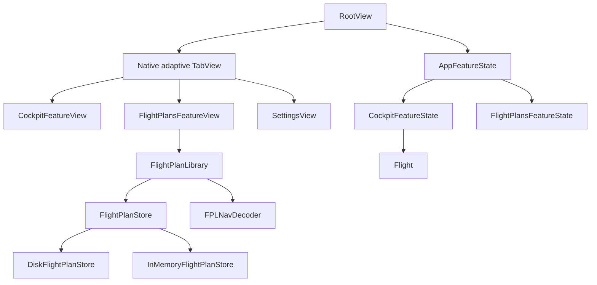

# App Navigation and Flight Plans Library — Technical Design

## Status and authority

This document defines the implementation design for the approved **App
Navigation and Flight Plans Library** paired baseline.

- Product behavior authority:
  [`APP-NAVIGATION-AND-FLIGHT-PLANS-LIBRARY_SPEC.md`](../features/APP-NAVIGATION-AND-FLIGHT-PLANS-LIBRARY_SPEC.md),
  whose previously approved revision was
  [`3c035f2dedd1dfce6a3b1354ba62d2d3eceb69c5`](https://github.com/johnbenz13/NavigationFlight/blob/3c035f2dedd1dfce6a3b1354ba62d2d3eceb69c5/docs/features/APP-NAVIGATION-AND-FLIGHTS-LIBRARY_SPEC.md).
- Design review source:
  [App Navigation and Flight Plans Library](https://www.figma.com/design/FDSRcz1yl7bkSoziKvGzQ1),
  approved corrective iteration **03 · Flight Plans Terminology Correction**
  and pages `28:183`, `28:371`, `28:34`, `28:502`, and `28:649`.
- Technical-design status: approved for implementation from the paired baseline approved by the feature owner on 2026-11-02.

The product spec owns observable behavior. Approved Figma nodes own layout,
visual hierarchy, spatial relationships, and interaction presentation. This
document selects modules, interfaces, state ownership, persistence, and ticket
boundaries. The terminology migration is the first implementation prerequisite.

## Goals

The implementation must:

- preserve one in-memory Flight while the pilot changes app sections;
- keep Flight Plans as an offline library of Flight Plans rather than Flight
  history;
- make import, replacement, removal, loading, and restart atomic;
- keep the Flight Plan used by a loaded Flight independent of later library changes;
- preserve each app section's navigation and presentation state while the app
  remains running;
- start a fresh launch in Flight Plans without restoring the prior Flight;
  and
- keep views declarative: views render snapshots and emit typed intents, while
  modules decide eligibility and outcomes.

Flight Plan creation and editing, Flight persistence, cloud synchronization,
actual settings, Charts, and Flights history remain out of scope.

## Architectural fit

The feature adds application coordination and persistence around the existing
Cockpit feature. It does not replace `Flight`, the FPLNav version
adapters, presentation adapters, or the map boundary.



The modules and their interfaces are:

| Module | Interface responsibility | Implementation hidden behind the interface |
| --- | --- | --- |
| `AppFeatureState` | Select app sections and coordinate commands that may replace or restart the loaded Flight. | Pending confirmations, loaded-library identity comparison, fresh-Flight creation, and cross-section outcomes. |
| `FlightPlanLibrary` | List, inspect, prepare imports, commit confirmed replacements, and remove saved Flight Plans. | Revision classification, sorting, decoding, validation, atomic persistence, and rollback behavior. |
| `FlightPlanStore` | Atomically load and replace durable library records. | Filesystem layout, file coordination, temporary writes, and recovery from interrupted writes. |
| `FlightPlansFeatureState` | Represent the current Flight Plans list, inspection selection, loading state, and presented result or error. | List/inspection transitions and stale-selection cleanup. |
| `CockpitFeatureState` | Own the loaded immutable Flight Plan snapshot and its current in-memory Flight. | Existing Flight commands plus protected-work classification and fresh load/restart transitions. |
| Presentation adapters | Return immutable display values from app, library, Flight Plan, and Flight state. | Formatting, badges, action labels, and action availability. |
| SwiftUI views | Render snapshots and emit typed intents. | Native navigation presentation, local focus, map camera, drawers, and accessibility presentation. |

`AppFeatureState`, `FlightPlansFeatureState`, and `CockpitFeatureState` are
in-process value modules. `FlightPlanLibrary` performs asynchronous file I/O and is
an actor so its read-modify-write operations are serialized. The storage seam is
real because it has a disk adapter in production and an in-memory adapter in
deterministic tests. The storage interface remains internal to the library; it
must not leak filesystem concepts into feature state or views.

## State ownership and lifetime

| State | Owner | Lifetime |
| --- | --- | --- |
| Selected top-level app section | `AppFeatureState` | Running app scene |
| Loaded Flight Plan snapshot, `Flight`, selected leg, mode, checklists, undo, and protected pilot work | `CockpitFeatureState` | Running app scene; never persisted |
| Cockpit map camera, open panels, callout selection, and other interaction context | Stable `CockpitFeatureView` / `CockpitView` identity | Running app scene |
| Flight Plans list projection and inspected Flight Plan ID | `FlightPlansFeatureState` | Running app scene |
| Flight Plans navigation path and list scroll position | Stable `FlightPlansFeatureView` identity | Running app scene |
| Saved Flight Plan bytes and import metadata | `FlightPlanLibrary` through `FlightPlanStore` | Across launches |
| Importer, alert, and confirmation presentation | Owning feature view, driven by typed pending state | Until dismissed or resolved |

`RootView` owns one `AppFeatureState` and composes all three app sections in the
native adaptive tab container. App-section views must have stable identities;
switching selection must not reconstruct the Cockpit or Flight Plans subtree. Each
app section owns its own navigation stack. Shell adaptation changes
presentation only and must not recreate feature state.

A fresh scene initializes the selected app section to Flight Plans and constructs an
empty `CockpitFeatureState`. It asynchronously loads only the saved Flight Plans
library. No active-Flight value is read from disk.

## Core values

### Terminology migration boundary

The first implementation ticket renames domain concepts before adding library
behavior:

| Current name | Canonical name |
| --- | --- |
| `NavigationFlight` | `FlightPlan` |
| `FlightSession` | `Flight` |
| `NavigationExecution` | `PlannedNavigation` |
| `NavigationExecutionAvailability` | `PlannedNavigationAvailability` |
| `LegExecution` | `PlannedLegNavigation` |
| properties named `flight` that contain imported preparation | `flightPlan` |
| `FlightSession.flightID` containing the imported project ID | distinct `Flight.id` and `FlightPlan.id` |

The FPLNav v5 and v7 DTOs retain their external field and type names, including
`execution`, because those names describe published wire contracts. Mappers
translate them into canonical domain names. A future `.fplnav` v8 may rename the
wire block to `plannedNavigation`; its decoder will map to the same domain model
without blocking this feature or removing v7 compatibility.

### Durable Flight Plan record

The durable record separates canonical imported content from library metadata:

```swift
struct StoredFlightPlan: Equatable, Sendable, Identifiable {
    let id: UUID
    let modifiedAt: Date
    let importedAt: Date
    let sourceData: Data
}
```

`id` and `modifiedAt` duplicate the canonical values in `sourceData` only to
support indexing and consistency checks. Reading a record decodes its bytes and
requires the decoded `FlightPlan.id` and `modifiedAt` to match the stored
metadata. A mismatch is a corrupt record, not a second source of truth.

The list and inspection presentation use a decoded library value:

```swift
struct LibraryFlightPlan: Equatable, Sendable, Identifiable {
    let flightPlan: FlightPlan
    let importedAt: Date

    var id: UUID { flightPlan.id }
}
```

The store retains the original validated `.fplnav` bytes. This provides offline
use without making `FlightPlan` conform to a second serialized format and
keeps version migration at the existing `FPLNavDecoder` boundary.

### Loaded Flight Plan and Flight identity

The loaded Cockpit state contains a `Flight` with its own UUID and the complete
decoded `FlightPlan` snapshot from which it was created. Its library relationship
is derived from `(flight.flightPlan.id, flight.flightPlan.modifiedAt)`:

- same ID and same modification date: the saved version is loaded;
- same ID and different modification date: the library and loaded versions
  differ;
- no matching saved ID: the library copy was removed, but the loaded snapshot
  remains usable.

The Cockpit never looks up its operational Flight Plan from the library after loading.
Replacing or removing a stored record therefore cannot mutate the current
Flight. Restart creates a new Flight UUID from the loaded snapshot, not the
current library record. Returning to Cockpit preserves the existing Flight UUID.

The terminology migration introduces the relationship explicitly:

```swift
struct Flight: Equatable, Sendable, Identifiable {
    let id: UUID
    let flightPlan: FlightPlan
    // Runtime progress, timing, revisions, and checklist state remain owned by
    // the Flight or its focused in-process modules.
}
```

The current `FlightSession.flightID` is actually populated with a Flight Plan ID.
The migration replaces it with distinct `Flight.id` and `FlightPlan.id` values;
tests inject both identifiers so repeated executions of one Flight Plan remain
deterministic and distinguishable.

## Flight Plans library interface

The external library interface should stay small and express complete user
operations:

```swift
actor FlightPlanLibrary {
    func plans() async throws -> [LibraryFlightPlan]
    func prepareImport(_ data: Data, importedAt: Date) async throws -> ImportProposal
    func commit(_ proposal: ImportProposal) async throws -> LibraryFlightPlan
    func remove(id: UUID) async throws
}
```

`plans()` returns records sorted by descending `importedAt`, with a stable ID
tie-breaker for deterministic tests. It decodes and validates stored bytes
before exposing them.

`prepareImport` validates the complete candidate without writing. It returns one
of these outcomes:

```swift
enum ImportProposal: Equatable, Sendable {
    case new(PreparedImport)
    case sameRevision(existing: LibraryFlightPlan)
    case replaceNewer(PreparedReplacement)
    case replaceOlder(PreparedReplacement)
}
```

The classification compares `FlightPlan.id` and `modifiedAt` exactly as
specified by the product baseline. Title and `createdAt` do not participate in
identity or revision ordering.

`PreparedReplacement` includes the expected existing revision. `commit` rejects
a stale proposal if another operation changed that record after preparation.
This prevents a confirmation for one revision from replacing a different
revision. A same-revision proposal cannot be committed and never refreshes
`importedAt`.

All validation occurs before the store changes. Store replacement is atomic. A
failed commit preserves the previous record and returns a typed error; callers
must refresh the list rather than assuming success.

## Storage seam and disk layout

The internal storage interface exposes whole-record operations rather than file
handles or paths:

```swift
protocol FlightPlanStore: Sendable {
    func records() async throws -> [StoredFlightPlan]
    func replace(_ record: StoredFlightPlan, expecting: Date?) async throws
    func remove(id: UUID) async throws
}
```

`expecting` is `nil` for a new record and the expected existing `modifiedAt` for
a confirmed replacement. The adapter reports a conflict if that precondition no
longer holds.

`DiskFlightPlanStore` uses an application-support directory with one
directory per project ID:

```text
Application Support/NavigationFlight/FlightPlans/
  <project-id>/
    plan.fplnav
    metadata.json
```

`metadata.json` stores the project ID, modification date, import date, and a
storage-schema version. The adapter writes a complete sibling temporary
directory, flushes both files, and atomically replaces the record directory.
It removes temporary artifacts after a failed operation. A deletion reports
success only after the record directory is absent.

The store never returns partially written records. Corrupt records produce a
typed read error identifying the affected Flight Plan ID when available. The first
release should surface the error and preserve the files for diagnosis rather
than silently deleting user data.

`InMemoryFlightPlanStore` implements the same preconditions and replacement
semantics for tests. Tests exercise library behavior through `FlightPlanLibrary`;
store-specific tests cover only atomic adapter guarantees.

## Application coordination

Cross-section operations belong to `AppFeatureState` because neither
Flight Plans nor Cockpit may unilaterally replace the other feature's state.

```swift
struct AppFeatureState: Equatable, Sendable {
    enum AppSection: Hashable, Sendable {
        case cockpit
        case flightPlans
        case settings
    }

    private(set) var selectedAppSection: AppSection = .flightPlans
    private(set) var cockpit = CockpitFeatureState()
    private(set) var flightPlans = FlightPlansFeatureState()
    private(set) var pendingFlightChange: PendingFlightChange?
}
```

App-section selection changes only `selectedAppSection`. It must not call a
Cockpit reset command, stop timing, or rebuild either feature state.

### Loading a saved Flight Plan

The application command receives the already decoded library Flight Plan and returns a
typed decision:

```swift
enum LoadFlightPlanDecision: Equatable, Sendable {
    case loaded
    case confirmationRequired(PendingFlightChange)
}
```

When no Flight exists or the current Flight has no protected pilot work, the
command creates a fresh Flight UUID and Cockpit state from the selected library snapshot and
selects Cockpit. Otherwise it stores a pending replacement containing the
candidate snapshot and leaves the existing state unchanged. Cancellation
clears only the pending value. Confirmation creates the fresh Flight and then
selects Cockpit. Any validation failure occurs before assignment and preserves
the existing Flight.

Loading never starts a leg. Importing never invokes the load command.

### Returning, updating, and restarting

Inspection action availability is derived from the inspected library record and
loaded snapshot:

| Relationship | Primary and secondary operations |
| --- | --- |
| No loaded Flight | `Load in Cockpit` |
| Inspected ID/revision equals loaded snapshot | `Return to Cockpit`, plus `Restart Flight` |
| Inspected ID equals loaded ID but revision differs | `Return to Cockpit`, `Load Updated Plan`, plus restart of the loaded version |
| Different ID | `Load in Cockpit` |

`Return to Cockpit` changes only the selected app section. `Load Updated Plan`
uses the normal loading command with the saved snapshot. `Restart Flight` uses
the Cockpit's loaded snapshot even if the library record is newer or absent. It
uses the same protected-work confirmation path as replacement.

## Protected pilot work

The decision to confirm replacement or restart is a domain/feature query, never
a view heuristic. Add one read-only query to `CockpitFeatureState`:

```swift
var hasProtectedPilotWork: Bool { get }
```

It is true when any of the following exists:

- recorded leg timing, identification-point outcome, or navigation progress;
- a committed Revised ETA or Revised Heading;
- an open uncommitted ETA or heading draft;
- a checklist acknowledgment; or
- another state explicitly classified as protected by the product spec.

Map movement, panel visibility, callout selection, inspected-leg selection, and
other presentation state are excluded. This query delegates to focused
`Flight` facts instead of inspecting private collections from
`AppFeatureState`. Deterministic tests enumerate every protected and unprotected
category.

## Removal behavior

Removal is a library operation followed by an application-state refresh. It
never commands the Cockpit.

The UI always asks for confirmation first. For the loaded Flight Plan ID, the
confirmation message explains that the in-memory Flight remains usable. After
successful removal:

- the list no longer contains the record;
- an inspection of that library record is dismissed;
- the loaded Cockpit snapshot and Flight are unchanged; and
- Cockpit inspection and restart remain available from the loaded snapshot.

Cancellation performs no library call. A store failure preserves the list's
last known successful state and reports the failure. The UI must not remove a
row optimistically unless it can restore it exactly after failure; the initial
implementation should await success before publishing the new list.

## SwiftUI composition

`RootView` uses native `TabView` adaptation and fixed semantic tabs in this
order: Cockpit, Flight Plans, Settings. The shell does not implement custom tab or
sidebar chrome. Each app section is a stable child whose feature state is
supplied from the root.

`FlightPlansFeatureView` owns the file importer because import is initiated only
from Flight Plans. It reads selected security-scoped bytes through a small file-read
helper, then passes `Data` to `FlightPlanLibrary`. The library never retains or
persists a provider URL or security-scoped token.

The existing `FPLNavFileLoader` responsibilities split as follows:

- security-scoped file access and extension checking move to a Flight Plans import
  boundary;
- `FPLNavDecoder` remains the single serialized-data decoder;
- cockpit eligibility validation becomes reusable library/import validation;
  and
- accepting a Flight Plan into Cockpit remains a Cockpit state transition invoked only
  by application coordination.

`CockpitFeatureView` no longer owns the file importer or chooses between import
inspection and Cockpit as one local workflow. It receives the root-owned
`CockpitFeatureState`, renders the loaded-Flight-Plan empty or operational state, and
emits typed intents upward for cross-section actions.

## Concurrency and failure rules

- File reads and store operations use `async` functions and never block the main
  actor.
- `FlightPlanLibrary` serializes import, replacement, list, and removal operations.
- Feature-state mutations occur on the main actor after an awaited operation
  returns.
- Each async result carries enough identity to reject stale UI completion. For
  example, a removal result for a previously inspected ID cannot dismiss a new
  inspection selected while the operation was running.
- Cancellation of picker or confirmation changes neither library nor Flight.
- No success UI is published before durable storage succeeds.
- Errors are typed at the library boundary and mapped to user-facing
  presentation outside the persistence adapter.

## Test strategy

The interface is the test surface.

### `FlightPlanLibrary` tests

- new import persists validated bytes and metadata;
- same-revision import does not write or refresh `importedAt`;
- newer and older revisions produce distinct confirmation proposals;
- confirmed replacement is atomic and updates sort order;
- stale replacement proposals are rejected;
- title equality never merges different IDs;
- failed validation and failed writes preserve existing records;
- records remain decodable without access to the original provider URL; and
- removal success, cancellation-at-feature-level, and failure semantics.

### `AppFeatureState` and Cockpit tests

- fresh launch selects Flight Plans with no Flight;
- app section changes preserve the complete Cockpit state;
- loading without protected work creates a fresh ready Flight with a distinct ID;
- every protected-work category requires confirmation;
- every presentation-only category does not require confirmation;
- cancellation preserves the exact existing Cockpit state;
- returning to Cockpit does not create a Flight;
- updating the saved copy does not change the loaded snapshot;
- loading an update follows the replacement rules;
- restart uses the loaded revision, including after library removal; and
- removing the loaded Flight Plan leaves the Flight unchanged.

### UI automation

Use deterministic launch fixtures and an isolated temporary library directory.
Cover the approved empty, populated, import, inspection, confirmation, error,
removal, Settings, and Cockpit states. Verify app section and navigation-state
preservation, active timing across tab changes, and the approved iPad portrait,
iPad landscape, and iPhone portrait adaptations. Each UI ticket must capture and
compare simulator screenshots with its exact approved Figma references under
the repository ticket workflow.

## Implementation sequence

### Code terminology audit

The migration ticket owns these current naming problems:

| Current location | Finding | Required correction |
| --- | --- | --- |
| `Domain/Flight/NavigationFlight.swift` | `NavigationFlight` is the imported preparation aggregate, not an executed Flight. | Rename the type and file to `FlightPlan`; keep `NavigationFlight` only as the product/module name. |
| `Domain/Flight/FlightSession.swift` | `FlightSession` is the actual execution aggregate, and its `flightID` currently contains the imported project ID. | Rename the type and file to `Flight`; add a distinct Flight UUID and rename the relationship to the source Flight Plan. |
| `Domain/Navigation/NavigationTypes.swift` | `NavigationExecution`, `NavigationExecutionAvailability`, `LegExecution`, and related names describe planned values as execution. | Rename mapped domain values to `PlannedNavigation`, `PlannedNavigationAvailability`, `PlannedLegNavigation`, and corresponding planned-navigation names. |
| `Features/Cockpit/CockpitFeatureState.swift` | The `flight` property and `accept(_:)` candidate are Flight Plans, while the `session` property is the Flight. | Rename stored properties, parameters, commands, and errors to expose `flightPlan` and `flight` accurately. |
| Cockpit/map presentation adapters | Parameters named `flight` receive the imported Flight Plan. | Rename parameters and local values to `flightPlan`; keep actual runtime values named `flight`. |
| FPLNav DTOs and strict JSON validation | `execution` is part of the published v5/v7 wire contract. | Retain wire names inside versioned DTO and validation boundaries; translate them in mappers. |
| Tests and technical documentation | Helpers and assertions use `flight` for decoded Flight Plans and `session` for Flights. | Rename fixtures/helpers and update documentation without changing behavior; add assertions for distinct Flight and Flight Plan IDs. |

The audit found no reason to rename the application target, Swift module,
repository, or `NavigationFlightApp`; those identify the product rather than a
domain entity.

Implement as dependency-ordered vertical slices. Each slice becomes one GitHub
issue, feature branch, and—only when requested—pull request.

1. **Migrate Flight Plan and Flight domain terminology**
   - rename the imported aggregate, actual execution, planned-navigation values,
     properties, fixtures, and tests; introduce distinct Flight and Flight Plan
     identities; retain v5/v7 DTO wire names and behavior.
2. **Library domain and persistence foundation**
   - `StoredFlightPlan`, import classification, `FlightPlanLibrary`, the store
     seam, disk and in-memory adapters, atomicity tests, and corruption errors.
3. **Application state and Flight-protection rules**
   - root-owned app/Cockpit state, app-section selection, protected-work query,
     load/restart decisions, and deterministic state tests without the final UI.
4. **Adaptive application shell and app-section preservation**
   - native fixed tabs/sidebar adaptation, Cockpit empty state, Settings
     placeholder, stable app-section identity, and shell UI tests.
5. **Flight Plans list and import**
   - empty/populated list, sorting, loaded badge, picker, errors, same/newer/older
     revision flows, and persistence-backed launch fixtures.
6. **Inspection, loading, updating, and restart**
   - relationship-derived actions, protected-work confirmations, cross-tab
     transitions, and retained Flight Plans inspection.
7. **Removal and loaded-Flight-Plan continuity**
   - normal and loaded-Flight-Plan confirmations, failure handling,
     empty-after-removal, loaded-Flight-Plan inspection, and restart after removal.
8. **Adaptive and accessibility conformance**
   - complete approved state matrix, Dynamic Type, VoiceOver, orientation/window
     resizing, visual comparison, and remaining UI automation.

The terminology migration makes later interfaces reviewable in the canonical
language. The library slice then establishes the durable import interface before
views depend on it. Application coordination moves Flight ownership before the
tab shell is introduced, preventing navigation presentation from becoming the
accidental owner of operational state.

## Rejected alternatives

### Persist `FlightPlan` directly

Rejected because it would create a second serialization contract, duplicate
FPLNav version migration, and risk losing source fidelity. Persist validated
source bytes and decode through the existing boundary instead.

### Let Flight Plans mutate `CockpitFeatureState`

Rejected because it couples one app section to another's implementation and
makes confirmation atomicity difficult to test. Cross-section commands
belong to application coordination.

### Resolve the loaded Flight Plan from the library on demand

Rejected because replacement or removal would silently change or invalidate an
active Flight. Cockpit owns an immutable snapshot for the Flight lifetime.

### Put persistence commands in SwiftUI views

Rejected because import classification, replacement preconditions, and rollback
would spread across presentation call sites. The library earns its depth by
hiding those rules behind complete operations.

### Add protocols for every module

Rejected because the in-process state modules have one implementation and are
already directly testable value types. Only storage varies across production
and tests, so only that seam receives adapters.

## Implementation handoff gates

Before implementing any slice:

1. create or select its GitHub issue and verify all blockers under
   [`ticket-workflow.md`](../agents/ticket-workflow.md);
2. reconcile the issue's acceptance criteria with the approved product-spec
   sections and exact Figma nodes;
3. for UI slices, load `figma:figma-design-to-code` and
   `figma:figma-swiftui`, record the visual contract, and compare the current
   simulator state before editing; and
4. preserve the approved behavior/design split. Any conflict or user-visible
   change returns to the paired-artifact workflow for owner resolution.
