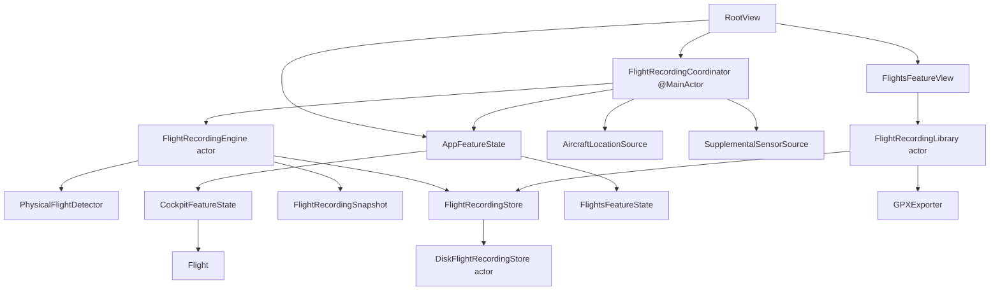

# Automatic Flight Recording and Recovery — Technical Design

## Status and authority

This document defines the implementation design for the approved **Automatic
Flight Recording and Recovery** paired baseline.

- Product behavior authority:
  [`AUTOMATIC-FLIGHT-RECORDING-AND-RECOVERY_SPEC.md`](../features/AUTOMATIC-FLIGHT-RECORDING-AND-RECOVERY_SPEC.md),
  approved revision [`14f2ed9`](https://github.com/johnbenz13/NavigationFlight/blob/14f2ed9/docs/features/AUTOMATIC-FLIGHT-RECORDING-AND-RECOVERY_SPEC.md).
- Design authority:
  [NavigationFlight — Automatic Flight Recording and Recovery](https://www.figma.com/design/ZrGA7ZuOACWtXA4mR7cwdc),
  approved **Iteration 02**, including Flights library `11:97`, Flight detail
  `11:127`, Cockpit recording lifecycle `12:5`, recovery `12:114`, adaptive
  references `13:5`, `13:28`, and `13:51`, and baseline notes `13:71`.
- Human approval: John, 2026-11-04.
- Technical-design status: approved for implementation by John on 2026-11-04.

The product spec owns observable behavior. Approved Figma nodes own layout,
visual hierarchy, spatial relationships, and interaction presentation. This
document selects modules, interfaces, durable formats, state ownership,
concurrency, recovery, and delivery gates. It does not approve detector
thresholds that the product baseline leaves unspecified.

## Scope and design objectives

The implementation must:

- continuously capture physical-flight evidence without exposing position;
- preserve every committed navigation action before reporting success;
- bound unexpected loss of high-frequency track samples to approximately five
  seconds;
- restore a recoverable Flight from its immutable Flight Plan snapshot and
  durable operational history;
- keep physical-flight phase and navigation-execution phase independent;
- isolate one corrupt or unsupported recording from healthy recordings;
- make export and summary projection read-only snapshots that cannot pause or
  mutate an active recording;
- retain current Cockpit navigation behavior and Position Check disclosure
  boundaries; and
- keep SwiftUI views declarative and free of sensor, detector, and persistence
  policy.

Graphical replay, debrief analysis, cloud storage, automatic retention,
recording rename, event export, and durable raw accelerometer or gyroscope data
remain out of scope.

## Architectural fit

The feature extends the existing value-state application architecture with one
long-lived actor module. It does not make `Flight` perform file I/O, turn
`AircraftLocationService` into application state, or let a view coordinate
durability.



| Module | Interface responsibility | Implementation hidden behind the interface |
| --- | --- | --- |
| `FlightRecordingEngine` | Arm, ingest evidence, commit navigation transitions, close, recover, and produce snapshots. | Provisional buffering, physical detector transitions, event ordering, durability barriers, gap tracking, and correction events. |
| `FlightRecordingStore` | Create, append, synchronize, inspect, snapshot, close, export-read, and remove recording packages. | Package layout, schema versions, atomic replacement, tail recovery, batching, checksums, and file coordination. |
| `FlightRecordingCoordinator` | Bind the running scene, Cockpit commands, sensor lifetimes, and engine snapshots. | Long-lived task ownership, cancellation, scene transitions, non-blocking warnings, and main-actor publication. |
| `PhysicalFlightDetector` | Return deterministic phase evidence from ordered samples and elapsed time. | Conservative windows, hysteresis, takeoff/landing/stop candidates, contradictions, and corrections. |
| `FlightRecordingLibrary` | List recordings, read details, prepare exports, and delete eligible closed recordings. | Per-package fault isolation, summary projection, stable sorting, and active-recording coordination. |
| `GPXExporter` | Produce a temporary GPX 1.1 file from a consistent store snapshot. | Segmentation at gaps, omission of invalid values, XML encoding, metadata, and filename sanitization. |
| Presentation projectors | Convert snapshots into Cockpit, recovery, row, detail, accessibility, and alert values. | Status vocabulary, formatting, action eligibility, and symbol-plus-text semantics. |
| SwiftUI views | Render immutable presentation values and emit typed intents. | Native tabs, navigation, lists, sheets, confirmation dialogs, share presentation, focus, and scroll state. |

The engine is a deep module: callers express complete operational intents and
receive committed results. They do not sequence journal writes, snapshots,
track flushes, phase detection, or recovery themselves.

## Architecture choice and state ownership

The project keeps its current MV-style composition. A new app-wide observable
model would duplicate `AppFeatureState`, while MVI or TCA would impose a second
state architecture on one feature. The engine actor supplies the explicit
state-machine and effect boundary that this feature requires without changing
the view architecture.

| State | Owner | Lifetime |
| --- | --- | --- |
| Selected app section and pending cross-feature decisions | `AppFeatureState` | Running app scene |
| Navigation execution and Cockpit configuration | `CockpitFeatureState` / `Flight` | Ready or active Flight; serialized through recording events when durable |
| Armed, provisional, durable, physical, navigation, GPS, warning, and closure state | `FlightRecordingEngine` | From loaded Flight Plan until discard or durable closure |
| Sensor and engine-consumption tasks | `FlightRecordingCoordinator` | Running app scene; explicit cancellation |
| Published recording status and recoverable-recording summaries | `FlightRecordingCoordinator` | Main actor, derived from engine snapshots |
| Flights list, selected detail, pending deletion/export, and loading errors | `FlightsFeatureState` | Running app scene |
| Recording package and immutable Flight Plan snapshot | `FlightRecordingStore` | Across launches |
| Open editors, drafts, menus, alerts, map camera, Position Check disclosure, and undo affordance | Existing views and feature state | Transient; never restored |

`RootView` creates one coordinator for the scene and starts its bootstrap task.
Top-level section changes do not start, stop, or reconstruct the coordinator.
An active recording therefore outlives the Cockpit view's visibility.

## Domain model

### Independent physical and navigation state

One combined phase enum would create invalid coupling. The durable aggregate
instead contains orthogonal state:

```swift
struct FlightRecording: Equatable, Sendable, Identifiable {
    let id: UUID
    let flightID: UUID
    let flightPlanSnapshot: RecordedFlightPlanSnapshot
    let startedAt: Date
    private(set) var physicalState: PhysicalFlightState
    private(set) var navigationState: RecordedNavigationState
    private(set) var gpsCoverage: GPSCoverageState
    private(set) var closure: FlightRecordingClosure?
    private(set) var nextEventSequence: UInt64
}

enum PhysicalFlightState: Equatable, Sendable {
    case preparing
    case groundMovement
    case airborne
    case landedAwaitingStop
    case stopped
    case unavailable
}

enum RecordedNavigationState: Equatable, Sendable {
    case ready
    case active
    case reachedFinalWaypoint
    case complete
}
```

`FlightRecordingClosure` records complete or incomplete outcome, automatic or
manual cause, wall-clock close time, monotonic elapsed duration, and whether
landing evidence was available. User-facing states such as **GPS Gap** and
**Navigation Complete — Recording Continues** are projections of these values,
not extra mutable phases.

### Physical detector

`PhysicalFlightDetector` is a pure value module. Each input contains a sample,
its structural-validity facts, and both wall and monotonic time. Its output is a
new detector state plus zero or more proposed physical events. It never mutates
navigation state.

The detector uses explicit candidate windows and hysteresis:

- ground movement requires sustained credible movement;
- takeoff requires sustained airborne evidence rather than a single speed or
  altitude value;
- landing requires sustained evidence distinct from a temporary descent;
- stop requires a conservative post-landing stationary window; and
- contradictory later evidence appends a correction event rather than editing
  the earlier event.

All thresholds and window lengths live in an injected
`PhysicalFlightDetectionPolicy`. Production values require the calibration gate
in **Open decisions**. Tests use compact policies and a manual clock; production
tests must never sleep for real time.

### Provisional capture and rolling buffer

Arming starts a bounded in-memory deque of structurally valid location samples.
It retains at most two minutes by monotonic sample time. Credible movement
creates an engine-owned provisional value, but no package visible to Flights.

Promotion performs one store operation that creates the durable package,
persists the immutable Flight Plan snapshot, appends `recordingStarted`, and
writes retained buffer samples in their original order. Promotion occurs on
credible takeoff or an accepted Start Leg command. A timeout discards only the
provisional value and buffer. Unloading, replacement, permission revocation, or
normal app exit while merely armed clears them without creating history.

If launch-time evidence indicates the aircraft is already airborne, promotion
uses a `partialStart` cause and begins at the first available sample. No earlier
sample or inferred path is created.

## Operational event journal

The journal is the authoritative ordered history and recovery input. Every
event has a stable ID, recording-local sequence, wall-clock timestamp,
monotonic elapsed duration, origin, schema version, and typed payload:

```swift
struct RecordedFlightEvent: Equatable, Sendable, Identifiable {
    enum Origin: String, Codable, Sendable {
        case pilot
        case automatic
        case recovery
        case system
    }

    let id: UUID
    let sequence: UInt64
    let occurredAt: Date
    let elapsed: Duration
    let origin: Origin
    let payload: RecordedFlightEventPayload
}
```

Payloads cover the product-spec event inventory: recording and physical-phase
transitions, leg starts, identification and reach outcomes, automatic next-leg
and recovery transitions, committed ETA and heading revisions, undo links,
Position Check request and outcome, GPS availability, navigation completion,
manual end, correction, recovery continuation, and closure.

Events carry canonical IDs and the minimum before/after values needed to audit
and replay the transition. An undo payload refers to the original event ID.
Position Check stores the qualified disclosed sample only after a successful
disclosure; the request event remains even when acquisition fails.

Incidental interface activity, drafts, cancelled or rejected commands, and
no-ops never enter the journal.

### Commit protocol

All durable navigation commands cross one interface:

```swift
actor FlightRecordingEngine {
    func commit(_ command: RecordedNavigationCommand) async throws
        -> CommittedNavigationTransition
}
```

The engine:

1. validates the command against a copied current `Flight` and recording state;
2. calculates the deterministic transition and event payload without publishing;
3. appends and synchronizes the event journal;
4. installs the candidate state and advances the sequence; and
5. returns the committed transition for main-actor publication.

If validation or persistence fails, the existing navigation state remains
published and the action is not reported as successful. A successful append
followed by process termination is safe because bootstrap replays it. This is
the only route for Start Leg, reach, identify, revision, undo, navigation
completion, and manual end while a durable recording exists.

Before promotion, Start Leg first creates the package and then commits the leg
transition as part of the same engine operation. Without location permission it
creates an action-only recording with unavailable GPS coverage.

## Track and supplemental sensor model

`RecordedTrackSample` preserves the delivered timestamp, coordinate, horizontal
and vertical accuracy, valid GPS altitude, valid speed with accuracy when
available, valid course with accuracy when available, and optional supplemental
barometric altitude and device-relative compass heading. Invalid measurements
are `nil`, never zero.

Deduplication removes only exact duplicate deliveries using a stable fingerprint
of timestamp and all delivered measurements. Equal coordinates at different
times and valid stationary or low-accuracy samples remain.

Track collection and Position Check consume the same source through independent
subscriptions or a multicast location hub. Position Check quality policy never
filters recording samples and recording never extends Position Check disclosure.

Known availability loss closes the current track segment and appends one
availability event. Fresh samples after recovery open a new segment. Summaries
and GPX never bridge segment boundaries.

Barometer and compass adapters are optional. Their latest timestamped values may
be associated with a location sample only within a documented freshness window.
Their absence or cancellation never blocks location recording. Raw motion values
are not durable.

## Store seam and disk format

The store interface expresses complete durability operations rather than paths
or file handles:

```swift
protocol FlightRecordingStore: Sendable {
    func create(_ seed: FlightRecordingSeed) async throws
    func appendEvent(_ event: RecordedFlightEvent, synchronize: Bool) async throws
    func appendTrackBatch(_ batch: RecordedTrackBatch) async throws
    func synchronizeTrack(recordingID: UUID) async throws
    func packages() async -> [FlightRecordingPackageResult]
    func readSnapshot(id: UUID) async throws -> FlightRecordingReadSnapshot
    func close(id: UUID, closure: FlightRecordingClosure) async throws
    func remove(id: UUID) async throws
}
```

The production adapter stores one self-contained package per Flight:

```text
Application Support/NavigationFlight/Flights/
  <recording-id>/
    manifest.json
    flight-plan.json
    events.ndjson
    track/
      00000001.ndjson
      00000002.ndjson
    summary.json
```

- `manifest.json` contains package schema version, IDs, start data, current
  lifecycle, coverage, closure, and file-format versions.
- `flight-plan.json` is a versioned storage DTO mapped from the immutable domain
  snapshot. Domain models do not conform directly to `Codable`.
- `events.ndjson` is append-only and sequence ordered. Each line is an envelope
  with payload version and checksum so an interrupted final append is detected.
- each track file is one GPS-availability segment containing independently
  checksummed batches; a torn final batch is ignored without losing prior data;
- `summary.json` is a replaceable cache and never authoritative.

Package creation writes a complete temporary directory, synchronizes it, then
atomically renames it. Manifest and summary changes use sibling temporary files
and atomic replacement. Event appends for operational commands synchronize
before returning. Track samples accumulate in a bounded batch and synchronize
at least every five seconds, on background transition when execution time is
available, before export snapshotting, and on orderly closure.

The store reports per-package success, corruption, or unsupported version so one
bad package cannot prevent list loading. It never deletes unreadable data
automatically. A future migration reads old DTOs and writes a new package only
after validation; unsupported packages remain visible and their readable track
segments remain exportable.

## Concurrency and lifecycle

`FlightRecordingEngine` and `DiskFlightRecordingStore` are actors because each
owns mutable state that must be serialized. Values crossing their seams are
`Sendable` value types. UI state and `FlightRecordingCoordinator` are main-actor
isolated.

The coordinator owns named unstructured tasks only where their lifetime must
outlive a view: location consumption, supplemental sensors, and engine snapshot
observation. It stores every task handle, cancels before replacement, cancels at
scene teardown, and treats `CancellationError` as normal lifecycle completion.
View-scoped loading and export preparation use `.task(id:)` so SwiftUI supplies
cancellation.

Location streams use a bounded buffering policy. Dropping already delivered
samples in an application buffer would violate the product contract, so the
source and store consumer must be sized and measured to keep up; buffer overflow
is a recorded storage-degradation event and warning, not silent loss.

No actor method assumes state remains unchanged across `await`. Candidate
transitions capture the expected generation and revalidate it after suspension,
or perform all state mutation behind a subordinate store operation that cannot
reenter the engine. Export and detail use immutable read snapshots, not live
package handles.

### Core Location integration

The existing Position Check source is generalized into a long-lived location
hub with explicit monitoring scopes. The recording scope starts when a Flight
Plan is loaded and authorized, while the disclosure scope remains bounded by
Position Check.

Implementation uses current Core Location continuous background support:

- enable the Location updates background mode;
- establish the required Core Location service/background activity session in
  the foreground before background delivery;
- communicate background collection before starting it;
- keep the session alive for the armed or durable recording lifetime; and
- recreate the required service session immediately when the process is
  relaunched for background location handling.

When-in-use authorization can support continuous background updates started
while the app is in use when the background capability and activity session are
active. The implementation should not request Always authorization unless
device testing demonstrates a product requirement that the approved permission
flow cannot satisfy. Force-quit remains an explicit collection limitation.

Permission, restriction, disabled services, reduced/poor accuracy, and resumed
delivery map to typed availability values. They never manufacture a stationary
sample.

## Bootstrap and recovery

Bootstrap runs before the normal app shell becomes interactive:

1. enumerate packages independently;
2. validate manifests, immutable snapshots, event sequences, and readable track
   tails;
3. identify every package without a durable closure;
4. replay its event journal into `Flight`, recording, and detector state;
5. project one recovery choice or a list when multiple records are recoverable;
6. keep unsupported/corrupt packages in Flights with restricted actions; and
7. enter the normal shell only after the pilot continues or ends the selected
   recovery, while healthy closed recordings can load concurrently.

`continueFlight(id:)` appends a recovery event before publishing restored state,
reestablishes the original monotonic time basis from stored elapsed duration and
current continuous clock, opens Cockpit, and resumes only from fresh sensor
samples. Wall-clock changes do not change event order or active timing.

`endAsIncomplete(id:)` appends the manual recovery closure and makes the package
deletable. Replacing or restarting a recoverable Flight routes through this same
explicit closure operation before a new Flight is installed.

Transient drafts, sheets, focus, camera, menus, and undo windows are absent from
the storage DTO and therefore cannot accidentally restore.

## Application coordination

`AppFeatureState.AppSection` adds `.flights` between `.flightPlans` and
`.settings`. It gains `FlightsFeatureState` plus pending recovery/replacement
decisions. Section selection remains presentation only.

Loading a Flight Plan arms the engine after the Cockpit candidate is accepted.
If confirmation displaces a durable or recoverable recording, confirmation
first closes it incomplete. The new Cockpit state is installed and armed only
after closure succeeds. A storage failure leaves the current Flight intact and
shows a non-blocking error.

Cockpit commands become async at the application coordination seam while their
domain calculations remain synchronous. Views disable only the specific command
while its commit is in flight; ordinary navigation remains usable after a track
write warning. Rejected duplicate taps do not create duplicate events.

The active recording cannot produce a delete intent. Library removal checks the
durable manifest again so a stale UI cannot delete a recording that became
active or recoverable.

## SwiftUI composition

`RootView` keeps the native adaptive `TabView` and adds semantic tabs in this
order: Cockpit, Flight Plans, Flights, Settings. The Figma tab chrome is a visual
reference, not a custom control.

`FlightsFeatureView` owns a `NavigationStack` and renders a native `List` with
sections for active/recovery-required and recent Flights. Stable recording IDs
drive rows and navigation. Row status always includes text and a symbol; color
is supplementary. At larger Dynamic Type sizes, metadata wraps or moves below
status instead of truncating the Flight identity.

`FlightDetailView` renders semantic sections for identity, route, timing,
completion/closure, GPS coverage, evidence-derived summaries, storage size, and
actions. Unavailable evidence uses explicit unavailable text. Export opens the
system share/save presentation for a temporary snapshot file. Delete uses a
destructive confirmation naming the Flight.

`FlightRecoveryView` is a launch gate, not a tab. One item emphasizes Continue
Flight and offers confirmed End as Incomplete. Multiple items use a list with
the same per-record actions and never auto-select.

Cockpit receives a compact `RecordingStatusPresentation` and typed End Recording
intent. The indicator remains outside the map, never carries coordinates or raw
sensor values, and uses the approved status vocabulary. Navigation Complete is
an explicit button only after the final waypoint. Existing Position Check views
remain the sole live-position disclosure surface.

Approved Figma uses Inter as an authoring font. Implementation uses SwiftUI
semantic system text styles unless the feature owner separately approves
shipping a custom font; this preserves Dynamic Type and matches the repository's
native-control direction. Custom Figma colors become named semantic assets only
where they are not equivalent to system background, label, separator, tint, or
status roles.

## GPX export

Export first asks the store for a synchronized immutable read snapshot. Active
recording continues into a new batch while export reads the snapshot boundary.

`GPXExporter` writes GPX 1.1 with one `trkseg` per stored segment, coordinates
and timestamps for every readable sample, and optional elevation, speed, and
course only when valid. Navigation events never become track points or
waypoints. Metadata contains Flight Plan identity, current status, and explicit
coverage classification.

The filename contains a sanitized Flight Plan name, UTC start timestamp, and a
stable short recording-ID suffix. Generation occurs outside the main actor and
checks cancellation between batches. Failure removes the temporary export file
and leaves the package unchanged.

## Summaries

Distance sums geodesic distances only between consecutive samples in the same
segment. Duration uses the physical recording interval. Maximum altitude uses
valid stored GPS altitude evidence; supplemental barometric altitude is labeled
separately if later exposed. GPS coverage is derived from known recording time
and gap intervals, not sample count. Approximate size uses package file sizes.

Summary projection is deterministic and replaceable. Missing input returns
`nil`; the UI never substitutes zero. Cached summary corruption triggers
recalculation without making the recording corrupt.

## Failure behavior

- Event-journal failure rejects the operational commit and retains the prior
  published navigation state.
- Track-write failure preserves committed data, records degradation when storage
  becomes writable, and exposes a restrained warning without blocking Cockpit.
- Low storage stops accepting new track batches, attempts the small operational
  journal write, and never deletes another recording.
- Permission loss closes the segment and preserves action recording.
- A torn final event or track batch is quarantined at the tail; earlier verified
  content remains readable.
- Manifest/Flight Plan corruption makes continuation unavailable but does not
  prevent deletion or export of independently readable track data.
- Export and deletion failures leave the package and list entry unchanged.

Warnings are derived from engine state and acknowledged presentation state;
dismissing a warning does not clear the underlying degradation fact.

## Accessibility and localization

- Status badges combine symbol and localized text and expose one concise
  accessibility label.
- Continue, Navigation Complete, End Recording, export, and delete have distinct
  labels, hints, and destructive roles.
- Recovery and error focus moves to the heading or primary action when
  presented.
- Rows retain a minimum system target and meaningful reading order at all
  supported Dynamic Type sizes.
- Dates, durations, distances, percentages, and byte counts use Foundation
  format styles; non-view projectors return `LocalizedStringResource` where
  appropriate.
- Layout uses leading/trailing semantics and does not encode status in color or
  animation alone.

## Test strategy

### Domain and detector tests

- every physical-state transition, candidate cancellation, hysteresis, brief
  stop, GPS drift, signal gap, contradiction, and correction;
- independent ordering of navigation completion and physical stop;
- complete/incomplete/manual closure matrix;
- two-minute rolling-buffer eviction and provisional timeout;
- exact-duplicate rejection with preservation of stationary and repeated-position
  samples; and
- wall-clock changes with monotonic ordering and elapsed time.

Tests inject a manual clock and explicit detector policy. No test uses fixed
sleep delays.

### Engine and recovery tests

- every accepted command appends and synchronizes before publication;
- rejected, cancelled, invalid, and no-op commands append nothing;
- Start Leg promotion and action-only recording;
- undo linkage and immutable original events;
- store failure leaves published `Flight` unchanged;
- replay restores every product-specified navigation fact;
- one and multiple recoverable packages;
- unsupported schema and corrupt-tail isolation; and
- cancellation and actor reentrancy generation checks.

### Store tests

- atomic package creation and manifest replacement;
- event and track append ordering, checksum validation, and torn-tail recovery;
- five-second maximum configured track synchronization interval;
- per-package corruption isolation;
- snapshot-safe export during concurrent append;
- close/delete preconditions and failed deletion preservation; and
- migration fixtures for every supported storage version.

### Export and summary tests

- GPX 1.1 escaping, ordering, optional omission, gap segmentation, metadata,
  filename sanitation, and stable collision suffix;
- active snapshot boundary without stopping recording;
- distance excludes gaps; and
- absent altitude, duration, and coverage remain unavailable rather than zero.

### App, presentation, and UI tests

- tab order and state preservation across section changes;
- recovery launch gates and destructive confirmations;
- Flights empty, populated, active, corrupt, and detail states;
- recording status and navigation-complete Cockpit states;
- VoiceOver labels and symbol-plus-text semantics;
- supported Dynamic Type sizes;
- iPad portrait, iPad landscape, and iPhone portrait interaction flows; and
- comparison with the exact approved Figma nodes cited in this document.

Background collection requires device tests for screen lock, foreground/background
transitions, permission changes, ordinary termination, force-quit limitation,
and low-storage simulation. Simulator evidence alone is insufficient.

## Delivery sequence and gates

1. **Storage spike and schema fixtures.** Prove synchronized journal append,
   batched track append, torn-tail recovery, and snapshot export before feature UI.
2. **Recording domain.** Add values, event payloads, detector, manual clock tests,
   and closure policy without Core Location or SwiftUI.
3. **Engine vertical slice.** Promote on Start Leg, durably commit one navigation
   transition, terminate, replay, and recover it.
4. **Location and background lifecycle.** Add multicast scope, continuous
   background sessions, rolling buffer, gaps, and device evidence.
5. **Cockpit integration.** Route all committed navigation operations through the
   engine and add status, Navigation Complete, and End Recording.
6. **Recovery.** Add launch enumeration, single/multiple recovery, continuation,
   and incomplete closure.
7. **Flights library and detail.** Add the fourth tab, per-package fault isolation,
   summaries, export, and deletion.
8. **Supplemental sensors and hardening.** Add optional altitude/heading adapters,
   storage degradation, schema migration fixtures, accessibility, and final
   approved-Figma comparison.

Each slice must preserve existing Cockpit and Position Check tests. Swift slices
require focused tests and an application build; SwiftUI slices additionally
require simulator interaction verification. Background claims require physical
device evidence.

## File plan

```text
NavigationFlight/
  Domain/Recording/
    FlightRecording.swift
    FlightRecordingEvent.swift
    PhysicalFlightDetector.swift
    FlightRecordingSummary.swift
  Data/Recording/
    FlightRecordingStore.swift
    DiskFlightRecordingStore.swift
    FlightRecordingStorageDTO.swift
    GPXExporter.swift
  Data/Location/
    AircraftLocationHub.swift
    CoreLocationAircraftLocationSource.swift
  Features/Recording/
    FlightRecordingCoordinator.swift
    RecordingStatusPresentation.swift
  Features/Flights/
    FlightsFeatureState.swift
    FlightsFeatureView.swift
    FlightDetailView.swift
    FlightRecoveryView.swift
    FlightsPresentation.swift
```

Existing `AppFeatureState`, `RootView`, `CockpitFeatureState`, Cockpit views,
location values, and tests receive focused integration changes. Storage DTOs
stay outside the domain folder.

## Open decisions and implementation blockers

### Detector calibration

The product spec deliberately requires conservative evidence but does not define
speed, altitude, accuracy, or duration thresholds. Before automatic movement,
takeoff, landing, and stop behavior can ship, the feature owner must approve a
calibration proposal backed by representative taxi, takeoff, landing, holding,
and GPS-noise fixtures. Until then, only the injected-policy architecture and
fixture-driven detector can be implemented; production constants are blocked.

### Background platform baseline

Confirm the deployment target supports the selected modern Core Location
session APIs. If it does not, the adapter may use `CLLocationManager` continuous
background updates behind the same source interface, but the capability,
permission copy, background indicator, and device validation remain mandatory.

### Supplemental altitude semantics

Confirm whether the first release stores absolute barometric altitude when
available or only relative pressure-derived change. The product spec permits a
supplement but does not define how a relative series is anchored. This does not
block GPS track recording and should not delay the core vertical slice.

## Rejected alternatives

### Make `Flight` Codable and save it after every mutation

This couples runtime and storage schemas, rewrites growing state for every
action, loses the audit journal, and makes migrations unsafe. Versioned DTOs and
append-only events preserve domain independence and crash recovery.

### Put recording in `CockpitFeatureView`

The recording must survive section changes, screen lock, and Cockpit view
reconstruction. View lifetime is the wrong seam for aircraft evidence.

### Use one combined recording phase enum

Physical and navigation completion may occur in either order. Combining them
creates a cross-product of invalid or misleading states and obscures closure
rules.

### Persist every location sample synchronously

It would increase energy and I/O cost without a stronger product guarantee.
Operational events synchronize immediately; bounded batches satisfy the
approximately five-second sensor-loss allowance.

### Use a database in the first slice

The feature needs append, snapshot, package isolation, and portable GPX export,
not relational queries. A versioned package store keeps the interface small and
uses existing Foundation capabilities. The store seam permits a future database
adapter if measured package performance proves it necessary.

### Restore transient SwiftUI state

Editors, sheets, map camera, focus, and undo affordances are not operational
evidence. Persisting them would violate the recovery contract and complicate
schema evolution.
