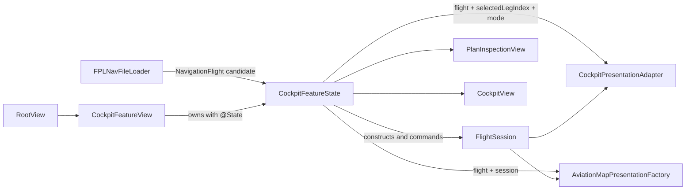
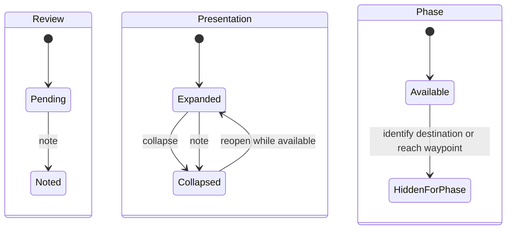

# `CockpitFeatureState` Technical Specification

Status: read-only reverse engineering of the implementation as of 2026-10-22.

This document describes the technical contract implemented by `CockpitFeatureState`. It records observed behavior rather than proposing a redesign. The delegated runtime state machine is documented separately in [`FlightSession` Technical Specification](FLIGHT-SESSION.md). The system context is described in the [architecture overview](../architecture.md).

## Responsibility and scope

`CockpitFeatureState` is the in-memory mutable state and command coordinator for the cockpit feature. It owns:

- the accepted `NavigationFlight`, if any;
- the selected leg index used for the feature's primary plan presentation;
- the selected whole-plan navigation calculation mode;
- the `FlightSession` that owns runtime flight execution;
- the immutable automatic or manual progression policy used to construct sessions; and
- per-leg start-checklist interaction state.

It coordinates three workflows:

1. admitting an imported plan into the executable cockpit;
2. selecting a leg and calculation mode before execution; and
3. forwarding pilot actions to `FlightSession` while applying cockpit-specific checklist and presentation synchronization.

It does not decode files, calculate resolved navigation values, construct presentation models, render views, store map interaction state, implement flight timing transitions, or persist runtime state.

The component is an internal value type (`struct`) conforming to `Equatable` and `Sendable`. Its owned feature values are externally readable within the module but `private(set)`. Mutations occur through synchronous `mutating` methods.

`CockpitPlanError` and `FPLNavFileLoader` share the same source file but are adjacent import-boundary components. They are not nested in or owned by `CockpitFeatureState`.

## Position in the architecture



`RootView` installs `CockpitFeatureView` as the application root. `CockpitFeatureView` owns one `CockpitFeatureState` in SwiftUI `@State` and translates view callbacks into feature commands. It also owns file-importer presentation, cockpit-versus-inspection presentation, and presented import errors; those values are outside `CockpitFeatureState`.

The feature state is the sole production owner and mutation adapter for its `FlightSession`. Views and presentation factories receive value snapshots and callbacks rather than mutating the feature state directly.

## Construction and initial state

The initializer accepts a `FlightSession.ProgressionPolicy`, defaulting to `.automaticNextLeg`. Before any plan is accepted:

| Property | Initial value |
| --- | --- |
| `progressionPolicy` | Supplied policy or `.automaticNextLeg` |
| `flight` | `nil` |
| `selectedLegIndex` | `0` |
| `mode` | `.noWind` |
| `session` | `nil` |
| `legStartChecklists` | Empty dictionary |

The policy is fixed for the lifetime of the feature-state value. In production builds, `CockpitFeatureView` uses automatic progression. Debug configuration can select manual progression through the `NAVIGATION_FLIGHT_PROGRESSION_POLICY` environment value. Debug configuration can also decode and accept a plan supplied through `NAVIGATION_FLIGHT_UI_TEST_PLAN` during view initialization.

## Plan-admission contract

`accept(_:)` examines `NavigationFlight.execution` before mutating feature state.

| Candidate execution state | Result |
| --- | --- |
| `.unavailableLegacyFormat(version:)` | Throws `CockpitPlanError.legacyPlan` |
| `.emptyPlan` | Throws `CockpitPlanError.emptyPlan` |
| `.eligible` with no execution legs | Throws `CockpitPlanError.emptyPlan` |
| `.eligible` with at least one execution leg | Replaces the current feature state with a fresh accepted-plan state |

Successful admission performs these operations in order:

1. Stores the candidate as `flight`.
2. Resets `selectedLegIndex` to zero.
3. Sets `mode` to the execution's saved `defaultMode`.
4. Constructs a new `FlightSession` using the candidate flight ID, the ordered domain-leg IDs, index zero, the selected mode, and the feature's progression policy.
5. Clears all per-leg checklist state.

Rejection occurs before any stored property is changed, so an already accepted plan, selection, mode, session, and checklist history remain intact after a rejected candidate.

The file loader performs the preceding boundary step: it restricts selection to the `.fplnav` extension, accesses security-scoped URLs, reads mapped data, invokes `FPLNavDecoder`, and maps decoder or file errors to `CockpitPlanError`. `accept(_:)` receives an already decoded domain value and handles only cockpit eligibility.

## Stored and derived state

| State | Meaning | Principal consumers |
| --- | --- | --- |
| `flight` | Immutable imported plan and resolved execution values accepted for this feature session | Both presentation factories and views |
| `selectedLegIndex` | Leg index supplied to the primary cockpit/inspection presentation adapter | `CockpitPresentationAdapter.makePresentation` and selection queries |
| `mode` | Navigation mode supplied to the primary presentation adapter and synchronized into a ready session | Plan inspection and primary cockpit presentation |
| `session` | Authoritative runtime execution, timing, progression, and pilot ETA state | Feature commands, cockpit presentation, and map presentation |
| `legStartChecklists` | Per-leg cockpit checklist interaction history keyed by leg UUID | `activeLegStartChecklist` and checklist commands |

The derived selection queries are true only before flight execution has produced any leg timing:

- `canSelectPreviousLeg` requires a ready session, no leg timings, and a selected index above zero.
- `canSelectNextLeg` requires a ready session, no leg timings, eligible execution data, and a successor execution leg.

`activeLegStartChecklist` is available only while the session is active. It resolves the active leg UUID from `session.legIDs[session.activeLegIndex]` and looks up that UUID in the checklist dictionary. The query may return an entry whose `phaseState` is hidden; `CockpitView` applies the additional requirement that the phase be available before rendering the checklist.

## Selected leg and active leg

The component stores both `selectedLegIndex` and `FlightSession.activeLegIndex`.

### Current consumers

The indices feed different presentation paths:

- `selectedLegIndex` is passed with `flight` and `mode` to `CockpitPresentationAdapter.makePresentation`. That presentation supplies plan inspection and the cockpit's primary saved-plan data.
- `session.activeLegIndex` drives runtime-sensitive presentation and behavior, including the aviation map, active checklist, next-leg preparation, leg timing, identification-point validation, and progression.

The names therefore describe a presentation selection and an execution position. The current feature behavior does not allow those positions to diverge persistently.

### Synchronization invariant

Whenever `session` is non-`nil`, every state externally observable through the current `CockpitFeatureState` command interface satisfies:

```text
selectedLegIndex == session.activeLegIndex
```

Before a plan is accepted, `selectedLegIndex` is zero and `session` is `nil`, so there is no session index to compare.

The invariant is maintained procedurally by each index-changing path:

| Transition | Feature index behavior | Session index behavior |
| --- | --- | --- |
| Successful plan admission | Resets to zero | Constructed from `selectedLegIndex` |
| Previous/next selection | Assigns the candidate only after session selection succeeds | `selectReadyLeg` assigns the same candidate |
| Rejected or unavailable selection | Remains unchanged | Remains unchanged |
| Successful non-final waypoint reach | Copies `session.activeLegIndex` after progression | Advances to the successor |
| Final waypoint reach | Remains on the final index | Remains on the final index |
| Failed waypoint reach | Remains unchanged | Validation fails before index mutation |
| All other feature commands | Unchanged | Unchanged |

Within `reachCurrentWaypoint`, the session advances before `selectedLegIndex` is copied from it. Checklist cleanup occurs between those statements. This is synchronous code with no callback or suspension point, so the intermediate mismatch is not externally observable as a stable feature state.

Access control prevents production callers from independently assigning `selectedLegIndex`, replacing the stored session, or assigning `FlightSession.activeLegIndex`. Because both containing types are value types, reading a session snapshot also does not provide shared mutable identity back into the stored feature state.

### Repository history

The two properties entered the code at different times. `selectedLegIndex` existed in the initial cockpit implementation before `FlightSession`. `FlightSession.activeLegIndex` was added later with the leg-timer runtime state. The existing selected index was retained and synchronized into the new session. When waypoint progression was introduced, `reachCurrentWaypoint` added the copy from the progressed session index back to the selected index. The current candidate-first selection sequence was introduced with that progression work so that the feature index changes only after session selection succeeds.

No current product path independently browses an inspected leg while a different session leg remains active. Before timing begins, browsing updates both indices. After the first timing record exists, the previous and next selection queries are false. Returning from the cockpit to plan inspection therefore continues to present the session's current leg.

The equality is an implemented integration invariant rather than a single structurally derived property. There is no assertion that compares the two values, and the test suite verifies their relationship through selection and progression outcomes rather than through one comprehensive invariant test.

## Pre-flight selection behavior

### Leg selection

`selectPreviousLeg()` and `selectNextLeg()` first evaluate their corresponding availability query. For an available move, each method:

1. computes the adjacent candidate index;
2. asks the optional session to select that candidate using the current feature mode;
3. ignores any thrown transition error; and
4. assigns `selectedLegIndex` only when the optional session call completed successfully.

The session call validates readiness, index bounds, and that the target leg has not already started. Under the feature's availability guards, production browsing occurs only with an existing ready session and empty timing history.

### Mode selection

`selectMode(_:)` operates only when a session is ready and the accepted flight has eligible execution data. Wind mode is ignored unless every execution leg contains a `withWind` value. An accepted mode is stored in `mode`, then passed to `session.selectReadyLeg` together with the current selected index. The session updates its `executionMode` without changing its active index.

The mode is whole-plan selection state: moving between browsed legs does not reset it. Once the session is active or completed, the mode command is ignored by its ready-state guard.

## Flight-execution coordination

### Starting a leg

`startLeg(at:)` forwards the timestamp to `FlightSession.startLeg`. A session transition error propagates to the caller. After a successful call, the feature creates a pending checklist for the session's active leg if one does not already exist.

### Identifying the destination

`identifyDestination(at:)` first forwards the transition to the session. If it succeeds, the feature changes the active checklist's phase state to hidden. The checklist's review and expanded/collapsed states are preserved.

### Reaching the current waypoint

`reachCurrentWaypoint(at:)` coordinates runtime progression and feature presentation in this order:

1. Captures the currently active checklist's leg ID, if available.
2. Forwards the reach transition to the session.
3. After success, hides the captured departing-leg checklist for the phase.
4. Copies the session's resulting active index to `selectedLegIndex`.
5. If the resulting session remains active, creates a pending checklist for the resulting active leg if none exists.

Under automatic progression, the session starts the successor at the same reach timestamp and remains active, so the feature immediately creates the successor's checklist. Under manual progression, the session advances to the successor in the ready state, so no successor checklist exists until `startLeg` is called. On final-leg completion, the index remains final and no new checklist is created.

If the session reach command throws, the checklist, selected index, and post-transition checklist creation steps do not execute.

### Reaching an identification point

`reachIdentificationPoint(key:nextTarget:at:)` first forwards the reach to the session. When that succeeds and `nextTarget` is present, it initializes pilot ETA state for that target using:

- the target's canonical `NavigationTimingTargetKey`;
- its planned elapsed seconds; and
- the reached identification-point key as `timingObservationKey`.

If the session already contains ETA state for the target, session initialization is idempotent and preserves the original state and observation key. Reaching an identification point does not change either leg index.

## Pilot ETA command forwarding

| Feature command | Session operation | Feature-level addition |
| --- | --- | --- |
| `openPilotETAEditor(target:)` | `initializePilotETA` | Supplies target key and planned elapsed value without an observation key |
| `adjustPilotETA(targetKey:by:)` | `adjustPilotETA` | None |
| `commitPilotETA(targetKey:)` | `commitPilotETA` | None |
| `beginEditingPilotETA(targetKey:)` | `beginEditingPilotETA` | None |
| `showPilotETACheck(targetKey:)` | `showPilotETACheck` | None |
| `hidePilotETACheck(targetKey:)` | `hidePilotETACheck` | None |

These methods use optional chaining. When no session exists, they are no-ops. The validity rules, rounding, editing lifecycle, and committed values belong to `FlightSession`.

## Leg-start checklist state model

Checklist state is stored by leg UUID, independently of the immutable checklist content produced by `CockpitPresentationAdapter`.

Each `LegStartChecklistState` combines three orthogonal dimensions:

| Dimension | Values | Meaning |
| --- | --- | --- |
| `reviewState` | `.pending`, `.noted` | Whether the pilot has recorded review completion |
| `presentationState` | `.expanded`, `.collapsed` | Whether the available checklist is a full card or compact chip |
| `phaseState` | `.available`, `.hiddenForPhase` | Whether the current flight phase permits rendering |

A newly created entry is pending, expanded, and available. Creation is idempotent by leg UUID: an existing entry is not reset.



Checklist commands operate only on the currently active session leg and only when an entry exists:

- `collapseLegStartChecklist` changes only presentation to collapsed.
- `reopenLegStartChecklist` changes presentation to expanded only while the phase remains available.
- `noteLegStartChecklist` marks review as noted and collapses presentation.
- Destination identification and waypoint reach hide the checklist without changing its review state.

Collapsing is not acknowledgment. Hiding is not acknowledgment. A noted checklist can be reopened while available and remains noted. Checklist interactions do not change the session timer, resolved navigation data, selected leg, or navigation mode.

Historical checklist entries remain in `legStartChecklists` across leg progression. Accepting another eligible plan clears the complete dictionary.

## Command interface

| Operation | Successful effect | Failure or unavailable-state behavior |
| --- | --- | --- |
| `accept(_:)` | Replaces plan, selection, mode, session, and checklist history | Throws `CockpitPlanError`; preserves prior state |
| `selectPreviousLeg()` | Selects the preceding pre-flight leg in feature and session | No-op when unavailable or session selection fails |
| `selectNextLeg()` | Selects the succeeding pre-flight leg in feature and session | No-op when unavailable or session selection fails |
| `selectMode(_:)` | Stores supported ready-state mode and synchronizes session | No-op outside ready state or for unsupported wind mode; session error is ignored |
| `startLeg(at:)` | Starts session timing and creates active-leg checklist | Propagates session error; optional session absence performs no transition |
| `identifyDestination(at:)` | Records identification and hides active checklist for phase | Propagates session error; optional session absence performs no session transition |
| `reachCurrentWaypoint(at:)` | Applies session progression, checklist hiding, index synchronization, and possible successor checklist | Propagates session error before feature side effects |
| `reachIdentificationPoint(...)` | Records reach and optionally initializes next-target ETA | Propagates reach error; ETA initialization is conditional on target presence |
| ETA commands | Forward to canonical session ETA state | No-op when the session or required ETA state is absent |
| Checklist commands | Mutate the active leg's stored checklist dimensions | No-op without an active leg or checklist; reopen also requires available phase |
| `cancelImport()` | No state change | Always a no-op |

Lifecycle commands use the optional session through optional chaining. Consequently, `startLeg`, `identifyDestination`, `reachCurrentWaypoint`, and `reachIdentificationPoint` return normally without changing state when invoked before plan admission. When a session exists and rejects a transition, its typed error propagates.

## Enforced invariants

- Successful plan admission always creates a session and resets selection to the first leg.
- Rejected plan admission leaves the complete prior feature state unchanged.
- Whenever a session exists, all externally observable states reachable through current feature commands have `selectedLegIndex == session.activeLegIndex`.
- Pre-flight adjacent-leg selection ends after any leg timing record exists.
- Wind mode is selectable only when every eligible execution leg supplies wind-resolved data.
- The accepted `NavigationFlight` is not mutated by execution, ETA, or checklist commands.
- Checklist entries are unique by leg UUID and are not recreated during the same accepted plan.
- Checklist review, presentation, and phase availability are represented independently.
- A hidden checklist cannot be reopened through the feature command.
- Session transition errors prevent subsequent feature-level side effects in the same command.
- Automatic progression can create a successor checklist at the outgoing reach timestamp; manual progression defers it until explicit start.
- Canceling the file importer preserves all feature state.

## Caller-supplied assumptions

The component relies on the following conditions established by imported domain data and collaborators:

- `NavigationFlight.legs` and eligible execution legs share compatible ordering and cardinality.
- Domain leg IDs are unique and correspond to `FlightSession.legIDs`.
- Map-provided identification-point and ETA target keys refer to the active imported flight and leg.
- Planned elapsed seconds supplied by an `AviationMapETATarget` belong to that target and the session's execution context.
- `CockpitFeatureView` rebuilds presentations from the latest value state after synchronous mutations.
- Presentation factories tolerate only the admitted plan/session combinations they validate internally.

These are current integration contracts. `CockpitFeatureState` does not independently revalidate all imported identities and array relationships.

## Dependencies and seams

`CockpitFeatureState` directly depends on:

- `NavigationFlight` for imported plan and eligibility state;
- `NavigationMode` for whole-plan mode selection;
- `FlightSession` for execution, timing, progression, and ETA state;
- `IdentificationPointKey` and `NavigationTimingTargetKey` for timing identity; and
- `AviationMapETATarget` for ETA target identity and planned elapsed seconds.

Its primary input seam is `accept(_:)`, which accepts a decoded domain value rather than a URL or raw data. Its runtime seam is `FlightSession`, exposed as a readable snapshot while mutations remain mediated by feature commands. Its view seam consists of synchronous commands called from closures in `CockpitFeatureView`.

`FPLNavFileLoader` is the adjacent filesystem and decoder seam. `CockpitPresentationAdapter` and `AviationMapPresentationFactory` are read-only output seams that derive renderable values from feature snapshots.

## Consumers and observable consequences

| Consumer | Feature information used | Observable consequence |
| --- | --- | --- |
| [`CockpitFeatureView`](../../NavigationFlight/Features/Cockpit/CockpitFeatureView.swift) | Entire state and command surface | Chooses empty, inspection, or cockpit content and routes all user actions |
| [`PlanInspectionView`](../../NavigationFlight/Features/Cockpit/PlanInspectionView.swift) | Primary presentation, selection availability, selection and mode callbacks | Browses pre-flight legs and chooses whole-plan calculation mode |
| [`CockpitPresentationAdapter`](../../NavigationFlight/Features/Cockpit/CockpitPresentationAdapter.swift) | Flight, selected index, mode, and session snapshots | Builds primary leg data, checklist content, next-leg preparation, and previous-leg summary |
| [`AviationMapPresentationFactory`](../../NavigationFlight/Map/AviationMapPresentation.swift) | Flight and session | Uses the session active index and runtime timing state for the map |
| [`CockpitView`](../../NavigationFlight/Features/Cockpit/CockpitView.swift) | Presentations, session, active checklist state, and action closures | Renders cockpit controls and sends execution, ETA, checklist, and navigation actions upward |

The primary presentation is derived from `selectedLegIndex` and `mode`. Runtime-sensitive presentations are derived from `session.activeLegIndex` and `session.executionMode`. Their agreement depends on the feature's synchronization behavior documented above.

## Lifetime and persistence

`CockpitFeatureView` owns the value in SwiftUI `@State` for the lifetime of that view identity. State changes trigger view recomputation through the enclosing `@State` value.

Accepting another eligible plan replaces the flight and session and clears checklist history. Canceling import preserves the current value. The feature state, session timing, ETA state, and checklist state have no persistence adapter and are not restored from storage by this implementation.

`Sendable` describes value transfer safety; it does not add shared identity, synchronization, observation, or durability.

## Test evidence

Behavior is covered in `NavigationFlightTests.swift`, including:

- `cockpitFeatureStateLoadsAtomicallyAndPreservesModeWhileBrowsing`;
- `cockpitFeatureStateAdvancesPresentationInManualMode`;
- `startingFirstLegCreatesPendingChecklistWithoutChangingTimingOrExecution`;
- `waypointIdentificationHidesChecklistWithoutChangingReviewOrTiming`;
- `reachedNowHidesPendingChecklistWithoutFabricatingNoted`;
- `previousDrawerCollapseDoesNotAcknowledgeChecklist`;
- `automaticProgressionCreatesFreshPendingChecklistForNewLeg`;
- `manualProgressionWaitsUntilStartBeforeCreatingChecklist`;
- `checklistCollapseReopenAndNotedAreScopedToActiveLeg`;
- `checklistInteractionsDoNotChangeTimerOrResolvedNavigationValues`; and
- `directTargetEditorReusesShortcutStateAndKeepsItsObservationSource`.

The selected-index/session-index invariant is exercised indirectly by browsing, manual progression, map active-leg, and presentation-origin assertions. No single test enumerates all feature transitions and asserts index equality after each one.

The file-loader boundary is covered by fixture-loading tests, and the user-facing action paths are additionally exercised in `NavigationFlightUITests.swift`.

## Source trace

- [`CockpitFeatureState.swift`](../../NavigationFlight/Features/Cockpit/CockpitFeatureState.swift) — primary implementation, checklist state, plan errors, and file loader.
- [`CockpitFeatureView.swift`](../../NavigationFlight/Features/Cockpit/CockpitFeatureView.swift) — state ownership, import handling, presentation construction, and command wiring.
- [`FlightSession.swift`](../../NavigationFlight/Domain/Flight/FlightSession.swift) — delegated runtime state machine.
- [`CockpitPresentationAdapter.swift`](../../NavigationFlight/Features/Cockpit/CockpitPresentationAdapter.swift) — primary, checklist, next-leg, and previous-leg presentation consumers.
- [`PlanInspectionView.swift`](../../NavigationFlight/Features/Cockpit/PlanInspectionView.swift) — pre-flight leg and mode selection UI.
- [`CockpitView.swift`](../../NavigationFlight/Features/Cockpit/CockpitView.swift) — cockpit action source and checklist rendering rules.
- [`AviationMapPresentation.swift`](../../NavigationFlight/Map/AviationMapPresentation.swift) — session-active-leg map consumer and ETA target source.
- [`NavigationFlightTests.swift`](../../NavigationFlightTests/NavigationFlightTests.swift) — deterministic unit and integration evidence.
- [`NavigationFlightUITests.swift`](../../NavigationFlightUITests/NavigationFlightUITests.swift) — end-to-end interaction evidence.

Repository history was consulted to establish the order in which `selectedLegIndex`, `FlightSession`, and progression synchronization entered the implementation. The current runtime contract above is derived from the present source.

## Open specification questions

This reverse-engineering pass found no unresolved ambiguity in current command behavior. The implementation contains two stored leg indices with distinct consumer roles, while current reachable feature states keep them equal. No current product behavior assigns an inspected leg independently from the session's active leg.
