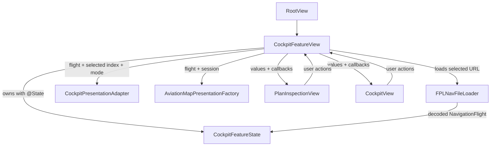
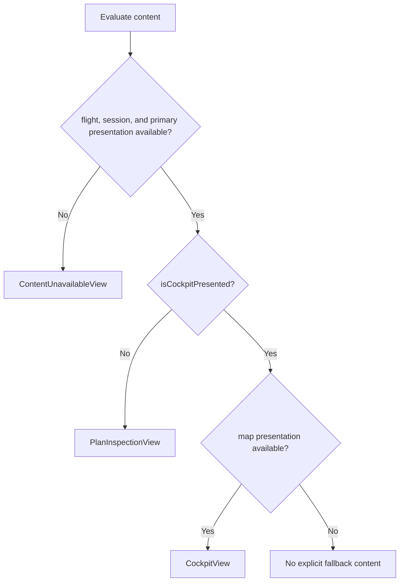

# `CockpitFeatureView` Technical Specification

Status: read-only reverse engineering of the implementation as of 2026-10-23.

This document describes the technical contract implemented by `CockpitFeatureView`. It records current behavior rather than proposing a redesign. The owned feature model is documented separately in [`CockpitFeatureState` Technical Specification](COCKPIT-FEATURE-STATE.md), and the delegated runtime state machine is covered by [`FlightSession` Technical Specification](FLIGHT-SESSION.md).

## Responsibility and scope

`CockpitFeatureView` is the SwiftUI container for the cockpit feature. It sits between the application root, the mutable feature model, presentation factories, and the two principal screens.

It is responsible for:

- owning `CockpitFeatureState` for the lifetime of the SwiftUI view identity;
- owning transient UI presentation state for the file importer, inspection/cockpit selection, and import-error alert;
- configuring the initial progression policy and optional UI-test plan;
- selecting the empty, plan-inspection, or cockpit UI branch;
- deriving immutable presentation values from the current feature-state snapshot;
- converting child-view callbacks into `CockpitFeatureState` commands; and
- loading and admitting a selected `.fplnav` file.

It does not decode `.fplnav` bytes itself, implement flight transitions, calculate presentation values, render the detailed plan or cockpit controls, own the cockpit's map interaction state, or persist feature state.

## Position in the architecture



`RootView` constructs `CockpitFeatureView` without inputs. The feature view is therefore the production composition root for this feature: it creates the state, loader, and adapter, then connects them to the leaf views.

The child views receive value snapshots and callback closures. They do not receive a writable binding to the complete `CockpitFeatureState`, so all feature-model mutation remains centralized in this container.

## Dependencies

| Dependency | Role in `CockpitFeatureView` | Ownership |
| --- | --- | --- |
| SwiftUI `View`, `@State`, `@ViewBuilder`, modifiers, and controls | Declarative rendering, local state retention, importer and alert presentation | Framework-managed |
| `UniformTypeIdentifiers.UTType` | Defines the `.fplnav` content type accepted by the importer | Static extension |
| `CockpitFeatureState` | Canonical mutable feature and runtime state | Owned in `@State` |
| `FPLNavFileLoader` | Converts a selected file URL into `NavigationFlight` | Immutable helper owned by the view value |
| `CockpitPresentationAdapter` | Builds primary cockpit data and optional runtime panels | Immutable helper owned by the view value |
| `AviationMapPresentationFactory` | Builds runtime-sensitive map presentation | Constructed during cockpit rendering |
| `PlanInspectionView` | Renders accepted-plan inspection and pre-flight controls | Child view value |
| `CockpitView` | Renders the executable cockpit and emits pilot actions | Child view value |
| `PresentedPlanError` | Gives alert payloads stable `Identifiable` identity | Private value stored in `@State` |

The loader and presentation adapters are concrete dependencies rather than injected protocols or initializer parameters. This keeps construction simple, but direct isolated testing of the container cannot substitute test doubles through its public initializer.

## State ownership

`CockpitFeatureView` stores four independent SwiftUI state values:

| State | Initial value | Meaning | Reset behavior |
| --- | --- | --- | --- |
| `state` | Configured `CockpitFeatureState` | Accepted plan, selected leg/mode, session, ETA state, and checklist state | Recreated when the view receives a new SwiftUI identity; accepted plans replace its plan-scoped values |
| `isImporterPresented` | `false` | Whether the system file importer is requested | SwiftUI and importer completion/cancellation drive dismissal |
| `isCockpitPresented` | `false` | Selects cockpit instead of inspection after a valid plan exists | Set true by inspection; false by cockpit return or successful import |
| `presentedError` | `nil` | Current import error shown by the item-driven alert | Alert presentation clears the binding on dismissal |

These values have deliberately different scopes:

- domain and execution state belongs to `CockpitFeatureState`;
- container navigation and modal presentation belong to `CockpitFeatureView`; and
- detailed cockpit interaction state, such as selected map targets and camera state, belongs to `CockpitView`.

There is no persistence layer in this view. Reconstructing it with a new identity returns to the configured initial state unless the debug UI-test environment supplies a plan.

## Initialization and lifecycle

The explicit initializer prepares the initial wrapped value of `state`.

1. In release builds, it selects `.automaticNextLeg`.
2. In debug builds, the `NAVIGATION_FLIGHT_PROGRESSION_POLICY` environment value selects manual progression only when its exact value is `manual`; every other value selects automatic progression.
3. It constructs `CockpitFeatureState` with that policy.
4. In debug builds, it optionally base64-decodes `NAVIGATION_FLIGHT_UI_TEST_PLAN`, decodes the bytes with `FPLNavDecoder`, and attempts to admit the resulting flight.
5. It assigns the configured value to `_state` using `State(initialValue:)`.

The initializer can run more than once because SwiftUI view structs are lightweight descriptions. `@State` storage is associated with the view's identity, so a newly constructed description does not itself reset already-installed state. The initializer's value is the seed used when SwiftUI first creates storage for that identity.

Debug plan decoding and admission use `try?`. Invalid base64, decoding failure, and rejected test plans silently leave the feature in its empty initial state.

## Rendering decision tree

The `body` applies the file-importer and alert modifiers to the result of `content`. `content` then chooses a branch from current state:



The primary `CockpitPresentationData` is recomputed from `state.flight`, `state.selectedLegIndex`, and `state.mode` whenever SwiftUI reevaluates the view. In cockpit mode, the map presentation is recomputed from the flight and session; next-leg preparation, previous-leg summary, and checklist presentation are also derived from that same snapshot.

The optional secondary presentations may be `nil` and are passed through to `CockpitView`. A failed primary adapter call causes the outer condition to fail and renders the same empty state used when no plan exists. A failed map factory call has no explicit `else` branch inside cockpit mode, so that branch contributes no visible cockpit content. All of these failures are suppressed with `try?` and do not populate `presentedError`.

## Import workflow

The empty view and `PlanInspectionView` can both set `isImporterPresented` to true. The `.fileImporter` modifier then requests a single file whose declared type is `.fplnav`.

On successful picker completion, `handleImport(_:)`:

1. extracts the first selected URL;
2. asks `FPLNavFileLoader` to load and decode it;
3. asks `CockpitFeatureState.accept(_:)` to validate and install it; and
4. returns presentation to plan inspection by setting `isCockpitPresented` to false.

If the result contains no URL, the method returns without changing feature state. Import cancellation calls `state.cancelImport()`, which is currently an intentional no-op.

`CockpitPlanError` is presented using its localized description. Any other error is wrapped in the message `The selected file couldn’t be opened. …`. Assigning a new `PresentedPlanError` triggers the item-driven alert because the payload is non-`nil` and `Identifiable`.

Admission is atomic inside `CockpitFeatureState`: a failed import preserves the previously accepted plan and session. The container also leaves `isCockpitPresented` unchanged on failure, so an error initiated from inspection remains in inspection and an error initiated by any future cockpit import entry point would remain in cockpit.

## How actions connect to `CockpitFeatureState`

SwiftUI buttons live in the child views, but the feature view supplies their behavior as closures. This is unidirectional data flow:

```text
CockpitFeatureState snapshot
        ↓
presentation adapters
        ↓
PlanInspectionView / CockpitView
        ↓ user invokes callback
CockpitFeatureView closure
        ↓
CockpitFeatureState command
        ↓
SwiftUI reevaluates from the new snapshot
```

### Plan inspection actions

| User intent from `PlanInspectionView` | Container closure | Result |
| --- | --- | --- |
| Open another plan | `isImporterPresented = true` | Presents the file importer |
| Open cockpit | `isCockpitPresented = true` | Selects the cockpit branch |
| Previous leg | `state.selectPreviousLeg()` | Requests synchronized pre-flight selection |
| Next leg | `state.selectNextLeg()` | Requests synchronized pre-flight selection |
| Select calculation mode | `state.selectMode($0)` | Requests whole-plan mode selection |

The view also passes `state.canSelectPreviousLeg` and `state.canSelectNextLeg`, allowing `PlanInspectionView` to disable unavailable controls without duplicating feature rules.

### Cockpit actions

| User intent from `CockpitView` | `CockpitFeatureState` command or local effect |
| --- | --- |
| Start active leg | `startLeg(at: .now)` |
| Identify destination | `identifyDestination(at: .now)` |
| Reach current waypoint | `reachCurrentWaypoint(at: .now)` |
| Reach identification point | `reachIdentificationPoint(key:nextTarget:at: .now)` |
| Open ETA editor | `openPilotETAEditor(target:)` |
| Adjust ETA | `adjustPilotETA(targetKey:by:)` |
| Commit ETA | `commitPilotETA(targetKey:)` |
| Resume ETA editing | `beginEditingPilotETA(targetKey:)` |
| Show ETA check | `showPilotETACheck(targetKey:)` |
| Hide ETA check | `hidePilotETACheck(targetKey:)` |
| Collapse checklist | `collapseLegStartChecklist()` |
| Reopen checklist | `reopenLegStartChecklist()` |
| Note checklist | `noteLegStartChecklist()` |
| Show plan inspection | Sets `isCockpitPresented = false`; does not command feature state |

The four throwing flight-transition commands use `try?`, so rejected transitions produce no alert or other container-level feedback. ETA and checklist commands are nonthrowing and forward directly.

The timestamp is captured in the container callback with `.now`. Child views express intent but do not choose a transition time, which keeps that integration decision at the feature boundary.

## SwiftUI concepts, with React/TypeScript comparisons

The comparisons below are analogies, not exact runtime equivalences.

| Swift / SwiftUI concept in this file | Meaning here | Rough React / TypeScript analogy |
| --- | --- | --- |
| `struct CockpitFeatureView: View` | A value describing UI; SwiftUI may create the struct repeatedly | A function component, although SwiftUI uses a value type rather than a JavaScript function invocation model |
| `var body: some View` | Declaratively returns the current view hierarchy | A component's returned JSX |
| `some View` | An opaque compile-time return type: callers know it conforms to `View` without naming the concrete nested generic type | No direct TypeScript equivalent; closest to hiding a concrete JSX element type behind a component contract |
| `@State private var` | SwiftUI-managed local source of truth retained across redraws for a stable view identity | `useState`, with identity determined by the SwiftUI view tree rather than hook call position alone |
| `$isImporterPresented` | The projected `Binding<Bool>` gives a child/modifier read-write access to that state | Passing a value plus setter, such as `[open, setOpen]`, packaged as one two-way binding |
| `.fileImporter(...)` and `.alert(...)` | View modifiers wrap/configure the preceding view description | Higher-order composition or props on a framework component; unlike DOM mutation, modifiers return another view value |
| `@ViewBuilder` | A result builder that allows conditionals and multiple view expressions to form one typed view result | JSX conditional rendering/fragments, but transformed and type-checked by the Swift compiler |
| `if let` | Optional binding: unwraps values only for the scope where they are non-`nil` | A null/undefined guard with narrowing, such as `if (value != null)` |
| Closures such as `onStartLeg` | Child-to-parent event callbacks with typed parameters | Callback props such as `onStartLeg={() => ...}` |
| `let` helper properties | Immutable dependencies on each particular view value | Constants captured by a function component render |
| `Result<[URL], any Error>` | A typed success/failure value delivered to the completion closure | A discriminated union like `{ ok: true; value: URL[] } \| { ok: false; error: Error }` |
| `try?` | Executes a throwing expression and converts failure to `nil` | Roughly `try { return value } catch { return undefined }`, with the important risk of hiding error detail |
| `#if DEBUG` | Compile-time conditional compilation | A build-time environment branch that a bundler removes, not an ordinary runtime `if` |

Useful Apple references:

- [Declaring a custom view](https://developer.apple.com/documentation/swiftui/declaring-a-custom-view)
- [`View`](https://developer.apple.com/documentation/swiftui/view)
- [`State`](https://developer.apple.com/documentation/swiftui/state)
- [`Binding`](https://developer.apple.com/documentation/swiftui/binding)
- [`ViewBuilder`](https://developer.apple.com/documentation/swiftui/viewbuilder)
- [Importing from a file](https://developer.apple.com/documentation/swiftui/modal-presentations#importing-from-file)
- [Presenting an alert](https://developer.apple.com/documentation/swiftui/modal-presentations#presenting-an-alert)
- [Maintaining state in your apps](https://developer.apple.com/documentation/swiftui/maintaining-state-in-your-apps)

## Error and fallback behavior

| Failure source | Current handling | Visible result |
| --- | --- | --- |
| Picker cancellation | Calls the no-op `cancelImport()` | Existing state remains visible |
| No selected URL | Returns from `handleImport` | No change |
| `CockpitPlanError` | Stores localized message in `presentedError` | Alert appears |
| Other loader/decoder error | Stores a generic prefix plus localized detail | Alert appears |
| Debug bootstrap decoding/admission | Suppressed with `try?` | Empty initial state |
| Primary presentation creation | Suppressed with `try?` | Empty-state UI |
| Map presentation creation | Suppressed with `try?` | No explicit cockpit fallback |
| Optional cockpit panel presentation | Suppressed with `try?` | Corresponding optional panel data is absent |
| Flight transition command | Suppressed with `try?` | State remains at the rejected transition; no container feedback |

## Invariants and integration assumptions

- A rendered inspection or cockpit branch has a non-`nil` flight, session, and primary presentation derived from the same `CockpitFeatureState` snapshot.
- `CockpitView` is rendered only when map presentation also succeeds.
- A successful import always returns the user to inspection before they explicitly enter the cockpit.
- Switching between inspection and cockpit does not reset `CockpitFeatureState`.
- The container never mutates fields inside the feature model directly; it invokes its command methods.
- Child callbacks are synchronous. There is no async task, actor hop, or suspension point in the current action wiring.
- The feature relies on SwiftUI reevaluation after `@State` mutation to rebuild all derived presentation values.
- `PresentedPlanError.id` is newly generated for every assigned error, so repeated messages still represent distinct alert items.

## Test evidence

`NavigationFlightUITests.swift` exercises container-visible behavior:

- `testEmptyStateOffersPlanImport` verifies the empty branch and enabled import action.
- `testImportedEditorPlanShowsSavedValuesAndModeSelection` launches with the debug plan environment, verifies inspection data and mode selection, enters the cockpit, drives flight actions through completion, and checks portrait/landscape continuity.

The deterministic state transitions reached through these callbacks are covered more extensively by `NavigationFlightTests.swift`. There is no isolated test that substitutes the loader or presentation factories, and the current UI tests do not exercise import-error alerts or presentation-factory failure fallbacks.

## Source trace

- [`CockpitFeatureView.swift`](../../NavigationFlight/Features/Cockpit/CockpitFeatureView.swift) — primary implementation.
- [`CockpitFeatureState.swift`](../../NavigationFlight/Features/Cockpit/CockpitFeatureState.swift) — owned state and command target.
- [`CockpitPresentationAdapter.swift`](../../NavigationFlight/Features/Cockpit/CockpitPresentationAdapter.swift) — primary and auxiliary presentation derivation.
- [`PlanInspectionView.swift`](../../NavigationFlight/Features/Cockpit/PlanInspectionView.swift) — inspection inputs and action sources.
- [`CockpitView.swift`](../../NavigationFlight/Features/Cockpit/CockpitView.swift) — cockpit inputs, local interaction state, and action sources.
- [`AviationMapPresentation.swift`](../../NavigationFlight/Map/AviationMapPresentation.swift) — map presentation factory.
- [`RootView.swift`](../../NavigationFlight/App/RootView.swift) — production parent.
- [`NavigationFlightUITests.swift`](../../NavigationFlightUITests/NavigationFlightUITests.swift) — end-to-end evidence.

## Current limitations

- Loader and adapter dependencies cannot be replaced through the view initializer.
- Suppressed presentation and transition errors are not observable to the user or diagnostics from this container.
- The cockpit branch has no explicit visible fallback when map presentation fails.
- State is in-memory only and is lost when the feature view receives a new identity or the process ends.
