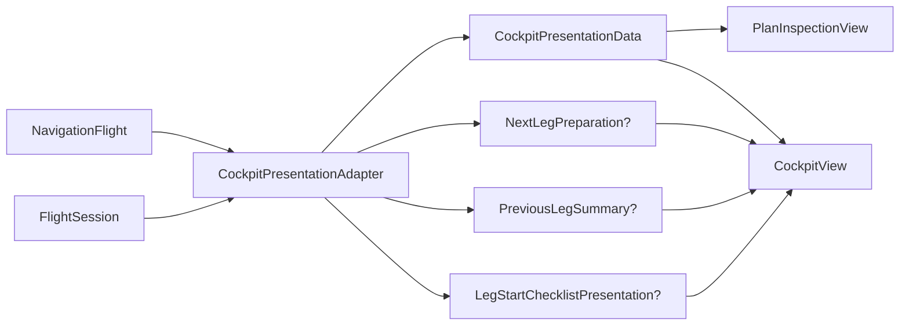

# `CockpitPresentationAdapter` Technical Specification

Status: read-only reverse engineering of the implementation as of 2026-10-23.

This document describes the technical contract implemented by `CockpitPresentationAdapter.swift`. It records current behavior rather than proposing a redesign. The composing SwiftUI container is documented in [`CockpitFeatureView` Technical Specification](COCKPIT-FEATURE-VIEW.md), the owned feature model in [`CockpitFeatureState` Technical Specification](COCKPIT-FEATURE-STATE.md), and runtime flight progression in [`FlightSession` Technical Specification](FLIGHT-SESSION.md).

## Responsibility and scope

`CockpitPresentationAdapter` is a stateless, synchronous projection layer between saved navigation-domain data, runtime session data, and cockpit-facing value models.

It is responsible for:

- selecting saved execution values for wind or no-wind mode;
- constructing the primary selected-leg presentation;
- deriving next-leg preparation and previous-leg summary panels;
- constructing the active-leg checklist presentation from a static template and saved values;
- joining resolved execution records back to their source-domain records;
- grouping frequencies for display without changing the phase-specific source projection;
- projecting route-event coordinates into a normalized schematic region;
- grouping coincident route annotations; and
- formatting the small set of strings owned by this boundary.

It does not mutate the flight or session, calculate new navigation solutions, advance flight state, decide whether a checklist is visible, render SwiftUI, build the interactive aviation map, decode files, or persist data.

## Position in the architecture



`CockpitFeatureView` owns one immutable adapter value and calls it during SwiftUI reevaluation. The adapter has no stored properties, caches, global state, asynchronous work, or side effects. All outputs are value types conforming to `Equatable` and `Sendable`.

The adapter combines two distinct sources:

| Source | Information used |
| --- | --- |
| `NavigationFlight` | Plan title, source legs and waypoints, source annotations, source VOR/DME references, altitude changes, and frequency changes |
| Eligible execution payload | Resolved legs, timings, headings, courses, distances, accepted VOR/DME values, phase frequencies, and resolved annotations |
| `FlightSession` | Active leg index, execution mode, completed-leg timing, and committed pilot ETA |

The source flight and eligible execution are assumed to describe the same plan. Joins are performed by saved UUIDs and, for selected legs, parallel array indices.

## Public presentation models

### `CockpitPresentationData`

The primary presentation is a complete immutable snapshot for one selected leg.

| Field group | Contents |
| --- | --- |
| Identity and endpoints | Plan title, human-readable leg position, origin, and destination |
| Schematic placement | Normalized origin, destination, and route-event coordinates |
| Navigation | Crossing altitudes, magnetic course, optional magnetic heading, ground distance, and initial altitude |
| Timing | Ground speed, selected-leg duration, and cumulative duration through the selected leg |
| Mode capability | Selected mode and whole-plan wind-mode support |
| Operational references | Endpoint VOR/DME references and phase-specific frequencies |
| Display collections | De-duplicated display frequencies and grouped route events |

Nested values preserve stable source identities:

- `PlannedReference.id` is the resolved reference UUID;
- `Frequency.id` is the saved execution-frequency ID;
- `DisplayFrequency.id` is the first frequency ID encountered in its display group; and
- `RouteEvent.id` is the first annotation entity UUID in its group, while `entityIDs` retains every grouped entity UUID.

### `NextLegPreparation`

This optional value describes the leg immediately after `session.activeLegIndex`. It contains the next leg index, its saved heading or course, its saved initial altitude, and optional changes that take effect exactly at leg start.

### `PreviousLegSummary`

This optional value describes only the most recently completed leg. It combines saved plan values with observed session timing and an optional committed destination ETA.

### Checklist types

`LegStartChecklistTemplate` separates static checklist content from flight-derived values. The built-in `tzeKivun` template has two sections:

| Section | Items |
| --- | --- |
| `leg-start` | Timer and direction |
| `gamad` | Altitude, speed/engine checks, and reporting |

`item(_:)` returns the first item of a requested kind across all sections. `gamadSection` returns the section whose ID is exactly `gamad`.

`LegStartChecklistPresentation` associates that template with the active leg ID, saved direction, and saved initial altitude. `plannedIndicatedAirspeedKnots` is always `nil` because the current v7 contract does not identify a saved value as planned IAS.

## Primary selected-leg projection

`makePresentation(flight:legIndex:mode:)` follows this sequence:

1. Require an eligible execution payload.
2. Require `legIndex` to exist in both the execution-leg and source-leg arrays.
3. Select timing and direction values for the requested mode.
4. Sum saved durations from the first execution leg through the selected leg, inclusive.
5. Join accepted VOR/DME execution references to source references and retain only references attached to the selected leg's endpoints.
6. Project every execution frequency into its phase-specific presentation form.
7. Collapse display-equivalent frequencies across phases.
8. Select execution annotations for the resolved leg ID and join each to its source entity.
9. Project endpoints and annotations into schematic coordinates.
10. Group coincident route events.
11. Return the complete immutable snapshot.

### Mode selection

| Mode | Timing | Direction field |
| --- | --- | --- |
| `.noWind` | `ResolvedLeg.noWind` | Magnetic course; `magneticHeadingDegrees` is `nil` |
| `.wind` | `ResolvedLeg.withWind.timing` | Saved magnetic heading from `withWind` |

Wind mode requires wind data for the selected leg and for every preceding leg included in cumulative time. The adapter does not fall back to no-wind values.

`supportsWindMode` is stricter than the selected-leg lookup: it is true only when every execution leg has a `withWind` solution.

### Cumulative time

`cumulativeDurationSeconds` is the sum of saved execution durations through the selected leg. It does not use elapsed session time, recompute speed or distance, or interpolate missing values.

### VOR/DME references

The adapter first indexes source references by UUID, then walks accepted execution references. A reference is emitted only when:

- its source UUID exists in `flight.vorDmeReferences`; and
- the source reference's waypoint is the selected source leg's departure or arrival.

Accepted references for other legs are ignored. Missing source records and non-endpoint references are silently omitted rather than treated as errors.

### Frequencies and display grouping

The `frequencies` dictionary contains an entry for every `FlightPhase`, including phases with an empty array. Each entry preserves the execution order for that phase and retains the original phase, role, service name, numeric frequency, and source.

`makeDisplayFrequencies(from:)` flattens phases in `FlightPhase.allCases` order and groups entries only when all of these values match:

- service name;
- derived service-type label;
- exact `Double` frequency value; and
- execution source.

The service-type label is a nonempty explicit role when one exists. Otherwise it is derived from the source as `Departure`, `Route`, `Arrival`, `VOR/DME`, or `User`.

Grouping is display-only. The original phase dictionary remains unchanged. A display group's phase list preserves first-seen phase order and does not repeat a phase. Meaningful differences in role, source, service, or exact frequency keep entries separate.

### Route-event construction

Only execution annotations whose `legID` equals the selected resolved leg's ID are considered. Annotation time is selected from the active mode:

| Mode | Annotation time |
| --- | --- |
| `.noWind` | `noWindTimeFromLegStartSeconds` |
| `.wind` | `withWindTimeFromLegStartSeconds` |

Each annotation kind is joined to a source collection and assigned fixed display copy:

| Kind | Required source | Title | Detail |
| --- | --- | --- | --- |
| Identification point | Matching identification point UUID | `Identification point` | `Passive planned marker` |
| Altitude change | Matching altitude-change UUID | `Altitude change` | Target altitude rounded to zero fractional digits, suffixed with `MSL` |
| Radio-frequency change | Matching frequency-change UUID | `Frequency change` | Service and frequency formatted to two or three fractional digits, suffixed with `MHz` |

A missing source record throws `missingSourceLeg` with the annotation entity UUID. Despite its name, this error is used for missing annotation source entities, not only source legs.

### Schematic coordinate projection

The projection computes a latitude/longitude bounding box across the origin, destination, and all projected positions. Each position is mapped linearly into a fixed subregion:

```text
x = 0.18 + longitudeOffset / longitudeSpan * 0.58
y = 0.78 - latitudeOffset  / latitudeSpan  * 0.50
```

Latitude and longitude spans are independently clamped to a minimum of `0.000001`, preventing division by zero. This is a schematic normalization, not a geodesic or map projection. Longitude increases to the right; latitude increases upward because the calculated y value decreases.

The implementation passes the endpoints both in `positions` and separately as `origin` and `destination`. This duplication does not change the bounding extrema.

### Coincident-event grouping

Events are coincident only when both their `WGS84Coordinate` and selected-mode time are exactly equal. The first event establishes group identity, normalized position, and ordering. Subsequent matches append entity IDs and kinds, replace the title with `Combined planned events`, and append detail text with ` · `.

No tolerance is applied to coordinates or time. Events at the same coordinate but different saved times remain distinct, as do events at the same time but different coordinates.

## Next-leg preparation

`makeNextLegPreparation(flight:session:)` targets `session.activeLegIndex + 1`.

- If that index does not exist in the source flight, it returns `nil`; this is the normal final-leg result.
- If the source leg exists but eligible execution data or the matching resolved leg does not, it throws `unavailableExecution`.
- Wind mode yields the saved magnetic heading and requires `withWind` data.
- No-wind mode yields the saved magnetic course.

The adapter reports at most one immediate altitude change and one immediate frequency change, selecting the first matching source record in collection order.

An altitude change is immediate when it belongs to the next source leg and is anchored either to that leg's departure waypoint or to leg progress exactly equal to zero. Identification-point anchors are never immediate.

A frequency change is immediate when it belongs to the next source leg and its progress fraction is exactly zero.

The resolved leg's `initialAltitudeMsl` is always returned separately, even when an immediate altitude change is present.

## Previous-leg summary

`makePreviousLegSummary(flight:session:)` searches `session.legTimings` from the end and selects the last entry whose `reachedAt` is non-`nil`. It returns `nil` when no completed timing exists or when the corresponding source/execution records are unavailable.

Planned duration and optional heading come from the session's current execution mode. Actual duration is:

```text
max(0, round(reachedAt - startedAt))
```

The summary looks up a committed pilot ETA using a destination target key composed from the completed timing's leg ID and the source leg's arrival waypoint ID. Its comparison basis is the committed ETA when present, otherwise the saved planned duration:

```text
delta = actualDuration - (committedDestinationETA ?? plannedDuration)
```

The optional VOR/DME summary uses the first source reference attached to the arrival waypoint that also appears in the eligible execution's accepted references. Station identity comes from the source record; radial and slant range come from the accepted execution record. Frequency and execution source are not included in this summary model.

## Active-leg checklist projection

`makeLegStartChecklist(flight:session:)` returns `nil` unless all of these conditions hold:

- the session leg state is `.active`;
- the active index exists in the source flight;
- the flight has eligible execution data; and
- the active index exists in the execution legs.

For a valid active leg, wind mode produces a saved heading and no-wind mode produces a saved course. The presentation always uses the built-in `tzeKivun` template and the resolved leg's saved initial altitude. It does not read checklist review, collapse, or phase visibility state; those concerns belong to `CockpitFeatureState`.

## Errors and optional absence

| Result | Meaning |
| --- | --- |
| `nil` checklist | No valid active leg presentation exists for the current snapshot |
| `nil` next-leg preparation | The current source leg is the final leg |
| `nil` previous-leg summary | No valid completed leg can be summarized |
| `unavailableExecution` | A required eligible execution payload or matching resolved next leg is absent |
| `invalidLegIndex(index)` | The requested primary leg index is absent from either parallel leg array |
| `unavailableWindMode` | A requested wind-derived leg, cumulative timing, annotation time, or panel value is absent |
| `missingSourceLeg(id)` | A resolved annotation cannot be joined to its required source entity |

Optional absence is used for normal UI non-applicability. Errors represent a requested projection that cannot honor its data contract. The composing feature view currently calls these methods with `try?`, so errors generally become absent UI rather than user-visible messages.

## Formatter contract

`CockpitPresentationFormatter` is colocated with the adapter but does not depend on it.

### Aviation degrees

`aviationDegrees(_:)` rounds to the nearest integer, normalizes into `0...359` using positive modulo arithmetic, pads to three digits, and appends `°`. Values crossing 360 wrap to `000°`; negative values wrap into the same range.

### Signed duration

`signedDuration(_:)` always emits a sign followed by two-digit minutes and seconds. Zero is positive. Minutes are not capped at 59, so the format represents a signed duration rather than a clock time.

## Invariants and integration assumptions

- Every adapter method is synchronous and read-only with respect to its inputs.
- All navigation and timing values are copied from saved domain or execution data; the adapter does not synthesize a flight solution.
- Source and execution leg arrays are index-aligned for valid eligible flights.
- Dictionary construction assumes unique IDs in source VOR/DME references, identification points, altitude changes, frequency changes, and accepted execution references. Duplicate keys would trap in `Dictionary(uniqueKeysWithValues:)` rather than produce a `CockpitPresentationError`.
- Exact `Double` equality defines both frequency grouping and zero-progress changes.
- Exact coordinate and integer-time equality defines coincident route events.
- Ordering is stable and source-driven: phase case order, collection order within phases, execution annotation order, and first matching source change/reference all affect output order or selection.
- `supportsWindMode` describes whole-plan capability, while individual wind projections still validate each required saved value.
- The adapter's presentation strings are embedded English and Hebrew literals rather than localized resources.

## Test evidence

`NavigationFlightTests.swift` provides focused evidence for the current adapter contract:

- `cockpitCollapsesIdenticalFrequenciesAcrossPhasesForDisplayOnly` verifies cross-phase display grouping without loss of phase-specific data.
- `cockpitKeepsMeaningfullyDifferentFrequenciesDistinct` verifies the grouping key boundaries.
- `nextLegPreparationUsesSavedResolvedValuesAndIsAbsentOnFinalLeg` verifies saved next-leg values and final-leg absence.
- `nextLegPreparationLabelsSavedCourseWhenNoHeadingExists` verifies no-wind direction semantics.
- `nextLegPreparationUsesExplicitSavedStartChanges` verifies exact leg-start altitude and frequency changes.
- `previousLegSummaryUsesSavedValuesAndSessionTiming` verifies planned and observed timing plus saved navigation values.
- `previousLegSummaryUsesCompletedLegRevisedDestinationETAAsComparisonBasis` verifies committed destination ETA precedence in delta calculation.
- `previousLegSummaryOnlyExposesMostRecentlyCompletedLeg` verifies completed-leg selection.
- `builtInLegStartTemplateDefinesTzeKivunAndGamadWithoutFlightValues` verifies static template structure and separation from flight-derived values.
- `checklistUsesOnlySavedDirectionAltitudeAndContractSupportedIAS` verifies mode-specific direction, saved altitude, and absent IAS.
- `cockpitAdapterPresentsTheSelectedResolvedLegAndOnlySumsSavedTime` verifies selected-leg identity and saved cumulative timing.

The tests support the principal successful projections. The error cases, coordinate normalization edge cases, duplicate-key preconditions, exact coincidence grouping, and formatter boundary behavior are contracts visible in the implementation but are not all named by focused tests.

## Current limitations

- Presentation failures carry no localized descriptions and are suppressed by the current SwiftUI composition layer.
- `missingSourceLeg` is broader than its name suggests.
- The static checklist copy and adapter-generated labels are not localized.
- The current data contract cannot populate planned indicated airspeed.
- Immediate changes and arrival VOR/DME summaries expose only the first qualifying source record.
- Exact floating-point equality controls several grouping and boundary decisions.
- Duplicate IDs can cause a runtime trap during dictionary construction.
- Schematic projection uses a rectangular latitude/longitude normalization and does not account for geodesic distortion or antimeridian crossing.
