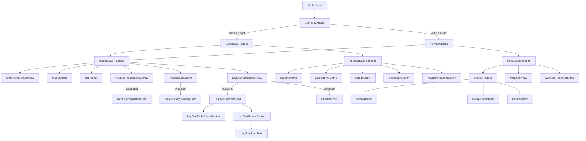

# Cockpit View

## Scope

`CockpitView` is the cockpit screen's presentation layer. It does not own the flight plan or mutate `FlightSession` directly. It receives immutable presentation/session snapshots and intent callbacks from `CockpitFeatureView`, then composes the map, overlays, metrics, and progression controls.

This document describes:

- which child views compose `CockpitView`;
- which presentation values, session state, and callbacks it receives;
- which local `@State` properties it owns and how long they live; and
- how pilot actions flow back to `CockpitFeatureView`.

## Composition

`GeometryReader` selects one of two layouts from the current available size:

- In landscape, an `HStack` gives 74 percent of the width to the map surface and places a vertical control panel beside it.
- In portrait, a `VStack` gives 74 percent of the height to the map surface and places a horizontal control panel below it.

The hierarchy below shows the logical composition. The landscape and portrait branches arrange the same map surface and cockpit information differently rather than creating separate feature components.



### Map surface

The map surface is a `ZStack`, so these children occupy the same map region:

| Child | What it displays or controls |
| --- | --- |
| `OfflineAviationMapView` | The offline route map, active-leg symbology, identification points, timing targets, and interactive callouts. It reads and writes camera and callout-placement bindings owned by `CockpitView`. |
| `mapControls` | Buttons to focus the active leg, waypoint, or route overview, plus a button that returns to plan inspection. |
| `legHeader` | The leg number, origin-to-destination summary, and a Charts button. Charts are not implemented yet; the button presents an explanatory alert. |
| `NextLegPreparationOverlay` | After the destination is identified, a collapsible NEXT chip/card showing the following leg's heading or course, starting or immediate altitude, and immediate frequency change. |
| `PreviousLegDrawer` | A left-edge PREV tab and drawer summarizing the most recently completed leg: planned/revised/actual time, delta, direction, and optional VOR/DME reference. It supports tap and horizontal drag gestures. |
| `LegStartChecklistOverlay` | The active leg's start checklist, either as an expanded card or collapsed chip. It appears only when checklist data and state refer to the same leg, the checklist is available, and the leg has a start time. |

### Control panel

The portrait and landscape panels reuse the same content in different arrangements:

| Child/helper | What it displays |
| --- | --- |
| `headingMetric` | Planned magnetic heading when wind data exists; otherwise magnetic course. When showing heading, it also shows the saved course. |
| `CockpitTimeMetric` | Before start, planned duration and an empty elapsed value. During an active leg, a `TimelineView` refreshes elapsed time once per second and shows the committed pilot ETA when available. |
| `altitudeMetric` | Initial planned altitude in feet MSL. |
| `frequencyRow` / `frequencyColumn` | The same planned frequencies, service types, and flight phases in a horizontal portrait scroller or vertical landscape scroller. The UI explicitly says these values are not tuned. |
| `waypointReachedButton` | A state-dependent progression control: Start Leg when ready; Waypoint Identified plus a Reached now shortcut before identification; Waypoint Reached after identification; or a noninteractive Navigation Complete label. |

Several private views implement those overlays:

- `LegStartChecklistCard`, `LegStartFlightCheckSection`, `LegStartGamadSection`, and `LegStartStaticItem`
- `NextLegPreparationCard`
- `PreviousLegSummaryCard`

`IdentificationPointContextOverlay` is also declared in `CockpitView.swift`, but `CockpitView` does not instantiate it. Identification-point and ETA contexts are instead passed to `OfflineAviationMapView`, whose map callouts render the active interaction UI.

## Inputs

The initializer boundary has three categories of input.

### Presentation data

| Input | Role |
| --- | --- |
| `data: CockpitPresentationData` | Cockpit-readable values for the selected leg: title/position, endpoints, direction, distance, speed, durations, altitude, mode, references, frequencies, and route events. `CockpitView` directly uses the leg label, endpoints, heading/course, duration, altitude, and display frequencies. |
| `mapPresentation: AviationMapPresentation` | Map geometry and annotations, active/next-leg data, identification points, and destination/timing targets. It is also queried to resolve selections and determine the next ETA target. |
| `nextLegPreparation: NextLegPreparation?` | Optional preview of the following leg. It is withheld from the overlay until the current destination is identified. |
| `previousLegSummary: PreviousLegSummary?` | Optional completed-leg summary that enables the PREV drawer. |
| `legStartChecklist: LegStartChecklistPresentation?` | Optional display content for the start-of-leg checklist. |

### Session state

| Input | Role |
| --- | --- |
| `session: FlightSession` | The current execution snapshot. Its leg state selects the main progression control; timestamps drive timers; destination identification gates next-leg preparation; pilot-ETA and reached-point records populate map interaction contexts. |
| `checklistState: CockpitFeatureState.LegStartChecklistState?` | The checklist's availability, expanded/collapsed presentation, and noted/unnoted review state. This lives in `CockpitFeatureState`, so it survives rebuilding or temporarily removing `CockpitView` while the containing feature retains its identity. |

These are value inputs, not bindings. `CockpitView` cannot assign through them. When `CockpitFeatureState` changes, `CockpitFeatureView` derives fresh values and SwiftUI reevaluates `CockpitView` with the new snapshot.

### Intent callbacks

The callbacks cover:

- leg progression: `onStartLeg`, `onIdentifyDestination`, and `onWaypointReached`;
- identification-point progression: `onIdentificationPointReached`;
- pilot ETA editing: `onOpenPilotETA`, `onAdjustPilotETA`, `onCommitPilotETA`, `onEditPilotETA`, `onShowPilotETACheck`, and `onHidePilotETACheck`;
- checklist commands: `onCollapseChecklist`, `onReopenChecklist`, and `onNoteChecklist`; and
- navigation: `onShowPlanInspection`.

Typed callback parameters keep domain identifiers and values explicit. For example, ETA adjustment reports both a `NavigationTimingTargetKey` and a signed seconds delta. Reaching an identification point reports its key and the optional next ETA target.

## Local state and lifetime

All local state is `private`, making `CockpitView` its sole owner. SwiftUI preserves these values across `body` reevaluations and portrait/landscape changes while the view retains the same identity. They return to their initial values after the cockpit branch is removed—for example, after returning to plan inspection—and a new `CockpitView` is later inserted.

| `@State` property | Purpose and reset behavior |
| --- | --- |
| `showsChartsUnavailable` | Drives the Charts Unavailable alert. The alert binding resets it when dismissed. |
| `mapFocusRequest` | Carries the latest programmatic map-focus request. It starts focused on the current leg and is replaced for leg, waypoint, overview, or a selected timing target. |
| `preservedMapCamera` | Stores the map camera across SwiftUI updates and layout/orientation changes. The map writes through its binding. |
| `isMapCameraUserControlled` | Records whether user manipulation currently owns camera positioning. A focus-button action clears it before issuing a new focus request. |
| `timingTargetCalloutOffsets` | Persists draggable callout offsets by timing-target key. The destination callout uses the visual style's default until a value is stored. |
| `identificationPointCalloutOffsets` | Persists draggable callout offsets by identification-point key. |
| `isNextPreparationPresented` | Expands or collapses next-leg preparation. Identifying the destination opens it; selecting another map object or reaching immediately closes it. |
| `isPreviousDrawerPresented` | Expands or collapses the previous-leg drawer. It closes when the active leg or summarized previous leg changes. |
| `selectedIdentificationPointID` | Tracks the selected identification-point callout. Selecting it again toggles it off; selecting a timing target clears it. It is cleared on active-leg changes. |
| `selectedTimingTargetKey` | Tracks the selected destination or identification-point ETA target. Selecting it again toggles it off; selecting an identification point clears it. It is cleared on active-leg changes. |

The active-leg `onChange` closes both transient leg overlays and clears both selections. A separate `onChange` closes the previous-leg drawer whenever `previousLegSummary?.legIndex` changes. Camera and callout offsets are deliberately not reset by those handlers, so they remain available for the lifetime of this `CockpitView` identity.

## Pilot interaction flow

Domain-changing actions follow a one-way path:

```text
Button or map callout
        ↓
CockpitView callback (sometimes after updating local selection UI)
        ↓
closure supplied by CockpitFeatureView
        ↓
CockpitFeatureState command
        ↓
new session/presentation snapshot
        ↓
SwiftUI reevaluates CockpitFeatureView and CockpitView
```

| Pilot action | Work inside `CockpitView` | Callback to `CockpitFeatureView` | Feature command/effect |
| --- | --- | --- | --- |
| Start Leg | None | `onStartLeg()` | `state.startLeg(at: .now)` |
| Waypoint Identified | Clears the identification-point selection and opens next-leg preparation | `onIdentifyDestination()` | `state.identifyDestination(at: .now)` |
| Reached now / Waypoint Reached | The shortcut closes next-leg preparation | `onWaypointReached()` | `state.reachCurrentWaypoint(at: .now)` |
| Select identification point | Toggles the selection, clears timing-target selection, closes next-leg preparation, and requests checklist collapse | No progression callback yet | Local selection plus `state.collapseLegStartChecklist()` through `onCollapseChecklist` |
| Mark selected identification point reached | Resolves the point and its next ETA target | `onIdentificationPointReached(point.id, nextTarget)` | `state.reachIdentificationPoint(key:nextTarget:at: .now)` |
| Select ETA timing target | Toggles selection, clears identification-point selection, collapses the checklist, and focuses the map | `onOpenPilotETA(target)` | `state.openPilotETAEditor(target:)` |
| Adjust, commit, edit, show check, or hide check in a map callout | Mostly forwards directly; committing an identification-point ETA returns selection to that point | Corresponding typed ETA callback | Corresponding `CockpitFeatureState` ETA command |
| Collapse, reopen, or note checklist | On narrow maps, reopening also closes the previous-leg drawer | Corresponding checklist callback | Corresponding checklist command |
| Plan Inspection | None | `onShowPlanInspection()` | Sets `isCockpitPresented = false` in `CockpitFeatureView` |
| Change map focus, drag a callout, open/close a drawer, or open Charts | Mutates only local `@State` | None | No feature-state change |

There is no `@Binding` to `FlightSession`. Operational mutations remain behind `CockpitFeatureState` commands, so the parent remains the single source of truth.

## SwiftUI concepts used here

| Concept | Meaning in `CockpitView` |
| --- | --- |
| `@State private var` | SwiftUI-managed, view-local storage retained while the view keeps the same identity. |
| `Binding` | Read-write access to state owned elsewhere. Projected bindings such as `$preservedMapCamera` expose state directly; custom `Binding(get:set:)` values adapt dictionary entries or multiple conditions. |
| Stored callbacks | Typed child-to-parent event handlers. `CockpitFeatureView` creates them, `CockpitView` stores them, and a later gesture invokes them. |
| `GeometryReader` | Supplies the size offered by the parent so the view can select its portrait or landscape composition. |
| `ZStack` | Layers the map, header, controls, and overlays in the same region. |
| `@ViewBuilder` | Allows `waypointReachedButton` to return different view structures for ready, active, and completed states. |
| `TimelineView(.periodic(...))` | Reevaluates timer content once per second without manually creating and invalidating a timer. |
| `.onChange(of:)` | Runs cleanup when an input changes, preventing selections or drawers from remaining attached to the wrong leg. |
| `some View` | Hides the concrete nested SwiftUI return type while preserving compile-time type checking. |

## Source trace

- [`CockpitView.swift`](../../NavigationFlight/Features/Cockpit/CockpitView.swift) — implementation described here.
- [`CockpitFeatureView.swift`](../../NavigationFlight/Features/Cockpit/CockpitFeatureView.swift) — parent that derives inputs and supplies callbacks.
- [`CockpitFeatureState.swift`](../../NavigationFlight/Features/Cockpit/CockpitFeatureState.swift) — operational state and command target.
- [`CockpitPresentationAdapter.swift`](../../NavigationFlight/Features/Cockpit/CockpitPresentationAdapter.swift) — derives cockpit and auxiliary presentation values.
- [`OfflineAviationMapView.swift`](../../NavigationFlight/Map/OfflineAviationMapView.swift) — renders the map and interactive callouts.
- [`AviationMapPresentation.swift`](../../NavigationFlight/Map/AviationMapPresentation.swift) — map presentation model and factory.
