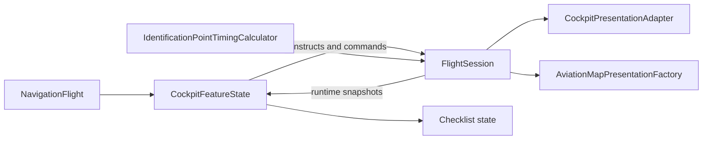
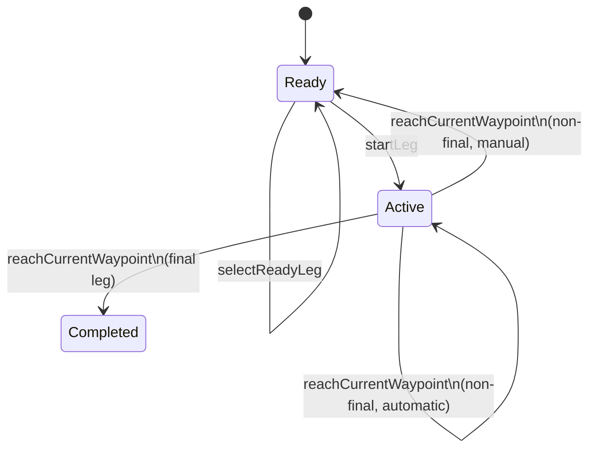
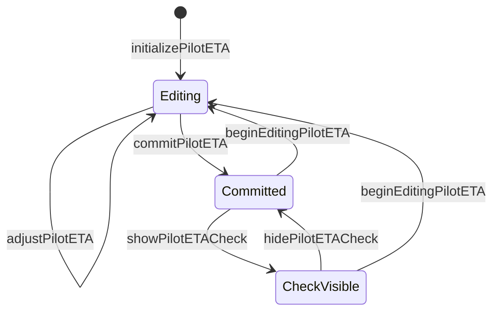

# `FlightSession` Technical Specification

Status: read-only reverse engineering of the implementation as of 2026-10-22.

This document describes the technical contract implemented by `FlightSession`. It records observed behavior rather than proposing a redesign. Product behavior for the automatic and manual handoff policies is specified separately in [Progression Policy — As-Is Product Specification](../features/PROGRESSION-POLICY_SPEC.md). The system context is described in the [architecture overview](../architecture.md).

## Responsibility and scope

`FlightSession` is the in-memory runtime domain module for executing one imported `NavigationFlight`. It owns:

- the current leg and navigation mode;
- the ready, active, and completed leg lifecycle;
- immutable selection of the automatic or manual [progression policy](../features/PROGRESSION-POLICY_SPEC.md#current-configuration-and-availability);
- per-leg start, destination-identification, and reach timestamps;
- per-identification-point reach timestamps;
- pilot-authored ETA draft, commit, edit, and comparison-visibility state; and
- elapsed-time queries derived from recorded timestamps.

It does not own the imported route or resolved execution data, checklist state, view state, map geometry, persistence, wall-clock acquisition, or flight-plan timing calculations. Callers supply identifiers, timestamps, planned elapsed values, and navigation mode.

The module is a value type (`struct`) with internal visibility. It is `Equatable` and `Sendable`; mutation is explicit through `mutating` operations. Stored runtime collections and lifecycle properties are externally readable but `private(set)`.

## Position in the architecture

`CockpitFeatureState` is the sole production owner and mutation adapter. It creates a new session after accepting an eligible plan, forwards pilot actions, synchronizes `selectedLegIndex` after progression, and applies checklist side effects. Presentation adapters read session snapshots; they do not mutate or observe the session.

## Identity and keys

| Type | Identity represented | Technical purpose |
| --- | --- | --- |
| `flightID` | Imported flight UUID | Associates the session with a plan; no method revalidates it |
| [`legIDs`](../FPLNAV-V7-INTEGRATION.md#runtime-boundary) | Ordered route-leg UUIDs | Defines valid leg indices and maps the active index to a leg identity |
| `IdentificationPointKey` | Leg UUID plus identification-point UUID | Prevents point identities from colliding across legs |
| `NavigationTimingTargetKey` | Leg UUID, target kind, and target UUID | Keys canonical pilot ETA state for an identification point or destination |

`NavigationTimingTargetKey.Kind` distinguishes `.identificationPoint` from `.destination`. The session treats keys as opaque values except that an identification-point reach key must reference the active leg. Target kind and target membership are not otherwise validated by `FlightSession`.

The FPLNav v7 integration contract documents the imported execution's exact leg order and one-to-one source relationships. It does not define `flightID`, `IdentificationPointKey`, or `NavigationTimingTargetKey`; those are Swift domain/session identities and therefore have no corresponding key definition to link in that document.

## Construction contract

The initializer requires a flight ID, an ordered nonempty-in-practice leg-ID collection, an active index, an execution mode, and an optional progression policy. The policy defaults to `.automaticNextLeg`.

Construction enforces only one condition directly: `activeLegIndex` must be a valid index in `legIDs`. Violation triggers a precondition failure rather than a typed error. A new session starts with:

- `legState == .ready`;
- no leg timing history;
- no identification-point timing history; and
- no pilot ETA state.

Production construction occurs only after `CockpitFeatureState` accepts an eligible execution with at least one leg. It passes the imported flight's ordered leg IDs, index zero, the execution's default mode, and the feature state's progression policy.

## State model

### Leg lifecycle

There is one session-wide `LegState`, not one state value per leg. Historical completion is represented by `LegTiming.reachedAt`, while the session-wide state describes the current active index.

### Timing record lifecycle

`startLeg` appends one `LegTiming` for the active index. The record's `startedAt` never changes. `identifyDestination` replaces that record with a copy containing `destinationIdentifiedAt`. `reachCurrentWaypoint` replaces it with a copy containing `reachedAt`, preserving the other timestamps.

Under automatic progression, reaching a non-final waypoint also appends the successor's `LegTiming` with the same timestamp. Under manual progression, the successor record is deferred until a later `startLeg` call.

### Pilot ETA lifecycle

Initialization rounds planned elapsed seconds to the nearest five seconds, stores the result as the draft, and is idempotent by target key. A negative planned value is rejected silently. Draft adjustment is permitted only while editing and clamps at zero. Commit copies the draft to `committedSeconds`; beginning another edit resets the draft to the committed value. Check visibility requires a committed value.

An optional `timingObservationKey` links an ETA state to the reached identification point used later for a reference calculation. The key is immutable after initialization because repeat initialization is ignored.

## Command interface

| Operation | Required state or input | Successful effect | Failure behavior |
| --- | --- | --- | --- |
| `selectReadyLeg(index:mode:)` | Session ready; valid unstarted index | Changes active index and execution mode | Throws typed transition error |
| `startLeg(at:)` | Session ready; active index never started | Appends timing record and becomes active | Throws typed transition error |
| `identifyDestination(at:)` | Active leg; not previously identified; timestamp at or after start | Records identification timestamp only | Throws typed transition error |
| `reachIdentificationPoint(key:orderedActiveLegPointKeys:at:)` | Active leg; complete unique active-leg order; selected point future; timestamp at or after start | Marks earlier future points passed without report, records the selected reach, and leaves later points future | Throws typed transition error before mutation |
| `reachCurrentWaypoint(at:)` | Active leg with timing record; unreached; timestamp at or after start | Completes current timing and applies progression policy | Throws typed transition error |
| `initializePilotETA(...)` | Nonnegative planned seconds; target absent and still future | Creates editing state with rounded draft | Otherwise no-op |
| `adjustPilotETA(...)` | Future target in editing state | Adds delta and clamps draft to zero | Otherwise no-op |
| `commitPilotETA(...)` | Existing future target | Commits draft and ends editing/check display | Otherwise no-op |
| `beginEditingPilotETA(...)` | Future target with committed value | Restores committed value into draft and edits | Otherwise no-op |
| `showPilotETACheck(...)` | Existing target with committed value | Shows comparison state | Otherwise no-op |
| `hidePilotETACheck(...)` | Existing target | Hides comparison state | Otherwise no-op |

The mixed failure interface is significant: lifecycle and reach commands use typed errors, while pilot ETA commands silently ignore invalid state or missing keys.

## Query interface

| Query | Result |
| --- | --- |
| `legStartedAt` | Start timestamp for the active leg, if a timing record exists |
| `destinationIdentifiedAt` | Destination-identification timestamp for the active leg, if recorded |
| `identificationPointTiming(for:)` | Reached or passed-without-report record for a composite point key |
| `identificationPointState(for:)` | Explicit future, reached, or passed-without-report outcome |
| `actualLegElapsedDuration(atIdentificationPoint:)` | Point reach minus the associated leg start; `nil` for future or passed points |
| `pilotETAState(targetKey:)` | Full canonical editor state for a target |
| `committedPilotETA(targetKey:)` | Committed pilot ETA only |
| `elapsedTime(at:)` | Active leg elapsed time, clamped to zero; otherwise `nil` |
| `LegTiming.actualElapsedDuration` | Leg reach minus leg start when the leg has been reached |

Durations are derived rather than stored. Absolute timestamps remain the source of truth.

## Progression algorithm

For a successful `reachCurrentWaypoint(at:)` call, the implementation performs these steps in order:

1. Require an active current leg and locate its timing record.
2. Reject duplicate reach and a timestamp earlier than the leg start.
3. Store the current leg's `reachedAt`, preserving start and optional identification time.
4. If the leg is final, set the session to completed and stop.
5. Increment `activeLegIndex` to the successor.
6. For automatic progression, append the successor timing record at the same timestamp and remain active.
7. For manual progression, create no successor record and become ready.

This makes the outgoing reach and automatic successor start one atomic timing boundary. It also ensures the current/displayed index advances under both intermediate-leg policies.

## Enforced invariants

- The active index is valid at construction and can only be changed to another valid index.
- A leg index can have at most one `LegTiming` record.
- A reached identification-point composite key can be recorded at most once.
- Identification and reach timestamps cannot precede the associated leg start.
- Destination identification and destination reach are distinct observations.
- Reaching an identification point does not change the active leg or leg lifecycle.
- A final waypoint produces `.completed` and no successor timing.
- Automatic progression uses one timestamp for outgoing reach and successor start.
- Manual progression intentionally leaves an untimed interval before explicit successor start.
- Recorded timing history and committed pilot ETA values survive in-memory leg progression.
- ETA drafts cannot become negative through the adjustment interface.

## Caller-supplied assumptions

The following conditions are relied upon but are not enforced by this module:

- `flightID` and `legIDs` describe the same imported flight.
- Leg IDs are unique and ordered consistently with route and execution arrays.
- Identification-point and ETA target IDs exist in the imported plan and match their declared kind.
- Planned elapsed values belong to the correct leg, target, and execution mode.
- Timestamps for distinct observations are chronologically meaningful beyond being no earlier than leg start. For example, a reach may be earlier than a previously recorded destination-identification timestamp without rejection.
- The feature synchronizes its selected leg with `activeLegIndex` after progression.
- The owner retains the mutated value; `FlightSession` has no observation or reference semantics.

These are integration contracts, not necessarily product defects.

## Dependencies and seams

The module depends only on Foundation value types, `NavigationMode`, and `IdentificationPointTimingCalculator`. It accepts timestamps rather than reading `Date.now`, which keeps timing transitions deterministic and directly testable.

`IdentificationPointTimingCalculator` is a stateless internal calculation module. `FlightSession` directly uses it only to round initial ETA drafts. Reference ETA calculation and display-second rounding are consumed by presentation code. There is no replaceable adapter at this seam because only one implementation exists and the calculations are pure.

The external seam is the `FlightSession` value and its command/query interface. It has substantial depth: callers provide small commands while the implementation preserves lifecycle, progression, history, and ETA-state invariants.

## Consumers and observable consequences

| Consumer | Session information used | Consequence |
| --- | --- | --- |
| [`CockpitFeatureState`](../../NavigationFlight/Features/Cockpit/CockpitFeatureState.swift) | Full command interface, active index, leg state, leg IDs | Owns mutations, synchronizes feature selection, and manages checklist side effects |
| [`CockpitPresentationAdapter`](../../NavigationFlight/Features/Cockpit/CockpitPresentationAdapter.swift) | Active state/index/mode, timings, committed ETAs | Builds start checklist, next-leg preparation, and completed-leg comparison |
| [`AviationMapPresentationFactory`](../../NavigationFlight/Map/AviationMapPresentation.swift) | Active index/mode, reached points, committed ETAs | Selects active map leg and timing mode; marks reached points; creates ETA targets |
| [`CockpitView`](../../NavigationFlight/Features/Cockpit/CockpitView.swift) | Leg state and ETA state snapshot | Selects controls and overlays; sends actions upward through closures |
| [`OfflineAviationMapView`](../../NavigationFlight/Map/OfflineAviationMapView.swift) | Leg state plus derived presentation | Changes map focus/interaction behavior without mutating the session |

Checklist state is deliberately outside `FlightSession`. As a result, progression is only the domain transition; `CockpitFeatureState` supplies the related UI workflow transition after the session command succeeds.

## Product-to-technical traceability

| Product concept | Technical representation |
| --- | --- |
| Current/displayed leg | `activeLegIndex`, mirrored by `CockpitFeatureState.selectedLegIndex` |
| Actively timed leg | `legState == .active` plus a timing record for the active index |
| Planned ETA | Imported `PlannedTiming` or `AnnotationExecution`; passed into session ETA initialization |
| Revised ETA | `PilotETAState.committedSeconds` |
| Reference ETA | Derived outside the session by `IdentificationPointTimingCalculator.referenceTargetElapsed` using `timingObservationKey` |
| Actual ETA | Derived from stored reach timestamp minus `LegTiming.startedAt` |
| Destination identification | `LegTiming.destinationIdentifiedAt` |
| Waypoint reached | `LegTiming.reachedAt` and the transition performed by `reachCurrentWaypoint` |
| Automatic/manual handoff | Immutable `ProgressionPolicy` consulted only for a non-final successful reach |
| Navigation complete | `legState == .completed` on the final active index |

The progression product requirements map directly to the `reachCurrentWaypoint` algorithm. Other `FlightSession` behavior—especially identification-point timing and pilot ETA editing—belongs to broader future cockpit or flight-execution product specifications.

## Lifetime and persistence

The session is owned in memory by `CockpitFeatureState`. Accepting another eligible flight replaces it with a fresh session. No persistence adapter serializes its timestamps, progression state, or pilot ETA state. `Sendable` permits safe transfer as a value, but does not provide synchronization, shared mutable identity, or durability.

## Test evidence

Behavior is covered in `NavigationFlightTests.swift`, including:

- construction, selection, start, and elapsed-time behavior;
- `automaticWaypointProgressionUsesOneAtomicTimestamp`;
- `manualWaypointProgressionWaitsForASecondStartTimestamp`;
- `destinationIdentificationRecordsOnceWithoutChangingActiveTiming`;
- `waypointCannotBeReachedWhileReady`;
- `duplicateFinalWaypointDoesNotOverwriteRecordedTimestamp`;
- `progressionDoesNotMutateImportedResolvedExecution`;
- `identificationPointReachRecordsOnceWithoutChangingLeg`;
- `identificationPointTimingDeltaAndTargetProgressionAreDeterministic`;
- `pilotETARoundsAndAdjustsWithoutMutatingPlan`;
- `destinationAndIdentificationTargetsUseTheSameCanonicalETAStateMachine`;
- leg-scoping and isolation tests for identification points and ETA revisions; and
- feature-level checklist and presentation tests for both progression policies.

The UI action paths are additionally exercised by `NavigationFlightUITests.swift`. This specification does not claim every caller-supplied assumption above has a negative test.

## Source trace

- [`FlightSession.swift`](../../NavigationFlight/Domain/Flight/FlightSession.swift) — primary implementation.
- [`IdentificationPointTimingCalculator.swift`](../../NavigationFlight/Domain/Flight/IdentificationPointTimingCalculator.swift) — rounding and reference timing calculations.
- [`CockpitFeatureState.swift`](../../NavigationFlight/Features/Cockpit/CockpitFeatureState.swift) — production ownership and mutation adapter.
- [`CockpitPresentationAdapter.swift`](../../NavigationFlight/Features/Cockpit/CockpitPresentationAdapter.swift) — cockpit projections.
- [`AviationMapPresentation.swift`](../../NavigationFlight/Map/AviationMapPresentation.swift) — map and ETA-target projections.
- [`NavigationFlightTests.swift`](../../NavigationFlightTests/NavigationFlightTests.swift) — domain and integration evidence.
- [`NavigationFlightUITests.swift`](../../NavigationFlightUITests/NavigationFlightUITests.swift) — end-to-end interaction evidence.

## Open specification questions

These are deliberately unresolved because the implementation cannot determine product intent:

- Whether a session must persist across app termination or feature recreation.
- Whether progression policy belongs to app settings, each flight, or each session.
- Whether timestamp ordering should be enforced across identification, point reach, and destination reach observations.
- Whether pilot ETA operations should expose rejected transitions instead of silently ignoring them.
- Whether imported identity and ordering assumptions should be validated at session construction or remain the owner's responsibility.
- Whether completed navigation may later support correction, reopening, or amendment.
