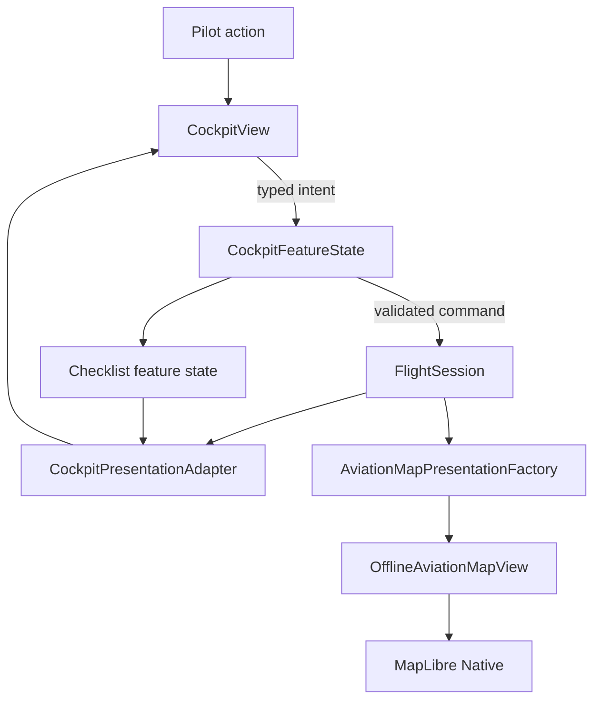

# Flying a Leg — Technical Design

## Status and authority

This document defines the implementation design for the approved **Flying a Leg** paired baseline.

- Product behavior authority: [`FLYING-A-LEG_SPEC.md`](../features/FLYING-A-LEG_SPEC.md), approved revision [`6033067`](https://github.com/johnbenz13/NavigationFlight/blob/60330670950c53cabf7645b7984c72c998c80237/docs/features/FLYING-A-LEG_SPEC.md).
- Design authority: [NavigationFlight — Flying a Leg](https://www.figma.com/design/yvLXb8bUFBiZHqsag4hq6I), approved through Iteration 07.
- Coverage authority: [Design Coverage Audit](https://www.figma.com/design/yvLXb8bUFBiZHqsag4hq6I?node-id=106-3), which traces all 125 product invariants and the device and accessibility baseline.
- Approval: John, 2026-10-25.
- Technical-design status: proposed for implementation.

The product spec continues to own behavior, state transitions, calculations, and terminology. The approved Figma nodes continue to own layout, hierarchy, spatial relationships, and interaction presentation. This document selects implementation seams and data structures; it does not change either approved authority.

## Scope

The design covers the complete first-release Flying a Leg behavior:

- ordered navigation-target progression and passed-without-report outcomes;
- target-specific Revised ETA drafts, commits, history, and explicit Reference ETA checks;
- drift-line geometry and per-open-flight visibility;
- pilot-authored Revised Heading drafts, commits, operational value, and history;
- completed-leg target and heading history;
- atomic 20-second undo for identification-point and arrival reach reports;
- canonical track-up map focus and successor-leg rotation;
- checklist templates separated into definition, value resolution, and rendering;
- approved cockpit, map, VOR/DME, device-adaptation, Dynamic Type, and accessibility behavior.

Durable active-flight persistence, GPS-derived behavior, a heading cross-check, Reference Heading, user-authored checklist templates, and general historical editing remain out of scope.

## Architectural fit

The implementation extends the current architecture rather than introducing a new state-management layer.



The modules and their interfaces are:

| Module | Interface responsibility | Implementation hidden behind the interface |
| --- | --- | --- |
| `FlightSession` | Accept explicit flight commands and expose immutable runtime facts and histories. | Target ordering, eligibility, ETA and heading lifecycles, reach transitions, historical records, and domain validation. |
| `CockpitFeatureState` | Coordinate feature-wide commands that may affect more than the session. | Atomic reach/undo snapshots, checklist restoration, drift-line preference, and loaded-plan lookup needed to validate domain commands. |
| `IdentificationPointTimingCalculator` | Return deterministic timing and signed-difference results. | Full-precision proportional calculation and display rounding. |
| `DriftLineGeometry` | Derive two map polylines from resolved leg endpoints and imported drift angle. | Great-circle/local projection math, intersection, and degenerate-input handling. |
| `ChecklistTemplateRenderer` | Render a selected validated template from a leg/session context. | Variable lookup, validation, ordering, and failure reporting. |
| Presentation adapters | Return immutable display snapshots from plan and runtime state. | Labels, availability, formatting, semantic state, and history projection. |
| SwiftUI and MapLibre views | Render snapshots and emit typed intents. | Layout, local selection, camera animation, callout placement, and accessibility presentation. |

These are in-process modules. No new protocol seam is needed: there is one production implementation and deterministic tests can exercise the same value-type interfaces. Time enters commands as an explicit `Date`, preserving deterministic tests without adding a clock protocol.

## State ownership

| State | Owner | Lifetime |
| --- | --- | --- |
| Imported plan, resolved target order, planned values, coordinates, drift angle, and VOR/DME | `NavigationFlight` and navigation domain values | Loaded plan; immutable |
| Leg lifecycle, observations, target outcomes, ETA revisions/check disclosures, heading revisions, and completed history | `FlightSession` | Current in-memory flight |
| Progression policy, selected checklist template, checklist state, drift-line visibility, and pending undo transaction | `CockpitFeatureState` | Current in-memory feature session |
| Selected callout, expanded editor/panel, callout offsets, and current camera | `CockpitView` | Current cockpit view identity |
| Map annotations, callout data, console values, and history rows | Presentation values | Re-derived snapshots |

Domain facts must not be inferred from view state. In particular, selecting a callout, focusing the map, expanding history, or moving a label cannot mutate `FlightSession` or invalidate undo.

## Canonical identifiers and target order

Keep `IdentificationPointKey` and `NavigationTimingTargetKey` as the canonical leg-scoped identifiers. Add a domain projection that resolves an active leg into one ordered target list:

```swift
struct NavigationTargetDescriptor: Equatable, Sendable {
    enum Kind: Equatable, Sendable {
        case identificationPoint
        case destination
    }

    let key: NavigationTimingTargetKey
    let kind: Kind
    let sequenceIndex: Int
    let plannedElapsedSeconds: Int
}
```

Identification points retain imported order after mapping validation. The destination is always the final descriptor. `CockpitFeatureState` supplies this immutable list to commands that need plan context; `FlightSession` does not reach back into `NavigationFlight` or duplicate imported coordinates.

All target-relative rules use `sequenceIndex`, not collection insertion order or elapsed-time comparison. This keeps eligibility deterministic when planned times are equal or imperfect.

### Concrete `.fplnav` example

The fixture [`editor-no-wind.fplnav`](../../NavigationFlightTests/Fixtures/FPLNav/V7/Editor/editor-no-wind.fplnav) contains one leg that illustrates the relationship:

| `.fplnav` source | ID | Meaning |
| --- | --- | --- |
| `navigation.route.waypoints[0]` | `...0002` | Departure waypoint **BAZRA**. |
| `navigation.route.waypoints[1]` | `...0003` | Arrival waypoint **Visual checkpoint**. |
| `navigation.route.legs[0]` | `...0004` | Leg from waypoint `...0002` to waypoint `...0003`. |
| `navigation.identificationPoints[0]` | `...0005` | An IP belonging to leg `...0004`, located at `legProgress: 0.4`. |
| `execution.annotations` entry for `...0005` | `...0005` | Resolved IP position and no-wind Planned ETA `238` seconds (`03:58`) from leg start. |
| `execution.legs[0]` | leg `...0004` | Resolved no-wind leg duration `596` seconds (`09:56`), which is the arrival waypoint's Planned ETA. |

The decoder and V7 mapper join those records by UUID. They produce a `NavigationFlight` whose active leg has immutable planned data. For this leg, the ordered runtime target projection is conceptually:

```text
Leg ...0004: BAZRA (...0002) → Visual checkpoint (...0003)

sequence 0
  IdentificationPointKey(legID: ...0004, identificationPointID: ...0005)
  NavigationTimingTargetKey(legID: ...0004,
                            kind: .identificationPoint,
                            targetID: ...0005)
  Planned ETA 03:58

sequence 1
  NavigationTimingTargetKey(legID: ...0004,
                            kind: .destination,
                            targetID: ...0003)
  Planned ETA 09:56
```

The departure waypoint is the leg's time origin, not a future navigation target, so it has no `NavigationTimingTargetKey`. The IP has both an `IdentificationPointKey`, used for its pilot-reported position fix, and a `NavigationTimingTargetKey`, used for its ETA editor. The arrival waypoint needs only the timing-target key because destination identification/reach is already scoped by the active leg.

With two IPs, the projection would be `departure → IP1 → IP2 → arrival`, but only `IP1`, `IP2`, and `arrival` are target descriptors. Reporting IP2 reached uses their sequence indices to mark an unreached IP1 passed without report. The runtime keys are not written back into `.fplnav`; they identify in-memory observations and revisions while preserving the imported plan as immutable input.

## Runtime domain model

### Target outcomes

Replace the reached-only lookup with an explicit outcome per target:

```swift
enum NavigationTargetOutcome: Equatable, Sendable {
    case future
    case reached(at: Date)
    case passedWithoutReport
}
```

The session stores outcomes by `NavigationTimingTargetKey`. `future` may be represented by absence internally, but the public query returns an explicit value. Only identification points can become `passedWithoutReport`; the destination moves from `future` to `reached` when the leg completes.

`reachIdentificationPoint` receives the ordered target descriptors, verifies the selected point is a future target on the active leg, then performs one mutation:

1. mark each earlier future identification point `passedWithoutReport`;
2. mark the selected point `reached(at:)`;
3. discard that target's uncommitted ETA draft;
4. preserve committed ETA history and heading state;
5. return a transition result identifying presentation effects such as the next future target.

`reachCurrentWaypoint` similarly marks every remaining future identification point `passedWithoutReport`, reaches the destination, closes the completed leg's heading draft, records completion, and applies the progression policy atomically.

Rejected commands validate completely before assignment so invariant 94 cannot observe partial mutation.

### ETA revisions and checks

Separate transient editing from durable history:

```swift
struct ETARevisionCommit: Equatable, Sendable, Identifiable {
    let id: UUID
    let targetKey: NavigationTimingTargetKey
    let elapsedSeconds: Int
    let committedAt: Date
}

struct ETAEditorState: Equatable, Sendable {
    var draftSeconds: Int
    var isEditing: Bool
}

struct ETACheckDisclosure: Equatable, Sendable {
    let observationKey: IdentificationPointKey
    let referenceSeconds: Int
    let revisedSeconds: Int
    let requestedAt: Date
}
```

The session keeps commit history per target, optional editor state per target, and the most recently revealed check disclosure per target. The current Revised ETA is the last commit. Earlier commits remain available to completed history.

Commands are target-specific:

- `openETAEditor(target:plannedElapsedSeconds:at:)` initializes from the latest commit or Planned ETA, raised when necessary to the current selectable ETA floor, and does not create a commit.
- `adjustETADraft(target:by:at:)` changes an open draft by five-second increments and clamps it to the current selectable ETA floor.
- `commitETA(target:at:)` revalidates the draft against current elapsed time, appends a valid commit, closes editing, hides any earlier disclosure, and invalidates undo only when it is a later flight-state action under the undo rules.
- `discardETADraft(target:)` removes transient editing without changing history.
- `requestETACheck(target:descriptors:at:)` selects the latest preceding reached identification point at request time, computes and stores the disclosure, and never mutates a revision.
- `hideETACheck(target:)` changes disclosure presentation only and does not erase the historical fact that a check was requested.

The Revised ETA can never be earlier than the running leg timer. Because revisions use five-second increments, the selectable floor is the current elapsed duration rounded upward to the next five-second value:

```text
selectable ETA floor = ceil(current leg elapsed seconds / 5) × 5
```

For example, at exactly `02:50` the minimum draft is `02:50`; at `02:52` it is `02:55`. Decrementing stops at that floor. The timer may advance after the editor opens, so commit performs the same check using the command's `at` timestamp. If the draft has fallen behind, `commitETA` returns a typed `etaPrecedesCurrentElapsedTime(minimumSeconds:)` error, leaves the editor open, and creates no commit. Presentation disables Commit while the draft is below the current floor and updates the displayed minimum as the timer advances. The system never silently commits a different ETA from the value the pilot explicitly selected.

The existing `timingObservationKey` must not remain captured in editor state. Observation selection is dynamic at **Check** time, which is required when a later identification point has since been reached.

`IdentificationPointTimingCalculator` retains full `Double` precision for:

```text
planned target ETA × actual observation ETA / planned observation ETA
```

It rounds only the displayed/stored disclosure result to the nearest second. A zero or negative planned observation ETA makes Check unavailable instead of producing a partial result.

### Revised Heading

Heading revisions are leg-scoped and independent of identification-point observations:

```swift
struct HeadingRevisionCommit: Equatable, Sendable, Identifiable {
    let id: UUID
    let legID: UUID
    let magneticDegrees: Int
    let committedAt: Date
}

struct HeadingEditorState: Equatable, Sendable {
    var draftMagneticDegrees: Int
}
```

The imported baseline remains in `NavigationFlight`. The adapter selects planned magnetic heading in planned-wind mode or magnetic course in no-wind mode. The session stores draft and commit history by leg ID.

Degrees use a domain normalization helper whose interface accepts any signed integer and returns `1...360`; zero and multiples of 360 display as `360°`. Adjustment is one degree. Opening begins from the latest commit or imported baseline. Commit appends history and makes the latest commit operational. Identification-point reach preserves both the current commit and open draft. Arrival reach discards only the completed leg's draft; commits remain historical and never carry to the successor.

No heading check, recommendation, correctness state, or Reference Heading type is introduced.

### Completed-leg history

Completed history is derived from immutable plan data plus retained session records rather than copied into a second lossy summary at completion. The projection includes:

- every target in route order;
- Planned ETA;
- all Revised ETA commits in commit order;
- Actual ETA for reached targets;
- Actual-versus-Planned and Actual-versus-each-Revised signed differences;
- passed-without-report with no Actual ETA or fabricated difference;
- only check disclosures actually requested during the active leg;
- imported heading/course baseline, all heading commits, and the final operational heading.

`PreviousLegSummary` should become a complete presentation tree rather than a single aggregate duration. The previous-leg panel remains read-only and therefore has no domain command interface.

## Atomic reach undo

Undo crosses the session/checklist/map seam, so `CockpitFeatureState` owns the transaction even though `FlightSession` owns the reach behavior.

```swift
struct PendingReachUndo: Equatable, Sendable {
    enum Kind: Equatable, Sendable {
        case identificationPoint(IdentificationPointKey)
        case destination(NavigationTimingTargetKey)
    }

    let kind: Kind
    let expiresAt: Date
    let restoration: ReachRestoration
}

struct ReachRestoration: Equatable, Sendable {
    let session: FlightSession
    let checklistState: CockpitFeatureState.LegStartChecklistState?
    let cockpitRestoration: CockpitRestoration
}
```

The restoration exists for a concrete mistake-recovery case: the pilot is viewing leg A, reports its arrival reached, and the app immediately selects leg B and rotates/focuses the map onto leg B. If the pilot taps **Undo**, restoring only `FlightSession` would put leg A back in the instruments while the map still showed leg B. The transaction must therefore restore session, checklist, selected callout/editor effects caused by the reach, and the map together.

“Semantic map restoration” means storing an intent such as “focus leg A in canonical track-up” instead of the exact pre-reach camera center, zoom, bearing, and pitch. That is sufficient only when the map was already in canonical leg focus. It is not sufficient when the pilot had panned or rotated leg A before the mistaken arrival, because invariant 119 requires the pre-transition map orientation to return.

The chosen design is therefore exact restoration through a framework-independent value:

```swift
struct MapCameraSnapshot: Equatable, Sendable {
    let center: AviationMapCoordinate
    let zoom: Double
    let bearingDegrees: Double
    let pitchDegrees: Double
    let isUserControlled: Bool
}
```

`CockpitView` already owns the preserved camera. It supplies this value, plus the selected callout/focus state, with a reach intent. `CockpitFeatureState` stores those values in `CockpitRestoration` without storing MapLibre objects or SwiftUI view state. Undo emits the snapshot back to `CockpitView`, which applies it atomically with the restored active leg. A canonical `.focusLeg` restoration is only a defensive fallback if no camera snapshot exists, not the normal arrival-undo behavior.

A reach command follows copy–mutate–commit semantics:

1. validate timestamp, target, eligibility, and ordered plan context;
2. capture the pre-command session, checklist state, exact camera snapshot, and reach-affected cockpit presentation state;
3. mutate a local session copy and compute checklist/progression effects;
4. assign all successful results together;
5. replace any earlier undo with a deadline of `reachTimestamp + 20 seconds`.

`undoMostRecentReach(at:)` succeeds only when `now < expiresAt`. It restores the captured session and checklist state, publishes the cockpit restoration request, then clears the pending transaction. The original departing-leg start timestamp is therefore restored unchanged, so its elapsed timer naturally includes time spent in the undo window.

The deadline is a wall-clock `Date`; no UI timer owns it. A periodic view refresh only controls countdown presentation. Foreground return reevaluates availability against the current date, so background time counts. Process termination may discard it with the rest of the first-release session.

Commands are classified centrally:

| Command class | Examples | Undo effect |
| --- | --- | --- |
| Passive presentation | pan/rotate, focus, callout selection, history expansion | Preserve |
| Presentation preference | drift-line visibility | Preserve |
| Reach | identification point or destination reach | Replace after success |
| Later flight-state action | manually start successor, commit successor ETA/heading, another successful reach | Invalidate before committing the later action |
| Rejected command | duplicate reach, unavailable Check, invalid timestamp | Preserve; no partial mutation |

Expiration is computed, not scheduled as a destructive mutation. `pendingReachUndo(at:)` returns `nil` after the deadline, and the next mutating feature command may clear expired storage opportunistically.

## Drift-line geometry and visibility

`CockpitFeatureState` owns `areDriftLinesVisible`, initialized to `true` when a new flight is accepted and preserved while changing legs or moving between plan inspection and cockpit.

`DriftLineGeometry` consumes only resolved departure/arrival coordinates and the imported drift angle. It returns two polylines in map coordinates:

1. a departure arm rotated to the right of the planned departure-to-arrival bearing;
2. an arrival arm rotated to the corresponding opposite side when viewed toward departure;
3. both terminate at their forward-ray intersection near the leg midpoint.

The implementation performs the construction in a local tangent-plane projection centered on the leg midpoint, then converts results back to WGS84. This avoids treating latitude/longitude degrees as a Cartesian plane while remaining deterministic for flight-leg distances. Degenerate zero-length legs or parallel rays return no overlay.

`AviationMapPresentation` exposes drift polylines separately from the planned track. The MapLibre adapter renders them in their own source/layer with dashed styling. Revised Heading, timing, reach, and camera changes never recompute their plan-fixed geometry.

## Map focus, rotation, and callouts

`AviationMapPresentation` adds the active leg's canonical track-up bearing and successor-transition metadata. `OfflineAviationMapView.Coordinator` remains the MapLibre adapter and performs camera changes.

- Starting or focusing a leg fits its endpoints and rotates the planned track vertically from bottom to top.
- User pan or rotation sets the existing user-controlled camera state; ordinary state refresh does not overwrite it.
- **Focus Leg** clears user ownership and reapplies canonical track-up.
- Arrival progression creates a new focus request with the successor bearing. The coordinator normalizes the angular delta into `-180...180` and animates through that shortest direction.
- Arrival undo sends the captured restoration request and removes successor presentation in the same SwiftUI update.
- No camera or annotation is labeled as live aircraft position, heading, or track.

Replace the two parallel callout selections in `CockpitView` with one value:

```swift
enum SelectedMapCallout: Equatable {
    case identificationPoint(IdentificationPointKey)
    case timingTarget(NavigationTimingTargetKey)
}
```

This makes the “at most one callout” invariant structural. Map-background tap and pan-begin set it to `nil`. Callout selection and dragging remain presentation-only. The VOR/DME label offset remains keyed local state and never modifies the imported reference.

## Checklist templates

The existing hard-coded checklist content is replaced by three layers:

```swift
struct ChecklistTemplate: Equatable, Sendable { /* title and ordered nodes */ }
struct ChecklistRenderContext: Equatable, Sendable { /* current leg/session values */ }
struct LegStartChecklistPresentation: Equatable, Sendable { /* resolved display rows */ }

struct ChecklistTemplateRenderer {
    func render(
        template: ChecklistTemplate,
        context: ChecklistRenderContext
    ) throws -> LegStartChecklistPresentation
}
```

Bundled templates are application data selected outside the cockpit. Template nodes may contain static text or a closed first-release set of typed variables. The renderer resolves all variables before returning presentation data; an unknown or unavailable required variable throws a validation error and cannot appear literally in operational content. `CockpitView` renders only resolved rows and does not switch on variable names.

The first release bundles these two equivalent templates. They use the same typed variables and operational sequence; only their pilot-facing language and title differ.

### Hebrew — צא כיוון + גמ״ד

This template follows the supplied cockpit reference:

| Group | Rendered content |
| --- | --- |
| Title | `צא כיוון` |
| `TIMER` | `Started · {elapsedTime}` |
| `COURSE` | `{operationalMagneticHeading}`; `Check magnetic compass` |
| `גמ״ד` — `גובה` | `{plannedAltitudeFeet} ft` |
| `גמ״ד` — `מהירות ומנוע` | `{plannedIAS}` or `Planned IAS unavailable`; `Oil pressure`; `Oil temperature`; `Amperage · Suction · Fuel` |
| `גמ״ד` — `דיווח` | `מה הדיווח הבא?` |

### English — Establish Heading + cruise check

| Group | Rendered content |
| --- | --- |
| Title | `Establish Heading` |
| `TIMER` | `Started · {elapsedTime}` |
| `COURSE` | `{operationalMagneticHeading}`; `Check magnetic compass` |
| `CRUISE CHECK` — `ALTITUDE` | `{plannedAltitudeFeet} ft` |
| `CRUISE CHECK` — `AIRSPEED & ENGINE` | `{plannedIAS}` or `Planned IAS unavailable`; `Oil pressure`; `Oil temperature`; `Amperage · Suction · Fuel` |
| `CRUISE CHECK` — `REPORTING` | `What is the next report?` |

`elapsedTime`, `operationalMagneticHeading`, `plannedAltitudeFeet`, and `plannedIAS` are typed template variables. “Unavailable” is a resolved presentation value, not an unresolved placeholder. Template layout supports right-to-left title and section text for Hebrew while numeric aviation values retain their natural readable order. Template selection remains a Settings concern; both templates render through the same cockpit view.

## Presentation projections

Keep formatting and availability outside views:

- `CockpitPresentationAdapter` derives the operational heading, source label, timer/Next ETA/altitude instruments, planned frequencies, arrival action, undo banner, checklist, and complete previous-leg history.
- `AviationMapPresentationFactory` derives ordered target annotations, target outcome badges, ETA callout state, VOR/DME content, drift lines, and canonical focus geometry.
- Shared formatting helpers produce elapsed durations, `001°...360°`, magnetic labels, and signed pilot-language differences such as “10 seconds late.”

Presentation enums should model meaningful states rather than expose Boolean combinations. For example, a target callout uses cases for future display, ETA editing, committed ETA with Check availability, reached result, and passed-without-report. This prevents impossible combinations such as a passed point with an editor or Actual ETA.

Views receive presentation values and typed intent closures. They do not receive mutable session bindings and do not calculate target eligibility, Reference ETA, operational heading, or undo validity.

## SwiftUI composition and adaptive layout

`CockpitView` remains the screen composition root but is split into focused private or file-private views as the approved surface expands:

- `CockpitMapSurface`
- `ActiveLegInstruments`
- `PlannedFrequenciesView`
- `ArrivalActionView`
- `ETAEditorView`
- `HeadingEditorView`
- `ReachUndoBanner`
- `PreviousLegPanel`
- `LegStartChecklistView`

These are view modules, not additional state owners. Their interfaces are display values plus intent closures.

Use semantic SwiftUI fonts and colors. Planned, Revised, Reference, and Actual labels remain explicit; status and difference meaning never depend on color alone. Controls use native `Button`, `Menu`, and accessibility actions where they match the approved interaction.

Adaptive composition follows the approved nodes:

| Target | Composition rule |
| --- | --- |
| iPad Pro 11-inch portrait | Primary design: map above the three-row lower console. |
| iPad Pro 11-inch landscape | Wide adaptation: map and instruments share horizontal space without changing commands or state. |
| iPhone portrait | Compact vertical layout with scrollable/expandable secondary content and the same operational actions. |
| Larger Text | Instruments and actions reflow vertically; values are not clipped or reduced below semantic Dynamic Type sizing. |

Use size class and available width, not only `width > height`, to choose compact versus regular composition. iPhone landscape remains unsupported by the product baseline and must not acquire a separate interaction model accidentally.

## Accessibility

- Every control has a human-readable label, value, and hint where consequence is not evident.
- Map targets expose the same state and actions through VoiceOver as their visual callouts; **Reached** is an explicit action, never triggered by focus.
- VoiceOver order follows operational hierarchy: active leg, map context and selected target, active instruments, planned frequencies, arrival action, chips, then undo banner as positioned in the approved adaptation notes.
- Heading and ETA values announce their kind and magnetic/elapsed-time context.
- Early/late differences announce direction, not just a signed number.
- Passed without report, Identified, Complete, and undo remaining are textual accessibility values.
- Draggable labels provide accessibility adjustment actions or a reset action; dragging is not their only usable interaction.
- Map rotation animation respects Reduce Motion by transitioning without the turn animation while preserving the final canonical orientation.
- Tap targets retain platform minimum sizing and do not shrink with compact layouts.

## Error handling and atomicity

Extend `FlightSession.TransitionError` with typed cases for wrong-leg targets, non-future targets, unavailable checks, missing plan context, and invalid heading/ETA commands. Feature commands propagate errors to `CockpitFeatureView`; production code must not silently discard operational errors with `try?`.

Expected unavailable actions are represented in presentation and omitted or disabled with explanatory accessibility text. Unexpected invariant failures present a non-destructive error. In either case, validation precedes mutation and the previous snapshot remains intact.

## File plan

Expected implementation changes are intentionally localized:

| Path | Change |
| --- | --- |
| `NavigationFlight/Domain/Flight/FlightSession.swift` | Target outcomes, ETA/heading state and history, reach results, validation, and query interfaces. |
| `NavigationFlight/Domain/Flight/IdentificationPointTimingCalculator.swift` | Dynamic observation selection support, exact Reference ETA, signed differences, and rounding. |
| `NavigationFlight/Domain/Flight/DriftLineGeometry.swift` | New pure drift-line geometry module. |
| `NavigationFlight/Domain/Flight/ChecklistTemplate.swift` | New template, variable, context, validation, and rendering types. |
| `NavigationFlight/Features/Cockpit/CockpitFeatureState.swift` | Ordered plan-context commands, drift visibility, atomic reach undo, checklist restoration, and exact map restoration requests. |
| `NavigationFlight/Features/Cockpit/CockpitPresentationAdapter.swift` | Operational instruments, complete history, undo, heading editor, and checklist projections. |
| `NavigationFlight/Map/AviationMapPresentation.swift` | Outcome-aware targets, ETA callout states, drift polylines, VOR/DME, and canonical orientation. |
| `NavigationFlight/Map/OfflineAviationMapView.swift` | Drift layers, single callout selection, target states, canonical focus, and shortest-turn animation. |
| `NavigationFlight/Features/Cockpit/CockpitView.swift` | Approved adaptive composition and intent wiring; extraction into focused view files when useful. |
| `NavigationFlight/Features/Cockpit/CockpitFeatureView.swift` | Command dispatch, explicit operational error handling, and restoration wiring. |
| `NavigationFlightTests/NavigationFlightTests.swift` | Deterministic domain, feature-state, presentation, geometry, and template tests. |
| `NavigationFlightUITests/NavigationFlightUITests.swift` | Approved happy paths, exceptions, adaptation, and accessibility-critical interactions. |

No FPLNav schema change is planned. The feature consumes existing resolved V7 plan values and stores new runtime activity only in memory.

## Delivery sequence

Each checkpoint leaves the project buildable and preserves current behavior outside its scope.

1. **Target lifecycle and ETA foundation**
   - Add ordered descriptors and explicit outcomes.
   - Implement passed-without-report and direct target editing.
   - Split ETA drafts from commit history and select the Check observation dynamically.
   - Expand target presentation and focused tests.
2. **Drift lines and map behavior**
   - Add deterministic geometry, presentation layers, visibility preference, and focus/callout rules.
   - Validate canonical track-up without implying live position.
3. **Revised Heading**
   - Add editor state, commit history, normalization, operational projection, and arrival reset.
4. **History and transactional undo**
   - Expand completed history.
   - Add copy–mutate–commit reach transactions, real-time expiry, invalidation, and atomic restoration.
   - Add successor shortest-turn animation and undo restoration.
5. **Checklist templates and complete approved UI**
   - Separate template definition, resolution, and rendering.
   - Implement the approved portrait, landscape, iPhone, Larger Text, and accessibility adaptations.
6. **End-to-end validation**
   - Exercise automatic, manual, and final-leg flows; background-return expiry; exceptions; and full history.
   - Compare simulator results against the approved Figma nodes.

## Test strategy

The interface of each deep module is its test surface. Tests use explicit UUIDs and dates and assert observable results rather than private storage.

### Domain and feature tests

- reaching a later point passes every earlier future point without inventing Actual ETA;
- destination reach passes remaining points before completion;
- direct ETA editing works before any observation and drafts never become operational implicitly;
- repeated ETA commits preserve ordered history while only the last is operational;
- ETA opening and adjustment clamp to the running timer's next five-second floor, and commit rejects a draft made stale by timer advancement;
- Check uses the latest eligible preceding observation at request time and retains full calculation precision;
- hidden or never-requested Reference ETA is not fabricated in history;
- heading normalization covers negative values, zero, 360, and values above 360;
- identification-point reach preserves heading commit and draft; arrival discards only the draft;
- drift geometry uses the imported angle and remains invariant under timing, heading, and reach changes;
- undo before the deadline restores the exact prior state for both progression policies and final-leg completion;
- undo at/after the deadline is unavailable; passive actions preserve it; later flight-state actions invalidate it;
- rejected actions leave the entire feature snapshot unchanged;
- checklist rendering resolves every supported variable and rejects unresolved bundled content.

### Presentation tests

- every target outcome maps to one valid callout state;
- Planned, Revised, Reference, and Actual labels and signed differences are correct;
- operational heading selects imported baseline or latest commit correctly;
- VOR/DME content is complete when present and wholly omitted when absent;
- Previous Leg contains complete target and heading history without retroactive checks;
- undo, checklist, and Previous Leg chips coexist in the approved hierarchy.

### UI and simulator tests

- ETA edit/commit/Check and **Revise Next ETA** focus flow;
- passed-without-report and duplicate/unavailable action behavior;
- heading edit, multiple commits, IP continuity, and successor reset;
- automatic/manual/final arrival, successor rotation, undo, and expiration after background return;
- drift visibility across leg changes and reset on a newly opened flight;
- target-callout exclusivity and dismissal on map pan;
- iPad portrait, iPad landscape, iPhone portrait, Larger Text, Reduce Motion, and VoiceOver order.

Use Swift Testing for deterministic domain and presentation coverage and XCUIAutomation for end-to-end interactions. Simulator review is required for the affected SwiftUI behavior and supported orientations.

## Acceptance trace

| Spec area | Primary implementation | Primary verification |
| --- | --- | --- |
| Invariants 1–18 | `FlightSession`, `CockpitFeatureState` | lifecycle, ordering, and atomic transition tests |
| Invariants 19–44 | ETA state/history and timing calculator | editor, commit, observation-selection, and disclosure tests |
| Invariants 45–54 | `DriftLineGeometry`, map presentation | geometry and visibility tests |
| Invariants 55–68 | heading state/history | normalization and lifecycle tests |
| Invariants 69–76 | completed-history projection | history completeness tests |
| Invariants 77–87 | feature-level reach transaction | deadline, invalidation, and exact restoration tests |
| Invariants 88–94 | feature/view lifetime and command validation | navigation/background and rejected-command tests |
| Invariants 95–108 | map and cockpit presentation | presentation and UI tests |
| Invariants 109–116 | map focus and checklist renderer | camera/focus and template tests |
| Invariants 117–125 | progression presentation and map aids | automatic/manual/final UI flows and simulator comparison |

## Risks and mitigations

| Risk | Mitigation |
| --- | --- |
| Undo restores domain state but leaves checklist or map on the successor | Own the transaction in `CockpitFeatureState` and restore the checklist, exact camera snapshot, callout/focus effects, and session in one assignment cycle. |
| ETA editor captures an obsolete observation | Remove observation identity from editor state and resolve it only on explicit Check. |
| Histories diverge from current operational values | Store append-only commits once and derive both current and historical projections from them. |
| Callout Boolean state permits two open targets | Replace parallel selections with one `SelectedMapCallout?`. |
| Camera refresh fights pilot pan/rotation | Preserve explicit user-camera ownership until a focus command. |
| Timer or undo pauses in background | Derive both from stored dates and current wall time, never accumulated UI ticks. |
| Large `CockpitView` becomes a second state machine | Extract rendering views with value inputs and intents while keeping mutation in feature/domain modules. |
| Figma pixel measurements harm adaptation | Implement approved hierarchy with semantic SwiftUI layout, fonts, colors, and controls; verify visually on each approved target. |

## Resolved implementation decisions

- The first release bundles the Hebrew **צא כיוון + גמ״ד** checklist from the supplied reference and the equivalent English **Establish Heading + cruise check** template defined above.
- Arrival undo restores an exact, framework-independent pre-transition camera snapshot plus reach-caused callout/focus changes. Canonical active-leg focus is a fallback only when no snapshot is available.
- Revised ETA editing and commitment cannot select or commit a value earlier than the running leg timer; the five-second editor uses the rounded-up current elapsed time as its floor.

The paired baseline now has no open technical-design question that blocks the first implementation checkpoint.

The Revised ETA timer-floor rule is a newly confirmed observable product constraint that is not yet present in approved product-spec revision `6033067`. Before implementing that rule, update `FLYING-A-LEG_SPEC.md`, mark the paired baseline for review, and reconcile the affected ETA editor/check Figma states under the product-spec/Figma workflow. The technical design records the intended implementation but does not supersede the product authority.
